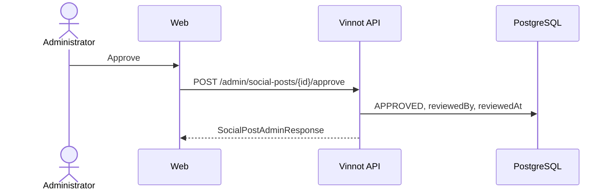

# UC-MKT-02 · Approve a post

| Field | Value |
|---|---|
| ID | `UC-MKT-02` |
| Module | [Social media marketing](../README.md) |
| Platforms | Web |
| Actors | Administrator, AI provider |
| Lucidchart IDs | None |
| Requirements | [`RF-WEB-MKT-05`](../requirements.md), [`RF-WEB-MKT-06`](../requirements.md), [`RF-WEB-MKT-07`](../requirements.md) |
| Test cases | [`CP-MKT-08`](../testing.md), [`CP-MKT-09`](../testing.md), [`CP-MKT-10`](../testing.md), [`CP-MKT-11`](../testing.md), [`CP-MKT-12`](../testing.md), [`CP-MKT-13`](../testing.md) |

## Preconditions

- The person is an administrator and there are posts in the queue.

## Postconditions

- The post was approved, rejected, edited or given new copy, with who did it and when.

## Main flow

1. The person opens `/admin/social-posts`; the queue shows the pending posts sorted by date.
2. Picks a post, picks the language (ES or EN) and reviews the slides of that language (rendered in [`UC-MKT-04`](uc-mkt-04-render-post-media.md), or as text while they have no images yet), caption with the language's legal line, hashtags, alt text, CTA and the generation info (model, mock, fact check with its issues). A language the post does not have yet (a post stored before #497) shows as pending with the Regenerate action.
3. Presses "Aprobar".
4. The client sends `POST /admin/social-posts/{id}/approve` and the API records who and when.

## Alternative flows

- 1a. The person is not an administrator: the API answers 403 and the web shows no menu entry.
- 3a. The person presses "Rechazar" and types an optional reason: `POST /{id}/reject` leaves the post `REJECTED`.
- 3b. The person edits the copy of one language and saves: `PUT /{id}` with `language` (`es` or `en`) validates the limits, re-appends that language's legal line when missing, leaves the other language as it is, stores who edited and leaves the post `PENDING_APPROVAL`, also when it was approved; when what is drawn changed, only that language's slides are rendered again.
- 3c. The person presses "Regenerar" on a pending, rejected or approved post: `POST /{id}/regenerate` asks for both languages again and returns to `PENDING_APPROVAL`; an approved post loses its approval (who and when). When the provider fails, the post keeps its status and copy and shows the error.
- 4a. The action does not match the status, the edited copy breaks a limit, or the edit names no language or another one: 409 `INVALID_POST_TRANSITION`, 400 `INVALID_POST_COPY` or 400 `INVALID_POST_LANGUAGE`; nothing changes.

## Business rules

- Approve only from `PENDING_APPROVAL`; reject from `PENDING_APPROVAL` or `APPROVED`; edit from those two; regenerate from `PENDING_APPROVAL`, `REJECTED` or `APPROVED`.
- A post waits for approval after a generation only with valid copy in both languages; each language has its own legal line and hashtags (always with `#vinnot`).
- Editing uses the same limits as generation: hook ≤ 60, 3 to 7 slides, caption ≤ 600, 5 to 10 hashtags including `#vinnot`, alt ≤ 200.
- `SCHEDULED`, `PUBLISHED` and `FAILED` are reserved for the publishing phase.

## Diagram

[View the full “UC-MKT-02 · Approve a post” diagram](https://images.vinnot.com/docs/diagrams/v1/en/modules-marketing-use-cases-uc-mkt-02-approve-post-324663b637d0.svg)

## Code

| Layer | Location |
|---|---|
| Backend | [`SocialPost.java`](../../../../../backend/src/main/java/com/vinnot/marketing/domain/model/SocialPost.java), [`SocialPostReviewService.java`](../../../../../backend/src/main/java/com/vinnot/marketing/application/service/SocialPostReviewService.java), [`SocialPostAdminController.java`](../../../../../backend/src/main/java/com/vinnot/marketing/infrastructure/web/controller/SocialPostAdminController.java) |
| Web | `AdminSocialPostsPage`, `useAdminSocialPostsViewModel`, `adminSocialPosts.service` |

## Automated tests

- Backend: [`SocialPostTest.java`](../../../../../backend/src/test/java/com/vinnot/marketing/domain/model/SocialPostTest.java), [`PostCopyTest.java`](../../../../../backend/src/test/java/com/vinnot/marketing/domain/model/PostCopyTest.java), [`SocialPostReviewServiceTest.java`](../../../../../backend/src/test/java/com/vinnot/marketing/application/service/SocialPostReviewServiceTest.java), [`SocialPostQueryServiceTest.java`](../../../../../backend/src/test/java/com/vinnot/marketing/application/service/SocialPostQueryServiceTest.java), [`SocialPostPresenterTest.java`](../../../../../backend/src/test/java/com/vinnot/marketing/application/service/SocialPostPresenterTest.java), [`SocialPostAdminControllerTest.java`](../../../../../backend/src/test/java/com/vinnot/marketing/infrastructure/web/controller/SocialPostAdminControllerTest.java), [`JdbcSocialPostRepositoryPostgresIntegrationTest.java`](../../../../../backend/src/test/java/com/vinnot/marketing/infrastructure/persistence/JdbcSocialPostRepositoryPostgresIntegrationTest.java)
- Web: `AdminSocialPostsPage`, view model, hooks, service, client and domain model tests
- App: Not applicable
