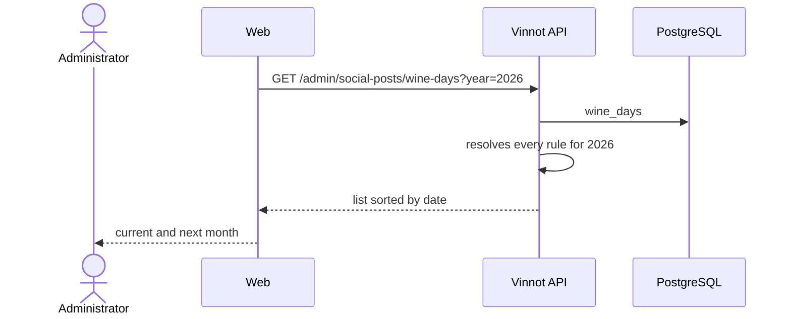

# UC-MKT-03 · Consult the wine-day calendar

| Field | Value |
|---|---|
| ID | `UC-MKT-03` |
| Module | [Social media marketing](../README.md) |
| Platforms | Web |
| Actors | Administrator |
| Lucidchart IDs | None |
| Requirements | [`RF-WEB-MKT-08`](../requirements.md) |
| Test cases | [`CP-MKT-14`](../testing.md), [`CP-MKT-15`](../testing.md) |

## Preconditions

- The person is an administrator.

## Postconditions

- The person knows which wine days fall in the period they look at, and when.

## Main flow

1. The page asks `GET /admin/social-posts/wine-days?year=2026`.
2. The API resolves every day's rule for that year and returns the list sorted by date.
3. The page shows the days of the current and next month in a side list.

## Alternative flows

- 1a. No `year` is passed: the API uses the current year.
- 2a. A day has a movable rule (`nth-weekday`, `last-weekday`, `offset-from`): its date changes from year to year (Chardonnay: 2026-05-21 and 2027-05-27).

## Business rules

- Every day has a Spanish and an English name, a kind (`GRAPE`, `STYLE`, `PROFESSION`, `NATIONAL`, `GENERIC`), a priority from 1 to 3 and an optional country.
- The rules: `fixed:MM-DD`, `nth-weekday:MM:DOW:N` (N from 1 to 4), `last-weekday:MM:DOW` and `offset-from:<rule>:<days>`.

## Diagram

[View the full “UC-MKT-03 · Consult the wine-day calendar” diagram](https://images.vinnot.com/docs/diagrams/v1/en/modules-marketing-use-cases-uc-mkt-03-wine-day-calendar-c1589ec16bcc.svg)

## Code

| Layer | Location |
|---|---|
| Backend | [`DateRule.java`](../../../../../backend/src/main/java/com/vinnot/marketing/domain/model/DateRule.java), [`SocialPostQueryService.java`](../../../../../backend/src/main/java/com/vinnot/marketing/application/service/SocialPostQueryService.java), [`V78__social_media_agent.sql`](../../../../../backend/src/main/resources/db/migration/V78__social_media_agent.sql) |
| Web | `AdminSocialPostsPage` (side list) |

## Automated tests

- Backend: [`DateRuleTest.java`](../../../../../backend/src/test/java/com/vinnot/marketing/domain/model/DateRuleTest.java), [`SocialPostQueryServiceTest.java`](../../../../../backend/src/test/java/com/vinnot/marketing/application/service/SocialPostQueryServiceTest.java), [`JdbcSocialPostRepositoryPostgresIntegrationTest.java`](../../../../../backend/src/test/java/com/vinnot/marketing/infrastructure/persistence/JdbcSocialPostRepositoryPostgresIntegrationTest.java), [`SocialPostAdminControllerTest.java`](../../../../../backend/src/test/java/com/vinnot/marketing/infrastructure/web/controller/SocialPostAdminControllerTest.java)
- Web: `AdminSocialPostsPage` and `adminSocialPosts.service` tests
- App: Not applicable
