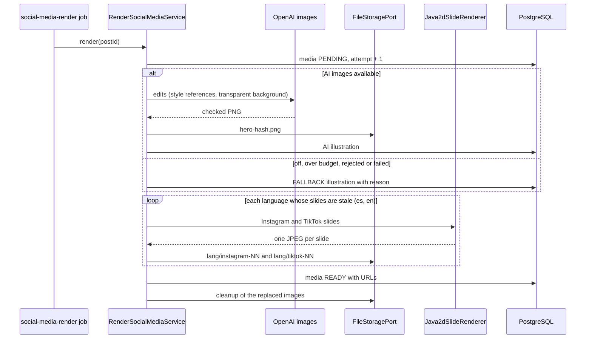

# UC-MKT-04 · Render a post's illustration and slides

| Field | Value |
|---|---|
| ID | `UC-MKT-04` |
| Module | [Social media marketing](../README.md) |
| Platforms | Web, Backend only |
| Actors | System, Administrator, AI provider |
| Lucidchart IDs | None |
| Requirements | [`RF-WEB-MKT-09`](../requirements.md), [`RF-WEB-MKT-10`](../requirements.md), [`RF-WEB-MKT-11`](../requirements.md), [`RF-WEB-MKT-12`](../requirements.md), [`RF-WEB-MKT-13`](../requirements.md), [`RF-WEB-MKT-14`](../requirements.md) |
| Test cases | [`CP-MKT-16`](../testing.md), [`CP-MKT-17`](../testing.md), [`CP-MKT-18`](../testing.md), [`CP-MKT-19`](../testing.md), [`CP-MKT-20`](../testing.md), [`CP-MKT-21`](../testing.md), [`CP-MKT-22`](../testing.md), [`CP-MKT-23`](../testing.md), [`CP-MKT-24`](../testing.md), [`CP-MKT-25`](../testing.md), [`CP-MKT-26`](../testing.md), [`CP-MKT-27`](../testing.md), [`CP-MKT-28`](../testing.md) |

## Preconditions

- The post has copy and is not published.
- For the AI illustration: `ai.images.enabled` is `true`, `AI_PROVIDER=openai`, the OpenAI key is set and AI budget is left. Otherwise the pillar vignette is used.

## Postconditions

- The post has its hero illustration (AI or pillar vignette, shared by both languages) and, per language (ES and EN), its JPEG slides for Instagram (1080x1350) and TikTok (1080x1920), stored with a public URL.
- `media.status` is `READY`, or `FAILED` with its error code.
- The replaced images are queued for storage cleanup.

## Main flow

1. The post's copy is generated, regenerated or edited in something that is drawn (hook, slides, CTA or illustration subject) in either language; the system queues a `social-media-render` job for that copy version.
2. The durable effects worker picks the job up outside any transaction and counts one attempt.
3. The system builds the illustration subject: the copy's shared `illustration` field (in English), or one derived from the wine day or the pillar.
4. It asks OpenAI (`/v1/images/edits`) for the illustration with four app illustrations as style references, the watercolor recipe and a transparent background; it checks that the image really has a transparent background and stores it as `posts/<id>/hero-<hash>.png`.
5. For each language whose slides do not show its current copy, it draws the slides of both formats: cover (illustration, hook and Vinnot mark), one card per copy slide (title, body and ornaments) and closing (CTA and the language's legal line).
6. It stores each slide as `posts/<id>/{es|en}/{instagram|tiktok}-NN-<hash>.jpg`, marks the media `READY` once every language is rendered and sends the images it replaced to cleanup.
7. The person opens the post in `/admin/social-posts`, picks the language and the format, sees the slides with the "AI illustration" or "Pillar vignette" badge and downloads the ones they need.

## Alternative flows

- 1a. The post was stored before V80 or its render request was lost: the sweep every 30 minutes queues the render of the upcoming posts with copy that are still waiting.
- 1b. The edit only changes the caption, hashtags or alt text: the hash of what is drawn does not change, nothing is queued and the slides stay current.
- 1c. The edit changes what is drawn in one language: only that language is drawn again; the other language's slides stay current.
- 1d. The post was stored before #497 and only has Spanish copy: only the Spanish slides are drawn; regenerating fills both languages.
- 4a. AI images are off, in mock mode, over budget or without style references (`AI_IMAGE_UNAVAILABLE`), or the request fails after its retries (`AI_IMAGE_FAILED`): the cover uses the pillar vignette and the media keeps the reason.
- 4b. The image has no transparent background or is not a valid image (`AI_IMAGE_REJECTED`): no retry; the pillar vignette is used.
- 4c. The already paid illustration cannot be stored (`HERO_STORE_FAILED`): the vignette is recorded for that version, so a retry never pays for the image again.
- 4d. The illustration version and subject did not change: the stored illustration is reused without calling OpenAI; when it cannot be read, it is painted again.
- 5a. The drawing cannot use the illustration (`INVALID_ILLUSTRATION`): every language is drawn again with the pillar vignette.
- 5b. The text does not fit even at the smallest size (`TEXT_DOES_NOT_FIT`) or the JPEG cannot be encoded (`ENCODING_FAILED`): the media ends `FAILED` with that code, without retry.
- 5c. The renderer is busy with another post (`BUSY`) or another transient error happens: the media stays `PENDING` with the error and the worker retries; after five attempts it ends `FAILED` with `RENDER_ATTEMPTS_EXHAUSTED`.
- 6a. The copy or the illustration version changes while drawing: the run stops without deleting anything and the newer run draws the post.
- 7a. The media is `PENDING`: the page shows "Rendering the slides…" and asks for the post again every 4 seconds until it changes.
- 7b. The media is `FAILED`: the page shows the error and suggests requesting a new illustration ([`UC-MKT-05`](uc-mkt-05-new-illustration.md)).

## Business rules

- A post never stays without images because of the illustration: every AI failure ends in the pillar vignette.
- Style requested by the product owner: "detailed hand-painted watercolor, fine sepia ink linework, warm sepia, cream, aged oak, olive and soft wine red palette, paper grain, warm light, elegant premium editorial feel", with a transparent background so no white box shows behind it, and no text, letters, numbers, logos, faces or people.
- Every image goes through AI admission with a flat cost per image (`ai.images.max-cost-usd`) and shares the monthly AI cap.
- Each language's slides are versioned by a hash of what is drawn in it (hook, slides, CTA and subject): editing only the caption, hashtags or alt text does not render again, editing one language renders only that one, and slides of older copy are never shown.
- Storage keys carry a hash of the content and are written once; each image weighs up to 5 MB.
- Publishing to the networks is phase 3.

## Diagram

[View the full “UC-MKT-04 · Render a post's illustration and slides” diagram](https://images.vinnot.com/docs/diagrams/v1/en/modules-marketing-use-cases-uc-mkt-04-render-post-media-6152cb8db7c4.svg)

## Code

| Layer | Location |
|---|---|
| Backend | [`RenderSocialMediaService.java`](../../../../../backend/src/main/java/com/vinnot/marketing/application/service/RenderSocialMediaService.java), [`SocialPostMedia.java`](../../../../../backend/src/main/java/com/vinnot/marketing/domain/model/SocialPostMedia.java), [`IllustrationPromptBuilder.java`](../../../../../backend/src/main/java/com/vinnot/marketing/application/service/IllustrationPromptBuilder.java), [`Java2dSlideRenderer.java`](../../../../../backend/src/main/java/com/vinnot/marketing/infrastructure/render/Java2dSlideRenderer.java), [`OpenAiImageClient.java`](../../../../../backend/src/main/java/com/vinnot/shared/infrastructure/ai/OpenAiImageClient.java), [`SocialMediaRenderEffectHandler.java`](../../../../../backend/src/main/java/com/vinnot/marketing/infrastructure/effects/SocialMediaRenderEffectHandler.java), [`SocialMediaRenderScheduler.java`](../../../../../backend/src/main/java/com/vinnot/marketing/infrastructure/scheduling/SocialMediaRenderScheduler.java), [`SocialMediaController.java`](../../../../../backend/src/main/java/com/vinnot/shared/infrastructure/web/controller/SocialMediaController.java) |
| Web | `SlideGallery`, `useAdminSocialPostsViewModel`, `useAdminSocialPosts` (polling query) |

## Automated tests

- Backend: [`RenderSocialMediaServiceTest.java`](../../../../../backend/src/test/java/com/vinnot/marketing/application/service/RenderSocialMediaServiceTest.java), [`SocialPostMediaTest.java`](../../../../../backend/src/test/java/com/vinnot/marketing/domain/model/SocialPostMediaTest.java), [`IllustrationPromptBuilderTest.java`](../../../../../backend/src/test/java/com/vinnot/marketing/application/service/IllustrationPromptBuilderTest.java), [`SlideDeckTest.java`](../../../../../backend/src/test/java/com/vinnot/marketing/application/model/SlideDeckTest.java), [`Java2dSlideRendererTest.java`](../../../../../backend/src/test/java/com/vinnot/marketing/infrastructure/render/Java2dSlideRendererTest.java), [`TextFitterTest.java`](../../../../../backend/src/test/java/com/vinnot/marketing/infrastructure/render/TextFitterTest.java), [`RenderAssetsTest.java`](../../../../../backend/src/test/java/com/vinnot/marketing/infrastructure/render/RenderAssetsTest.java), [`ClasspathStyleReferenceCatalogTest.java`](../../../../../backend/src/test/java/com/vinnot/marketing/infrastructure/render/ClasspathStyleReferenceCatalogTest.java), [`OutboxSocialMediaRenderQueueTest.java`](../../../../../backend/src/test/java/com/vinnot/marketing/infrastructure/effects/OutboxSocialMediaRenderQueueTest.java), [`SocialMediaRenderEffectHandlerTest.java`](../../../../../backend/src/test/java/com/vinnot/marketing/infrastructure/effects/SocialMediaRenderEffectHandlerTest.java), [`JdbcSocialPostMediaPostgresIntegrationTest.java`](../../../../../backend/src/test/java/com/vinnot/marketing/infrastructure/persistence/JdbcSocialPostMediaPostgresIntegrationTest.java), [`OpenAiImageClientTest.java`](../../../../../backend/src/test/java/com/vinnot/shared/infrastructure/ai/OpenAiImageClientTest.java), [`ImageTransparencyTest.java`](../../../../../backend/src/test/java/com/vinnot/shared/infrastructure/ai/ImageTransparencyTest.java), [`SocialMediaObjectsTest.java`](../../../../../backend/src/test/java/com/vinnot/shared/infrastructure/storage/SocialMediaObjectsTest.java), [`R2FileStorageServiceSocialMediaTest.java`](../../../../../backend/src/test/java/com/vinnot/shared/infrastructure/storage/R2FileStorageServiceSocialMediaTest.java), [`StorageCleanupEffectHandlerSocialMediaTest.java`](../../../../../backend/src/test/java/com/vinnot/shared/infrastructure/storage/StorageCleanupEffectHandlerSocialMediaTest.java), [`SocialMediaControllerTest.java`](../../../../../backend/src/test/java/com/vinnot/shared/infrastructure/web/controller/SocialMediaControllerTest.java)
- Web: tests of `SlideGallery`, `useAdminSocialPosts`, the service, the client and the `socialPost` domain model
- App: Not applicable
