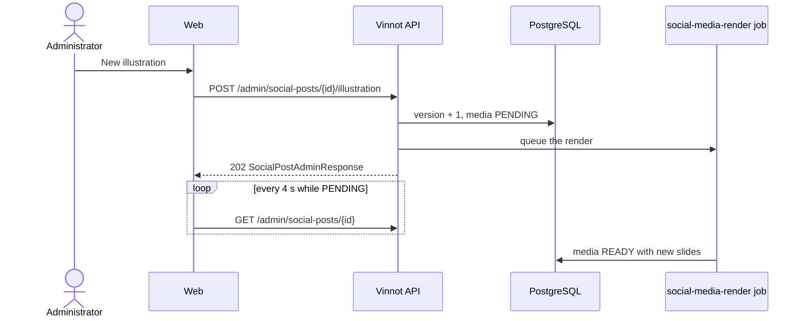

# UC-MKT-05 · Request a new illustration

| Field | Value |
|---|---|
| ID | `UC-MKT-05` |
| Module | [Social media marketing](../README.md) |
| Platforms | Web |
| Actors | Administrator, AI provider |
| Lucidchart IDs | None |
| Requirements | [`RF-WEB-MKT-15`](../requirements.md) |
| Test cases | [`CP-MKT-29`](../testing.md), [`CP-MKT-30`](../testing.md), [`CP-MKT-31`](../testing.md) |

## Preconditions

- The person is an administrator.
- The post has copy and is not `PUBLISHED`.

## Postconditions

- The media targets a new illustration version and is `PENDING`; the post status does not change (an approved post stays approved).
- The previous slides stay visible until the new ones are ready.

## Main flow

1. The person opens a post in `/admin/social-posts` and presses "New illustration".
2. The client sends `POST /admin/social-posts/{id}/illustration`.
3. The API bumps the illustration version, sets the media to `PENDING` with zero attempts, queues the render job and answers 202 with the post.
4. The page shows "New illustration requested. The slides are being rendered again." and asks for the post every 4 seconds.
5. The job paints a new illustration and draws the slides again ([`UC-MKT-04`](uc-mkt-04-render-post-media.md)); the page shows the new slides.

## Alternative flows

- 1a. The post has no copy or is already published: the web disables the button and the API answers 409 `INVALID_POST_TRANSITION`.
- 3a. The media was `FAILED`: the new version sets it back to `PENDING` and the render starts from zero attempts; this is how a failed render is retried.

## Business rules

- Every request pays for a new image when AI images are available; otherwise the cover uses the pillar vignette again.
- The illustration subject does not change; the version does, so the stored illustration is not reused.
- The replaced illustration and slides go to storage cleanup, which only deletes what no post and no pending job uses.

## Diagram

[View the full “UC-MKT-05 · Request a new illustration” diagram](https://images.vinnot.com/docs/diagrams/v1/en/modules-marketing-use-cases-uc-mkt-05-new-illustration-bd2594f42b8e.svg)

## Code

| Layer | Location |
|---|---|
| Backend | [`SocialPost.java`](../../../../../backend/src/main/java/com/vinnot/marketing/domain/model/SocialPost.java), [`SocialPostMedia.java`](../../../../../backend/src/main/java/com/vinnot/marketing/domain/model/SocialPostMedia.java), [`SocialPostReviewService.java`](../../../../../backend/src/main/java/com/vinnot/marketing/application/service/SocialPostReviewService.java), [`SocialPostAdminController.java`](../../../../../backend/src/main/java/com/vinnot/marketing/infrastructure/web/controller/SocialPostAdminController.java) |
| Web | `SlideGallery` ("New illustration"), `useAdminSocialPostsViewModel`, `adminSocialPosts.service` |

## Automated tests

- Backend: [`SocialPostTest.java`](../../../../../backend/src/test/java/com/vinnot/marketing/domain/model/SocialPostTest.java), [`SocialPostMediaTest.java`](../../../../../backend/src/test/java/com/vinnot/marketing/domain/model/SocialPostMediaTest.java), [`SocialPostReviewServiceTest.java`](../../../../../backend/src/test/java/com/vinnot/marketing/application/service/SocialPostReviewServiceTest.java), [`SocialPostAdminControllerTest.java`](../../../../../backend/src/test/java/com/vinnot/marketing/infrastructure/web/controller/SocialPostAdminControllerTest.java)
- Web: tests of `SlideGallery`, `useAdminSocialPostsViewModel`, `AdminSocialPostsPage`, the service and the client
- App: Not applicable
