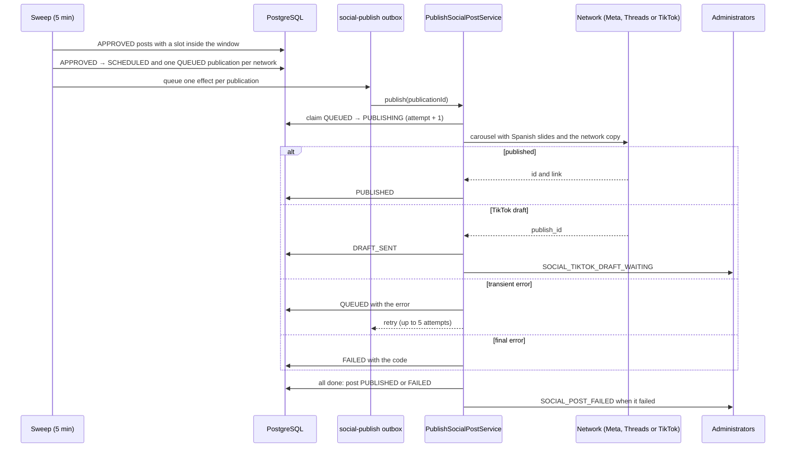

# UC-MKT-06 · Publish a post to the networks

| Field | Value |
|---|---|
| ID | `UC-MKT-06` |
| Module | [Social media marketing](../README.md) |
| Platforms | Web, App, Backend only |
| Actors | System, Instagram, Facebook, Threads, TikTok, Administrator |
| Lucidchart IDs | None |
| Requirements | [`RF-WEB-MKT-19`](../requirements.md), [`RF-WEB-MKT-20`](../requirements.md), [`RF-WEB-MKT-21`](../requirements.md), [`RF-WEB-MKT-22`](../requirements.md), [`RF-WEB-MKT-23`](../requirements.md), [`RF-WEB-MKT-31`](../requirements.md), [`RF-WEB-MKT-33`](../requirements.md), [`RF-APK-MKT-01`](../requirements.md) |
| Test cases | [`CP-MKT-39`](../testing.md), [`CP-MKT-40`](../testing.md), [`CP-MKT-41`](../testing.md), [`CP-MKT-42`](../testing.md), [`CP-MKT-43`](../testing.md), [`CP-MKT-44`](../testing.md), [`CP-MKT-45`](../testing.md), [`CP-MKT-46`](../testing.md), [`CP-MKT-47`](../testing.md), [`CP-MKT-69`](../testing.md), [`CP-MKT-80`](../testing.md) |

## Preconditions

- `app.marketing.publishing.enabled` is `true` and at least one network is enabled (`app.marketing.publishing.networks.<network>.enabled`).
- The account of every enabled network is configured (Instagram and Facebook) or connected (Threads and TikTok, [`UC-MKT-10`](uc-mkt-10-connect-network-account.md)).
- The post is `APPROVED` (by a person or by its pillar, [`UC-MKT-09`](uc-mkt-09-auto-approve-by-pillar.md)) and its time (`scheduledFor`) has arrived, or the administrator published it now ([`UC-MKT-12`](uc-mkt-12-publish-post-now.md)).

## Postconditions

- There is one publication per enabled network (`social_publications`) with its status, the network id, the public link, the attempts and the last error.
- The post is `PUBLISHED` when every network succeeded (a TikTok draft counts) or `FAILED` with the first error when a network failed for good.
- Once publishing starts the post is frozen: it is not edited, regenerated or rejected and gets no new illustration, so published images are never replaced or cleaned up.

## Main flow

1. Every 5 minutes (`app.marketing.publishing.delay-ms`) the sweep looks for up to 50 `APPROVED` posts whose slot has passed and lies inside the publishing window (the last 2 × `media-grace`, 12 h by default).
2. For each one, in its own transaction, the system checks that the Spanish slides are ready in both formats, moves the post to `SCHEDULED` (only over the `APPROVED` status it read), creates one `QUEUED` publication per enabled network and queues one `social-publish` durable effect for each, due at that network's time: the post time, or the network's not-before time of the post's day when later.
3. The effects worker takes each effect outside any transaction and claims the publication atomically (`QUEUED` → `PUBLISHING`, one more attempt).
4. The system builds the Spanish request: the Instagram slides (4:5) for Instagram, Facebook and Threads, or the TikTok slides (9:16) for TikTok, all with absolute https URLs, the alt text and the copy formatted for the network.
5. The network adapter publishes the carousel: Instagram creates one container per image and the carousel container, waits until Meta has processed it and publishes it; Facebook uploads every photo unpublished and creates one Page post with the photos; Threads creates the containers and publishes; TikTok sends the photos through the Content Posting API.
6. The publication becomes `PUBLISHED` with the network id and link.
7. Once every publication of the post is done, the system settles the post: `PUBLISHED` with `publishing.finishedAt`.
8. In `/admin/social-posts`, the web and the app show each network's status, the "View on <network>" link, the attempts and the publishing date.

## Alternative flows

- 1a. The post is older than the publishing window: the sweep ignores it; it is never published late.
- 1b. Publishing is off or no network is enabled: the sweep reads and starts nothing.
- 2a. The Spanish slides are not ready yet: the post stays `APPROVED` and the sweep looks again; once more than `media-grace` (6 h) has passed since the slot, it becomes `FAILED` with `MEDIA_NOT_READY` and every administrator gets the `SOCIAL_POST_FAILED` notice without a network.
- 2b. A network has a not-before time later than the post (`app.marketing.publishing.networks.<network>.not-before`, TikTok 19:30 by default): its effect waits until then; the post stays `SCHEDULED` until every network is done. "Publish now" ([`UC-MKT-12`](uc-mkt-12-publish-post-now.md)) does not wait.
- 3a. The publication is no longer `QUEUED` (a duplicate effect or a second worker): nothing happens; a post is never published twice on the same network.
- 3b. Publishing or the network was switched off after queueing: the publication becomes `FAILED` with `PUBLISHING_OFF`.
- 4a. A slide URL is not absolute https: the publication becomes `FAILED` with `MEDIA_NOT_PUBLIC`.
- 5a. TikTok in `MEDIA_UPLOAD` mode (the default): TikTok leaves the carousel as a draft in the account's inbox; the publication becomes `DRAFT_SENT` without a link and every administrator gets `SOCIAL_TIKTOK_DRAFT_WAITING` to finish it in the TikTok app. With `DIRECT_POST` it is published directly.
- 5a1. The creator posts the draft from the TikTok app: within 15 minutes (`app.marketing.publishing.draft-sync.delay-ms`) the draft sweep sees TikTok's `PUBLISH_COMPLETE` and the publication becomes `PUBLISHED`, with the "View on TikTok" link when TikTok already gives the public post id (otherwise without a link). A draft still in the inbox stays `DRAFT_SENT`; drafts sent more than 14 days ago are no longer checked.
- 5b. Transient error (`RATE_LIMITED`, `UNAVAILABLE`, `PROCESSING_TIMEOUT`): the publication goes back to `QUEUED` with the error and the outbox retries it, up to 5 attempts; the fifth leaves it `FAILED`.
- 5c. Final error (`NOT_CONNECTED`, `TOKEN_INVALID`, `MEDIA_REJECTED`, `REJECTED`): the publication becomes `FAILED` with that code.
- 7a. A network failed for good: the post becomes `FAILED` with the first failure's error and every administrator gets `SOCIAL_POST_FAILED` with the network and the reason; the person can retry that network ([`UC-MKT-07`](uc-mkt-07-retry-publication.md)).

## Business rules

- One Spanish account is published: the Spanish copy and slides; the English slides are not published.
- Instagram and Facebook: caption with the legal line and hashtags, at most 2,200 characters and 30 hashtags; trailing hashtags go first, the caption and its legal line never. Threads: hook, caption shortened on a word with "…" and legal line, at most 500 characters, no hashtags and one topic (the first hashtag other than `#vinnot`). TikTok: the hook as title (at most 90) and the caption with hashtags as description (at most 4,000).
- Images per network: Instagram and Threads 2 to 20, Facebook 1 to 50, TikTok 1 to 35; outside that the network is not called and the publication fails with `REJECTED`.
- Instagram checks its daily publishing quota before creating containers; without quota it answers `RATE_LIMITED`.
- The processing wait checks every `MARKETING_NETWORKS_POLL_INTERVAL` (15 s) up to `MARKETING_NETWORKS_POLL_TIMEOUT` (5 min) and then fails with `PROCESSING_TIMEOUT`, which is retried.
- A posted draft is written only over `DRAFT_SENT`, so two sweeps never write it twice; the sweep checks at most 20 drafts per run, oldest first, within TikTok's limit of 30 status checks per minute.
- Settling the post is a compare-and-set over `SCHEDULED`: a concurrent settle or an admin action is never overwritten and the failure notice goes out once per run.

## Diagram

[View the full “UC-MKT-06 · Publish a post to the networks” diagram](https://images.vinnot.com/docs/diagrams/v1/en/modules-marketing-use-cases-uc-mkt-06-publish-post-43fdac555b74.svg)

## Code

| Layer | Location |
|---|---|
| Backend | [`SocialPublishingSweepService.java`](../../../../../backend/src/main/java/com/vinnot/marketing/application/service/SocialPublishingSweepService.java), [`SocialPublishingStarter.java`](../../../../../backend/src/main/java/com/vinnot/marketing/application/service/SocialPublishingStarter.java), [`PublishSocialPostService.java`](../../../../../backend/src/main/java/com/vinnot/marketing/application/service/PublishSocialPostService.java), [`NetworkCaptionFormatter.java`](../../../../../backend/src/main/java/com/vinnot/marketing/domain/service/NetworkCaptionFormatter.java), [`SocialPublication.java`](../../../../../backend/src/main/java/com/vinnot/marketing/domain/model/SocialPublication.java), [`SocialPost.java`](../../../../../backend/src/main/java/com/vinnot/marketing/domain/model/SocialPost.java), [`OutboxSocialPublishQueue.java`](../../../../../backend/src/main/java/com/vinnot/marketing/infrastructure/effects/OutboxSocialPublishQueue.java), [`SocialPublishEffectHandler.java`](../../../../../backend/src/main/java/com/vinnot/marketing/infrastructure/effects/SocialPublishEffectHandler.java), adapters in [`infrastructure/social`](../../../../../backend/src/main/java/com/vinnot/marketing/infrastructure/social/), [`SocialPublishingNoticeService.java`](../../../../../backend/src/main/java/com/vinnot/marketing/application/service/SocialPublishingNoticeService.java), [`SyncSocialDraftsService.java`](../../../../../backend/src/main/java/com/vinnot/marketing/application/service/SyncSocialDraftsService.java), [`SocialDraftSyncScheduler.java`](../../../../../backend/src/main/java/com/vinnot/marketing/infrastructure/scheduling/SocialDraftSyncScheduler.java) |
| Web | `SocialPostPublications` inside `SocialPostDetail` |
| App | Publications section of `SocialPostDetailSheet` |

## Automated tests

- Backend: [`SocialPublicationTest.java`](../../../../../backend/src/test/java/com/vinnot/marketing/domain/model/SocialPublicationTest.java), [`SocialPostPublishingTest.java`](../../../../../backend/src/test/java/com/vinnot/marketing/domain/model/SocialPostPublishingTest.java), [`NetworkCaptionFormatterTest.java`](../../../../../backend/src/test/java/com/vinnot/marketing/domain/service/NetworkCaptionFormatterTest.java), [`SocialPublishingSweepServiceTest.java`](../../../../../backend/src/test/java/com/vinnot/marketing/application/service/SocialPublishingSweepServiceTest.java), [`SocialPublishingStarterTest.java`](../../../../../backend/src/test/java/com/vinnot/marketing/application/service/SocialPublishingStarterTest.java), [`PublishSocialPostServiceTest.java`](../../../../../backend/src/test/java/com/vinnot/marketing/application/service/PublishSocialPostServiceTest.java), [`SocialPublishingNoticeServiceTest.java`](../../../../../backend/src/test/java/com/vinnot/marketing/application/service/SocialPublishingNoticeServiceTest.java), [`InstagramPublisherTest.java`](../../../../../backend/src/test/java/com/vinnot/marketing/infrastructure/social/InstagramPublisherTest.java), [`FacebookPublisherTest.java`](../../../../../backend/src/test/java/com/vinnot/marketing/infrastructure/social/FacebookPublisherTest.java), [`ThreadsPublisherTest.java`](../../../../../backend/src/test/java/com/vinnot/marketing/infrastructure/social/ThreadsPublisherTest.java), [`TikTokPublisherTest.java`](../../../../../backend/src/test/java/com/vinnot/marketing/infrastructure/social/TikTokPublisherTest.java), [`GraphApiTest.java`](../../../../../backend/src/test/java/com/vinnot/marketing/infrastructure/social/GraphApiTest.java), [`StatusPollerTest.java`](../../../../../backend/src/test/java/com/vinnot/marketing/infrastructure/social/StatusPollerTest.java), [`OutboxSocialPublishQueueTest.java`](../../../../../backend/src/test/java/com/vinnot/marketing/infrastructure/effects/OutboxSocialPublishQueueTest.java), [`SocialPublishEffectHandlerTest.java`](../../../../../backend/src/test/java/com/vinnot/marketing/infrastructure/effects/SocialPublishEffectHandlerTest.java), [`SocialPublishingSchedulerTest.java`](../../../../../backend/src/test/java/com/vinnot/marketing/infrastructure/scheduling/SocialPublishingSchedulerTest.java), [`SyncSocialDraftsServiceTest.java`](../../../../../backend/src/test/java/com/vinnot/marketing/application/service/SyncSocialDraftsServiceTest.java), [`TikTokDraftTrackerTest.java`](../../../../../backend/src/test/java/com/vinnot/marketing/infrastructure/social/TikTokDraftTrackerTest.java), [`SocialDraftSyncSchedulerTest.java`](../../../../../backend/src/test/java/com/vinnot/marketing/infrastructure/scheduling/SocialDraftSyncSchedulerTest.java), [`MarketingPublishingConfigurationTest.java`](../../../../../backend/src/test/java/com/vinnot/marketing/infrastructure/config/MarketingPublishingConfigurationTest.java), [`JdbcSocialPublicationRepositoryPostgresIntegrationTest.java`](../../../../../backend/src/test/java/com/vinnot/marketing/infrastructure/persistence/JdbcSocialPublicationRepositoryPostgresIntegrationTest.java), [`JdbcSocialPostPublishingPostgresIntegrationTest.java`](../../../../../backend/src/test/java/com/vinnot/marketing/infrastructure/persistence/JdbcSocialPostPublishingPostgresIntegrationTest.java), [`SocialPublishingNoticeTemplateTest.java`](../../../../../backend/src/test/java/com/vinnot/notification/infrastructure/template/SocialPublishingNoticeTemplateTest.java), [`SocialPublishingPushTemplatesTest.java`](../../../../../backend/src/test/java/com/vinnot/notification/infrastructure/push/SocialPublishingPushTemplatesTest.java)
- Web: tests of `SocialPostPublications`, `SocialPostDetail`, the `socialPost` domain, the service and the client
- App: tests of `AdminSocialPostsScreen`, `useAdminSocialPostsViewModel`, the `socialPost` domain, the service and the client
