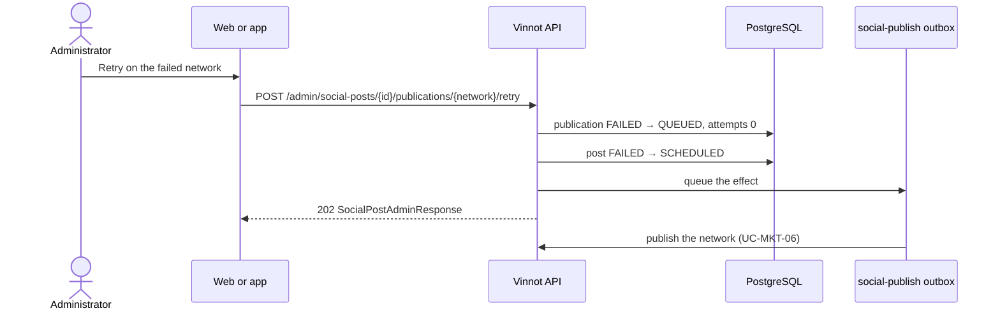

# UC-MKT-07 · Retry a failed publication

| Field | Value |
|---|---|
| ID | `UC-MKT-07` |
| Module | [Social media marketing](../README.md) |
| Platforms | Web, App |
| Actors | Administrator, System |
| Lucidchart IDs | None |
| Requirements | [`RF-WEB-MKT-24`](../requirements.md), [`RF-APK-MKT-01`](../requirements.md) |
| Test cases | [`CP-MKT-48`](../testing.md), [`CP-MKT-49`](../testing.md), [`CP-MKT-50`](../testing.md), [`CP-MKT-51`](../testing.md) |

## Preconditions

- The person is an administrator.
- The publication on that network is `FAILED`.
- Publishing and the network are enabled.

## Postconditions

- The publication on that network is `QUEUED` again, without error and with zero attempts, and is queued as a durable effect.
- If the post was `FAILED`, it is `SCHEDULED` again.

## Main flow

1. The person opens a failed post in `/admin/social-posts` and sees each network's status with its error.
2. They fix the cause if needed (for example, reconnect the account, [`UC-MKT-10`](uc-mkt-10-connect-network-account.md), or request a new illustration when the slides failed).
3. They press "Retry" on the failed network.
4. The client sends `POST /admin/social-posts/{id}/publications/{network}/retry`.
5. In one transaction, the API moves the publication from `FAILED` to `QUEUED` (a conditional move), resets the attempts to zero, moves the post from `FAILED` to `SCHEDULED` (which needs ready Spanish slides) and queues a `social-publish` effect.
6. The API answers 202 with the post; the page shows "The publication is queued again.".
7. The worker publishes that network as in [`UC-MKT-06`](uc-mkt-06-publish-post.md) and the post is settled again.

## Alternative flows

- 3a. The publication on that network is no longer `FAILED` (someone else retried it at the same time, or it already finished): the API answers 409 `INVALID_PUBLICATION_TRANSITION`; of two concurrent retries only one wins.
- 5a. The post is `FAILED` and its Spanish slides are not ready: the API answers 409 `INVALID_POST_TRANSITION` and nothing changes; request a new illustration and wait for the slides.
- 5b. Publishing or the network is off: the API answers 409 `SOCIAL_PUBLISHING_OFF`.
- 4a. The network in the path does not exist: 400 `INVALID_REQUEST`. The post has no publication on that network, or does not exist: 404.

## Business rules

- Every publication gets up to 5 attempts per run; a manual retry starts the count over.
- The effect key carries a random value, so a retry is always queued even if an earlier effect remains; the atomic claim prevents publishing twice.
- If the new run fails again, the administrators get another `SOCIAL_POST_FAILED` notice (the key includes the run's finish time).

## Diagram

[View the full “UC-MKT-07 · Retry a failed publication” diagram](https://images.vinnot.com/docs/diagrams/v1/en/modules-marketing-use-cases-uc-mkt-07-retry-publication-c995f8f4247a.svg)

## Code

| Layer | Location |
|---|---|
| Backend | [`SocialPublicationRetryService.java`](../../../../../backend/src/main/java/com/vinnot/marketing/application/service/SocialPublicationRetryService.java), [`SocialPublication.java`](../../../../../backend/src/main/java/com/vinnot/marketing/domain/model/SocialPublication.java), [`SocialPost.java`](../../../../../backend/src/main/java/com/vinnot/marketing/domain/model/SocialPost.java), [`SocialPostAdminController.java`](../../../../../backend/src/main/java/com/vinnot/marketing/infrastructure/web/controller/SocialPostAdminController.java) |
| Web | `SocialPostPublications`, `useSocialPublicationRetry`, `adminSocialPosts.service` |
| App | `SocialPostDetailSheet`, `useAdminSocialPostsViewModel`, `adminSocialPosts.service` |

## Automated tests

- Backend: [`SocialPublicationRetryServiceTest.java`](../../../../../backend/src/test/java/com/vinnot/marketing/application/service/SocialPublicationRetryServiceTest.java), [`SocialPublicationTest.java`](../../../../../backend/src/test/java/com/vinnot/marketing/domain/model/SocialPublicationTest.java), [`SocialPostPublishingTest.java`](../../../../../backend/src/test/java/com/vinnot/marketing/domain/model/SocialPostPublishingTest.java), [`SocialPostAdminControllerTest.java`](../../../../../backend/src/test/java/com/vinnot/marketing/infrastructure/web/controller/SocialPostAdminControllerTest.java), [`GlobalExceptionHandlerTransitionConflictTest.java`](../../../../../backend/src/test/java/com/vinnot/shared/infrastructure/web/GlobalExceptionHandlerTransitionConflictTest.java)
- Web: tests of `SocialPostPublications`, `useSocialPublicationRetry`, the service and the client
- App: tests of `useAdminSocialPostsViewModel`, `useAdminSocialPosts`, the service and the client
