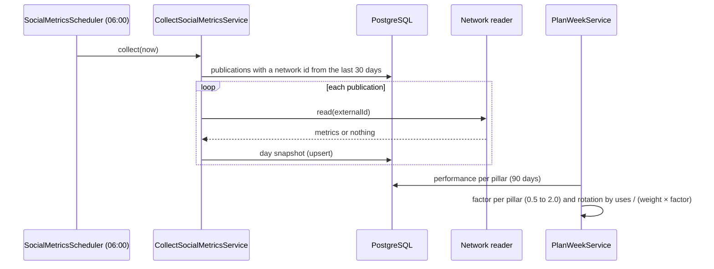

# UC-MKT-08 · Collect metrics and weight the pillars

| Field | Value |
|---|---|
| ID | `UC-MKT-08` |
| Module | [Social media marketing](../README.md) |
| Platforms | Web, App, Backend only |
| Actors | System, Instagram, Facebook, Threads, Administrator |
| Lucidchart IDs | None |
| Requirements | [`RF-WEB-MKT-25`](../requirements.md), [`RF-WEB-MKT-26`](../requirements.md), [`RF-APK-MKT-01`](../requirements.md), [`RF-APK-MKT-02`](../requirements.md) |
| Test cases | [`CP-MKT-52`](../testing.md), [`CP-MKT-53`](../testing.md), [`CP-MKT-54`](../testing.md), [`CP-MKT-55`](../testing.md) |

## Preconditions

- `app.marketing.metrics.enabled` is `true` for the daily reading.
- There are `PUBLISHED` or `DRAFT_SENT` publications with a network id in the last 30 days.

## Postconditions

- Every measured publication has the day's metrics snapshot (`social_post_metrics`), one per publication and day.
- The planner weighs each pillar by its performance over the last 90 days and the page shows that performance.

## Main flow

1. Every day at 06:00 in the planner zone (`app.marketing.metrics.cron`), the system looks for the publications with a network id published in the last `app.marketing.metrics.window-days` (30).
2. For each one, its network's reader asks for the metrics: Instagram (views, reach, likes, comments, saves and shares), Facebook (views, reach, reactions as likes, comments and shares) and Threads (views, likes, replies as comments, and reposts, quotes and shares added up as shares); Instagram adds new follows if `follows` is added to the metrics list.
3. It stores the day's snapshot; reading again the same day replaces it.
4. When planning ([`UC-MKT-01`](uc-mkt-01-plan-week.md)), the system adds up each publication's latest snapshot per pillar over the last `app.marketing.weighting.window-days` (90) and computes each pillar's factor: its interactions per view against the overall ones, between 0.5 and 2.0.
5. Each rotating slot takes the pillar with the fewest uses divided by (weight × factor), never repeating the previous pillar; the lower `sort_order` breaks ties.
6. On the web and in the app, each post shows the latest metrics per network and the "Content pillars" panel shows per pillar the measured posts, views, interactions and the factor.

## Alternative flows

- 2a. TikTok: there is no metrics reading (the `publish_id` is not a video id the TikTok API can query); the publication has no metrics.
- 2b. The network has no data yet or the post is gone: nothing is stored.
- 2c. Reading one publication fails (token, network down): it is logged and the others go on.
- 4a. A pillar has fewer than 3 measured posts (a post counts as measured when any snapshot has views), no views, or there are no interactions overall: its factor is neutral (1.0).
- 4b. The daily reading is off: there are no new snapshots and every pillar stays neutral.

## Business rules

- A null value is a metric the network does not give; interactions = the non-null likes + comments + saves + shares.
- The Instagram metrics are configurable (`MARKETING_INSTAGRAM_METRICS`), because Meta refuses the whole read when one metric is not valid for carousels.
- Wine days, `APP_FEATURE` once every four rotating posts and never repeating the previous pillar stay.

## Diagram

[View the full “UC-MKT-08 · Collect metrics and weight the pillars” diagram](https://images.vinnot.com/docs/diagrams/v1/en/modules-marketing-use-cases-uc-mkt-08-collect-metrics-weight-pillars-d7d81d347a9f.svg)

## Code

| Layer | Location |
|---|---|
| Backend | [`CollectSocialMetricsService.java`](../../../../../backend/src/main/java/com/vinnot/marketing/application/service/CollectSocialMetricsService.java), [`PillarPerformanceService.java`](../../../../../backend/src/main/java/com/vinnot/marketing/application/service/PillarPerformanceService.java), [`PillarWeighting.java`](../../../../../backend/src/main/java/com/vinnot/marketing/domain/service/PillarWeighting.java), [`WeeklyPlanner.java`](../../../../../backend/src/main/java/com/vinnot/marketing/domain/service/WeeklyPlanner.java), [`JdbcSocialMetricsRepository.java`](../../../../../backend/src/main/java/com/vinnot/marketing/infrastructure/persistence/JdbcSocialMetricsRepository.java), readers in [`infrastructure/social`](../../../../../backend/src/main/java/com/vinnot/marketing/infrastructure/social/), [`SocialMetricsScheduler.java`](../../../../../backend/src/main/java/com/vinnot/marketing/infrastructure/scheduling/SocialMetricsScheduler.java) |
| Web | `SocialPostPublications` (metrics) and `ContentPillarsPanel` (performance) |
| App | Metrics in `SocialPostDetailSheet` and pillars in `AdminSocialPostsScreen` |

## Automated tests

- Backend: [`CollectSocialMetricsServiceTest.java`](../../../../../backend/src/test/java/com/vinnot/marketing/application/service/CollectSocialMetricsServiceTest.java), [`PillarPerformanceServiceTest.java`](../../../../../backend/src/test/java/com/vinnot/marketing/application/service/PillarPerformanceServiceTest.java), [`PillarWeightingTest.java`](../../../../../backend/src/test/java/com/vinnot/marketing/domain/service/PillarWeightingTest.java), [`WeeklyPlannerTest.java`](../../../../../backend/src/test/java/com/vinnot/marketing/domain/service/WeeklyPlannerTest.java), [`PlanWeekServiceTest.java`](../../../../../backend/src/test/java/com/vinnot/marketing/application/service/PlanWeekServiceTest.java), [`PublicationMetricsTest.java`](../../../../../backend/src/test/java/com/vinnot/marketing/domain/model/PublicationMetricsTest.java), [`SocialMetricsReadersTest.java`](../../../../../backend/src/test/java/com/vinnot/marketing/infrastructure/social/SocialMetricsReadersTest.java), [`JdbcSocialMetricsRepositoryPostgresIntegrationTest.java`](../../../../../backend/src/test/java/com/vinnot/marketing/infrastructure/persistence/JdbcSocialMetricsRepositoryPostgresIntegrationTest.java), [`SocialPublishingSchedulersTest.java`](../../../../../backend/src/test/java/com/vinnot/marketing/infrastructure/scheduling/SocialPublishingSchedulersTest.java)
- Web: tests of `SocialPostPublications`, `ContentPillarsPanel`, `useContentPillarsPanel` and the service
- App: tests of `AdminSocialPostsScreen`, `useAdminSocialPostsViewModel` and the service
