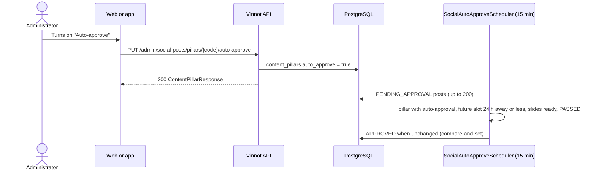

# UC-MKT-09 · Auto-approve by pillar

| Field | Value |
|---|---|
| ID | `UC-MKT-09` |
| Module | [Social media marketing](../README.md) |
| Platforms | Web, App, Backend only |
| Actors | Administrator, System |
| Lucidchart IDs | None |
| Requirements | [`RF-WEB-MKT-27`](../requirements.md), [`RF-WEB-MKT-28`](../requirements.md), [`RF-APK-MKT-02`](../requirements.md) |
| Test cases | [`CP-MKT-56`](../testing.md), [`CP-MKT-57`](../testing.md), [`CP-MKT-58`](../testing.md), [`CP-MKT-59`](../testing.md), [`CP-MKT-60`](../testing.md) |

## Preconditions

- The person is an administrator.
- `app.marketing.auto-approve.enabled` is `true` for the automatic approval to run.

## Postconditions

- The pillar has its "Auto-approve" (`auto_approve`) or "Active" (`active`) switch at the chosen value.
- The eligible pending posts of a pillar with auto-approval are `APPROVED` without a reviewer, with reason `AUTO_APPROVED`.

## Main flow

1. The person opens `/admin/social-posts` and, in the "Content pillars" panel, turns on a pillar's "Auto-approve".
2. The client sends `PUT /admin/social-posts/pillars/{code}/auto-approve` with `{"enabled": true}`.
3. The API stores the switch and answers 200 with the pillar (`active`, `autoApprove` and `performance`).
4. Every 15 minutes (`app.marketing.auto-approve.delay-ms`) the system reads up to 200 `PENDING_APPROVAL` posts, the earliest first.
5. A post is eligible when its pillar has auto-approval on, its slot has not arrived yet and is 24 h away or less (`app.marketing.auto-approve.lead`), its Spanish slides are ready and its fact check is `PASSED`.
6. The system approves it with a compare-and-set against the version it read: `APPROVED`, `review.reviewedBy` null, `review.reason = AUTO_APPROVED` and `review.automatic = true`.
7. The page shows "Approved automatically on <date>" in the review; the post goes on to [`UC-MKT-06`](uc-mkt-06-publish-post.md).

## Alternative flows

- 1a. The person turns a pillar's "Active" off: `PUT /admin/social-posts/pillars/{code}/active` with `{"enabled": false}`; the planner stops planning it. For the `WINE_DAY` pillar, no wine days are planned.
- 1b. It is the last active rotating pillar (not counting `APP_FEATURE`): 409 `LAST_ROTATING_PILLAR`; the page shows "It cannot be switched off: it is the last active pillar the planner rotates.".
- 2a. The pillar code does not exist: 404. The body has no `enabled`: 400.
- 5a. The fact check is `FLAGGED` or `SKIPPED`, the slides are not ready, the slot is more than 24 h away or has passed: the post stays pending for human review.
- 6a. An administrator edited, rejected or approved the post between the read and the approval: the compare-and-set writes nothing and the post stays as the person left it.

## Business rules

- Auto-approval is off for every pillar (V82) and its job is off by configuration.
- An automatic approval is told apart by a null `reviewedBy` and the `AUTO_APPROVED` reason; there is no reviewer and no email.
- Every pillar starts active (V83); V84 leaves `HUMOR` inactive.

## Diagram

[View the full “UC-MKT-09 · Auto-approve by pillar” diagram](https://images.vinnot.com/docs/diagrams/v1/en/modules-marketing-use-cases-uc-mkt-09-auto-approve-by-pillar-098a1a8af068.svg)

## Code

| Layer | Location |
|---|---|
| Backend | [`AutoApproveSocialPostsService.java`](../../../../../backend/src/main/java/com/vinnot/marketing/application/service/AutoApproveSocialPostsService.java), [`ContentPillarAdminService.java`](../../../../../backend/src/main/java/com/vinnot/marketing/application/service/ContentPillarAdminService.java), [`PostReview.java`](../../../../../backend/src/main/java/com/vinnot/marketing/domain/model/PostReview.java), [`ContentPillar.java`](../../../../../backend/src/main/java/com/vinnot/marketing/domain/model/ContentPillar.java), [`SocialPillarAdminController.java`](../../../../../backend/src/main/java/com/vinnot/marketing/infrastructure/web/controller/SocialPillarAdminController.java), [`JdbcContentPillarCatalog.java`](../../../../../backend/src/main/java/com/vinnot/marketing/infrastructure/persistence/JdbcContentPillarCatalog.java), [`SocialAutoApproveScheduler.java`](../../../../../backend/src/main/java/com/vinnot/marketing/infrastructure/scheduling/SocialAutoApproveScheduler.java) |
| Web | `ContentPillarsPanel`, `useContentPillarsPanel`, review label in `SocialPostDetail` |
| App | Pillar switches in `AdminSocialPostsScreen` |

## Automated tests

- Backend: [`AutoApproveSocialPostsServiceTest.java`](../../../../../backend/src/test/java/com/vinnot/marketing/application/service/AutoApproveSocialPostsServiceTest.java), [`ContentPillarAdminServiceTest.java`](../../../../../backend/src/test/java/com/vinnot/marketing/application/service/ContentPillarAdminServiceTest.java), [`ContentPillarTest.java`](../../../../../backend/src/test/java/com/vinnot/marketing/domain/model/ContentPillarTest.java), [`SocialPostPublishingTest.java`](../../../../../backend/src/test/java/com/vinnot/marketing/domain/model/SocialPostPublishingTest.java), [`WeeklyPlannerTest.java`](../../../../../backend/src/test/java/com/vinnot/marketing/domain/service/WeeklyPlannerTest.java), [`SocialPillarAdminControllerTest.java`](../../../../../backend/src/test/java/com/vinnot/marketing/infrastructure/web/controller/SocialPillarAdminControllerTest.java), [`SocialPillarSwitchesPostgresIntegrationTest.java`](../../../../../backend/src/test/java/com/vinnot/marketing/infrastructure/persistence/SocialPillarSwitchesPostgresIntegrationTest.java), [`SocialContentRefinementMigrationPostgresIntegrationTest.java`](../../../../../backend/src/test/java/com/vinnot/marketing/infrastructure/persistence/SocialContentRefinementMigrationPostgresIntegrationTest.java), [`SocialPostPresenterTest.java`](../../../../../backend/src/test/java/com/vinnot/marketing/application/service/SocialPostPresenterTest.java), [`SocialPublishingSchedulersTest.java`](../../../../../backend/src/test/java/com/vinnot/marketing/infrastructure/scheduling/SocialPublishingSchedulersTest.java)
- Web: tests of `ContentPillarsPanel`, `useContentPillarsPanel`, `SocialPostDetail`, the service and the client
- App: tests of `AdminSocialPostsScreen`, `useAdminSocialPostsViewModel`, the service and the client
