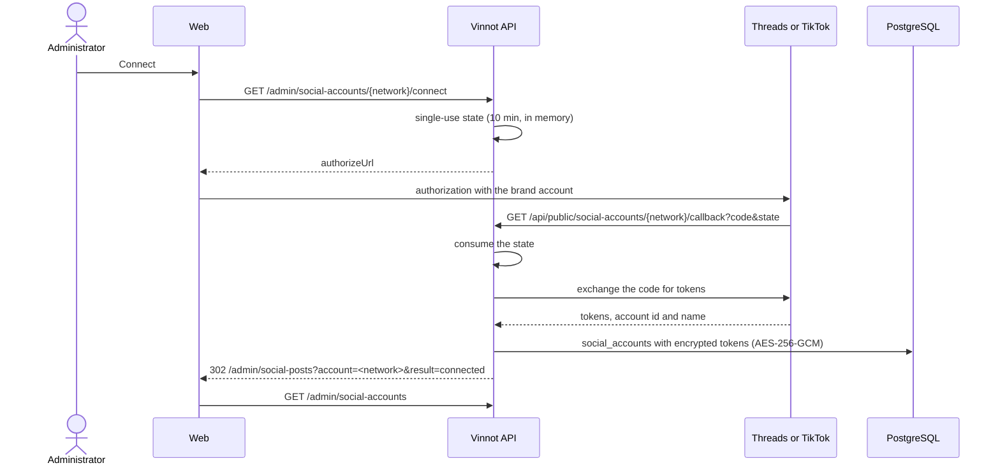

# UC-MKT-10 · Connect a network account

| Field | Value |
|---|---|
| ID | `UC-MKT-10` |
| Module | [Social media marketing](../README.md) |
| Platforms | Web, App |
| Actors | Administrator, Threads, TikTok, System |
| Lucidchart IDs | None |
| Requirements | [`RF-WEB-MKT-29`](../requirements.md), [`RF-WEB-MKT-30`](../requirements.md), [`RF-WEB-MKT-23`](../requirements.md), [`RF-APK-MKT-03`](../requirements.md) |
| Test cases | [`CP-MKT-61`](../testing.md), [`CP-MKT-62`](../testing.md), [`CP-MKT-63`](../testing.md), [`CP-MKT-64`](../testing.md), [`CP-MKT-65`](../testing.md), [`CP-MKT-66`](../testing.md) |

## Preconditions

- The person is an administrator and uses the web (connecting is web only; the app shows the connections read-only).
- The network's app is configured on the server (`MARKETING_THREADS_*` or `MARKETING_TIKTOK_*`) and `MARKETING_ACCOUNTS_ENCRYPTION_KEY` exists ([setup guide](../../../infra/guides/social-networks-setup.md)).

## Postconditions

- `social_accounts` has one row per connected network with the account id and name and its tokens encrypted with AES-256-GCM; no token leaves the server or reaches the log.
- The "Network connections" panel shows the network "Connected", with the account and the expiry date.

## Main flow

1. The person opens `/admin/social-posts` and, in "Network connections", presses "Connect" on Threads or TikTok.
2. The client asks for `GET /admin/social-accounts/{network}/connect`.
3. The API issues a single-use `state` (256 random bits, 10 minutes, kept in server memory) and answers with the network's authorization URL.
4. The browser goes to the network; the person signs in with the brand account and accepts the permissions.
5. The network redirects to `GET /api/public/social-accounts/{network}/callback?code=…&state=…`.
6. The API consumes the `state`, exchanges the code for the tokens (Threads: a 60-day long-lived token; TikTok: an access token and a refresh token), reads the account id and name and stores everything encrypted.
7. The API answers 302 to `/admin/social-posts?account=<network>&result=connected`, without the code, the `state` or a token, with `Cache-Control: no-store` and `Referrer-Policy: no-referrer`.
8. The page shows "<network> is connected." and the panel refreshes with `GET /admin/social-accounts`.

## Alternative flows

- 1a. Instagram and Facebook show "Configured on the server" or "Not configured on the server" and have no button: they are configured with secrets. `GET /{network}/connect` for them answers 422 `SOCIAL_ACCOUNT_NOT_OAUTH` and `DELETE` answers 409 `SOCIAL_ACCOUNT_CONFIGURED_BY_SECRETS`.
- 3a. The network's app is not configured on the server: 422 `SOCIAL_ACCOUNT_NOT_CONFIGURED`. The encryption key is missing: 422 `SOCIAL_ACCOUNT_ENCRYPTION_KEY_MISSING`. The network does not exist: 404.
- 5a. The `state` is unknown, already used, expired or for another network, the person cancelled on the network, or the exchange fails: the API answers 302 with `result=error`, stores nothing and the page shows "<network> could not be connected. Try again.".
- 5b. The server restarted between "Connect" and the redirect: the `state` is lost; start again.
- 6a. Automatic refresh: every hour the system refreshes the Threads token in its last 10 days (when it is at least a day old) and the TikTok token in its last half hour. A refusal by the network, an already expired credential or a stored token that cannot be decrypted (`TOKEN_UNREADABLE`, for example after rotating the key) leave the account `REFRESH_FAILED` with its error, and every administrator gets `SOCIAL_ACCOUNT_RECONNECT` once; a transient error is retried on the next run. Reconnecting fixes it.
- 8a. "Disconnect": `DELETE /admin/social-accounts/{network}` removes the account and answers 204; without an account, 404.

## Business rules

- The `state` lives in the memory of a single backend instance (the low-cost deployment runs one); with several instances the callback might not find it.
- Tokens are encrypted bound to the network and the field, so a ciphertext is useless on another network or field.
- An account works while it is `CONNECTED` and its token has not expired; otherwise publishing on that network fails with `NOT_CONNECTED` or `TOKEN_INVALID`.
- `expiresAt` is when it stops working unless refreshed: the end of the TikTok refresh token or of the Threads token; null for Meta.

## Diagram

[View the full “UC-MKT-10 · Connect a network account” diagram](https://images.vinnot.com/docs/diagrams/v1/en/modules-marketing-use-cases-uc-mkt-10-connect-network-account-d11d4b62a762.svg)

## Code

| Layer | Location |
|---|---|
| Backend | [`SocialAccountAdminService.java`](../../../../../backend/src/main/java/com/vinnot/marketing/application/service/SocialAccountAdminService.java), [`SocialAccountRefreshService.java`](../../../../../backend/src/main/java/com/vinnot/marketing/application/service/SocialAccountRefreshService.java), [`SocialAccountAdminController.java`](../../../../../backend/src/main/java/com/vinnot/marketing/infrastructure/web/controller/SocialAccountAdminController.java), [`SocialAccountCallbackController.java`](../../../../../backend/src/main/java/com/vinnot/marketing/infrastructure/web/controller/SocialAccountCallbackController.java), [`ThreadsOAuthProvider.java`](../../../../../backend/src/main/java/com/vinnot/marketing/infrastructure/accounts/ThreadsOAuthProvider.java), [`TikTokOAuthProvider.java`](../../../../../backend/src/main/java/com/vinnot/marketing/infrastructure/accounts/TikTokOAuthProvider.java), [`InMemorySocialAccountConnectStates.java`](../../../../../backend/src/main/java/com/vinnot/marketing/infrastructure/accounts/InMemorySocialAccountConnectStates.java), [`JdbcSocialAccountStore.java`](../../../../../backend/src/main/java/com/vinnot/marketing/infrastructure/accounts/JdbcSocialAccountStore.java), [`SocialAccountCipher.java`](../../../../../backend/src/main/java/com/vinnot/marketing/infrastructure/accounts/SocialAccountCipher.java), [`ConfiguredSocialAccountTokens.java`](../../../../../backend/src/main/java/com/vinnot/marketing/infrastructure/accounts/ConfiguredSocialAccountTokens.java) |
| Web | `SocialAccountsPanel`, `useSocialAccountsPanel`, `useAdminSocialAccounts`, `adminSocialAccounts.service`, `adminSocialAccounts.client` |
| App | Read-only connections in `AdminSocialPostsScreen` |

## Automated tests

- Backend: [`SocialAccountAdminServiceTest.java`](../../../../../backend/src/test/java/com/vinnot/marketing/application/service/SocialAccountAdminServiceTest.java), [`SocialAccountRefreshServiceTest.java`](../../../../../backend/src/test/java/com/vinnot/marketing/application/service/SocialAccountRefreshServiceTest.java), [`SocialAccountAdminControllerTest.java`](../../../../../backend/src/test/java/com/vinnot/marketing/infrastructure/web/controller/SocialAccountAdminControllerTest.java), [`SocialAccountCallbackControllerTest.java`](../../../../../backend/src/test/java/com/vinnot/marketing/infrastructure/web/controller/SocialAccountCallbackControllerTest.java), [`ThreadsOAuthProviderTest.java`](../../../../../backend/src/test/java/com/vinnot/marketing/infrastructure/accounts/ThreadsOAuthProviderTest.java), [`TikTokOAuthProviderTest.java`](../../../../../backend/src/test/java/com/vinnot/marketing/infrastructure/accounts/TikTokOAuthProviderTest.java), [`InMemorySocialAccountConnectStatesTest.java`](../../../../../backend/src/test/java/com/vinnot/marketing/infrastructure/accounts/InMemorySocialAccountConnectStatesTest.java), [`JdbcSocialAccountStorePostgresIntegrationTest.java`](../../../../../backend/src/test/java/com/vinnot/marketing/infrastructure/accounts/JdbcSocialAccountStorePostgresIntegrationTest.java), [`SocialAccountCipherTest.java`](../../../../../backend/src/test/java/com/vinnot/marketing/infrastructure/accounts/SocialAccountCipherTest.java), [`ConfiguredSocialAccountTokensTest.java`](../../../../../backend/src/test/java/com/vinnot/marketing/infrastructure/accounts/ConfiguredSocialAccountTokensTest.java), [`MetaPageTokenClientTest.java`](../../../../../backend/src/test/java/com/vinnot/marketing/infrastructure/accounts/MetaPageTokenClientTest.java), [`SocialAccountRefreshSchedulerTest.java`](../../../../../backend/src/test/java/com/vinnot/marketing/infrastructure/accounts/SocialAccountRefreshSchedulerTest.java), [`SocialAccountsConfigurationTest.java`](../../../../../backend/src/test/java/com/vinnot/marketing/infrastructure/accounts/SocialAccountsConfigurationTest.java), [`SocialAccountTest.java`](../../../../../backend/src/test/java/com/vinnot/marketing/domain/model/SocialAccountTest.java)
- Web: tests of `SocialAccountsPanel`, `useSocialAccountsPanel`, `useAdminSocialAccounts`, the `socialAccount` domain, the service and the client
- App: tests of `AdminSocialPostsScreen`, the service and the client
