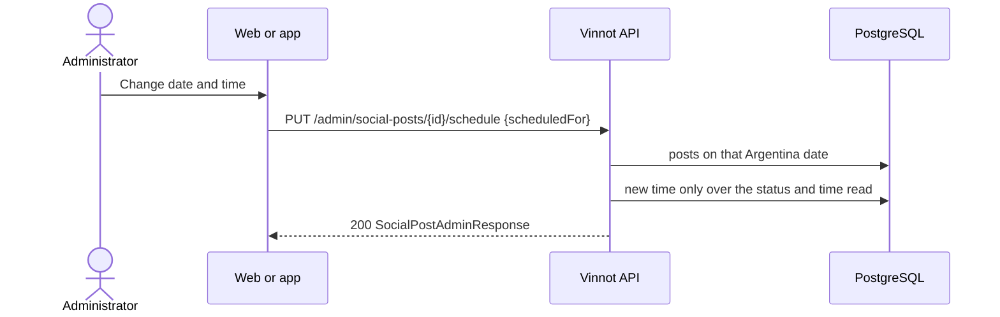

# UC-MKT-11 · Change a post's date and time

| Field | Value |
|---|---|
| ID | `UC-MKT-11` |
| Module | [Social media marketing](../README.md) |
| Platforms | Web, App |
| Actors | Administrator, System |
| Lucidchart IDs | None |
| Requirements | [`RF-WEB-MKT-34`](../requirements.md), [`RF-APK-MKT-04`](../requirements.md) |
| Test cases | [`CP-MKT-70`](../testing.md), [`CP-MKT-71`](../testing.md), [`CP-MKT-72`](../testing.md), [`CP-MKT-73`](../testing.md), [`CP-MKT-74`](../testing.md) |

## Preconditions

- The person is an administrator.
- The post has not started publishing: it is `DRAFT`, `PENDING_APPROVAL`, `APPROVED` or `REJECTED` (`canReschedule` is `true`).

## Postconditions

- The post goes out at the new time; its status, copy and slides stay as they were.
- No other post goes out on that Argentina date.

## Main flow

1. The person opens the post in `/admin/social-posts` and chooses "Change date and time".
2. They pick the date and time in Argentina time. On a wine-day post the client warns that its copy mentions the day.
3. The client sends `PUT /admin/social-posts/{id}/schedule` with `{"scheduledFor": "<ISO-8601 instant>"}`.
4. The API checks the status and that the time is in the future (kept to the second), and that no other post goes out on that date in the planner zone.
5. It writes the new time only over the status and time it read, and answers 200 with the post (`SocialPostAdminResponse`, with `networkSchedule` at the new time).
6. The publishing sweep publishes the post at its new time ([`UC-MKT-06`](uc-mkt-06-publish-post.md)) once it is approved.

## Alternative flows

- 3a. The body has no valid instant: 400.
- 4a. The post is `SCHEDULED`, `PUBLISHED` or `FAILED`: 409 `INVALID_POST_TRANSITION`; nothing changes.
- 4b. The time is now or in the past: 400 `SOCIAL_POST_SCHEDULE_NOT_FUTURE`.
- 4c. Another post goes out on that Argentina date: 409 `SOCIAL_POST_DATE_TAKEN`. Changing only the time within the post's own date is allowed.
- 5a. The publishing sweep started the post, or someone else moved it, after it was read: 409 `INVALID_POST_TRANSITION` and nothing is written; the sweep, in turn, never starts a post that was moved after it read it.

## Business rules

- The post keeps its status: an approved post stays approved and a rejected one stays rejected.
- The planner counts the moved post on its new date: planning again never adds a second post on that date, and a rotating post moved off the slot days still uses up one slot of its week.
- A copy job that read the old time discards its copy; the draft is written again by the 30-minute job.
- Auto-approval and the publishing window follow the new time.

## Diagram

[View the full “UC-MKT-11 · Change a post's date and time” diagram](https://images.vinnot.com/docs/diagrams/v1/en/modules-marketing-use-cases-uc-mkt-11-reschedule-post-bd810a77de7c.svg)

## Code

| Layer | Location |
|---|---|
| Backend | [`SocialPost.java`](../../../../../backend/src/main/java/com/vinnot/marketing/domain/model/SocialPost.java), [`SocialPostScheduleService.java`](../../../../../backend/src/main/java/com/vinnot/marketing/application/service/SocialPostScheduleService.java), [`JdbcSocialPostRepository.java`](../../../../../backend/src/main/java/com/vinnot/marketing/infrastructure/persistence/JdbcSocialPostRepository.java), [`SocialPostAdminController.java`](../../../../../backend/src/main/java/com/vinnot/marketing/infrastructure/web/controller/SocialPostAdminController.java), [`RescheduleSocialPostRequest.java`](../../../../../backend/src/main/java/com/vinnot/marketing/infrastructure/web/dto/RescheduleSocialPostRequest.java) |
| Web | `AdminSocialPostsPage` ("Change date and time") |
| App | `AdminSocialPostsScreen` ("Change date and time") |

## Automated tests

- Backend: [`SocialPostScheduleTest.java`](../../../../../backend/src/test/java/com/vinnot/marketing/domain/model/SocialPostScheduleTest.java), [`SocialPostScheduleServiceTest.java`](../../../../../backend/src/test/java/com/vinnot/marketing/application/service/SocialPostScheduleServiceTest.java), [`SocialPostAdminControllerTest.java`](../../../../../backend/src/test/java/com/vinnot/marketing/infrastructure/web/controller/SocialPostAdminControllerTest.java), [`JdbcSocialPostPublishingPostgresIntegrationTest.java`](../../../../../backend/src/test/java/com/vinnot/marketing/infrastructure/persistence/JdbcSocialPostPublishingPostgresIntegrationTest.java), [`GlobalExceptionHandlerTransitionConflictTest.java`](../../../../../backend/src/test/java/com/vinnot/shared/infrastructure/web/GlobalExceptionHandlerTransitionConflictTest.java), [`WeeklyPlannerTest.java`](../../../../../backend/src/test/java/com/vinnot/marketing/domain/service/WeeklyPlannerTest.java)
- Web: tests of the reschedule action on `AdminSocialPostsPage`
- App: tests of the reschedule action on `AdminSocialPostsScreen`
