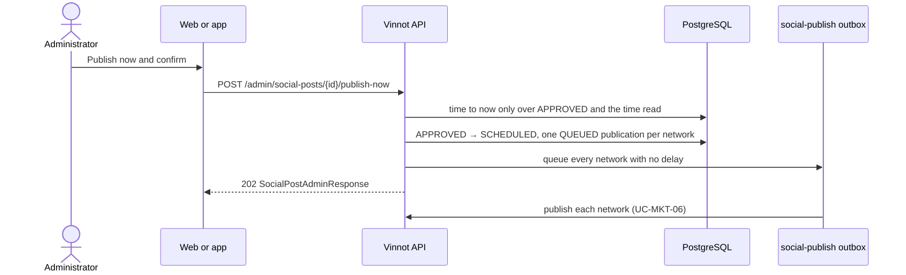

# UC-MKT-12 · Publish a post now

| Field | Value |
|---|---|
| ID | `UC-MKT-12` |
| Module | [Social media marketing](../README.md) |
| Platforms | Web, App |
| Actors | Administrator, System, Instagram, Facebook, Threads, TikTok |
| Lucidchart IDs | None |
| Requirements | [`RF-WEB-MKT-35`](../requirements.md), [`RF-APK-MKT-04`](../requirements.md) |
| Test cases | [`CP-MKT-75`](../testing.md), [`CP-MKT-76`](../testing.md), [`CP-MKT-77`](../testing.md), [`CP-MKT-78`](../testing.md), [`CP-MKT-79`](../testing.md) |

## Preconditions

- The person is an administrator.
- The post is `APPROVED` and its Spanish slides are ready in both formats.
- Publishing is on and at least one network is enabled (`canPublishNow` is `true`).

## Postconditions

- The post's time is now and it is `SCHEDULED`, with one `QUEUED` publication per enabled network queued to go out at once.
- The networks publish it as in [`UC-MKT-06`](uc-mkt-06-publish-post.md); the post is settled when every network is done.

## Main flow

1. The person opens an approved post in `/admin/social-posts` and chooses "Publish now".
2. They confirm.
3. The client sends `POST /admin/social-posts/{id}/publish-now`.
4. In one transaction the API moves the post's time to now (only over the `APPROVED` status and time it read) and starts its publishing as the sweep does, but with every network queued at once, ignoring its not-before time.
5. The API answers 202 with the post `SCHEDULED` and its publications `QUEUED`.
6. The worker publishes each network ([`UC-MKT-06`](uc-mkt-06-publish-post.md)).

## Alternative flows

- 4a. Publishing is off or no network is enabled: 409 `SOCIAL_PUBLISHING_OFF`; nothing changes.
- 4b. The post is not `APPROVED`: 409 `INVALID_POST_TRANSITION`.
- 4c. The Spanish slides are not ready: 409 `SOCIAL_POST_MEDIA_NOT_READY`; wait for the slides or request a new illustration.
- 4d. The sweep started the post, or someone moved or changed it, after it was read: 409 `INVALID_POST_TRANSITION` and nothing is written or queued; the post publishes once.

## Business rules

- Publishing now does not check the date: the post may go out on a date that already has another post.
- The networks' not-before times (TikTok 19:30 by default) do not apply.
- Like any start, the post is frozen from then on: no edit, regeneration, rejection or new illustration.

## Diagram

[View the full “UC-MKT-12 · Publish a post now” diagram](https://images.vinnot.com/docs/diagrams/v1/en/modules-marketing-use-cases-uc-mkt-12-publish-post-now-122d4d96f27f.svg)

## Code

| Layer | Location |
|---|---|
| Backend | [`SocialPost.java`](../../../../../backend/src/main/java/com/vinnot/marketing/domain/model/SocialPost.java), [`SocialPostScheduleService.java`](../../../../../backend/src/main/java/com/vinnot/marketing/application/service/SocialPostScheduleService.java), [`SocialPublishingStarter.java`](../../../../../backend/src/main/java/com/vinnot/marketing/application/service/SocialPublishingStarter.java), [`JdbcSocialPostRepository.java`](../../../../../backend/src/main/java/com/vinnot/marketing/infrastructure/persistence/JdbcSocialPostRepository.java), [`SocialPostAdminController.java`](../../../../../backend/src/main/java/com/vinnot/marketing/infrastructure/web/controller/SocialPostAdminController.java) |
| Web | `AdminSocialPostsPage` ("Publish now") |
| App | `AdminSocialPostsScreen` ("Publish now") |

## Automated tests

- Backend: [`SocialPostScheduleTest.java`](../../../../../backend/src/test/java/com/vinnot/marketing/domain/model/SocialPostScheduleTest.java), [`SocialPostScheduleServiceTest.java`](../../../../../backend/src/test/java/com/vinnot/marketing/application/service/SocialPostScheduleServiceTest.java), [`SocialPublishingStarterTest.java`](../../../../../backend/src/test/java/com/vinnot/marketing/application/service/SocialPublishingStarterTest.java), [`SocialPostAdminControllerTest.java`](../../../../../backend/src/test/java/com/vinnot/marketing/infrastructure/web/controller/SocialPostAdminControllerTest.java), [`JdbcSocialPostPublishingPostgresIntegrationTest.java`](../../../../../backend/src/test/java/com/vinnot/marketing/infrastructure/persistence/JdbcSocialPostPublishingPostgresIntegrationTest.java), [`GlobalExceptionHandlerTransitionConflictTest.java`](../../../../../backend/src/test/java/com/vinnot/shared/infrastructure/web/GlobalExceptionHandlerTransitionConflictTest.java)
- Web: tests of the publish-now action on `AdminSocialPostsPage`
- App: tests of the publish-now action on `AdminSocialPostsScreen`
