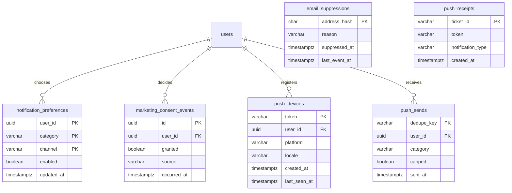

# Notifications

Email and push notices. Other modules request a notice (a verification, a registration,
an event change, a community reply) and this module decides whether it is sent, in which
language and when, based on the person's preferences, their marketing consent, quiet
hours and push caps. Personalised push suggestions are planned by the `engagement` package from activity signals and go out through this module. It also registers phones for push and handles email
unsubscriptions.

- Module code: `NOT`.
- Backend: package [`notification`](../../../../backend/src/main/java/com/vinnot/notification/).
- [Use cases](use-cases/README.md) · [Requirements](requirements.md) ·
  [Architecture](architecture.md) · [Testing](testing.md)

## Actors

| Actor | What they do in this module |
|---|---|
| Signed-in user | Chooses which notices to receive, grants or withdraws consent, allows and receives push |
| Email recipient | Reads it and can unsubscribe from promotional ones |
| System (scheduled jobs) | Delivers emails and push, retries, postpones, reads bounces and checks receipts |
| Email provider and Expo push service | Send the messages and report bounces, complaints and receipts |

## Categories

| Category | Type | Can it be turned off? | Notes |
|---|---|---|---|
| Account, security, payments, tickets | Mandatory, visible | No | — |
| Wine submissions, support, moderation | Mandatory, hidden | No | — |
| Events near you | Optional | Yes; starts on | Push only, 1 a day |
| Community | Optional | Yes; starts on | Comments, like summaries, new seal (`TIER_REACHED`) and new follower (`NEW_FOLLOWER`) |
| Recommendations | Promotional | Yes; starts on | Push only, 1 every 7 days |
| News | Promotional | Yes; starts on | — |

Every category starts on. Promotional ones stop if the person withdraws marketing consent or turns them off.

## Business rules

| Rule | Detail | Where |
|---|---|---|
| Preferences | Mandatory categories cannot be turned off; optional and promotional ones start on; promotional ones stop when consent is withdrawn | [`NotificationPreferences.java`](../../../../backend/src/main/java/com/vinnot/notification/domain/model/NotificationPreferences.java) |
| Consent | Counts as granted until the person withdraws it; each decision is saved with date and source and never changed | [`NotificationPreferencesService.java`](../../../../backend/src/main/java/com/vinnot/notification/application/service/NotificationPreferencesService.java) |
| Sent once | Each notice has a key; repeating it does not create another send | [`EnqueueNotificationService.java`](../../../../backend/src/main/java/com/vinnot/notification/application/service/EnqueueNotificationService.java) |
| Language | The account's; without one, Spanish; announcements keep the requested language | [`DeliverNotificationService.java`](../../../../backend/src/main/java/com/vinnot/notification/application/service/DeliverNotificationService.java) |
| Blocked addresses | A permanent bounce or a complaint blocks the address, mandatory emails included | [`EmailFeedbackService.java`](../../../../backend/src/main/java/com/vinnot/notification/application/service/EmailFeedbackService.java) |
| Email unsubscribe | Only on promotional emails; the link is encrypted, does not expire and leaves consent unchanged | [`UnsubscribeService.java`](../../../../backend/src/main/java/com/vinnot/notification/application/service/UnsubscribeService.java) |
| Quiet hours | Pushes that can wait are postponed between 22:00 and 08:00 in the account's time zone | [`QuietHours.java`](../../../../backend/src/main/java/com/vinnot/notification/domain/model/QuietHours.java) |
| Push caps | 3 a day for non-mandatory categories, plus each category's own cap; personalised suggestions use their own budget | [`DeliverPushService.java`](../../../../backend/src/main/java/com/vinnot/notification/application/service/DeliverPushService.java) |
| Personalised suggestions | The [`engagement`](../../../../backend/src/main/java/com/vinnot/engagement/) planner picks at most one a day from the [Activity](../activity/README.md) signals; its own budget of 2 every 7 days, 1 a day and 48 hours between two, never before 09:00; they do not use the cap of 3 a day ([`UC-NOT-07`](use-cases/uc-not-07-receive-suggestions.md)) | [`EngagementPolicy.java`](../../../../backend/src/main/java/com/vinnot/engagement/domain/model/EngagementPolicy.java), [`SendTime.java`](../../../../backend/src/main/java/com/vinnot/engagement/domain/model/SendTime.java) |
| Phones | One token per account; up to 10 phones per send; deleted when the account is deactivated | [`PushDeviceService.java`](../../../../backend/src/main/java/com/vinnot/notification/application/service/PushDeviceService.java) |
| Retries | Up to 10 with growing waits; exhausted ones are deleted after 30 days | [`DurableEffectWorker.java`](../../../../backend/src/main/java/com/vinnot/shared/infrastructure/effects/DurableEffectWorker.java) |

## Where it lives

| Part | Location |
|---|---|
| API | Controllers in [`notification/infrastructure/web`](../../../../backend/src/main/java/com/vinnot/notification/infrastructure/web/), under `/users/me/notification-preferences`, `/users/me/push-devices` and `/notifications/unsubscribe` |
| Web | Profile tab [`UserProfileNotificationsTab`](../../../../frontend-react/src/presentation/pages/user/UserProfileNotificationsTab.tsx) and [`UnsubscribePage`](../../../../frontend-react/src/presentation/pages/public/UnsubscribePage.tsx) |
| App | [`NotificationPreferencesSheet`](../../../../frontend-mobile/src/presentation/features/user/NotificationPreferencesSheet.tsx) and push in [`pushNotifications.service.ts`](../../../../frontend-mobile/src/application/services/pushNotifications.service.ts) |

## Data

[View the full “Notifications · Data” diagram](https://images.vinnot.com/docs/diagrams/v1/en/modules-notifications-readme-159fbcb6f664.svg)

`notification_preferences` only stores the choices for optional and promotional
categories; mandatory ones are not stored because they are always sent.
`marketing_consent_events` only accepts inserts. `email_suppressions` stores the
address as a hash. Pending emails and pushes live in the shared `external_effects`
outbox. The announcement and push switch tables (`announcements`,
`announcement_delivery_stats`, `push_type_switches`, `push_type_switch_changes`,
`push_delivery_outcomes`) are used from [Administration](../admin/README.md);
`announcement_delivery_stats` (V79) counts each announcement's emails and pushes
sent, failed and opened, and `push_receipts.announcement_id` (V79) links each ticket
to its announcement so failed receipts that arrive later are counted (the diagram
does not show that column). Also, `organizer_push_digests` groups
registration notices for the organizer.
