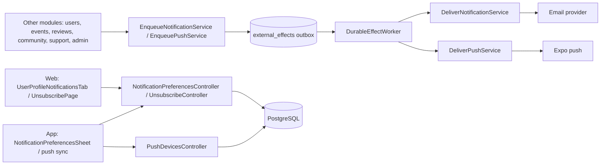
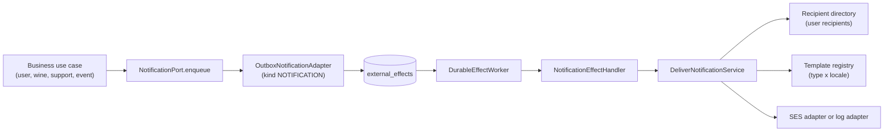

# Architecture

How the module is built in each layer. Other modules request notices through output
ports; the module stores them in the outbox in the same transaction and a job delivers
them by email or push following preferences, consent, quiet hours and caps. The web and
the app follow `screen → hook → service → API client → HTTP transport`; the app adds a
device gateway for push.

[View the full “Architecture” diagram](https://images.vinnot.com/docs/diagrams/v1/en/modules-notifications-architecture-4eeccd983b8b.svg)

## Backend

### Responsibilities and boundaries

The `notification` module owns every email the backend sends. Business modules
describe *what* to send with a typed `NotificationRequest` and call one input
port, `NotificationPort.enqueue`. They never render copy, choose a provider or
talk to SES. The module stores the request in the shared `external_effects`
outbox inside the caller's transaction and delivers it later, so a provider
outage never fails or rolls back business work.

[View the full “Responsibilities and boundaries” diagram](https://images.vinnot.com/docs/diagrams/v1/en/modules-notifications-architecture-4655d250a8b2.svg)

| Layer | Contents |
|---|---|
| Domain (`notification/domain/model`) | `NotificationType`, `NotificationCategory`, `NotificationLocale`, `NotificationRecipient`, `NotificationRequest` |
| Application | Input ports `NotificationPort` and `DeliverNotificationUseCase`; output ports for the outbox, rendering, delivery and recipient lookup; `EnqueueNotificationService` and `DeliverNotificationService` |
| Infrastructure | Outbox adapter, payload codec and sealer, effect handlers, retention, template registry and templates, SES and log adapters, JDBC recipient directory |

Business modules depend only on the application port and the domain request
types. Nothing outside the module imports its infrastructure.

### Request contract

`NotificationRequest{type, recipient, locale, data, dedupeKey, category}`:

- `type` selects the template. The category comes from the type
  (`NotificationRequest.of` derives it; a mismatch is rejected).
- `recipient` is either an address (with an optional display name) or a user id.
  A user recipient is resolved at delivery time from `users`, so the message
  goes to the current address and renders in the user's current
  `preferred_language` (the request locale is the fallback); if the account no
  longer exists the message is dropped. Addresses cannot contain whitespace, so they cannot inject headers.
- `locale` is `ES` or `EN`. There is no fallback: rendering a locale the type
  does not support fails instead of silently switching language.
- `data` holds string values for the template. Values are escaped when they are
  inserted into HTML and are substituted in one pass, so text that looks like a
  placeholder stays literal.
- `dedupeKey` identifies one logical send. Delivery is at least once; the outbox
  key `notification:<dedupeKey>` is unique, so enqueueing the same key twice
  stores one message.

### Current notification types

| Type | Category | Recipient | Locale | Dedupe key | Producer |
|---|---|---|---|---|---|
| `ACCOUNT_EMAIL_VERIFICATION` | `ACCOUNT` | new account address | user's `preferred_language` (es/en) | `ACCOUNT_EMAIL_VERIFICATION:<tokenId>` | `AccountActionTokenService` |
| `ACCOUNT_PASSWORD_RESET` | `SECURITY` | account address | user's `preferred_language` (es/en) | `ACCOUNT_PASSWORD_RESET:<tokenId>` | `AccountActionTokenService` |
| `ACCOUNT_EMAIL_CHANGE_CONFIRMATION` | `SECURITY` | requested new address | user's `preferred_language` (es/en) | `ACCOUNT_EMAIL_CHANGE_CONFIRMATION:<tokenId>` | `AccountActionTokenService` |
| `ACCOUNT_EMAIL_CHANGED` | `SECURITY` | previous address | user's `preferred_language` (es/en) | `ACCOUNT_EMAIL_CHANGED:<consumed tokenId>` | `ConfirmEmailChangeCommandHandler` |
| `ACCOUNT_WELCOME` | `ACCOUNT` | the user (user id) | user's `preferred_language` at delivery | `welcome:<userId>` | `WelcomeEmailService`, called by `VerifyEmailCommandHandler` and `SocialLoginCommandHandler` the first time the email becomes verified |
| `ACCOUNT_PASSWORD_CHANGED` | `SECURITY` | the user (user id) | user's `preferred_language` at delivery | `password-changed:<userId>:<sessionVersion>` | `ChangePasswordCommandHandler`, `ResetPasswordCommandHandler` |
| `ACCOUNT_LOGIN_LOCKED` | `SECURITY` | the user (user id) | the user's `preferred_language` at delivery | `login-locked:<userId>:<untilMillis>` | `LoginLockStarter`, when the temporary sign-in lock starts |
| `ACCOUNT_SOCIAL_LINKED` | `SECURITY` | the user (user id); data `provider` | user's `preferred_language` at delivery | `social-linked:<socialIdentityId>` | `SocialLoginCommandHandler`, when a provider is linked to an existing account |
| `ACCOUNT_DEACTIVATED` | `SECURITY` | account address captured at deactivation | user's `preferred_language` | `account-deactivated:<userId>:<sessionVersion>` | `DeactivateOwnAccountCommandHandler` |
| `ACCOUNT_DELETED` | `SECURITY` | account address captured before deletion | user's `preferred_language` | `account-deleted:<userId>` | `DeleteOwnAccountCommandHandler` |
| `ACCOUNT_ROLE_CHANGED` | `SECURITY` | the user (user id); data `role` (the role granted) | user's `preferred_language` at delivery | `role-changed:<userId>:<sessionVersion>` | `AccountAdministrationNoticeService` from `AssignRoleCommandHandler` (both role endpoints), only when the role set changed |
| `ACCOUNT_SUSPENDED` | `SECURITY` | account address captured at the ban; data `reasonCode`, `note` only with `OTHER` | user's `preferred_language` | `account-suspended:<userId>:<sessionVersion>` | `AccountAdministrationNoticeService` from `BanUserCommandHandler` |
| `ACCOUNT_REINSTATED` | `SECURITY` | the user (user id), only when the account was suspended | user's `preferred_language` at delivery | `account-reinstated:<userId>:<unbannedAtEpochMillis>` | `AccountAdministrationNoticeService` from `UnbanUserCommandHandler` |
| `ACCOUNT_DELETED_BY_ADMIN` | `SECURITY` | account address captured before deletion | user's `preferred_language` | `account-deleted-by-admin:<userId>` | `AccountAdministrationNoticeService` from `DeleteUserAdminCommandHandler` |
| `TERMS_UPDATED` | `ACCOUNT` | each active user who accepted an earlier revision; data `version`, `requiredFrom`, `timeZone` | user's `preferred_language` at delivery | `terms-updated:<acceptanceRevision>:<userId>` | `AnnounceTermsUpdateService` from `TermsAnnouncementScheduler` |
| `WINE_SUBMISSION_STATUS` | `SUBMISSIONS` | submitter (user id) | submitter's `preferred_language` at delivery (ES fallback) | `submission:<id>:<updatedAt>` | `EmailWineSubmissionNotificationAdapter` |
| `SUPPORT_REQUEST` | `SUPPORT` | configured support inbox, Reply-To = requester | EN | `support:<requestId>` | `JdbcSupportRequestAdapter` |
| `SUPPORT_REQUEST_RECEIVED` | `SUPPORT` | the address typed in the form, signed in or not; data `requestId` (shown as the `VIN-…` reference) and `subject`, never the message | the form's `language` (es/en) | `support-received:<requestId>` | `JdbcSupportRequestAdapter` |
| `EVENT_REGISTRATION_ATTENDEE` | `TICKETS` | attendee | registration language | `event-registration:<id>:<version>:ATTENDEE` | `NotifyEventRegistrationService` |
| `EVENT_REGISTRATION_ORGANIZER` | `TICKETS` | event organizer, except for changes the organizer made and for the cancellations of a cancelled event | organizer's `preferred_language` | `event-registration:<id>:<version>:ORGANIZER` | `NotifyEventRegistrationService` |
| `NEWSLETTER` | `NEWSLETTER` (promotional) | user id, email and push; data `subject`, `body` (announcement format), `route` | the version matching the user's `preferred_language`, else the other one | `announcement:<id>:<userId>` (email), `announcement:<id>:<lang>:<firstUserId>` (push) | `DeliverAnnouncementsService` (administrators' news, #310) |
| `SERVICE_NOTICE` | `ACCOUNT` | user id, email and push; same data as `NEWSLETTER` | same as `NEWSLETTER` | same as `NEWSLETTER` | `DeliverAnnouncementsService` (administrators' service notices, #310) |
| `ANNOUNCEMENT_TEST` | `ACCOUNT` | the sending administrator only, email and push; data `kind` plus the tested kind's data | each written version | `announcement-test:<testId>:<lang>` | `AnnouncementService.sendTest` (#310) |
| `EVENT_CANCELLED_ORGANIZER_SUMMARY` | `TICKETS` | event organizer (user id), only when someone else cancelled the event and at least one registration was cancelled | organizer's `preferred_language` | `event-cancelled-summary:<eventId>` | `EventCancellationService` |
| `EVENT_CANCELLED_ATTENDEE` | `TICKETS` | each registration active when the event was cancelled | registration language | `event-cancelled:<eventId>:<registrationId>` | `EventCancellationService` |
| `EVENT_CHANGED_ATTENDEE` | `TICKETS` | each confirmed registration when a published or sold-out event changes its start, end or venue | registration language | `event-changed:<eventId>:<scheduleVersion>:<registrationId>` | `EventScheduleChangeService` from `UpdateEventCommandHandler` |
| `EVENT_REMINDER` | `TICKETS` | each confirmed registration of a published or sold-out event starting in 1–24 hours, once (`event_registrations.reminded_at`); a second, push-only reminder follows 15 minutes to 2 hours before (`reminded_soon_at`) | registration language | `reminder:<registrationId>:24h:<startEpoch>` | `SendEventRemindersService` from `EventReminderScheduler` |
| `PAYMENT_RECEIPT` | `TICKETS` | buyer (user id) | buyer's `preferred_language` at delivery | `payment-receipt:<paymentId>` | `PaymentNoticeService` from `ApplyProviderPaymentService` |
| `PAYMENT_REFUND_REQUESTED` | `TICKETS` | buyer and organizer (user ids, `audience`) | recipient's `preferred_language` | `payment-refund-requested:<paymentId>:<BUYER\|ORGANIZER>` | `PaymentNoticeService` from `ApplyProviderPaymentService` and `RequestPaymentRefundService` |
| `PAYMENT_REFUNDED` | `TICKETS` | buyer and organizer (user ids, `audience`) | recipient's `preferred_language` | `payment-refunded:<paymentId>:<refundedAmount>:<BUYER\|ORGANIZER>` | `PaymentNoticeService` from `ApplyProviderPaymentService` |
| `PAYMENT_CHARGEBACK` | `TICKETS` | organizer (user id) | organizer's `preferred_language` | `payment-chargeback:<paymentId>` | `PaymentNoticeService` from `ApplyProviderPaymentService` |
| `PAYMENT_REFUND_REJECTED` | `TICKETS` | organizer (user id), email only; data `title`, `amount`, `currency`, `reference`, `registrationId` and `reason` (short code) | organizer's `preferred_language` | `payment-refund-rejected:<paymentId>:<n>` (once per rejection) | `PaymentNoticeService` from `RefundRejectionRecorder` (reconciliation) |
| `PAYMENT_ACCOUNT_CONNECTED` | `PAYMENTS` | organizer (user id) | organizer's `preferred_language` | `payment-account-connected:<userId>:<stateHash>` | `PaymentAccountNoticeService` from `ConnectPaymentAccountService.complete` |
| `PAYMENT_ACCOUNT_RECONNECT_REQUIRED` | `PAYMENTS` | organizer (user id), email and push; data `reason` (`REVOKED` or `EXPIRED`) | organizer's `preferred_language` | `payment-reconnect:<userId>:<expiresAtEpochSeconds>` | `PaymentAccountNoticeService` from `RenewalFailureRecorder` (renewal worker) |
| `SOCIAL_BATCH_READY` | `MODERATION` | every active administrator (user id), email and push; data `count`, `from`, `to` | administrator's `preferred_language` at delivery | `social-batch:<from>:<adminId>` | `SocialBatchNoticeService`, when a planning run leaves pending social posts |
| `SOCIAL_POST_FAILED` | `MODERATION` | every active administrator (user id), email and push; data `postId`, `error` and `network` (absent when the slides were never ready) | administrator's `preferred_language` at delivery | `social-failed:<postId>:<network\|ALL>:<run finish in ms>:<adminId>` | `SocialPublishingNoticeService`, when a social post fails for good (once per run) |
| `SOCIAL_TIKTOK_DRAFT_WAITING` | `MODERATION` | every active administrator (user id), email and push; data `postId` | administrator's `preferred_language` at delivery | `social-tiktok-draft:<postId>:<adminId>` | `SocialPublishingNoticeService`, when TikTok receives the carousel as a draft |
| `SOCIAL_ACCOUNT_RECONNECT` | `MODERATION` | every active administrator (user id), email and push; data `network` | administrator's `preferred_language` at delivery | `social-reconnect:<network>:<UTC day>:<adminId>` | `SocialPublishingNoticeService` from `SocialAccountRefreshService`, when a Threads or TikTok account becomes `REFRESH_FAILED` |

Account emails are enqueued in the account transaction: registration, resend
verification, forgot password, email-change request and email-change
confirmation commit even when SES is unavailable, and the worker retries the
email. A failed email-changed notice no longer rolls the confirmed change back.

The welcome email is queued only when an account's email goes from unverified
to verified: after the verification link (local signup), when a social login
creates the account, or when a provider proves the email of a local account that
never verified it. That transition happens once per user, so repeated logins and
re-verification never send another, and `welcome:<userId>` absorbs retries while
it is queued. It is transactional (`ACCOUNT`), has no offers and links to wines,
cellar, events and wine routes.

Security notices (`SECURITY`, transactional) cannot be turned off in
preferences. Account closure writes to the address captured in the same
transaction, before deletion removes it, so a failed deletion sends nothing.
The user's own deactivation or deletion sends the self-service notices.
Administrator actions (#309) send their own copy, which never says "if this
wasn't you": a role change, a suspension with its preset reason (`SPAM`,
`HARASSMENT`, `FRAUD`, `IMPERSONATION`, `TERMS_VIOLATION`, `OTHER`; the
administrator's detail reaches the person only with `OTHER`), the end of a
suspension, and a deletion. A suspension and a deletion write to the address
captured in the command's transaction.

The terms notice (#309) goes out when the selected terms publication carries a
new acceptance revision. `TermsAnnouncementScheduler` (every 5 minutes,
`app.legal.announcements.delay-ms`; off with `app.legal.announcements.enabled=false`)
walks the active, unsuspended accounts that accepted an earlier revision in batches of 500,
with a V56 cursor per revision, and emails the date from which acceptance is
required (`app.legal.notice-period`, 30 days by default). Accounts that never
accepted any revision are not told: they must accept straight away.

The support acknowledgement (#309) is queued with the support email, in the
same transaction, to the address the requester typed, with a generic greeting
and at most once per address and UTC day (see
[public support](../support/architecture.md)). The client sends the
interface language as `language`; it is not part of the request fingerprint,
so a retry in another language is still the same request.

Resend verification and forgot password do not enqueue the email in the
request: for every address they store one `ACCOUNT_RECOVERY_REQUESTED` effect
(random key, payload = action and normalized address), so the request does the
same work whether or not the account exists. `AccountRecoveryEffectHandler`
then resolves the account, issues the token and enqueues the email inside the
worker's job transaction, so a failed attempt leaves no partial token. Unknown or ineligible addresses are a no-op, and these rows are
discarded after one day (`AccountRecoveryRetention`).

The event path keeps its database trigger: V35 enqueues
`EVENT_REGISTRATION_CHANGED`, `EventRegistrationEffectHandler` reads the current
registration state and calls `NotificationPort` inside the worker transaction,
and the same worker drain delivers the resulting notification. Superseded
transitions are still skipped. V40 replaces the trigger function with the same
kind, keys and payload: it records the acting user in
`event_registrations.last_actor_id` and skips the organizer copy when the
organizer made the change or when a bulk event cancel cancels the
registration. Event emails show dates in `events.timezone` (IANA id, taken from
the organizer's time zone when the event is created); messages queued before
V40 render in UTC.

### Delivery

`app.auth.email.provider` selects exactly one delivery adapter:

- `log` (default): `LoggingNotificationDeliveryAdapter` records the type only.
  Recipients, links and content are never logged and nothing is sent.
- `ses`: `SesNotificationDeliveryAdapter` sends HTML and plain text through the
  shared `SesV2Client` bean of `AwsServiceClientConfiguration`, with its call and
  attempt timeouts and no SDK retries. The sender is `Vinnot <app.auth.email.from>`
  (a configured value that already has a display name is kept). Reply-To is set
  when the template asks for it. Every failure increments
  `vinnot.email.failures`, logs only the type and exception class, and is
  rethrown so the outbox retries it.

The outbox worker (see [Outbox throughput and guarantees](#outbox-throughput-and-guarantees))
runs each email job in its own transaction and retries with
exponential backoff up to 10 attempts (`DurableEffectWorker.MAX_ATTEMPTS`, the
limit the partial indexes on `external_effects` repeat), keeping exhausted rows
for operator inspection for 30 days (`app.notifications.exhausted-retention`);
after that `NotificationRetention` deletes the exhausted email (`NOTIFICATION`)
and push (`PUSH_NOTIFICATION`) jobs, because an exhausted notification is never
replayed and only holds personal data (push payloads carry display names). A failed job rolls back everything its handler wrote, and the
attempt is recorded in a separate transaction, so a database error inside a
handler never blocks the jobs queued after it. Undelivered `SUPPORT_REQUEST` and
`SUPPORT_REQUEST_RECEIVED` messages are discarded after 7 days (`NotificationRetention`), because they hold
personal data.

#### Bounces and complaints

Every send, transactional mail included, first checks `EmailSuppressionPort`.
A suppressed address is skipped before rendering (so a promotional message never
issues an unsubscribe link) and only the type is logged. `email_suppressions`
keeps a SHA-256 fingerprint of the trimmed, lower-cased address, never the
address itself.

Addresses are suppressed from SES feedback. With
`app.auth.email.ses-configuration-set` set (`EMAIL_SES_CONFIGURATION_SET`), SES
sends through that configuration set, which publishes bounce and complaint
events to SNS and on to an SQS queue
(`infra/aws-low-cost/email-feedback-stack.json`). With
`app.notifications.feedback.queue-url` set (`EMAIL_FEEDBACK_QUEUE_URL`),
`SqsEmailFeedbackPoller` reads that queue every `poll-ms` (60 s) on its own
scheduler, with a 5 s long poll and at most 5 batches of 10. Permanent bounces
suppress as `HARD_BOUNCE` and complaints as `COMPLAINT`; transient and
undetermined bounces and other events are acknowledged without effect. A message
is deleted only after it is recorded; an unreadable one is left to reach the
dead-letter queue after 5 receives. Both settings are empty by default, and then
the app sends exactly as before. The configuration set also suppresses the same
reasons on the SES side, and the account-level SES suppression list covers
both environments.

### Preferences, consent and unsubscribe

Every `NotificationCategory` has a kind:

- `TRANSACTIONAL` (`ACCOUNT`, `SECURITY`, `PAYMENTS`, `TICKETS`, and the
  unlisted `SUBMISSIONS`, `SUPPORT` and `MODERATION`): always delivered and never
  editable.
- `OPTIONAL` (`EVENTS_NEARBY`, `COMMUNITY`, `REMINDERS`): delivered unless the
  user turns the channel off. `REMINDERS` groups nudges about the user's own
  activity (wines to rate, cellar, first steps, coming back to the app) and has no
  push limit of its own.
- `PROMOTIONAL` (`RECOMMENDATIONS`, `NEWSLETTER`): delivered unless the user
  withdraws marketing consent or turns the channel off. An account that never
  decided counts as consenting with every channel on.

Choices are stored per user, category and channel (`EMAIL`, `PUSH`) in
`notification_preferences`. Consent is an append-only history in
`marketing_consent_events`, with the decision, server time and source (`WEB` or
`MOBILE`; an unsubscribe link only turns a channel off and never records
consent); the latest row is the current decision and, with no rows, consent
counts as granted. The first explicit answer is recorded even when it matches
that default. Users read
and change both with `GET`/`PUT /users/me/notification-preferences`. Each category in
the response carries `email`, `push`, `editable`, `emailAvailable` and `pushAvailable`:
the last two say whether some type of the category is emailed (`NotificationType.emails()`)
or has a push template (`PushRendererPort.types()`), and clients hide the switch of an
unavailable channel. A `PUT`
applies the consent decision first, then the choices; enabling a promotional
channel while consent is withdrawn fails with `MARKETING_CONSENT_REQUIRED`, and changing a
transactional category fails with `TRANSACTIONAL_NOTIFICATION_CATEGORY`.

Non-transactional requests must be addressed to a user id, because the choice
belongs to an account. `DeliverNotificationService` checks the stored choice
after resolving the recipient, and `DeliverPushService` checks the push choice
per account, so a change made after enqueueing still applies. A promotional
email or push is never sent while marketing consent is withdrawn, even when the
category is on. Activity summaries (likes, the organizer digest) are not marketing: they
follow only their own category's choice.

Promotional emails get two links from `UnsubscribeLinkPort`
(`SealedUnsubscribeLinks`): an AES-GCM token over the user and category, with a
key derived from `jwt.secret` under its own purpose label. The page link
(`{frontend}/unsubscribe?token=`) goes in the footer; the one-click link
(`{app.notifications.public-api-base-url}/notifications/unsubscribe?token=`) goes in
the `List-Unsubscribe` header together with
`List-Unsubscribe-Post: List-Unsubscribe=One-Click`, sent as SES message headers.
`POST /notifications/unsubscribe` is public: it turns off email for that one
category and does not revoke consent. `GET` is not accepted, so mail scanners
opening the link change nothing; the web page asks for a click first.
`APP_PUBLIC_API_BASE_URL` sets the API base (`https://api.vinnot.com/api` in
production, `https://api-dev.vinnot.com/api` in development).

### Push devices

`push_devices` (V46) keeps one row per Expo push token: `token` (primary key),
`user_id` (`ON DELETE CASCADE`), `platform` (`IOS`/`ANDROID`), `locale`
(`es`/`en`, the app language), `created_at`, `last_seen_at` and, since V65,
`channels` (the app created the per-category Android channels). `PushToken`
accepts only `ExponentPushToken[...]` or `ExpoPushToken[...]` and never prints its
value. `PushDeviceService` (`ManagePushDevicesUseCase`):

- `PUT /users/me/push-devices` registers or refreshes a device and sets
  `last_seen_at` to now; the app calls it on every cold start. A token last used
  by another account moves to the signed-in one, so a shared phone only receives
  pushes for whoever is signed in. The optional `channels: true` says the device
  created the category channels; without it (older app versions) the device keeps
  getting the legacy `default` channel.
- `DELETE /users/me/push-devices` unregisters it; unknown or foreign tokens are
  ignored.
- `POST /auth/logout` with `pushToken` forgets this device even when the session
  already expired: for the session's account when the refresh token is known
  (live, expired or revoked), otherwise only that exact token, whoever it belongs
  to. Logout works with an expired access token.
- A password reset ends every session and forgets every device of the account.
- Deactivating an account (own or by an administrator) removes all its devices;
  permanent deletion removes them through the foreign key.
- `PushDeviceRetentionScheduler` (daily, `app.notifications.push.device-purge-cron`,
  03:50) forgets devices not registered for `app.notifications.push.device-retention`
  (`PUSH_DEVICE_RETENTION`, 120 days): uninstalled apps and phones never opened
  again. It is idempotent, so every instance may run it.

### Push delivery

Business modules call `PushNotificationPort.push(PushRequest)`: one type, up to
1000 account ids, template data and a dedupe key (at most 180 characters). The
request is stored as **one** outbox job (`PUSH_NOTIFICATION`, key
`push:<dedupeKey>`) in the caller's transaction, so a broadcast never becomes one
job per device. `PushEffectHandler` runs it **outside** the outbox transaction
(see [Outbox throughput and guarantees](#outbox-throughput-and-guarantees)), and
`DeliverPushService` then:

0. drops the whole request when an administrator switched its type off
   (`push_type_switches`, #310), quiet-hour copies included, and drops it when it
   is past `expiresAt`;
1. skips accounts already in `push_sends` for that key (a retried job) and
   inactive, suspended (locked) or deleted accounts (`JdbcPushAudience`);
2. for non-transactional categories only: applies the account's **push**
   preference (the preferences of every account of the job are read in one batch,
   `NotificationPreferenceRepositoryPort.loadAll`) and holds accounts inside quiet
   hours (22:00–08:00 in `users.timezone`; 22:00–09:00 for engagement pushes, the
   event-triggered `WINE_RECOMMENDATION` included, #405 S11) by storing a delayed
   copy of the request for them (key `<dedupeKey>:quiet:<epochSecond>`);
3. keeps the accounts with at least one device (the ten most recent);
4. for pushes with a limit (every reactive non-transactional push counts towards
   `app.notifications.push.daily-cap`, default 3 in the last 24 h; some categories
   add their own limit; engagement pushes neither stop at nor count toward the daily
   cap, they are recorded with `capped = false` and pass the
   [engagement budget](#engagement-pushes) instead) **reserves** the push: `PushSendLogPort.reserve` checks the
   limits and records the accounts in `push_sends` in one short transaction that
   holds a transaction-scoped advisory lock per account (accounts hashed into 64
   slots, locked in order). Concurrent jobs for the same account wait for each
   other and see each other's sends, so two jobs never both pass a limit;
5. renders the push once per device language through `PushTemplateRegistry`
   (`PushTemplate` beans; only types that push have one) into `PushContent`:
   title ≤ 65 and body ≤ 178 characters, shortened at a word with an ellipsis,
   plus an in-app route;
6. sends in batches of at most 100 messages, keeping an account's devices in one
   batch. A transactional push records its accounts in `push_sends` as soon as
   the provider accepts each batch. Then, best-effort (a failure is logged and
   never fails the job, so a delivered batch is never sent again), it stores the
   accepted tickets in `push_receipts` and forgets tokens rejected as
   `DeviceNotRegistered`. A provider failure fails the job: a reserved push first
   releases the reservations of the accounts not reached, and the retry only
   reaches accounts not recorded yet. A batch the provider rejects as malformed
   (`400`/`413`) is counted as failed and this job does not send it again; the job
   goes on. A reserved account the provider did not take (its batch was rejected,
   or none of its messages was accepted) is released from `push_sends` and
   `engagement_sends`, so a push it never got uses up none of its limits and never
   counts as an unopened engagement push (a retry after a later provider failure
   may try it again). Counting outcomes is best-effort as well, and a batch's
   accounts leave the job's pending list as soon as the provider answers, so a
   metrics failure never fails the job nor sends a batch twice.

Transactional pushes are urgent (`priority: high`) and ignore preferences, quiet
hours and the cap. A request marked `deferrable` (a transactional push that can
wait: reminders a day ahead, organizer summaries, chargebacks) still ignores
preferences and the cap, but waits out quiet hours like an optional push and is
sent at normal priority; the flag survives the outbox and quiet-hours copies, and
jobs queued before it existed are immediate. An optional `expiresAt` drops a push
that is delivered too late, and drops the accounts whose quiet hours would end
after it, so a reminder never arrives once the event is about to start.

The Expo payload carries `to`, `title`, `body`, `sound: default`, `priority`
(`high` only for urgent pushes), `channelId`, `ttl` (seconds until `expiresAt`,
when the push has one, so Expo stops retrying an offline device) and
`data = {url, type, ref}`: the in-app route, the `NotificationType` name and the
job's dedupe key, which the app reports back when the push is opened. No
personal data. `channelId` follows the category when the device registered
`channels: true`, otherwise it is `default`:

| Category (or type) | Android channel |
|---|---|
| `TICKETS`, `PAYMENTS`, `ACCOUNT`, `SECURITY`, `SUBMISSIONS`, `SUPPORT`, `MODERATION` | `tickets` |
| `COMMUNITY` | `community` |
| `RECOMMENDATIONS` | `recommendations` |
| `EVENTS_NEARBY` | `events-nearby` |
| `REMINDERS` | `reminders` |
| `NEWSLETTER`, and the types `SERVICE_NOTICE` and `ANNOUNCEMENT_TEST` | `news` |
| any category the mapping does not know | `default` |

Every outcome is counted per type and UTC day in `push_delivery_outcomes` (V59):
sent (accounts with at least one message the provider accepted), blocked by
preferences, deferred by quiet hours, dropped by the daily or category cap,
expired, failed (device messages the provider rejected, and undelivered receipts),
switched off, and for engagement pushes dropped by the shared budget, by fatigue
or held out (`DROPPED_ENGAGEMENT_BUDGET`, `DROPPED_FATIGUE`, `DROPPED_HOLDOUT`). The counters are written in their own transaction, so a job
retried after a provider failure counts its re-evaluated accounts again: the
numbers are close, not exact. Every provider error code other than
`DeviceNotRegistered`, in a ticket or a receipt, is logged with its count (never
the token), and every code is counted in the Micrometer counter
`vinnot.push.provider.errors{stage=ticket|receipt, code}`.

`PushReceiptScheduler` (every 5 minutes, `app.notifications.push.receipts-enabled`)
runs `CheckPushReceiptsService`, outside any transaction: it first drops tickets
older than a day (Expo keeps receipts for a day; a younger ticket is never dropped
unchecked) and `push_sends` older than a week, then walks every ticket older than
15 minutes, oldest first, in chunks of 1000 (a keyset cursor, so tickets whose
receipt is not ready yet do not stop the walk) until none is left or
`app.notifications.push.receipts-budget` (4 minutes) is spent. Per chunk it forgets
devices whose receipt says `DeviceNotRegistered` and deletes the receipts it read.

The `log` provider sends nothing, returns a synthetic accepted ticket
(`log-<uuid>`) per message and reads every receipt as delivered, so local and
development metrics count sends like production.

Configuration: `PUSH_PROVIDER` (`app.notifications.push.provider`, `log` by
default; `expo` sends through `https://exp.host/--/api/v2/push`),
`EXPO_ACCESS_TOKEN` (optional secret, sent as a bearer token), `PUSH_DAILY_CAP`,
`PUSH_RATE_PER_SECOND` (500), `PUSH_HTTP_RETRIES` (3), `PUSH_RECEIPTS_BUDGET` (4m),
`PUSH_DEVICE_RETENTION` (120d). Development stays on `log`; production sets `expo`
in `compose.production.yml` from the release that ships the `0.1.3` binaries.

### Outbox throughput and guarantees

The shared outbox (`external_effects`, `DurableEffectWorker`) carries every email,
push and cleanup job. The path of a job: the business transaction inserts it, its
commit notifies the listening worker, one short transaction claims a batch,
virtual threads run the jobs, and a push job's provider calls go through the rate
limiter to Expo.

- **Wake-up and poll.** An insert of a job due at once notifies the
  `external_effects` channel when its transaction commits (V65 trigger).
  `DurableEffectWakeUp` keeps one pool connection listening and drains on every
  notification; the scheduled poll (`app.effects.poll-ms`, 30 s) remains the
  fallback for delayed jobs, retries and a lost listener connection (reopened with
  a growing pause up to one minute). `app.effects.listen-enabled` turns the
  wake-up off; a poll of an hour or longer (integration tests that drain by hand)
  turns it off too.
- **Claim.** One short transaction claims up to `app.effects.batch-size` (20) due
  jobs with `FOR UPDATE SKIP LOCKED` and leases them: `next_attempt_at` moves
  `app.effects.lease` (15 min) ahead and the transaction commits, so other
  instances skip them without a lock being held. A job left by a worker that died
  becomes due again when its lease ends. A drain keeps claiming until nothing is
  due (including jobs its own jobs queued) or `app.effects.drain-budget` (60 s) is
  spent.
- **Run.** Jobs run on virtual threads, at most `app.effects.concurrency` (4) at a
  time per instance. A transactional handler (the default: email, cleanup,
  registration changes) runs in its own transaction that also locks the job's
  row, so a failure rolls back what it wrote. The push handler runs outside any
  transaction: each read and write is its own statement, so no connection or row
  lock is held while Expo answers. Pool use is therefore at most one listener
  connection, one per running transactional job and a short one per push
  statement, well inside Hikari's 20.
- **Provider calls.** `ExpoPushSenderAdapter` waits for a token bucket shared by
  every send of the instance (`PUSH_RATE_PER_SECOND`, 500 messages per second,
  one second of burst; Expo allows 600 per second per project, so with several
  instances divide it between them). `429` and `5xx` are retried in place up to
  `PUSH_HTTP_RETRIES` times, waiting what `Retry-After` asks (at most 30 s) or 1 s,
  2 s, 4 s…; then the job fails and backs off. `400` and `413` are never retried.
- **Guarantees.** A push with a limit (every non-transactional one) is reserved
  before it is sent: at most once. A crash between reserving and sending loses
  that push for those accounts; it is never sent twice and never exceeds a cap.
  A transactional push is recorded right after the provider accepts each batch:
  at least once. A crash between the provider accepting a batch and recording it
  re-sends that one batch, as before. Failed jobs back off
  `min(1 h, 30 s × 2^attempts)` for at most 10 attempts.
- **Scale.** One instance sends up to 500 messages per second: about 1.8 million
  an hour. A job reaches up to 1000 accounts, at most 100 messages per HTTP call.
  At 1k users the weekly volume is minutes of sending a week; at 100k users about
  200k sends a week take roughly 7 minutes; at 1M users about 2M sends a week take
  about 67 minutes at 500 per second (about 56 at Expo's ceiling of 600), spread
  over the week by send times.

**Why a Postgres outbox and not Kafka or RabbitMQ.** The job is written in the
same transaction as the business change, so an effect exists exactly when its
decision committed, with no dual write. The ceiling is Expo's 600 messages per
second per project, not the queue: claiming a few jobs per second with
`SKIP LOCKED` is far below what Postgres handles, and each job carries up to 1000
accounts. A broker would add an always-on service, its own durability and
monitoring, and a second store to keep consistent, for no throughput gain at this
scale. Move to a dedicated queue (PGMQ inside Postgres first, or SQS) when any of
these holds: claim latency above one minute sustained, the backend runs on more
than one host, or more than about 500 jobs per second sustained.

### Transactional pushes

Push copy lives in `push/<bundle>_<es|en>.properties` (`PushCopy`, no fallback
language, one-pass placeholders), written in the app's professional register: no
emoji and no exclamation marks, which a test checks together with key parity.
Each pushed type has a `PushTemplate` bean in `notification.infrastructure.push`.

| Moment | Type | Who | Opens | Timing |
| --- | --- | --- | --- | --- |
| Registration status or payment status changed (`NotifyEventRegistrationService`, same key as the email) | `EVENT_REGISTRATION_ATTENDEE` | attendee | `/my-tickets/<registrationId>` | immediate |
| Buyer's bank reversed a payment (`PaymentNoticeService.chargeback`) | `PAYMENT_CHARGEBACK` | organizer | `/partner/events` | deferrable |
| Mercado Pago must be connected again (`PaymentAccountNoticeService.reconnectRequired`, same key as the email) | `PAYMENT_ACCOUNT_RECONNECT_REQUIRED` | organizer | `/partner/events` | deferrable |
| Event cancelled (`EventCancellationService`) | `EVENT_CANCELLED_ATTENDEE` | every active attendee | `/my-tickets` | immediate |
| Date, time or venue changed (`EventScheduleChangeService`; `change` = DATE, VENUE or BOTH) | `EVENT_CHANGED_ATTENDEE` | every confirmed attendee | `/events/<eventId>` | immediate |
| About a day before (`window` = DAY_BEFORE, with the email; only for events more than 2 h away) | `EVENT_REMINDER` | confirmed attendee | `/my-tickets/<registrationId>` | deferrable, expires 2 h before the start |
| About two hours before (`window` = SOON, push only) | `EVENT_REMINDER` | confirmed attendee | `/my-tickets/<registrationId>` | immediate, expires at the start |
| Registration activity on an organizer's event, aggregated | `EVENT_REGISTRATION_ORGANIZER` | organizer | `/partner/events` | deferrable |

The registration push leads with a declined, reported or refunded payment and
otherwise with the registration status; a status without copy gets a neutral
update. A cancelled or changed event pushes one request for all its attendees
(`PushRequest.batches` splits more than 1000 into keys `<key>:<n>`), not one per
registration. Reminder keys, email and push, end with the event start
(`reminder:<registrationId>:24h:<startEpoch>`, `...:2h:<startEpoch>`), because
`push_sends` keeps keys for a week: a rescheduled event is pushed again. The
organizer never gets one push per registration: the registration notice adds new
confirmed places, requests awaiting approval (including a reported transfer) and
cancellations to
`organizer_push_digests` (V49, one row per event). The first activity opens a
15-minute window; `OrganizerDigestScheduler` (every minute,
`app.events.organizer-digests.enabled`, `initial-delay-ms`/`delay-ms` 60000) runs
`SendOrganizerDigestsService`, which removes each due row and queues one push in
the same transaction (key `organizer-digest:<eventId>:<dueEpoch>`); a digest of
an event no longer published or sold out is removed without a push, for example
"Cata: 3 new registrations · 1 awaiting your approval". Organizer emails stay one
per registration. Payment receipts and refunds add no buyer push, because the registration
change they cause already pushes.

### New events near you

`EVENT_NEARBY` is a push-only type (`NotificationType.emails()` is false, so it
needs no email template) in the optional `EVENTS_NEARBY` category. A user opts in
by setting an area (`/users/me/event-area`, table `user_event_areas`): a catalogue
region, or a location rounded to 0.1° (about 11 km) by the app and again by the
server. When an event is published for the first time (`PublishEventCommandHandler`,
or the create/update handlers moving it to `PUBLISHED`, checked with
`isPublishedOnce()` before the change), `AnnounceNewEventNearbyService` runs in the
same transaction:

- nothing for a republication, a status other than `PUBLISHED` (a sold-out event
  is never announced) or an event whose effective registration deadline passed;
- `PostgresNewEventAudience` finds areas whose region name equals the event's
  region or city (ignoring case and surrounding spaces; accents still count), or whose
  location is within 50 km
  (haversine, after a latitude band), excluding the organizer and members with a
  block either way with the organizer (`user_blocks`). The place comes
  from the event in memory, so an event created or edited as published in the
  same request matches before its row is flushed;
- one push request per 1000 accounts (key `event-nearby:<eventId>`) that opens
  `/events/<eventId>` ("New event near you" / "Nuevo evento cerca tuyo", with the
  place and the start in the event's zone) and expires when registration closes.

Delivery applies the `EVENTS_NEARBY` push preference, quiet hours and the global
cap, plus the category's own limit (`NotificationCategory.pushLimit`, a count
and a rolling window): at most one such push per account in any 24 hours, counted from `push_sends` (index
V51). Two jobs delivered at the same moment can both pass that check; the
window is one worker cycle.

### Taste-based recommendations

`TasteAffinityScheduler` (cron `app.recommendations.affinities.cron`, default
03:40; off with `app.recommendations.enabled=false`) runs
`ComputeTasteAffinitiesService`, which replaces `user_taste_affinities` (V52) in
one transaction. Each user's rating of a wine is their review rating, or the
cellar rating of a wine they did not review; rejected reviews do not count. One
row per user and grape (trimmed, lower-case name; the label is the most common
spelling) and per user and wine type, with the average rating and how many rated
wines it comes from. The free-text `style` column is not used.

Creating a wine (`CreateWineCommandHandler`), publishing a submission
(`WineSubmissionCatalogPublisher`) and featuring a wine
(`ToggleWineFeaturedCommandHandler`, and `UpdateWineCommandHandler` behind the
admin edit form, only when it becomes featured) call
`RecommendWineService` in the same transaction. Bulk imports write SQL directly
and never reach it. For an active wine, `PostgresTasteAudience` finds accounts
with a strong affinity (`TasteAffinity`: at least 3 rated wines averaging 4.0 or
more) for one of its grapes or its type, preferring a grape, and excluding the
wine's creator and anyone who has it in their cellar or reviewed it. The wine is
passed from memory, so a wine saved in the same request matches before it is
flushed. One `WINE_RECOMMENDATION` push-only request per reason (key
`wine-recommendation:<wineId>:<reason UUID>`) opens `/wines/<wineId>` ("A wine
for you" / "Un vino para vos", naming the grape or the wine type) and expires
after 3 days. Like every engagement push it never goes out between 22:00 and 09:00
local time: delivery holds it until 09:00.

`RECOMMENDATIONS` is promotional: delivery skips users who turned it off or
withdrew marketing consent, and its category limit is one push per account in
any 7 days. The send log is kept 7 days, as long as the longest category window
(a test pins this). `WINE_RECOMMENDATION` is also an engagement push: its data
carries `contentRef` `WINE:<wineId>`, and delivery admits it under the shared
[engagement budget](#engagement-pushes), so the planner never suggests that wine
again. The nightly recompute runs at a time of an explicit zone
(`app.recommendations.affinities.zone`, UTC) and takes a transaction-scoped
advisory lock: a run that finds another instance recomputing skips, and readers
keep the previous table until the new one commits.

### Engagement pushes

The engagement engine (#405, `com.vinnot.engagement`) plans at most one
personalised push per account and day, from a catalog of ten push-only types,
under one shared budget. Event-triggered `WINE_RECOMMENDATION` counts against
the same budget. Pushes the person asked for (tickets, reminders of their own
events, security) never count and are never blocked by it.

**Pipeline.**

| Step | Component | What happens |
|---|---|---|
| 1. Run | `EngagementPlannerScheduler` | Every hour (`app.engagement.delay-ms`, first run 10 minutes after start; off with `app.engagement.enabled=false`). Safe on every instance. |
| 2. Lease | `JdbcPlannerLease` (`engagement_planner_lease`) | A run takes the cluster-wide lease while it is free or expired (`app.engagement.lease`, 2 h) and releases it at the end; another instance's run is skipped. |
| 3. Zones | `EngagementPlannerService` | Only the time zones whose local hour is in the planning window: from `planning-hour` (04:00) for `catch-up-hours` (6), so a missed run is caught up later that morning. Unknown zone names are skipped. |
| 4. Pages | `JdbcEngagementAudience` | Each zone's active, unsuspended accounts with a push device that were not planned that local day, in keyset pages of `page-size` (1000) over `(timezone, id)`. Pages run on virtual threads, `concurrency` (4) at a time, which also bounds the connections a run uses. A failed page is logged and counted; its accounts are planned by the next run. |
| 5. Claim | `engagement_planning` | A conditional upsert claims the page's accounts for the day, so two runs never plan one account twice. |
| 6. Signals | `EngagementPageService` | In bulk for the page: activity rhythms (usual open hour, last open), the last 20 ledger rows and their opens, push preferences. |
| 7. Candidates | ten `CandidateSourcePort` adapters | One statement per type for the whole page (see the catalog). |
| 8. Choice | `EngagementSelection`, `EngagementPolicy` | Drops candidates of a category the account turned off, of a switched-off type, too soon after the last push of that type or past their category's own limit; of the suggestions only the one whose turn it is competes (see rotation below) and the best score wins; then the budget decides. |
| 9. Holdout | `Holdout` | Accounts in the measurement group get a ledger row (`holdout = true`) and no push. |
| 10. Queue | `PushNotificationPort.schedule` | Accounts that get the same push at the same time share one request (up to 1000); the page's requests go to the outbox in one batch, each delayed to its send time and expiring at 21:59 local. |
| 11. Delivery | `DeliverPushService` | Switches, preferences, quiet hours (until 09:00) and the category limit apply as for every push, the reactive daily cap does not; then, inside the account's reservation lock, `EngagementBudgetPort` admits and records the push in `engagement_sends`, or drops it as `DROPPED_ENGAGEMENT_BUDGET`, `DROPPED_FATIGUE` or `DROPPED_HOLDOUT`. A send that fails, or that the provider does not take, releases its ledger rows. |

The planner's checks are an optimisation; the budget is enforced at delivery,
under the same per-account advisory lock that guards the daily cap, so any number
of planner runs and event-triggered pushes racing for one account admit at most
what the budget allows (an integration test races four).

**Catalog.** Each candidate's score is its type's weight times
`0.5 + 0.5 × strength`, where strength is 55 % taste fit, 20 % freshness (fading
over 60 days), 15 % proximity and 10 % view recency (fading over 14 days). An
account away for 14 days or more only gets `WINBACK`.

**Rotation.** The evergreen suggestions `TASTE_PICK`, `ROUTE_PICK` and
`WINERY_PICK` share the `RECOMMENDATIONS` limit of one a week, so only the one whose
turn it is competes (`EngagementSelection.suggestionInTurn`): the wine of the week
once 14 days passed since the last wine suggestion (`EngagementRules.WINE_OF_THE_WEEK_EVERY`;
an event-triggered `WINE_RECOMMENDATION` counts); otherwise the route or winery sent
least recently; and the wine of the week again when neither is eligible, so the week
is not left empty. With all three eligible an account gets wine, route, wine, winery,
and again: the wine every two weeks, routes and wineries every four. The cadences
still apply (`TASTE_PICK` at most weekly, `ROUTE_PICK` and `WINERY_PICK` at most
every 14 days). The suggestion in turn then competes with the other candidates by
its score.

| Type | Category | Candidate | Weight | Same type again after | Opens | Copy (es / en) |
|---|---|---|---|---|---|---|
| `TASTE_PICK` | `RECOMMENDATIONS` | The most rated active wine of a grape or type the account rates highly that it has not rated, kept or been suggested | 0.75 | 7 days | `/wines/<id>` | "Tu vino de la semana": "{wine}, porque te gusta el {reason}." / "Your wine of the week": "{wine}, because you like {reason}." |
| `ROUTE_PICK` | `RECOMMENDATIONS` | A published route of a region whose routes it viewed lately, with a recommended type it rates highly, or of a region of wines it rated highly | 0.65 | 14 days | `/routes/<id>` | "Una ruta para vos": "{route}, en {region}. Elegida según tus gustos." / "A route for you": "{route}, in {region}. Picked for your taste." |
| `WINERY_PICK` | `RECOMMENDATIONS` | An active winery of the region it rates highly most often, best rated first, never suggested and none of whose wines it rated | 0.6 | 14 days | `/wineries/<id>` | "Bodega de la semana": "{winery}, en {region}. Conocé sus vinos." / "Winery of the week": "{winery}, in {region}. Discover its wines." |
| `VIEWED_NOT_RATED` | `REMINDERS` | A wine opened at least twice in 30 days, last 5 to 10 days ago, not rated, kept or asked about | 0.8 | — | `/wines/<id>` | "¿Lo probaste?": "¿Ya probaste {wine}? Contanos qué te pareció." / "Have you tried it?": "Have you tried {wine}? Tell us what you thought." |
| `CELLAR_CHECKIN` | `REMINDERS` | The oldest cellar wine kept over 30 days without a rating or review, never asked about | 0.6 | 30 days | `/wines/<id>` | "¿Cómo estuvo?": "¿Ya abriste {wine}? Dejá tu puntaje." / "How was it?": "Have you opened {wine}? Add your rating." |
| `WEEKEND_EVENTS` | `EVENTS_NEARBY` | On local Thursdays, published events Friday to Sunday in the account's event area (its region, or 50 km around its location), not its own, not registered, no blocked organizer; one push names the most attended | 0.85 | 6 days | `/events/<id>` (one) or `/events` | "Este finde cerca tuyo": "{count} eventos este finde en tu zona. Elegí el tuyo." / "This weekend near you": "{count} events this weekend in your area. Pick yours." |
| `ONBOARDING` | `REMINDERS` | First two weeks, each step once: day 1 scan a label, day 3 rate three wines (while it rated fewer), day 7 the most rated wine it has not rated or kept; a step whose days passed is skipped | 1.0 | — | `/wines` or `/wines/<id>` | "Primeros pasos": "Escaneá una etiqueta y conocé el vino en segundos." / "First steps": "Scan a label and get to know the wine in seconds." |
| `WINBACK` | `REMINDERS` | After 14 days without the app, the wine most viewed lately that it has not rated or kept; after 30, how many wines were added; then silence until it returns | 0.9 | — | `/wines/<id>` or `/wines` | "Te extrañamos": "{wine} es de lo más buscado estas semanas." / "We miss you": "{wine} is among the most viewed wines these weeks." |
| `MILESTONE` | `COMMUNITY` | Likes on its reviews (10 to 1000) or reviewed wines (5 to 500) crossed a milestone in the last week, never celebrated; the highest wins | 0.9 | — | `/wines/<id>` or `/wines` | "Tu reseña sumó": "Tus reseñas ya suman {count} me gusta." / "Your reviews are adding up": "Your reviews now have {count} likes." |
| `POST_EVENT` | `REMINDERS` | The day after an event it attended (confirmed, not cancelled, ended yesterday local), once | 0.95 | — | `/events/<id>` | "¿Cómo estuvo el evento?": "¿Qué tal {event}? Puntuá los vinos que probaste." / "How was the event?": "How was {event}? Rate the wines you tasted." |

The other variants (step 2 and 3 of onboarding, the second come-back push, the
rated-wines milestone, a single weekend event, a route or winery without region,
and fallbacks when no wine is found) live in
`backend/src/main/resources/push/engagement_es.properties` and `engagement_en.properties`,
rendered by `EngagementPushTemplates`. A lock screen shows the title and about two lines
(80 characters) of the body, so the fixed words of a body stay within 60 characters and, with
typical names, a filled body within 80; raw titles stay within 40, and any filled push still fits
the hard limits of 65 and 178 (tests pin all three). Onboarding links to `/wines` rather than
the scanner, because the app does not open the scanner from a push.

**Budget, fatigue and holdout.** `EngagementPolicy` allows 2 engagement pushes in
any rolling 7 days, 1 per local calendar day and 48 hours between two
(`weekly-limit`, `daily-limit`, `minimum-gap`). When an account got none in the
last 7 days, its best candidate is owed whatever its score; a second one in the
same week needs a score of at least `second-push-min-score` (0.6). After
`fatigue-streak` (3) delivered pushes in a row without an open, the account gets at
most `fatigued-weekly-limit` (1) a week; after `pause-after` (28 days) of pushes
without any open it gets none until it opens the app again, except `WINBACK`: the
come-back pushes exist for accounts that stopped opening the app, so the pause
does not stop them (the budget, the holdout and opt-outs still do), and after their
second attempt they fall silent until the account returns. `holdout-percent` (5)
of accounts, chosen by a SHA-256 hash of their id, never get an engagement push:
their ledger rows count for the budget, not for fatigue, and measure the lift.

**Send time.** `SendTime` sends at the account's usual app-open hour in its own
time zone (from `app_opens`), clamped to 09:00–21:59 (a usual hour of 22:00 or
later moves to 21:00); without one, 19:30 on weekdays and 12:30 on weekends. A
run that is late for that hour sends at once while still inside the window, and
not at all after 21:59.

**Measurement and automatic pause.** `GET /admin/notifications/push/engagement?days=1|7|30`
returns per type: sent, opened (a `push_opens` row for the push's key), opted out
(the account turned that category's push off within 48 hours of the send) and held
out, with their rates and whether the type is on. Every hour
(`auto-pause.delay-ms`) `EngagementMetricsService` switches off a type whose
opt-out rate in the last 7 days exceeds `auto-pause.opt-out-rate` (2 %) over at
least `auto-pause.min-sends` (200) sends; the change is audited as
"automatic pause (opt-out rate)" and an administrator turns it back on in push
controls. From then on the automatic pause only judges the pushes sent after that
moment (the latest off-to-on change in `push_type_switch_changes`), so the sends
that caused the pause never pause the type again. `EngagementLedgerRetentionService` deletes ledger rows older than
`ledger-retention` (365 days, never less than 35) every day.

**Scale.** A page costs a fixed number of statements however many accounts it holds
(claim, rhythms, history, opens, preferences, one per source, one ledger batch, one
outbox batch); an integration test pins that 10 and 100 accounts cost the same.

| Accounts | Planning per day | Engagement sends per week (at most 2 per account) | Sending at 500 / 600 per second |
|---|---|---|---|
| 1k | 1 page | about 2k | seconds |
| 100k | 100 pages | about 200k | about 7 / 6 minutes |
| 1M | 1000 pages, spread over the hours each zone's window opens | about 2M | about 67 / 56 minutes, spread over the week by send times |

Equal pushes share one job of up to 1000 accounts, so the outbox carries few jobs.
Why the shared Postgres outbox and not Kafka or RabbitMQ is explained in
[Outbox throughput and guarantees](#outbox-throughput-and-guarantees).

**Configuration.** Every key is under `app.engagement` and can be overridden from
the environment: `enabled`, `initial-delay-ms`, `delay-ms`, `planning-hour`,
`catch-up-hours`, `page-size`, `concurrency`, `lease`, `weekly-limit`,
`daily-limit`, `minimum-gap`, `second-push-min-score`, `fatigue-streak`,
`fatigued-weekly-limit`, `pause-after`, `holdout-percent`, `ledger-retention`,
`retention-delay-ms` and `auto-pause.enabled|window|opt-out-window|opt-out-rate|min-sends|delay-ms`.

### Moderation

All moderation emails use the transactional `MODERATION` category (#307): they are
statements of reasons about the user's own content, or staff alerts, and are not
listed in preferences. They go to user recipients, so the address and language are
resolved at delivery.

- `REVIEW_PUBLICATION_DECISION`: `DecideReviewPublicationCommandHandler` tells the
  author whether their review or comment was published. New comments publish at once, so this
  applies to legacy pending items and edited pending or rejected reviews. A rejection names the
  preset reason and links to `/content-policy`; the moderator's note travels only
  with an explicit `OTHER` (a legacy note-only rejection keeps its note internal). An
  approval links to the wine.
- `CONTENT_REMOVED`: `DeleteReviewCommandHandler` and
  `DeleteReviewCommentCommandHandler` tell the author when a moderator removes
  someone else's content, through a report (`ReportedContentRemovalAdapter` passes
  the report's reason) or directly from the admin panel. Authors deleting their
  own content get nothing. The email never names the reporter.
- `REPORT_OUTCOME`: `ReviewReportCommandHandler` (resolved or dismissed) and
  `RemoveReportedContentCommandHandler` (removed) tell the reporter how their
  report ended, what they reported and why, never naming the author. A reporter
  whose account was deleted is skipped.
- `MODERATION_QUEUE_DIGEST`: `ModerationDigestScheduler` (every 15 minutes,
  `app.moderation.digest.delay-ms`; off with `app.moderation.digest.enabled=false`)
  runs `SendModerationDigestService`. It moves the V54 cursor and, when wine
  submissions started waiting for review or reports were opened in that window,
  emails each active administrator and moderator once: one item is named (the
  wine, or the report's reason), several are counted, with buttons to
  `/admin/wine-submissions` and `/admin/community`. The cursor and the emails share
  one transaction, so a failed run reports the window next time. Like the likes
  summary, a window ends five minutes before the run and the cursor never moves back,
  so a row stamped before its transaction committed is reported by the next digest.
- Social media agent notices (#489, #510) for every administrator, by email and push
  (the push opens the app at `/`; the queue lives on the web): `SOCIAL_BATCH_READY` when a
  new batch awaits approval; `SOCIAL_POST_FAILED` when a post could not be published (it
  names the network and the translated reason, for example "the connection with the network
  expired or was revoked", and invites a retry); `SOCIAL_TIKTOK_DRAFT_WAITING` when the
  carousel landed as a draft in the TikTok inbox and must be finished in the TikTok app; and
  `SOCIAL_ACCOUNT_RECONNECT` when the Threads or TikTok connection stopped working. The
  emails carry a button to `/admin/social-posts`; copy in
  `email/social_publishing_{es,en}.properties` and `push/marketing_{es,en}.properties`
  ([Social media marketing](../marketing/architecture.md#publishing-to-the-networks)).

### Community activity

Community notices use the optional `COMMUNITY` category (#308): they are on until
the member turns them off, and the preference is checked per channel at delivery.
They go to user recipients, so the address and language are resolved at delivery.

- `REVIEW_COMMENT` (email and push): when a comment is posted
  (`AddReviewCommentCommandHandler`), or a comment left pending from before is
  approved (`DecideReviewPublicationCommandHandler`), `CommentActivityAnnouncer` tells the review's author who
  commented (public name: first and last name, otherwise the username) and on
  which wine; the email button and the push open `/wines/<id>`. Nothing is sent
  for a comment on one's own review or while either member blocks the other
  (`isInteractionBlocked`). Dedupe key `review-comment:<commentId>`.
- `REVIEW_LIKES_DAILY` (push only) and `REVIEW_LIKES_WEEKLY` (email): likes are
  never announced one by one. `ReviewLikeSummaryScheduler` runs
  `SummarizeReviewLikesCommandHandler` every evening at 19:00
  (`app.community.likes.daily-cron`) and every Sunday at 10:00
  (`app.community.likes.weekly-cron`), Argentina time
  (`app.community.likes.zone`); off with `app.community.likes.enabled=false`.
  Each cadence moves its own V55 cursor and sends one summary per member whose
  approved reviews got likes in that window: one like names who liked, several
  on one review are counted with its wine, several across reviews add the most
  liked review's wine. Self-likes, likes between members where either blocks the
  other, likes on hidden wines and removed likes do not count. A window ends five
  minutes before the run, so a like still being saved at the cut-off goes into the
  next summary. The daily push is dropped if it cannot be
  shown within a day. Dedupe keys `review-likes:<daily|weekly>:<userId>:<windowEnd>`.
  The cursor and the summaries share one transaction, so a failed run reports the
  window next time.
- `TIER_REACHED` (push; “Reached <tier>”, with Spanish and English templates): when a
  person reaches a [points and seals](../gamification/README.md) tier for the first
  time, the gamification module enqueues it on the durable effect queue once per
  person and tier. Dropping a tier and climbing back does not repeat it, and the V70
  backfill never sends it.
- `NEW_FOLLOWER` (push only; “New follower”, “<name> started following you.”, with
  Spanish and English templates in `push/community_*.properties`): when someone
  starts following a member (#541), `PushNewFollowerNotifier` in the community
  module enqueues it in the follow's transaction with the follower's public name;
  the push opens `/users/<followerId>`. A follow is never possible across a block.
  Dedupe key `new-follower:<followerId>:<followeeId>:<UTC date>`, so following,
  unfollowing and following again pushes at most once a day. There is no in-app
  inbox: the push is the notice.

### Administrators' announcements and push controls

The admin notifications section (#310, ADMIN only) has two parts.

**Announcements.** An administrator writes a title (one line, at most 120
characters) and a body in Spanish, English or both. The body is a small text
format parsed by `AnnouncementBody`, never HTML: `## ` starts a heading, `**text**`
is bold, `[text](https://…)` is a link and a line that is only
`[[Label]](https://…)` is a button. Links must be absolute `http(s)` addresses
without credentials (`INVALID_ANNOUNCEMENT_LINK`), and may hold one level of
balanced parentheses (`…/Malbec_(grape)`); the body has at most 5000 characters
and needs some visible text. Templates render it through escaping helpers, so nothing typed reaches
an email as markup. There are two kinds (`AnnouncementKind`):

- `NEWS` → `NEWSLETTER`, promotional: skips accounts that withdrew marketing
  consent or turned the newsletter off for that channel; the email carries the
  unsubscribe link.
- `SERVICE` → `SERVICE_NOTICE`, transactional (`ACCOUNT`): every active account,
  for maintenance or important changes, never commercial content. Its push still
  waits out quiet hours (it is sent as `deferrable`).

The audience (`AnnouncementAudience`) picks email, push or both and optionally one
language (`preferred_language`), one region (the member's "events near you" region,
`user_event_areas.region_id`), one country (`countryId`: members whose "events near
you" region belongs to that country, `regions.country_id`; an area set as a
location never matches a country) and one role (`PARTNER`, `MODERATOR` or `ADMIN`).
With both a region and a country, the member's region must be that region and
belong to that country, so a region of another country matches nobody.
`JdbcAnnouncementAudience` answers the count and the batches with the same query:
active, unsuspended accounts; by email, a verified address that is not in
`email_suppressions`; by push, at least one device; for news, a latest consent
event that is not a withdrawal and a `NEWSLETTER` channel not turned off (an
account with no decisions is included). The push opens one of the preset
screens (`AnnouncementDestination`: home, events, wines, wine routes, wineries).

`POST /admin/notifications/announcements/preview` renders one language with the
real templates for the administrator (news gets a placeholder unsubscribe link).
`POST …/test` sends every written version to the administrator only, as
`ANNOUNCEMENT_TEST` with a "[Prueba]"/"[Test]" subject and push title, by email
only when their address is not suppressed and by push only when they have a
device; a test that would reach nothing is refused (`ANNOUNCEMENT_TEST_UNREACHABLE`).
Announcement emails keep the language of the version they carry
(`NotificationType.keepsRequestLocale`), so a fallback version never gets the
other language's greeting and footer. `POST /admin/notifications/announcements` (202)
refuses an audience nobody matches (`ANNOUNCEMENT_AUDIENCE_EMPTY`) and stores the
send in `announcements` (V60) with the sender, the content, the segment and the
accounts it reached. The body may carry an optional client-generated `requestId`
(UUID) that becomes the announcement id: a repeated or doubled request with the
same id returns the first send (same 202 body) instead of sending it again, also
when both arrive at once (`INSERT … ON CONFLICT (id) DO NOTHING`); an id a test
used is refused (`ANNOUNCEMENT_REQUEST_CONFLICT`). Without it every request is a
new send. `POST …/test` ignores it. `AnnouncementDeliveryScheduler` (every 30 seconds,
`app.notifications.announcements.enabled`, `…delay-ms`) runs
`DeliverAnnouncementsService`: it locks the oldest pending announcement with
`FOR UPDATE SKIP LOCKED`, queues the next 500 accounts after its cursor (one email
each; one push request per language version) and moves the cursor, marking the
announcement completed once the audience runs out. Delivery applies preferences,
consent, suppressions, quiet hours, the daily cap (news only; a service notice is transactional) and the
push switches again.
`GET /admin/notifications/announcements` lists the latest 20 sends and tests;
`GET …/reach` returns the accounts reached by email, by push and in total.

**Per-announcement stats (#490).** Every history record carries `stats` with what
happened to its messages so far, and `GET /admin/notifications/announcements/{id}`
returns one send or test with its `stats` (404 `NOT_FOUND` for an unknown id;
`ADMIN` only, no reauthentication because it changes nothing). `recipients` is
still the number of accounts it targeted when it was sent.

| Field | What it counts |
| --- | --- |
| `emailsSent` | Emails the provider accepted. |
| `emailsFailed` | Emails that will not arrive: the address was suppressed at delivery (an earlier bounce or complaint) or the outbox gave up after its last attempt. |
| `pushesSent` | Accounts with at least one push the provider accepted, like the per-type `SENT` metric. |
| `pushesFailed` | Push messages (one per device) the provider rejected when sent or whose receipt later came back undelivered. |
| `pushesOpened` | Accounts that opened the push, once per account, from app versions that report opens. |

Nothing new goes into the messages: every dedupe key of an announcement starts
with `announcement:<id>:` (`announcement-test:<id>:` for a test), as
`AnnouncementRef` sums up, and a push carries its key as the `ref` the app already
sends back in `POST /users/me/push-opens`. That is how they are attributed:

- `DeliverNotificationService` counts the email as sent when the provider accepts
  it and as failed when the address is suppressed; `NotificationEffectHandler`
  calls `gaveUp` when the job's last attempt fails (`OutboxAttempts` reads
  `external_effects.attempts` in its own transaction). The job still fails and
  stays for an operator as before; an intermediate failure that later succeeds on
  a retry is not counted as failed.
- `DeliverPushService` counts the accounts reached and the messages rejected in
  each batch, and stores the announcement in `push_receipts.announcement_id`;
  `CheckPushReceiptsService` adds every undelivered receipt of that announcement
  as failed.
- `PushOpenService` counts each account's first open of an announcement type
  (`NEWSLETTER`, `SERVICE_NOTICE`, `ANNOUNCEMENT_TEST`) in the same transaction as the open;
  another `ref` of the same announcement for the same account does not count
  again.

`JdbcAnnouncementStats` stores the counts in `announcement_delivery_stats` (V79)
with an upsert that adds in the database (`SET x = x + EXCLUDED.x`), so concurrent
batches and receipt checks never overwrite a count. Send and failure counts run in
their own transaction and are kept even if the job later fails; counting is
best-effort and never fails a delivery. Like the per-type metrics, a retried job
may count a message twice: the numbers are close, not exact. Announcements sent
before V79 have no row and read as zero.

**Push controls.** `GET /admin/notifications/push` returns the server provider
(`PUSH_PROVIDER`, read-only: it stays the global last-resort switch), every pushed
type with its category, whether it is transactional and its switch, and the
latest 20 switch changes. `PUT /admin/notifications/push/types/{type}` with
`{enabled}` stores the switch in `push_type_switches` and an audit row in
`push_type_switch_changes` (who, from what to what, when); an unchanged value writes
nothing.
`GET /admin/notifications/push/metrics?days=1|7|30` returns the outcome counts per
type for that window, today included.
`GET /admin/notifications/push/engagement?days=1|7|30` returns the engagement
results per type ([engagement pushes](#engagement-pushes)); another window is
refused with `INVALID_METRICS_WINDOW`.

Every non-GET request under `/admin/notifications/` needs a fresh
reauthentication (`AdminSensitiveActionInterceptor`), except the preview, which
changes nothing and runs while the administrator types. The web and mobile admin
clients ask for it once and reuse the proof for the test and the send.

### Secrets in the outbox

Verification, reset and email-change links contain a raw single-use token, and
only its SHA-256 hash is stored in `user_action_tokens`, so the link cannot be
rebuilt later from an opaque reference. The link is therefore stored in the
outbox payload, but sealed: values listed in `NotificationType.secretDataKeys`
are encrypted with AES-GCM using a key derived from `jwt.secret` with a
dedicated purpose label, and authenticated against the type, dedupe key and
field. A database-only read cannot use a queued link, and a sealed value cannot
be moved to another message. No new deployment secret is needed; rotating
`jwt.secret` makes queued links undeliverable, and users can request a new one.
Successful rows are deleted by the worker; tokens expire on their own lifetime.

### Templates

`NotificationTemplateRegistry` collects every `NotificationTemplate` bean and
keys it by type and locale. Startup fails when a type has no template or two
templates claim the same type and locale.

Copy lives in resource bundles under `backend/src/main/resources/email/`:
`account_{es,en}`, `account_admin_{es,en}`, `submission_{es,en}`, `support_en`,
`support_received_{es,en}`, `events_{es,en}`, `event_summary_{es,en}`,
`event_cancelled_{es,en}`, `event_changed_{es,en}`, `event_reminder_{es,en}`,
`payment_{es,en}`, `payment_account_{es,en}`, `moderation_publication_{es,en}`,
`moderation_removed_{es,en}`, `moderation_report_{es,en}`,
`moderation_digest_{es,en}`, `community_comment_{es,en}`,
`community_likes_{es,en}`, `terms_updated_{es,en}`, `newsletter_{es,en}`,
`service_notice_{es,en}` and `announcement_test_{es,en}`. Promotional emails use
`BrandedEmailTemplate.promotionalHtml`/`promotionalText`, whose footer explains
why the email arrives and links to unsubscribe; transactional output is unchanged. Templates
compose the body from escaped fragments and wrap it in the shared branded layout
(`BrandedEmailTemplate` and `email/branded-message.html`). Links use
`app.auth.frontend-base-url`.

### How to add a notification type

1. Add a value to `NotificationType` with its category, any data keys that
   carry access credentials (`secretDataKeys`) and, if it holds personal data
   that should not wait forever, an undelivered retention. A push-only type passes
   `emails = false` and needs a `PushTemplate` instead of the email steps below.
2. Add the copy to a bundle `email/<name>_<language>.properties` for each
   language it supports.
3. Add a template: extend `BundleEmailTemplate`, declare the supported locales
   and render subject, text and HTML with the branded layout. Register it as a
   Spring bean (a `@Component`, or a `@Bean` in a configuration class when one
   class serves several types).
4. From the business use case, call `NotificationPort.enqueue` inside the
   business transaction with a deterministic dedupe key for the logical send.
5. Test the template (expected subject, text and HTML for each locale), the
   producer's request (type, recipient, locale, data, dedupe key) and add the
   type's sample to `NotificationEmailPreviewTest`, which fails until every
   type has one.

No adapter, port or worker change is needed.

### Upgrade compatibility

`LegacyNotificationEffectHandler` still delivers rows queued before this module
with the old kinds `submission-status` and `SUPPORT_REQUEST`.

### Testing

- Golden fixtures in `backend/src/test/resources/notification/golden/` were
  captured from the senders that existed before this module; each migrated
  template must reproduce them byte for byte.
- `NotificationOutboxPostgresIntegrationTest` runs the real outbox SQL, worker
  and templates: transaction joining, dedupe, retries after a provider failure,
  user resolution, the trigger relay, legacy rows and retention.
- `AccountEmailOutagePostgresIntegrationTest` proves that registration,
  forgot password and email-change confirmation commit while the provider is
  down, and that the queued reset link is sealed.
- `AccountRecoveryPostgresIntegrationTest` proves that forgot password and
  resend verification write the same rows for existing, ineligible and unknown
  addresses, and that only eligible accounts receive a working link.
- `EventNotificationRecipientsPostgresIntegrationTest` covers organizer
  language, self-action suppression and the bulk-cancel summary.
- `JdbcPushAdministrationPostgresIntegrationTest` and
  `JdbcAnnouncementPostgresIntegrationTest` cover the push switches with their
  audit, the outcome counters, the announcement audience (consent, preferences,
  suppression, verification, segment) and the locked delivery cursor.
- `NotificationEmailPreviewTest` renders a sample of every type and, when
  `-Dvinnot.email.preview.directory=<dir>` is set, writes the HTML and text
  previews there without sending anything.

### References

- `backend/src/main/java/com/vinnot/notification/`
- `backend/src/main/java/com/vinnot/shared/infrastructure/effects/`
- `backend/src/main/resources/email/`
- [Sessions, publication and external effects](../../backend/architecture/session-and-data-integrity.md),
  [data consistency diagrams](../../backend/diagrams/data-consistency.md).

## Web

### Preferences

`/profile?tab=notifications` shows `UserProfileNotificationsTab` →
`useNotificationPreferencesViewModel` → `useNotificationPreferences` →
`notificationsService` → `notificationsClient`. The tab has the marketing consent switch
and a table of nine categories with email and push; the rules on what can change live
in `domain/notification/notificationPreferences.ts`. The service sends the `WEB`
source. Under “Events near you” the area picker from [Events](../events/architecture.md)
appears. The web has no notification inbox: notices arrive by email and, on the phone,
by push. The email language follows the interface: when it changes, `usersService` saves
the account's preferred language.

### Unsubscribing from an email

`/unsubscribe` is public: `UnsubscribePage` → `useUnsubscribeViewModel` calls
`POST /notifications/unsubscribe` only after the “Confirm” click and shows the
unsubscribed category, with a link to the preferences, or an error.

## App

### Preferences

`ProfileScreen` opens `NotificationPreferencesSheet` → `useNotificationPreferencesSheet`
→ `notificationsService` → `notificationsClient`, with the `MOBILE` source. Changes show
at once and roll back if the API fails. Turning on a push asks for the system permission
when it was never asked; `useDevicePush` reads the permission, reads it again on return
to the foreground and opens Settings when it is blocked. The “Events near you” area is
in the same sheet ([Events](../events/architecture.md)).

### Permission and registration

`pushNotificationsGateway` is the only piece that knows `expo-notifications`:
permission, Expo token, the Android channels with the `#ab214c` accent, the silent
foreground banner and the tap on a notification, also from a cold start.

Notifications are on in the account; the phone permission decides whether they arrive.
`launchPushPrompt` (`domain/notification/pushPermissionPrompt.ts`) decides the sheet of
each launch from scratch and `pushNotificationsService.launchPrompt` guarantees a single
sheet per process, so returning from the background never repeats it:

| Situation | Sheet | Main action |
|---|---|---|
| First launch, the system never asked (signed in or not) | `intro` (“Turn on notifications”) | “Turn on” opens the system prompt |
| Signed in, the system can still ask | `enable` (“Your notifications are off”) | “Turn on notifications” opens the system prompt |
| Signed in, the system blocked the permission | `settings` | “Open settings” opens the phone settings |
| Permission granted, simulator, or signed out after the first launch | none | — |

`useLaunchPushPrompt` waits for the stored preferences and the session, and
`PushNotificationsSync` shows `PushPermissionSheet` with that variant. “Not now” closes
the sheet until the next launch from scratch. `pushPromptStorage` only remembers that
the first-launch sheet was shown. After a confirmed ticket, `usePushPermissionPrompt`
shows the event variant when the system can still ask and no other sheet showed in that
launch.

The Android channels are created before the permission is requested (Android 13 or later
shows the prompt only once a channel exists). `usePushNotificationsSync` also creates
them at startup and renames them on a language change; `setNotificationChannelAsync`
runs in JavaScript, so an OTA is enough:

| Channel | Importance | Name |
|---|---|---|
| `tickets` | high | “Tickets and account” |
| `community` | default | “Community” |
| `recommendations` | default | “Recommendations” |
| `events-nearby` | default | “Events near you” |
| `reminders` | default | “Reminders” |
| `news` | low | “News” |
| `default` | default | “Vinnot”, for pushes sent before the channels |

`pushNotificationsService.register` sends `PUT /users/me/push-devices` with the token,
the platform, the language and, on Android, `channels: true` once it created the
channels; it keeps the token in `pushDeviceStorage` and hands it over on sign-out.
Without permission it registers nothing and removes the phone's last token from the
account with `DELETE /users/me/push-devices`, so declining the prompt or turning them off
in the settings leaves the account without that phone. `usePushNotificationsSync`,
mounted by `PushNotificationsSync`, registers again on every launch from scratch (so
`last_seen_at` stays current), on sign-in, language change or token rotation, and on
return to the foreground while not registered, for example back from the settings with
the permission granted.

### Opening a notification

The `data.url` route goes through `safeNativeIntent` and the allowed-section list in
`domain/notification/pushRoute.ts` (tickets, events, wines, routes, wineries and partner
events); any other is ignored. `toPushOpen` reads `ref` and `type` from `data`, and the
app reports the open with `POST /users/me/push-opens` without waiting for the answer or
delaying navigation; an older push that only carries `url` still opens, without a report.
`usePushNotificationsSync` navigates once the root navigation is ready
(`useRootNavigationState`) and the session finished loading. Without a session it does
not navigate: it keeps the section as the return destination (`rememberReturnPath`),
which sign-in opens, and reports the open after sign-in. The native notifications module requires a store
build; an OTA does not add it, but the channels, the permission sheets and the signals are
JavaScript and ship by OTA.

### Activity signals

`activityService` sends, without waiting for the answer and only with a session, the
signals engagement pushes use: `POST /users/me/activity/views` with `{kind, id}` once per
opening of a wine, route, event or winery detail (`useDetailViewTracking`), and
`POST /users/me/activity/app-open` on a launch from scratch and on return to the
foreground (`useAppOpenTracking`, mounted by `ActivitySync`), at most once every 30
minutes. An error is only logged in development.
