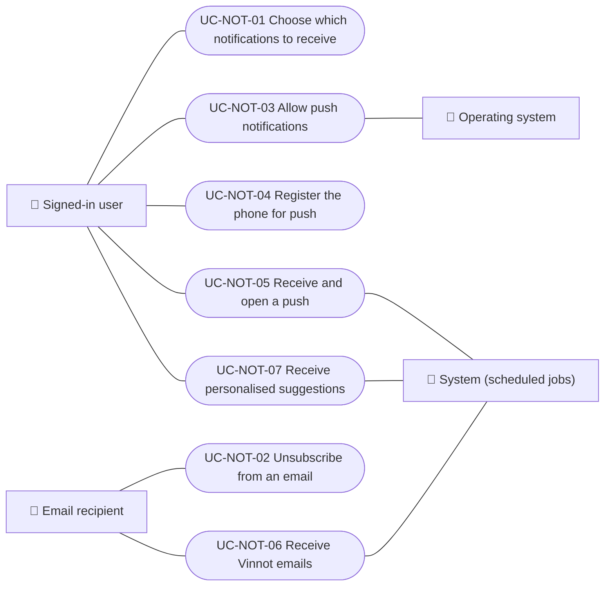

# Use cases

Notification use cases: choosing which notices to receive and marketing consent, unsubscribing from an email, allowing and registering push on the phone, receiving push, receiving emails and receiving personalised suggestions. Team announcements are in Administration and the “Events near you” area is in Events. Each case applies to the platforms listed.

| ID | Use case | Platforms | Actors |
|---|---|---|---|
| `UC-NOT-01` | [Choose which notifications to receive](uc-not-01-manage-preferences.md) | Web, APK | Signed-in user |
| `UC-NOT-02` | [Unsubscribe from an email](uc-not-02-unsubscribe.md) | Web | Email recipient |
| `UC-NOT-03` | [Allow push notifications](uc-not-03-allow-push.md) | APK | Signed-in user, Operating system |
| `UC-NOT-04` | [Register the phone for push](uc-not-04-register-device.md) | APK | Signed-in user |
| `UC-NOT-05` | [Receive and open a push](uc-not-05-receive-push.md) | APK | Signed-in user, System (scheduled jobs) |
| `UC-NOT-06` | [Receive Vinnot emails](uc-not-06-receive-email.md) | Web, APK | Email recipient, System (scheduled jobs) |
| `UC-NOT-07` | [Receive personalised suggestions](uc-not-07-receive-suggestions.md) | APK | Signed-in user, System (scheduled jobs) |

## Use case diagram

[View the full “Use cases · Use case diagram” diagram](https://images.vinnot.com/docs/diagrams/v1/en/modules-notifications-use-cases-readme-03a3df19ce82.svg)

## Lucidchart mapping

| ID | Lucidchart IDs |
|---|---|
| `UC-NOT-01` | [WEB UC-NOTIF-01](https://lucid.app/lucidchart/9f11a16b-bb5a-42fc-a9e8-0852b17bd241/edit), [APK UC-NOTIF-05](https://lucid.app/lucidchart/e095dd25-e8ac-41ba-bf5b-396e1055f217/edit) |
| `UC-NOT-02` | [WEB UC-NOTIF-03](https://lucid.app/lucidchart/9f11a16b-bb5a-42fc-a9e8-0852b17bd241/edit) |
| `UC-NOT-03` | [APK UC-NOTIF-01](https://lucid.app/lucidchart/e095dd25-e8ac-41ba-bf5b-396e1055f217/edit), [APK UC-NOTIF-02](https://lucid.app/lucidchart/e095dd25-e8ac-41ba-bf5b-396e1055f217/edit) |
| `UC-NOT-04` | [APK UC-NOTIF-03](https://lucid.app/lucidchart/e095dd25-e8ac-41ba-bf5b-396e1055f217/edit) |
| `UC-NOT-05` | [APK UC-NOTIF-04](https://lucid.app/lucidchart/e095dd25-e8ac-41ba-bf5b-396e1055f217/edit) |
| `UC-NOT-06` | None |
| `UC-NOT-07` | None |
