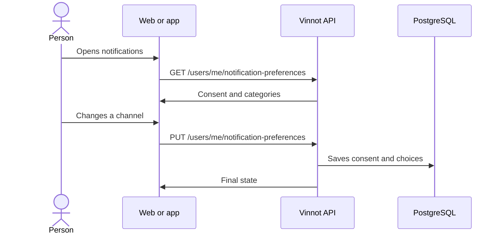

# UC-NOT-01 · Choose which notifications to receive

| Field | Value |
|---|---|
| ID | `UC-NOT-01` |
| Module | [Notifications](../README.md) |
| Platforms | Web, APK |
| Actors | Signed-in user |
| Lucidchart IDs | [WEB UC-NOTIF-01](https://lucid.app/lucidchart/9f11a16b-bb5a-42fc-a9e8-0852b17bd241/edit), [APK UC-NOTIF-05](https://lucid.app/lucidchart/e095dd25-e8ac-41ba-bf5b-396e1055f217/edit) |
| Requirements | [`RF-WEB-NOT-01`](../requirements.md), [`RF-WEB-NOT-02`](../requirements.md), [`RF-APK-NOT-01`](../requirements.md), [`RF-APK-NOT-02`](../requirements.md) |
| Test cases | [`CP-NOT-01`](../testing.md), [`CP-NOT-28`](../testing.md), [`CP-NOT-02`](../testing.md), [`CP-NOT-03`](../testing.md), [`CP-NOT-04`](../testing.md), [`CP-NOT-05`](../testing.md) |

## Preconditions

- The person is signed in.

## Postconditions

- Their preferences are saved and later sends follow them.

## Main flow

1. The person opens Profile → Notifications on the web or the notifications sheet on the app.
2. The client calls `GET /users/me/notification-preferences`.
3. The API returns the marketing consent and nine categories with their email and push state, whether they can be changed and which channels each one uses (`emailAvailable`, `pushAvailable`).
4. The person changes a category's channel or the consent.
5. The client sends `PUT /users/me/notification-preferences` with the `WEB` or `MOBILE` source.
6. The API saves the consent first and then each choice, and returns the final state.

## Alternative flows

- 4a. The category is mandatory (account, security, payments or tickets): the control is disabled and the API rejects the change.
- 4b. A promotional category is turned on while consent is withdrawn: the API rejects the change.
- 4c. On the app a push is turned on and the phone never asked for permission: the system prompt opens.
- 3a. On the app the system permission is missing or blocked: the sheet offers “Allow notifications” or “Open Settings”.
- 3b. A category never sends through a channel, such as email for a category that only uses push: the web shows “—” instead of the switch and the app does not show that switch.

## Business rules

- Mandatory categories are always sent.
- A channel is available in a category when some notice of that category is sent through it.
- Every category starts on and marketing consent counts as granted; withdrawing it stops recommendations and news.
- When and where the consent was granted or withdrawn is saved.
- The “Events near you” area is chosen in the same place ([UC-EVT-07](../../events/use-cases/uc-evt-07-event-area.md)).

## Diagram

[View the full “UC-NOT-01 · Choose which notifications to receive” diagram](https://images.vinnot.com/docs/diagrams/v1/en/modules-notifications-use-cases-uc-not-01-manage-preferences-e02cb75e3a88.svg)

Component diagram in Lucidchart: [WEB UC-NOTIF-01](https://lucid.app/lucidchart/9f11a16b-bb5a-42fc-a9e8-0852b17bd241/edit), [APK UC-NOTIF-05](https://lucid.app/lucidchart/e095dd25-e8ac-41ba-bf5b-396e1055f217/edit).

## Code

| Layer | Location |
|---|---|
| Endpoints | `GET /users/me/notification-preferences`, `PUT /users/me/notification-preferences` |
| Backend | [`NotificationPreferencesController.java`](../../../../../backend/src/main/java/com/vinnot/notification/infrastructure/web/NotificationPreferencesController.java), [`NotificationPreferencesService.java`](../../../../../backend/src/main/java/com/vinnot/notification/application/service/NotificationPreferencesService.java), [`NotificationPreferences.java`](../../../../../backend/src/main/java/com/vinnot/notification/domain/model/NotificationPreferences.java), [`NotificationCategory.java`](../../../../../backend/src/main/java/com/vinnot/notification/domain/model/NotificationCategory.java) |
| Web | [`UserProfileNotificationsTab.tsx`](../../../../../frontend-react/src/presentation/pages/user/UserProfileNotificationsTab.tsx), [`useNotificationPreferencesViewModel.ts`](../../../../../frontend-react/src/presentation/pages/user/useNotificationPreferencesViewModel.ts), [`useNotificationPreferences.ts`](../../../../../frontend-react/src/presentation/hooks/queries/notification/useNotificationPreferences.ts), [`notifications.service.ts`](../../../../../frontend-react/src/application/services/notifications.service.ts), [`notifications.client.ts`](../../../../../frontend-react/src/infrastructure/api/clients/notifications.client.ts), [`notificationPreferences.ts`](../../../../../frontend-react/src/domain/notification/notificationPreferences.ts) |
| App | [`NotificationPreferencesSheet.tsx`](../../../../../frontend-mobile/src/presentation/features/user/NotificationPreferencesSheet.tsx), [`useNotificationPreferencesSheet.ts`](../../../../../frontend-mobile/src/presentation/features/user/useNotificationPreferencesSheet.ts), [`useDevicePush.ts`](../../../../../frontend-mobile/src/presentation/features/notifications/useDevicePush.ts), [`notifications.service.ts`](../../../../../frontend-mobile/src/application/services/notifications.service.ts), [`notifications.client.ts`](../../../../../frontend-mobile/src/infrastructure/api/clients/notifications.client.ts) |

## Automated tests

- Backend: [`NotificationPreferencesControllerTest.java`](../../../../../backend/src/test/java/com/vinnot/notification/infrastructure/web/NotificationPreferencesControllerTest.java), [`NotificationPreferencesServiceTest.java`](../../../../../backend/src/test/java/com/vinnot/notification/application/service/NotificationPreferencesServiceTest.java), [`NotificationPreferencesTest.java`](../../../../../backend/src/test/java/com/vinnot/notification/domain/model/NotificationPreferencesTest.java), [`JdbcNotificationPreferenceRepositoryPostgresIntegrationTest.java`](../../../../../backend/src/test/java/com/vinnot/notification/infrastructure/persistence/JdbcNotificationPreferenceRepositoryPostgresIntegrationTest.java)
- Web: [`UserProfileNotificationsTab.test.tsx`](../../../../../frontend-react/src/presentation/pages/user/UserProfileNotificationsTab.test.tsx), [`notifications.service.test.ts`](../../../../../frontend-react/src/application/services/notifications.service.test.ts), [`notifications.client.test.ts`](../../../../../frontend-react/src/infrastructure/api/clients/notifications.client.test.ts), [`notificationPreferences.test.ts`](../../../../../frontend-react/src/domain/notification/notificationPreferences.test.ts)
- App: [`NotificationPreferencesSheet.test.tsx`](../../../../../frontend-mobile/src/presentation/features/user/NotificationPreferencesSheet.test.tsx), [`useDevicePush.test.ts`](../../../../../frontend-mobile/src/presentation/features/notifications/useDevicePush.test.ts), [`notifications.service.test.ts`](../../../../../frontend-mobile/src/application/services/notifications.service.test.ts), [`notifications.client.test.ts`](../../../../../frontend-mobile/src/infrastructure/api/clients/notifications.client.test.ts), [`notificationPreferences.test.ts`](../../../../../frontend-mobile/src/domain/notification/notificationPreferences.test.ts)
