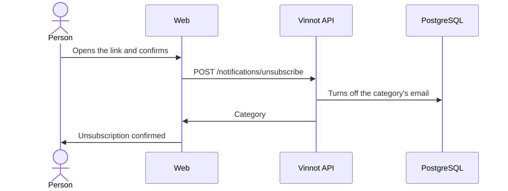

# UC-NOT-02 · Unsubscribe from an email

| Field | Value |
|---|---|
| ID | `UC-NOT-02` |
| Module | [Notifications](../README.md) |
| Platforms | Web |
| Actors | Email recipient |
| Lucidchart IDs | [WEB UC-NOTIF-03](https://lucid.app/lucidchart/9f11a16b-bb5a-42fc-a9e8-0852b17bd241/edit) |
| Requirements | [`RF-WEB-NOT-03`](../requirements.md) |
| Test cases | [`CP-NOT-06`](../testing.md), [`CP-NOT-07`](../testing.md), [`CP-NOT-08`](../testing.md) |

## Preconditions

- The person received a promotional email with an unsubscribe link.

## Postconditions

- That category stops sending them emails.

## Main flow

1. The person taps “Unsubscribe” in the email.
2. The web opens `/unsubscribe?token=…` and asks to confirm.
3. The person confirms.
4. The web sends `POST /notifications/unsubscribe` with the token, without a session.
5. The API turns off that category's email and returns which one it was.
6. The web confirms the unsubscription and offers to go to the preferences.

## Alternative flows

- 1a. The mail client offers one-click unsubscribe: it sends the same request without opening the web.
- 5a. The token is invalid or belongs to a mandatory category: the API rejects it and the web shows an error.

## Business rules

- Only promotional emails carry an unsubscribe link.
- Unsubscribing does not change marketing consent or push.
- The token is encrypted, identifies the person and the category, and does not expire.
- The unsubscription only applies after confirming, so a link scanner cannot trigger it.

## Diagram

[View the full “UC-NOT-02 · Unsubscribe from an email” diagram](https://images.vinnot.com/docs/diagrams/v1/en/modules-notifications-use-cases-uc-not-02-unsubscribe-64b0e7d706b3.svg)

Component diagram in Lucidchart: [WEB UC-NOTIF-03](https://lucid.app/lucidchart/9f11a16b-bb5a-42fc-a9e8-0852b17bd241/edit).

## Code

| Layer | Location |
|---|---|
| Endpoints | `POST /notifications/unsubscribe` |
| Backend | [`UnsubscribeController.java`](../../../../../backend/src/main/java/com/vinnot/notification/infrastructure/web/UnsubscribeController.java), [`UnsubscribeService.java`](../../../../../backend/src/main/java/com/vinnot/notification/application/service/UnsubscribeService.java), [`SealedUnsubscribeLinks.java`](../../../../../backend/src/main/java/com/vinnot/notification/infrastructure/security/SealedUnsubscribeLinks.java) |
| Web | [`UnsubscribePage.tsx`](../../../../../frontend-react/src/presentation/pages/public/UnsubscribePage.tsx), [`useUnsubscribeViewModel.ts`](../../../../../frontend-react/src/presentation/pages/public/useUnsubscribeViewModel.ts), [`notifications.service.ts`](../../../../../frontend-react/src/application/services/notifications.service.ts), [`notifications.client.ts`](../../../../../frontend-react/src/infrastructure/api/clients/notifications.client.ts) |

## Automated tests

- Backend: [`UnsubscribeControllerTest.java`](../../../../../backend/src/test/java/com/vinnot/notification/infrastructure/web/UnsubscribeControllerTest.java), [`UnsubscribeServiceTest.java`](../../../../../backend/src/test/java/com/vinnot/notification/application/service/UnsubscribeServiceTest.java), [`SealedUnsubscribeLinksTest.java`](../../../../../backend/src/test/java/com/vinnot/notification/infrastructure/security/SealedUnsubscribeLinksTest.java)
- Web: [`UnsubscribePage.test.tsx`](../../../../../frontend-react/src/presentation/pages/public/UnsubscribePage.test.tsx)
- App: None
