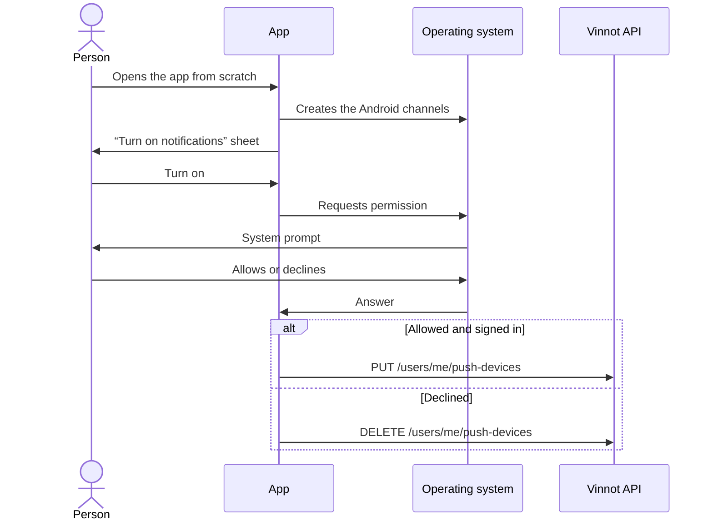

# UC-NOT-03 · Allow push notifications

| Field | Value |
|---|---|
| ID | `UC-NOT-03` |
| Module | [Notifications](../README.md) |
| Platforms | APK |
| Actors | User, Operating system |
| Lucidchart IDs | [APK UC-NOTIF-01](https://lucid.app/lucidchart/e095dd25-e8ac-41ba-bf5b-396e1055f217/edit), [APK UC-NOTIF-02](https://lucid.app/lucidchart/e095dd25-e8ac-41ba-bf5b-396e1055f217/edit) |
| Requirements | [`RF-APK-NOT-03`](../requirements.md) |
| Test cases | [`CP-NOT-09`](../testing.md), [`CP-NOT-10`](../testing.md), [`CP-NOT-11`](../testing.md), [`CP-NOT-12`](../testing.md), [`CP-NOT-29`](../testing.md), [`CP-NOT-30`](../testing.md) |

## Preconditions

- The app is installed and the phone has not answered the notification permission yet.

## Postconditions

- The phone may show notifications and is registered when someone is signed in, or the person left them off and the phone receives no push.

## Main flow

1. The person opens the app for the first time on that phone, signed in or not.
2. The app creates the Android notification channels and shows the “Turn on notifications” sheet with one line: “So you don't miss anything about events and wines.”. The sheet closes before the system prompt appears.
3. The person taps “Turn on” and the system shows its permission prompt.
4. The person allows notifications.
5. When someone is signed in, the app registers the phone ([UC-NOT-04](uc-not-04-register-device.md)).

## Alternative flows

- 3a. The person taps “Not now”: the system prompt does not appear and the app shows no other sheet until it is next opened from scratch.
- 4a. The person declines: the app does not register the phone and removes from the account any registration that phone left (`DELETE /users/me/push-devices`).
- 1a. Notifications are off and the person is signed in: every time the app is opened from scratch, the same “Turn on notifications” sheet appears. “Turn on” opens the system prompt; once the system blocked them (iOS after “Don't Allow”, Android after two denials), the sheet says “In Settings, turn on notifications for Vinnot.” and “Open Settings” opens Vinnot's notification settings on Android or Vinnot's page in Settings on iOS. No app can turn them back on by itself once the system blocked them. On return with the permission granted, the app registers the phone. Returning to the app from the background does not show the sheet.
- 1b. A confirmed ticket, while the system can still ask and no other sheet showed in that launch: a sheet explains the event alerts and only “Turn on notifications” opens the system prompt.
- 2a. Android 12 or earlier grants the permission by default: neither the sheet nor the prompt appears.

## Business rules

- Notifications are on in the account; the phone permission decides whether they arrive.
- The app shows at most one permission sheet per launch from scratch.
- The Android channels are created before the permission is requested, as Android 13 or later requires.
- iOS does not allow push without this permission.

## Diagram

[View the full “UC-NOT-03 · Allow push notifications” diagram](https://images.vinnot.com/docs/diagrams/v1/en/modules-notifications-use-cases-uc-not-03-allow-push-cf8c59c1000f.svg)

Component diagram in Lucidchart: [APK UC-NOTIF-01](https://lucid.app/lucidchart/e095dd25-e8ac-41ba-bf5b-396e1055f217/edit), [APK UC-NOTIF-02](https://lucid.app/lucidchart/e095dd25-e8ac-41ba-bf5b-396e1055f217/edit).

## Code

| Layer | Location |
|---|---|
| App | [`pushNotifications.service.ts`](../../../../../frontend-mobile/src/application/services/pushNotifications.service.ts), [`pushPermissionPrompt.ts`](../../../../../frontend-mobile/src/domain/notification/pushPermissionPrompt.ts), [`pushChannels.ts`](../../../../../frontend-mobile/src/domain/notification/pushChannels.ts), [`pushNotifications.gateway.ts`](../../../../../frontend-mobile/src/infrastructure/device/pushNotifications.gateway.ts), [`pushPrompt.storage.ts`](../../../../../frontend-mobile/src/infrastructure/storage/pushPrompt.storage.ts), [`pushDevice.storage.ts`](../../../../../frontend-mobile/src/infrastructure/storage/pushDevice.storage.ts), [`useLaunchPushPrompt.ts`](../../../../../frontend-mobile/src/presentation/features/notifications/useLaunchPushPrompt.ts), [`usePushChannels.ts`](../../../../../frontend-mobile/src/presentation/features/notifications/usePushChannels.ts), [`PushPermissionSheet.tsx`](../../../../../frontend-mobile/src/presentation/features/notifications/PushPermissionSheet.tsx), [`usePushPermissionPrompt.ts`](../../../../../frontend-mobile/src/presentation/features/notifications/usePushPermissionPrompt.ts), [`useDevicePush.ts`](../../../../../frontend-mobile/src/presentation/features/notifications/useDevicePush.ts), [`PushNotificationsSync.tsx`](../../../../../frontend-mobile/src/presentation/navigation/PushNotificationsSync.tsx) |

## Automated tests

- Backend: None
- Web: None
- App: [`pushNotifications.service.test.ts`](../../../../../frontend-mobile/src/application/services/pushNotifications.service.test.ts), [`pushPermissionPrompt.test.ts`](../../../../../frontend-mobile/src/domain/notification/pushPermissionPrompt.test.ts), [`pushChannels.test.ts`](../../../../../frontend-mobile/src/domain/notification/pushChannels.test.ts), [`pushPrompt.storage.test.ts`](../../../../../frontend-mobile/src/infrastructure/storage/pushPrompt.storage.test.ts), [`pushDevice.storage.test.ts`](../../../../../frontend-mobile/src/infrastructure/storage/pushDevice.storage.test.ts), [`useLaunchPushPrompt.test.ts`](../../../../../frontend-mobile/src/presentation/features/notifications/useLaunchPushPrompt.test.ts), [`usePushChannels.test.ts`](../../../../../frontend-mobile/src/presentation/features/notifications/usePushChannels.test.ts), [`PushPermissionSheet.test.tsx`](../../../../../frontend-mobile/src/presentation/features/notifications/PushPermissionSheet.test.tsx), [`usePushPermissionPrompt.test.ts`](../../../../../frontend-mobile/src/presentation/features/notifications/usePushPermissionPrompt.test.ts)
