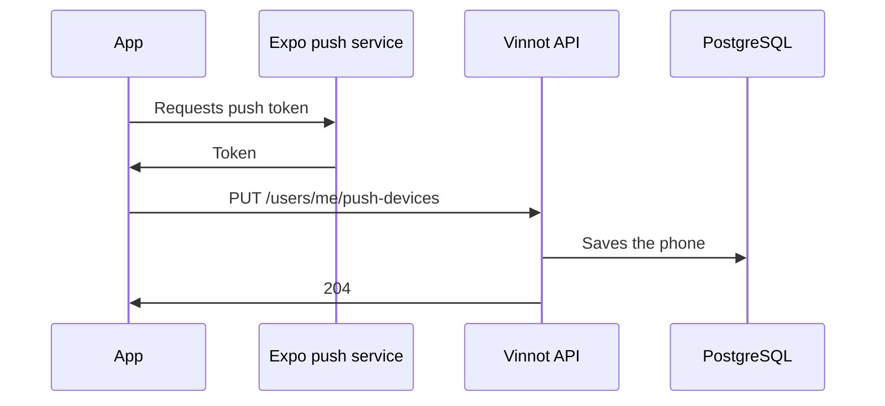

# UC-NOT-04 · Register the phone for push

| Field | Value |
|---|---|
| ID | `UC-NOT-04` |
| Module | [Notifications](../README.md) |
| Platforms | APK |
| Actors | Signed-in user |
| Lucidchart IDs | [APK UC-NOTIF-03](https://lucid.app/lucidchart/e095dd25-e8ac-41ba-bf5b-396e1055f217/edit) |
| Requirements | [`RF-APK-NOT-04`](../requirements.md) |
| Test cases | [`CP-NOT-13`](../testing.md), [`CP-NOT-14`](../testing.md), [`CP-NOT-15`](../testing.md), [`CP-NOT-16`](../testing.md), [`CP-NOT-17`](../testing.md), [`CP-NOT-31`](../testing.md) |

## Preconditions

- The phone has notification permission and the person is signed in.

## Postconditions

- The phone is linked to the account to receive push.

## Main flow

1. The app gets the phone's Expo push token.
2. It sends `PUT /users/me/push-devices` with the token, the platform and the app language; on Android it adds `channels: true` once it created the notification channels.
3. The API validates the token and saves it for that account.
4. The app registers it again every time it is opened from scratch (so the API knows the phone is still in use), on sign-in, language change or token change, and on return to the foreground while it is not registered.

## Alternative flows

- 3a. The token is not in Expo format: the API answers 400.
- 3b. The token was on another account: it moves to the current account.
- 4a. The person signs out: the app sends the token with the sign-out and the API unregisters it.
- 2a. Registration fails: it is retried on return to the foreground.
- 1a. The phone has no notification permission: the app registers nothing and removes from the account the last token that phone registered with `DELETE /users/me/push-devices`; if that fails, it tries again on the next launch.

## Business rules

- A token belongs to a single account.
- Sends go to at most the 10 most recent phones of each account.
- Suspending or deactivating an account deletes its phones.

## Diagram

[View the full “UC-NOT-04 · Register the phone for push” diagram](https://images.vinnot.com/docs/diagrams/v1/en/modules-notifications-use-cases-uc-not-04-register-device-2c88758ef8d4.svg)

Component diagram in Lucidchart: [APK UC-NOTIF-03](https://lucid.app/lucidchart/e095dd25-e8ac-41ba-bf5b-396e1055f217/edit).

## Code

| Layer | Location |
|---|---|
| Endpoints | `PUT /users/me/push-devices`, `POST /auth/logout` |
| Backend | [`PushDevicesController.java`](../../../../../backend/src/main/java/com/vinnot/notification/infrastructure/web/PushDevicesController.java), [`PushDeviceService.java`](../../../../../backend/src/main/java/com/vinnot/notification/application/service/PushDeviceService.java), [`LogoutCommandHandler.java`](../../../../../backend/src/main/java/com/vinnot/user/application/command/handler/LogoutCommandHandler.java) |
| App | [`usePushNotificationsSync.ts`](../../../../../frontend-mobile/src/presentation/hooks/usePushNotificationsSync.ts), [`PushNotificationsSync.tsx`](../../../../../frontend-mobile/src/presentation/navigation/PushNotificationsSync.tsx), [`pushNotifications.service.ts`](../../../../../frontend-mobile/src/application/services/pushNotifications.service.ts), [`pushNotifications.gateway.ts`](../../../../../frontend-mobile/src/infrastructure/device/pushNotifications.gateway.ts), [`pushDevice.storage.ts`](../../../../../frontend-mobile/src/infrastructure/storage/pushDevice.storage.ts) |

## Automated tests

- Backend: [`PushDevicesControllerTest.java`](../../../../../backend/src/test/java/com/vinnot/notification/infrastructure/web/PushDevicesControllerTest.java), [`PushDeviceServiceTest.java`](../../../../../backend/src/test/java/com/vinnot/notification/application/service/PushDeviceServiceTest.java), [`PushTokenTest.java`](../../../../../backend/src/test/java/com/vinnot/notification/domain/model/PushTokenTest.java), [`JdbcPushDeviceRepositoryPostgresIntegrationTest.java`](../../../../../backend/src/test/java/com/vinnot/notification/infrastructure/persistence/JdbcPushDeviceRepositoryPostgresIntegrationTest.java)
- Web: None
- App: [`usePushNotificationsSync.test.tsx`](../../../../../frontend-mobile/src/presentation/hooks/usePushNotificationsSync.test.tsx), [`pushNotifications.service.test.ts`](../../../../../frontend-mobile/src/application/services/pushNotifications.service.test.ts), [`pushNotifications.gateway.test.ts`](../../../../../frontend-mobile/src/infrastructure/device/pushNotifications.gateway.test.ts), [`pushDevice.storage.test.ts`](../../../../../frontend-mobile/src/infrastructure/storage/pushDevice.storage.test.ts)
