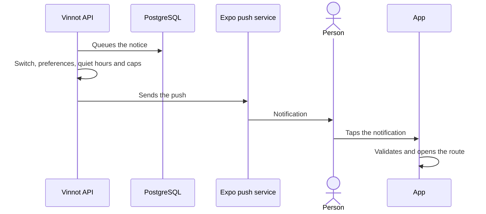

# UC-NOT-05 · Receive and open a push

| Field | Value |
|---|---|
| ID | `UC-NOT-05` |
| Module | [Notifications](../README.md) |
| Platforms | APK |
| Actors | Signed-in user, System (scheduled jobs) |
| Lucidchart IDs | [APK UC-NOTIF-04](https://lucid.app/lucidchart/e095dd25-e8ac-41ba-bf5b-396e1055f217/edit) |
| Requirements | [`RF-APK-NOT-05`](../requirements.md), [`RF-APK-NOT-06`](../requirements.md) |
| Test cases | [`CP-NOT-18`](../testing.md), [`CP-NOT-19`](../testing.md), [`CP-NOT-20`](../testing.md), [`CP-NOT-21`](../testing.md), [`CP-NOT-22`](../testing.md), [`CP-NOT-23`](../testing.md), [`CP-NOT-32`](../testing.md), [`CP-NOT-33`](../testing.md) |

## Preconditions

- Something generated a notice for the person and their phone is registered.

## Postconditions

- The person received the push and, if they tapped it, is in the matching section.

## Main flow

1. The module that originated the notice puts it in the send queue.
2. The send job checks the type switch, the expiry, duplicates, the account and the preferences.
3. It checks quiet hours and the daily caps.
4. It sends the push through Expo and then checks the receipts.
5. The person taps the notification.
6. The app reports the open (`POST /users/me/push-opens` with the push `ref` and `type`, without waiting for the answer), validates the route and, once navigation is ready, opens the section: a ticket, an event, a wine, a route, a winery or the partner events.

## Alternative flows

- 2a. The type is turned off by the team, the notice expired, it was already sent, the account is inactive or the person turned it off: it is not sent.
- 3a. It is between 22:00 and 08:00 in the account's time zone and the notice can wait: it is postponed until 08:00.
- 3b. The daily or category cap was reached: it is dropped.
- 6a. The route is not allowed: the app ignores it.
- 5a. The app was closed: the route opens on start, once navigation is ready.
- 5b. Nobody is signed in: the app does not navigate; it keeps the section as the destination and opens it after sign-in, when it also reports the open.
- 6b. The push carries no `ref` or `type` (pushes sent before this change only carry the route): the app opens the section without reporting the open.

## Business rules

- Mandatory categories skip preferences and caps; those that cannot wait are sent at high priority.
- Caps: 3 a day for non-mandatory categories, 1 a day for nearby events and 1 every 7 days for recommendations.
- The title is cut to 65 characters and the text to 178.
- Failed sends are retried up to 10 times with growing waits.

## Diagram

[View the full “UC-NOT-05 · Receive and open a push” diagram](https://images.vinnot.com/docs/diagrams/v1/en/modules-notifications-use-cases-uc-not-05-receive-push-7ca03534e786.svg)

Component diagram in Lucidchart: [APK UC-NOTIF-04](https://lucid.app/lucidchart/e095dd25-e8ac-41ba-bf5b-396e1055f217/edit).

## Code

| Layer | Location |
|---|---|
| Backend | [`EnqueuePushService.java`](../../../../../backend/src/main/java/com/vinnot/notification/application/service/EnqueuePushService.java), [`DeliverPushService.java`](../../../../../backend/src/main/java/com/vinnot/notification/application/service/DeliverPushService.java), [`QuietHours.java`](../../../../../backend/src/main/java/com/vinnot/notification/domain/model/QuietHours.java), [`ExpoPushSenderAdapter.java`](../../../../../backend/src/main/java/com/vinnot/notification/infrastructure/push/ExpoPushSenderAdapter.java), [`CheckPushReceiptsService.java`](../../../../../backend/src/main/java/com/vinnot/notification/application/service/CheckPushReceiptsService.java) |
| App | [`pushNotifications.gateway.ts`](../../../../../frontend-mobile/src/infrastructure/device/pushNotifications.gateway.ts), [`usePushNotificationsSync.ts`](../../../../../frontend-mobile/src/presentation/hooks/usePushNotificationsSync.ts), [`pushRoute.ts`](../../../../../frontend-mobile/src/domain/notification/pushRoute.ts), [`pushOpen.ts`](../../../../../frontend-mobile/src/domain/notification/pushOpen.ts), [`pushChannels.ts`](../../../../../frontend-mobile/src/domain/notification/pushChannels.ts), [`notifications.client.ts`](../../../../../frontend-mobile/src/infrastructure/api/clients/notifications.client.ts) |

## Automated tests

- Backend: [`DeliverPushServiceTest.java`](../../../../../backend/src/test/java/com/vinnot/notification/application/service/DeliverPushServiceTest.java), [`EnqueuePushServiceTest.java`](../../../../../backend/src/test/java/com/vinnot/notification/application/service/EnqueuePushServiceTest.java), [`QuietHoursTest.java`](../../../../../backend/src/test/java/com/vinnot/notification/domain/model/QuietHoursTest.java), [`PushRequestTest.java`](../../../../../backend/src/test/java/com/vinnot/notification/domain/model/PushRequestTest.java), [`PushContentTest.java`](../../../../../backend/src/test/java/com/vinnot/notification/domain/model/PushContentTest.java), [`CheckPushReceiptsServiceTest.java`](../../../../../backend/src/test/java/com/vinnot/notification/application/service/CheckPushReceiptsServiceTest.java), [`ExpoPushSenderAdapterTest.java`](../../../../../backend/src/test/java/com/vinnot/notification/infrastructure/push/ExpoPushSenderAdapterTest.java), [`JdbcPushDeliveryPostgresIntegrationTest.java`](../../../../../backend/src/test/java/com/vinnot/notification/infrastructure/persistence/JdbcPushDeliveryPostgresIntegrationTest.java), [`PushPlanningServiceTest.java`](../../../../../backend/src/test/java/com/vinnot/notification/application/service/PushPlanningServiceTest.java), [`PushRateLimiterTest.java`](../../../../../backend/src/test/java/com/vinnot/notification/infrastructure/push/PushRateLimiterTest.java), [`PushOpenServiceTest.java`](../../../../../backend/src/test/java/com/vinnot/notification/application/service/PushOpenServiceTest.java), [`PushOpensControllerTest.java`](../../../../../backend/src/test/java/com/vinnot/notification/infrastructure/web/PushOpensControllerTest.java), [`PushInfrastructureTest.java`](../../../../../backend/src/test/java/com/vinnot/notification/infrastructure/push/PushInfrastructureTest.java), [`TransactionalPushTemplatesTest.java`](../../../../../backend/src/test/java/com/vinnot/notification/infrastructure/push/TransactionalPushTemplatesTest.java), [`JdbcPushOpenStorePostgresIntegrationTest.java`](../../../../../backend/src/test/java/com/vinnot/notification/infrastructure/persistence/JdbcPushOpenStorePostgresIntegrationTest.java)
- Web: None
- App: [`pushRoute.test.ts`](../../../../../frontend-mobile/src/domain/notification/pushRoute.test.ts), [`pushNotifications.gateway.test.ts`](../../../../../frontend-mobile/src/infrastructure/device/pushNotifications.gateway.test.ts), [`pushOpen.test.ts`](../../../../../frontend-mobile/src/domain/notification/pushOpen.test.ts), [`usePushNotificationsSync.test.tsx`](../../../../../frontend-mobile/src/presentation/hooks/usePushNotificationsSync.test.tsx), [`notifications.client.test.ts`](../../../../../frontend-mobile/src/infrastructure/api/clients/notifications.client.test.ts)
