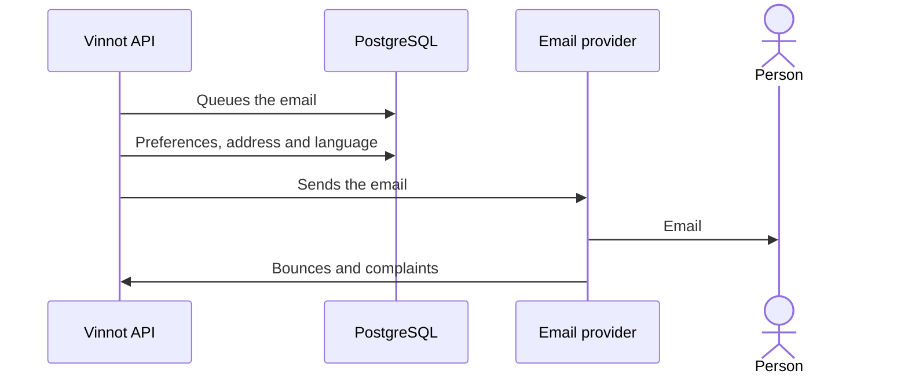

# UC-NOT-06 · Receive Vinnot emails

| Field | Value |
|---|---|
| ID | `UC-NOT-06` |
| Module | [Notifications](../README.md) |
| Platforms | Web, APK |
| Actors | Email recipient, System (scheduled jobs) |
| Lucidchart IDs | None |
| Requirements | [`RF-WEB-NOT-04`](../requirements.md), [`RF-WEB-NOT-05`](../requirements.md), [`RF-WEB-NOT-06`](../requirements.md), [`RF-WEB-NOT-07`](../requirements.md), [`RF-WEB-NOT-08`](../requirements.md), [`RF-WEB-NOT-09`](../requirements.md), [`RF-APK-NOT-07`](../requirements.md), [`RF-APK-NOT-08`](../requirements.md), [`RF-APK-NOT-09`](../requirements.md), [`RF-APK-NOT-10`](../requirements.md), [`RF-APK-NOT-11`](../requirements.md), [`RF-APK-NOT-12`](../requirements.md) |
| Test cases | [`CP-NOT-24`](../testing.md), [`CP-NOT-25`](../testing.md), [`CP-NOT-26`](../testing.md), [`CP-NOT-27`](../testing.md) |

## Preconditions

- Something generated an email for the person: a verification, a status change, a registration, a community notice or an announcement.

## Postconditions

- The person received the email in their language, or the send was discarded by a rule.

## Main flow

1. The module that originated the notice puts it in the send queue, once per key.
2. The send job checks the preferences, the current address and the account language again.
3. It builds the branded HTML email and its text version.
4. If it is promotional, it adds the unsubscribe link and one-click unsubscribe.
5. It sends it through the email provider.

## Alternative flows

- 2a. The person turned that category off: it is not sent.
- 2b. The address bounced permanently or marked spam: it is not sent, not even mandatory ones.
- 5a. The provider fails: it is retried up to 10 times with growing waits.

## Business rules

- The language is the one saved on the account; without one, Spanish. Announcements keep the language they were requested in.
- Permanent bounces and complaints are read from the provider every minute and the address is only stored as a hash.
- Emails never carry passwords; secret links travel encrypted in the queue.
- Exhausted sends are deleted after 30 days.

## Diagram

[View the full “UC-NOT-06 · Receive Vinnot emails” diagram](https://images.vinnot.com/docs/diagrams/v1/en/modules-notifications-use-cases-uc-not-06-receive-email-8f2e8ea8e922.svg)

## Code

| Layer | Location |
|---|---|
| Backend | [`EnqueueNotificationService.java`](../../../../../backend/src/main/java/com/vinnot/notification/application/service/EnqueueNotificationService.java), [`DeliverNotificationService.java`](../../../../../backend/src/main/java/com/vinnot/notification/application/service/DeliverNotificationService.java), [`DurableEffectWorker.java`](../../../../../backend/src/main/java/com/vinnot/shared/infrastructure/effects/DurableEffectWorker.java), [`EmailFeedbackService.java`](../../../../../backend/src/main/java/com/vinnot/notification/application/service/EmailFeedbackService.java), [`SqsEmailFeedbackPoller.java`](../../../../../backend/src/main/java/com/vinnot/notification/infrastructure/feedback/SqsEmailFeedbackPoller.java) |

## Automated tests

- Backend: [`EnqueueNotificationServiceTest.java`](../../../../../backend/src/test/java/com/vinnot/notification/application/service/EnqueueNotificationServiceTest.java), [`DeliverNotificationServiceTest.java`](../../../../../backend/src/test/java/com/vinnot/notification/application/service/DeliverNotificationServiceTest.java), [`EmailFeedbackServiceTest.java`](../../../../../backend/src/test/java/com/vinnot/notification/application/service/EmailFeedbackServiceTest.java), [`NotificationOutboxPostgresIntegrationTest.java`](../../../../../backend/src/test/java/com/vinnot/notification/infrastructure/NotificationOutboxPostgresIntegrationTest.java), [`JdbcEmailSuppressionRepositoryPostgresIntegrationTest.java`](../../../../../backend/src/test/java/com/vinnot/notification/infrastructure/persistence/JdbcEmailSuppressionRepositoryPostgresIntegrationTest.java), [`NotificationTemplateRegistryTest.java`](../../../../../backend/src/test/java/com/vinnot/notification/infrastructure/template/NotificationTemplateRegistryTest.java)
- Web: None
- App: None
