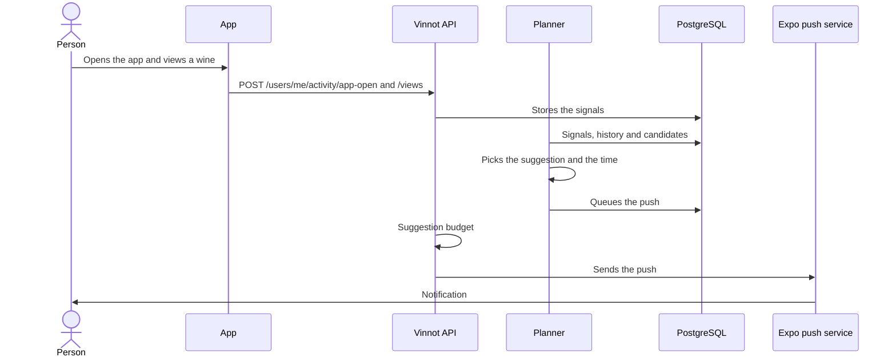

# UC-NOT-07 · Receive personalised suggestions

| Field | Value |
|---|---|
| ID | `UC-NOT-07` |
| Module | [Notifications](../README.md) |
| Platforms | APK |
| Actors | Signed-in user, System (scheduled jobs) |
| Lucidchart IDs | None |
| Requirements | [`RF-APK-NOT-13`](../requirements.md), [`RF-APK-NOT-14`](../requirements.md) |
| Test cases | [`CP-NOT-34`](../testing.md), [`CP-NOT-35`](../testing.md), [`CP-NOT-36`](../testing.md), [`CP-NOT-37`](../testing.md), [`CP-NOT-38`](../testing.md), [`CP-NOT-39`](../testing.md), [`CP-NOT-40`](../testing.md), [`CP-NOT-41`](../testing.md), [`CP-NOT-42`](../testing.md), [`CP-NOT-43`](../testing.md) |

## Preconditions

- The person is signed in to the app and their phone is registered for push ([UC-NOT-04](uc-not-04-register-device.md)).

## Postconditions

- The person got at most one suggestion that day, at the hour they usually open the app, within the weekly budget.

## Main flow

1. While the person uses the app, the app reports each open, on a cold start and on returning to the foreground, with `POST /users/me/activity/app-open`, and each wine, route, event or winery detail they open with `POST /users/me/activity/views`, without waiting for the answer.
2. The API stores one row per person, content and day, and at most one open every 30 minutes.
3. Every hour, the planner takes the exclusive lease and walks, in each time zone where it is between 04:00 and 10:00, the accounts not planned yet that day.
4. For each account it gathers the candidates: welcome, day after an event, milestone, come-back, weekend events, wine viewed and not rated, wine of the week or picked for their taste, route, winery and cellar check-in; it drops those of categories the person turned off, types the team turned off and those that would repeat too soon.
5. It picks the highest-scored candidate and sets the send time: the person's usual app-open hour in their time zone or, without one, 19:30 on weekdays and 12:30 at weekends, always between 09:00 and 21:59.
6. It puts the push in the send queue for that time.
7. At that time, the send job asks the suggestion budget, which admits it, and sends it ([UC-NOT-05](uc-not-05-receive-push.md)).
8. The person taps the notification, the app reports the open and opens the suggested content.

## Alternative flows

- 1a. There is no session: the app reports no signal.
- 1b. The request fails: the screen stays the same; the open is reported again on the next open or return to the foreground.
- 3a. Another instance holds the planner lease: this run plans nothing.
- 4a. The person has not opened the app for 14 days: only come-back pushes compete, at most two per absence (at 14 and at 30 days); then silence until they return.
- 4b. There are no candidates: nothing is sent that day.
- 5a. The account is in the holdout group: the suggestion is recorded but not sent.
- 7a. They already got 2 suggestions in the last 7 days, one that day or one less than 48 hours ago: it is not sent.
- 7b. The last 3 suggestions went unopened: they get at most 1 a week; after 28 days without opening any, they get none, come-back pushes excepted, until they open the app.
- 7c. They already got one that week and the new one scores below 0.6: it is not sent.

## Business rules

- Suggestion budget: 2 every 7 days, 1 per local day and 48 hours between two; when none was received in 7 days, the best candidate is sent whatever its score.
- They are never sent between 22:00 and 09:00 in the account's time zone.
- They respect each category's preferences (Recommendations, Reminders, Events near you and Community) and the marketing consent; they neither use nor count toward the cap of 3 a day of the other notices, and mandatory and social notices never use this budget.
- The holdout group is 5% of accounts, always the same ones by a hash of the id, to measure the effect of the suggestions.
- A type whose opt-outs exceed 2% of its sends, with at least 200 sends in 7 days, is switched off automatically.
- Activity signals are deleted after 180 days and the suggestion ledger after 365; they are never shown to other people or shared with third parties ([Activity](../../activity/README.md)).

## Diagram

[View the full “UC-NOT-07 · Receive personalised suggestions” diagram](https://images.vinnot.com/docs/diagrams/v1/en/modules-notifications-use-cases-uc-not-07-receive-suggestions-db5a8f62cf2d.svg)

## Code

| Layer | Location |
|---|---|
| Endpoints | `POST /users/me/activity/views`, `POST /users/me/activity/app-open` |
| Backend | [`EngagementPlannerService.java`](../../../../../backend/src/main/java/com/vinnot/engagement/application/service/EngagementPlannerService.java), [`EngagementPageService.java`](../../../../../backend/src/main/java/com/vinnot/engagement/application/service/EngagementPageService.java), [`EngagementSelection.java`](../../../../../backend/src/main/java/com/vinnot/engagement/domain/model/EngagementSelection.java), [`EngagementPolicy.java`](../../../../../backend/src/main/java/com/vinnot/engagement/domain/model/EngagementPolicy.java), [`SendTime.java`](../../../../../backend/src/main/java/com/vinnot/engagement/domain/model/SendTime.java), [`Holdout.java`](../../../../../backend/src/main/java/com/vinnot/engagement/domain/model/Holdout.java), [`EngagementAdmissionService.java`](../../../../../backend/src/main/java/com/vinnot/engagement/application/service/EngagementAdmissionService.java), [`EngagementPlannerScheduler.java`](../../../../../backend/src/main/java/com/vinnot/engagement/infrastructure/scheduling/EngagementPlannerScheduler.java), [`ActivityController.java`](../../../../../backend/src/main/java/com/vinnot/activity/infrastructure/web/ActivityController.java), [`RecordContentViewCommandHandler.java`](../../../../../backend/src/main/java/com/vinnot/activity/application/command/handler/RecordContentViewCommandHandler.java), [`RecordAppOpenCommandHandler.java`](../../../../../backend/src/main/java/com/vinnot/activity/application/command/handler/RecordAppOpenCommandHandler.java), [`ReadActivitySignalsQueryHandler.java`](../../../../../backend/src/main/java/com/vinnot/activity/application/query/handler/ReadActivitySignalsQueryHandler.java) |
| App | [`activity.service.ts`](../../../../../frontend-mobile/src/application/services/activity.service.ts), [`useAppOpenTracking.ts`](../../../../../frontend-mobile/src/presentation/hooks/useAppOpenTracking.ts), [`useDetailViewTracking.ts`](../../../../../frontend-mobile/src/presentation/hooks/useDetailViewTracking.ts), [`ActivitySync.tsx`](../../../../../frontend-mobile/src/presentation/navigation/ActivitySync.tsx), [`activity.client.ts`](../../../../../frontend-mobile/src/infrastructure/api/clients/activity.client.ts), [`activity.ts`](../../../../../frontend-mobile/src/domain/activity/activity.ts) |

## Automated tests

- Backend: [`EngagementPlannerServiceTest.java`](../../../../../backend/src/test/java/com/vinnot/engagement/application/service/EngagementPlannerServiceTest.java), [`EngagementPageServiceTest.java`](../../../../../backend/src/test/java/com/vinnot/engagement/application/service/EngagementPageServiceTest.java), [`EngagementAdmissionServiceTest.java`](../../../../../backend/src/test/java/com/vinnot/engagement/application/service/EngagementAdmissionServiceTest.java), [`EngagementHistoryReaderTest.java`](../../../../../backend/src/test/java/com/vinnot/engagement/application/service/EngagementHistoryReaderTest.java), [`EngagementLedgerRetentionServiceTest.java`](../../../../../backend/src/test/java/com/vinnot/engagement/application/service/EngagementLedgerRetentionServiceTest.java), [`EngagementCandidateTest.java`](../../../../../backend/src/test/java/com/vinnot/engagement/domain/model/EngagementCandidateTest.java), [`EngagementPolicyTest.java`](../../../../../backend/src/test/java/com/vinnot/engagement/domain/model/EngagementPolicyTest.java), [`EngagementSelectionTest.java`](../../../../../backend/src/test/java/com/vinnot/engagement/domain/model/EngagementSelectionTest.java), [`HoldoutTest.java`](../../../../../backend/src/test/java/com/vinnot/engagement/domain/model/HoldoutTest.java), [`SendTimeTest.java`](../../../../../backend/src/test/java/com/vinnot/engagement/domain/model/SendTimeTest.java), [`EngagementPlannerPostgresIntegrationTest.java`](../../../../../backend/src/test/java/com/vinnot/engagement/infrastructure/EngagementPlannerPostgresIntegrationTest.java), [`CandidateSourcesPostgresIntegrationTest.java`](../../../../../backend/src/test/java/com/vinnot/engagement/infrastructure/candidate/CandidateSourcesPostgresIntegrationTest.java), [`EngagementBudgetAdapterTest.java`](../../../../../backend/src/test/java/com/vinnot/engagement/infrastructure/notification/EngagementBudgetAdapterTest.java), [`JdbcEngagementPostgresIntegrationTest.java`](../../../../../backend/src/test/java/com/vinnot/engagement/infrastructure/persistence/JdbcEngagementPostgresIntegrationTest.java), [`EngagementSchedulersTest.java`](../../../../../backend/src/test/java/com/vinnot/engagement/infrastructure/scheduling/EngagementSchedulersTest.java), [`EngagementPushTemplatesTest.java`](../../../../../backend/src/test/java/com/vinnot/notification/infrastructure/push/EngagementPushTemplatesTest.java), [`PushPlanningServiceTest.java`](../../../../../backend/src/test/java/com/vinnot/notification/application/service/PushPlanningServiceTest.java), [`RecordContentViewCommandHandlerTest.java`](../../../../../backend/src/test/java/com/vinnot/activity/application/command/handler/RecordContentViewCommandHandlerTest.java), [`RecordAppOpenCommandHandlerTest.java`](../../../../../backend/src/test/java/com/vinnot/activity/application/command/handler/RecordAppOpenCommandHandlerTest.java), [`ReadActivitySignalsQueryHandlerTest.java`](../../../../../backend/src/test/java/com/vinnot/activity/application/query/handler/ReadActivitySignalsQueryHandlerTest.java), [`OpenHourHistogramTest.java`](../../../../../backend/src/test/java/com/vinnot/activity/domain/model/OpenHourHistogramTest.java), [`PurgeExpiredActivityCommandHandlerTest.java`](../../../../../backend/src/test/java/com/vinnot/activity/application/command/handler/PurgeExpiredActivityCommandHandlerTest.java), [`JdbcActivityPostgresIntegrationTest.java`](../../../../../backend/src/test/java/com/vinnot/activity/infrastructure/persistence/JdbcActivityPostgresIntegrationTest.java), [`ActivityRetentionSchedulerTest.java`](../../../../../backend/src/test/java/com/vinnot/activity/infrastructure/scheduling/ActivityRetentionSchedulerTest.java), [`ActivityControllerTest.java`](../../../../../backend/src/test/java/com/vinnot/activity/infrastructure/web/ActivityControllerTest.java), [`EngagementSignalEndpointsSecurityTest.java`](../../../../../backend/src/test/java/com/vinnot/activity/infrastructure/web/EngagementSignalEndpointsSecurityTest.java)
- Web: None
- App: [`activity.test.ts`](../../../../../frontend-mobile/src/domain/activity/activity.test.ts), [`activity.service.test.ts`](../../../../../frontend-mobile/src/application/services/activity.service.test.ts), [`activity.client.test.ts`](../../../../../frontend-mobile/src/infrastructure/api/clients/activity.client.test.ts), [`useAppOpenTracking.test.ts`](../../../../../frontend-mobile/src/presentation/hooks/useAppOpenTracking.test.ts), [`useDetailViewTracking.test.ts`](../../../../../frontend-mobile/src/presentation/hooks/useDetailViewTracking.test.ts)
