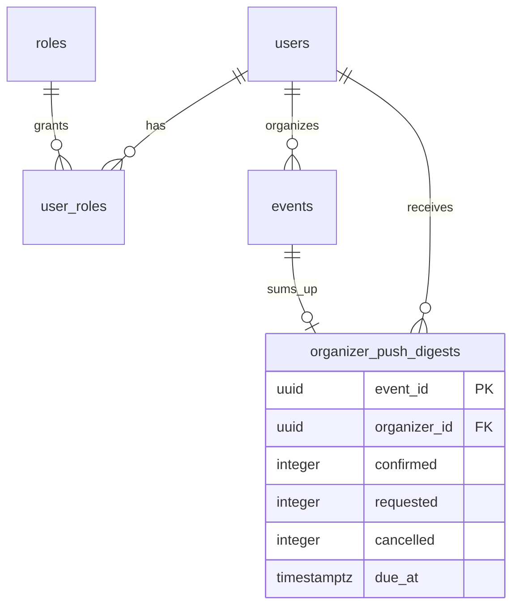

# Partners

Organizers (partner role) publish and manage their own events: they create them, edit
them, change their state, cancel them and review registrations. They get an email for
each registration and a push that sums up each event's activity. The Mercado Pago
account for payouts and the refunds are in [Payments](../payments/README.md); an
administrator grants the role in [Administration](../admin/README.md).

- Module code: `PAR`.
- Backend: package [`partner`](../../../../backend/src/main/java/com/vinnot/partner/), which reuses the [Events](../events/README.md) use cases.
- [Use cases](use-cases/README.md) · [Requirements](requirements.md) ·
  [Architecture](architecture.md) · [Testing](testing.md)

## Actors

| Actor | What they do in this module |
|---|---|
| Organizer (partner or administrator) | Manages their events and reviews their registrations |
| System (scheduled jobs) | Groups registration activity and sends the summary push |

## Business rules

| Rule | Details | Where |
|---|---|---|
| Granted role | There is no application to become a partner; an administrator grants the role. The web and the app show “My events” to partners and administrators | [`PartnerEventController.java`](../../../../backend/src/main/java/com/vinnot/partner/infrastructure/web/controller/PartnerEventController.java) |
| Own events only | The organizer comes from the session; editing or cancelling someone else's event gives 422 | [`UpdateEventCommandHandler.java`](../../../../backend/src/main/java/com/vinnot/event/application/command/handler/UpdateEventCommandHandler.java) |
| Online payment | A paid event needs a linked Mercado Pago account to be published or sold out | [`OnlineEventPaymentAvailability.java`](../../../../backend/src/main/java/com/vinnot/payment/application/service/OnlineEventPaymentAvailability.java) |
| States | A cancelled event never changes again; a completed one can go back to published or draft, but cannot be cancelled or postponed; “sold out” is set by the system | [`Event.java`](../../../../backend/src/main/java/com/vinnot/event/domain/model/Event.java) |
| Cancelling does not delete | Cancelling leaves the event in a cancelled state with a reason; the free note only appears with “Other” and holds up to 280 characters | [`CancelEventCommandHandler.java`](../../../../backend/src/main/java/com/vinnot/event/application/command/handler/CancelEventCommandHandler.java) |
| Review | Approve, waitlist or reject; a confirmed or finished registration cannot be rejected; the organizer never credits payments | [`ReviewEventRegistrationCommandHandler.java`](../../../../backend/src/main/java/com/vinnot/event/application/command/handler/ReviewEventRegistrationCommandHandler.java) |
| Notices | One email per registration; pushes are grouped over 15 minutes per event and dropped if the event is cancelled | [`SendOrganizerDigestsService.java`](../../../../backend/src/main/java/com/vinnot/event/application/service/SendOrganizerDigestsService.java) |
| Local draft | The editor keeps what was typed on the device for 7 days | [`eventDraft.ts`](../../../../frontend-react/src/domain/event/eventDraft.ts) |

Event and registration states are in [Events](../events/README.md).

## Where it lives

| Part | Location |
|---|---|
| API | [`PartnerEventController`](../../../../backend/src/main/java/com/vinnot/partner/infrastructure/web/controller/PartnerEventController.java) at `/partner/events`, and registration review at `/events/{eventId}/registrations` |
| Web | `/partner/events` in [`pages/partner`](../../../../frontend-react/src/presentation/pages/partner/) |
| App | `frontend-mobile/app/(app)/partner/`, with the screens in [`features/partner`](../../../../frontend-mobile/src/presentation/features/partner/) and the editor in [`features/event`](../../../../frontend-mobile/src/presentation/features/event/) |

## Data

The module has no event tables of its own: it uses `events` and `event_registrations`
from [Events](../events/README.md), with `events.organizer_id` as owner. `V49` creates
`organizer_push_digests`, one row per event with the activity still to be notified.

[View the full “Partners · Data” diagram](https://images.vinnot.com/docs/diagrams/v1/en/modules-partner-readme-4e8775154619.svg)

Each row is deleted when its push is sent, and with its event or the organizer's account.
