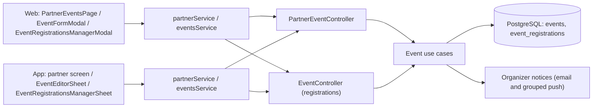

# Architecture

How the module is built in each layer. The backend has no domain of its own: an HTTP
adapter reuses the [Events](../events/README.md) use cases with the organizer's identity.
The web and the app follow `screen → hook → service → API client → HTTP transport` and
share the event editor with administration. The payout account and refunds are in
[Payments](../payments/README.md).

[View the full “Architecture” diagram](https://images.vinnot.com/docs/diagrams/v1/en/modules-partner-architecture-c45a076a2c06.svg)

## Backend

### Owned list

`GET /partner/events` derives `organizerId` exclusively from the JWT principal.
It does not accept an arbitrary organizer query parameter. This property is
essential to prevent horizontal enumeration. The optional `search` is trimmed and
matched, ignoring case, against the title, venue, city, region and country, the
same fields as the public event search, but over the organizer's events in every
state. A blank or missing `search` lists every owned event, newest first, as before.

### Creation

`POST /partner/events` forces `organizerId` to the authenticated user. Its
contract includes:

- basic information and type;
- start and end;
- textual location, coordinates, and map URL;
- price, currency, and capacity;
- deadline, ticket limit, and approval mode;
- attendance confirmation and hold duration;
- payment alias, QR, and instructions;
- image and contact data;
- requested initial status.

The request is validated at the edge, while temporal, capacity, and transition
rules are enforced inside the domain.

### Update and cancellation

The partner update uses `PUT`; its command accepts optional fields, preserves
omitted values, and applies only present fields. `clearFields` (up to 50 names of
up to 64 characters) empties optional fields, with the same semantics as the
administrative endpoint. Editors send the state only when it changes and name each
emptied optional field in `clearFields`; asking for `CANCELLED` answers 400
`USE_CANCEL_ENDPOINT`.

Partner delete does not erase data. It invokes `CancelEventCommand` with
`isAdmin=false` and verifies ownership. The `204` response means the operation
completed, not that the physical row disappeared.

### Contract and permissions

| Path | Permission | Response |
|---|---|---|
| `GET /partner/events?search=&page=&size=` | `EVENT_CREATE` | Page of own events (20 by default), optionally filtered by `search` |
| `POST /partner/events` | `EVENT_CREATE` | `201` with the ID |
| `PUT /partner/events/{id}` | `EVENT_UPDATE` or `EVENT_UPDATE_OWN` | `200` |
| `DELETE /partner/events/{id}` | `EVENT_DELETE` or `EVENT_DELETE_OWN` | `204`; cancels with the optional reason |
| `GET /events/{eventId}/registrations` | `EVENT_UPDATE` or `EVENT_UPDATE_OWN` | The event's registrations |
| `PATCH /events/{eventId}/registrations/{registrationId}` | `EVENT_UPDATE` or `EVENT_UPDATE_OWN` | Reviewed registration |

`PartnerEventController` is only an HTTP adapter: it reuses the
[Events](../events/architecture.md#backend) use cases. An administrator grants the
`PARTNER` role; there is no application or self sign-up. Editing or cancelling someone
else's event answers `422` `EVENT_OWNERSHIP`. Publishing a paid event, or keeping it
published or sold out, requires the organizer's linked Mercado Pago account
([Payments](../payments/README.md)).

### States

A cancelled event never changes state again. A completed one can go back to published or
draft, but cannot be cancelled or postponed. The system computes `SOLD_OUT` from capacity
and it cannot be requested; sending the current state back, `SOLD_OUT` included, is not a
state change. The web editor shows a sold-out event as published.

### Registration review

`ReviewEventRegistrationCommandHandler` applies `APPROVE`, `WAITLIST` or `REJECT` with an
optional note. Approving a free registration leaves it waiting for the attendee's
confirmation, when the event asks for it, or confirmed; on a paid event it leaves it
waiting for payment. A confirmed or finished registration cannot be rejected. There is no
pay-at-the-door.

### Organizer notices

Each new registration emails the organizer. Pushes are grouped:
`NotifyEventRegistrationService` accumulates confirmed, requested and cancelled counts in
`organizer_push_digests` for 15 minutes, and `OrganizerDigestScheduler` (every 60 s)
delivers one push per event with the totals; cancelled events are dropped.

## Web

### Returned states and management actions

Registration and payment are separate dimensions. `CONFIRMED` is not a payment
status and `REPORTED` alone does not confirm attendance.

| Registration state | Meaning / offered management |
|---|---|
| REQUESTED | Free: approve/reject/waitlist. Legacy paid: attendee resumes checkout, no manual credit |
| AWAITING_PAYMENT | Attendee resumes checkout; organizer may reject but cannot credit a payment |
| AWAITING_ATTENDEE_CONFIRMATION | Wait for attendee; management allows rejection |
| CONFIRMED | Confirmed registration |
| WAITLISTED | Waiting list |
| REJECTED | Rejected request |
| CANCELLED | Cancelled request |
| EXPIRED | Backend-defined reservation/deadline expiration |

Management derives actions from returned state and event price. Approve, waitlist and reject each open a confirmation for that attendee with an optional organizer note for them only; there is no shared note box, so a note never carries to the next attendee. Only the attendee being reviewed shows as pending. Cancelling an event offers "Keep event" as the dismiss option and confirms success. Server responses
determine subsequent transitions. Only provider-verified payments confirm paid admission. Manual reporting, crediting, aliases and QR payment instructions are removed from the editor.

`expiresAt`, `approvedAt`, `confirmedAt` and other timestamps map to dates.
Counters and capacity are informational projections; backend revalidates
capacity when accepting concurrent operations.

### Local event editor recovery

The admin/partner editor keeps incomplete fields through `useEventDraftRecovery`, an application service and the `EventDraftStorage` port. Adapters use LocalStorage on web and AsyncStorage on mobile. Keys isolate each account and event, with a separate draft for new events. Data has a versioned schema, a size limit and a seven-day recovery validity window.

Closing, pressing Escape or dismissing the sheet keeps the draft. Reopening offers **Resume draft** or **Discard draft**, with explicit confirmation for discarding. Recovered information must be reviewed before saving; it does not automatically overwrite changes published by another editor. Storage errors are visible and retryable; voluntary closing waits for persistence. Local operations are serialized so late writes cannot revive discarded data.

Failed remote saves keep the draft; only confirmed success removes it. This neither publishes nor changes the server DRAFT status and does not synchronize devices. Clearing browser/app data or uninstalling can remove recovery data.

### Online registration and organizer account

The editor offers Free or Online payment with Mercado Pago. MANUAL/AUTOMATIC approval and extra attendee confirmation apply only to free events. Paid registration automatically holds capacity for the configured duration and opens checkout. Currency is selected as ARS. Legacy REQUESTED/REPORTED unpaid registrations can resume checkout without manual crediting.

Organizers must link their own Mercado Pago account through `/partner/payments` before publishing paid events. Backend readiness checks enforce this; drafts do not require an account. The paid section exposes the connection link. Mobile starts OAuth using the app session and opens the official Mercado Pago destination directly, without Vinnot tokens in URLs. The callback completes automatically using server-held single-use state and PKCE, without another browser login. The result page shows success or failure and returns through a fixed app link; the editor refreshes status on mount and foreground. Opening the provider app depends on the OS and Mercado Pago. The payment environment sets the charging limits ([Payments](../payments/README.md)).

## App

### Returned states and management actions

Registration and payment are separate dimensions. `CONFIRMED` is not a payment
status and `REPORTED` alone does not confirm attendance.

| Registration state | Meaning / offered management |
|---|---|
| REQUESTED | Free: approve/reject/waitlist. Legacy paid: attendee resumes checkout, no manual credit |
| AWAITING_PAYMENT | Attendee resumes checkout; organizer may reject but cannot credit a payment |
| AWAITING_ATTENDEE_CONFIRMATION | Wait for attendee; management allows rejection |
| CONFIRMED | Confirmed registration |
| WAITLISTED | Waiting list |
| REJECTED | Rejected request |
| CANCELLED | Cancelled request |
| EXPIRED | Backend-defined reservation/deadline expiration |

Management derives actions from returned state and event price. Server responses
determine subsequent transitions. Only provider-verified payments confirm paid admission. Manual reporting, crediting, aliases and QR payment instructions are removed from the editor.

Every review action asks for confirmation inside that attendee's dialog (web) or
card (app), with an optional note for that attendee; on failure the note is kept
for a retry. The refund dialog dismisses with "Go back". When Mercado Pago rejected a refund, the
registration shows it and offers “Retry refund” ([Payments](../payments/architecture.md)).

`expiresAt`, `approvedAt`, `confirmedAt` and other timestamps map to dates.
Counters and capacity are informational projections; backend revalidates
capacity when accepting concurrent operations.

### Local event editor recovery

The admin/partner editor keeps incomplete fields through `useEventDraftRecovery`, an application service and the `EventDraftStorage` port. Adapters use LocalStorage on web and AsyncStorage on mobile. Keys isolate each account and event, with a separate draft for new events. Data has a versioned schema, a size limit and a seven-day recovery validity window.

Closing, pressing Escape or dismissing the sheet keeps the draft. Reopening offers **Resume draft** or **Discard draft**, with explicit confirmation for discarding. Recovered information must be reviewed before saving; it does not automatically overwrite changes published by another editor. Storage errors are visible and retryable; voluntary closing waits for persistence. Local operations are serialized so late writes cannot revive discarded data.

Failed remote saves keep the draft; only confirmed success removes it. This neither publishes nor changes the server DRAFT status and does not synchronize devices. Clearing browser/app data or uninstalling can remove recovery data.

### Online registration and organizer account

The editor offers Free or Online payment with Mercado Pago. MANUAL/AUTOMATIC approval and extra attendee confirmation apply only to free events. Paid registration automatically holds capacity for the configured duration and opens checkout. Currency is selected as ARS. Legacy REQUESTED/REPORTED unpaid registrations can resume checkout without manual crediting.

Organizers must link their own Mercado Pago account before publishing paid events; there is no mobile `/partner/payments` route. Backend readiness checks enforce this; drafts do not require an account. The paid section of `EventEditorFields.tsx` exposes the connection link through `usePaymentAccountSetup` and `paymentAccount.client.ts` (`/payments/mercadopago/account/connect` with `returnToApp: true`). Mobile starts OAuth using the app session and opens the official Mercado Pago destination directly, without Vinnot tokens in URLs. The callback completes automatically using server-held single-use state and PKCE, without another browser login. The result page shows success or failure and returns through a fixed app link; the editor refreshes status on mount and foreground. Opening the provider app depends on the OS and Mercado Pago. Production uses the LIVE policy: a positive ARS amount, a real organizer distinct from the platform and a 3% commission; the pilot policy remains available for restricted environments only.

## Event editor

### Web and mobile event editor

The editor groups basic information/cover, location, contact and registration into collapsible sections. Folding preserves draft values and validation opens sections containing errors. Mobile admin and partner share `EventEditorSheet`, `EventEditorFields` and `useEventEditor` while retaining their separately authorized mutations. Web reuses `EventFormModal` for both roles and delegates orchestration to `useEventEditor`. The shared mobile `ManagedEvent`/`EventEditorInput` contract belongs to the event domain; existing partner names remain compatibility aliases.

Pure `domain/event/eventEditor.ts` rules return typed codes translated in presentation, without knowing i18n namespaces. Both clients validate dates, deadlines, coordinates, price, capacity, currency, contact and registration limits. Empty capacity remains unlimited rather than becoming zero. Free registration sends a null price; paid registration requires a positive price. When editing, both clients name each emptied optional field in `clearFields` (`toPatchRequest`, as in administration) and send the state only when it changed. The mobile editor does not send the payment alias, QR or instructions, which it does not show, so saving from the app never clears them. Paid events use Mercado Pago checkout and the 3% split configured in payment. Production uses `LIVE`, without the pilot amount cap or single seller restriction; `LIVE_PILOT` remains available for controlled tests.

The editor's location section includes a map before searching, marker/click selection and valid zero coordinates. Mobile allows panning and zooming; late geocoding responses cannot overwrite a manual selection or another draft. Web preserves external-map consent. The reusable picker also serves the winery editor and route stops on web/mobile. Stop maps expand on demand; moving a point replaces that stop draft so an older search cannot overwrite the selected coordinates. The route overview remains a preview.

Cover uploads continue through the existing hooks and media pipeline; web accepts file selection or drag-and-drop.
