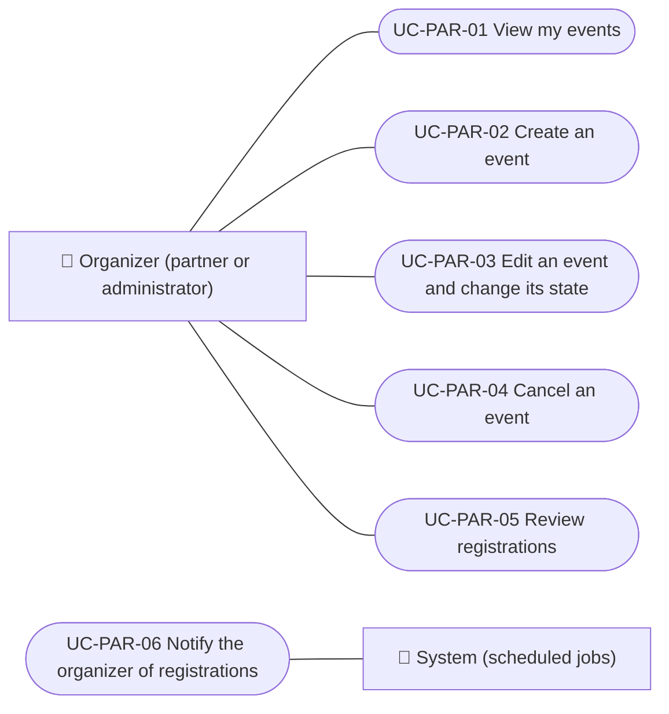

# Use cases

Event organizer use cases (partner role): viewing their events, creating them, editing them and changing their state, cancelling them, reviewing registrations and receiving registration notices. The payout account and refunds are in Payments and granting the role is in Administration. Each case applies to the platforms listed.

| ID | Use case | Platforms | Actors |
|---|---|---|---|
| `UC-PAR-01` | [View my events](uc-par-01-list-own-events.md) | Web, APK | Organizer (partner or administrator) |
| `UC-PAR-02` | [Create an event](uc-par-02-create-event.md) | Web, APK | Organizer (partner or administrator) |
| `UC-PAR-03` | [Edit an event and change its state](uc-par-03-edit-event.md) | Web, APK | Organizer (partner or administrator) |
| `UC-PAR-04` | [Cancel an event](uc-par-04-cancel-event.md) | Web, APK | Organizer (partner or administrator) |
| `UC-PAR-05` | [Review registrations](uc-par-05-review-registrations.md) | Web, APK | Organizer (partner or administrator) |
| `UC-PAR-06` | [Notify the organizer of registrations](uc-par-06-organizer-notices.md) | Backend only | System (scheduled jobs) |

## Use case diagram

[View the full “Use cases · Use case diagram” diagram](https://images.vinnot.com/docs/diagrams/v1/en/modules-partner-use-cases-readme-38487d9a65b1.svg)

## Lucidchart mapping

| ID | Lucidchart IDs |
|---|---|
| `UC-PAR-01` | [WEB UC-PAR-01](https://lucid.app/lucidchart/9f11a16b-bb5a-42fc-a9e8-0852b17bd241/edit), [APK UC-ORG-01](https://lucid.app/lucidchart/e095dd25-e8ac-41ba-bf5b-396e1055f217/edit) |
| `UC-PAR-02` | [WEB UC-PAR-02](https://lucid.app/lucidchart/9f11a16b-bb5a-42fc-a9e8-0852b17bd241/edit), [APK UC-ORG-02](https://lucid.app/lucidchart/e095dd25-e8ac-41ba-bf5b-396e1055f217/edit) |
| `UC-PAR-03` | [WEB UC-PAR-03](https://lucid.app/lucidchart/9f11a16b-bb5a-42fc-a9e8-0852b17bd241/edit), [APK UC-ORG-02](https://lucid.app/lucidchart/e095dd25-e8ac-41ba-bf5b-396e1055f217/edit), [APK UC-ORG-04](https://lucid.app/lucidchart/e095dd25-e8ac-41ba-bf5b-396e1055f217/edit) |
| `UC-PAR-04` | [WEB UC-PAR-04](https://lucid.app/lucidchart/9f11a16b-bb5a-42fc-a9e8-0852b17bd241/edit), [APK UC-ORG-05](https://lucid.app/lucidchart/e095dd25-e8ac-41ba-bf5b-396e1055f217/edit) |
| `UC-PAR-05` | [WEB UC-PAR-05](https://lucid.app/lucidchart/9f11a16b-bb5a-42fc-a9e8-0852b17bd241/edit), [APK UC-ORG-06](https://lucid.app/lucidchart/e095dd25-e8ac-41ba-bf5b-396e1055f217/edit) |
| `UC-PAR-06` | None |
