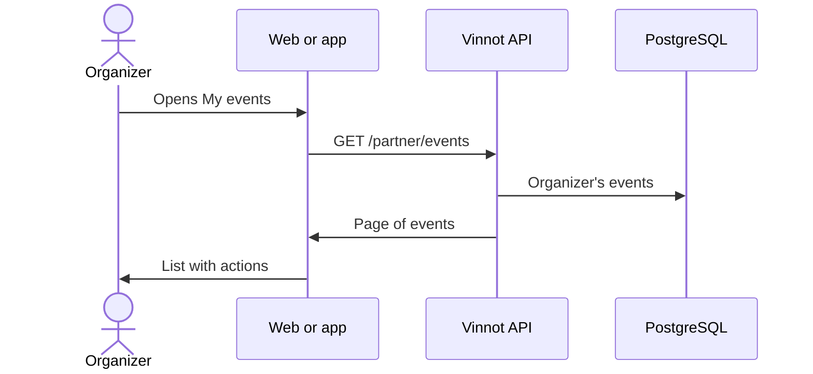

# UC-PAR-01 · View my events

| Field | Value |
|---|---|
| ID | `UC-PAR-01` |
| Module | [Partners](../README.md) |
| Platforms | Web, APK |
| Actors | Organizer (partner or administrator) |
| Lucidchart IDs | [WEB UC-PAR-01](https://lucid.app/lucidchart/9f11a16b-bb5a-42fc-a9e8-0852b17bd241/edit), [APK UC-ORG-01](https://lucid.app/lucidchart/e095dd25-e8ac-41ba-bf5b-396e1055f217/edit) |
| Requirements | [`RF-WEB-PAR-01`](../requirements.md), [`RF-APK-PAR-01`](../requirements.md) |
| Test cases | [`CP-PAR-01`](../testing.md), [`CP-PAR-02`](../testing.md) |

## Preconditions

- The person has the partner role, granted by an administrator, or is an administrator.

## Postconditions

- The person sees their events with their state.

## Main flow

1. The person opens “My events”: on the web, `/partner/events`; on the app, from the profile.
2. The client calls `GET /partner/events`, 20 at a time.
3. The API takes the organizer from the session and returns only their events.
4. The client shows each event with date, state and registrations, and the edit, cancel and view registrations actions.

## Alternative flows

- 1a. The person is neither partner nor administrator: the client does not show the section and the API answers 403.

## Business rules

- The organizer is never chosen by parameter: it is always the signed-in person.
- There is no application to become a partner; an administrator grants the role ([Administration](../../admin/README.md)).

## Diagram

[View the full “UC-PAR-01 · View my events” diagram](https://images.vinnot.com/docs/diagrams/v1/en/modules-partner-use-cases-uc-par-01-list-own-events-b3f1bd9d1c1c.svg)

Component diagram in Lucidchart: [WEB UC-PAR-01](https://lucid.app/lucidchart/9f11a16b-bb5a-42fc-a9e8-0852b17bd241/edit), [APK UC-ORG-01](https://lucid.app/lucidchart/e095dd25-e8ac-41ba-bf5b-396e1055f217/edit).

## Code

| Layer | Location |
|---|---|
| Endpoints | `GET /partner/events` |
| Backend | [`PartnerEventController.java`](../../../../../backend/src/main/java/com/vinnot/partner/infrastructure/web/controller/PartnerEventController.java) |
| Web | [`PartnerEventsPage.tsx`](../../../../../frontend-react/src/presentation/pages/partner/PartnerEventsPage.tsx), [`usePartnerEventsViewModel.ts`](../../../../../frontend-react/src/presentation/pages/partner/usePartnerEventsViewModel.ts), [`usePartnerEvents.ts`](../../../../../frontend-react/src/presentation/hooks/queries/partner/usePartnerEvents.ts), [`partner.service.ts`](../../../../../frontend-react/src/application/services/partner.service.ts), [`partner.client.ts`](../../../../../frontend-react/src/infrastructure/api/clients/partner.client.ts) |
| App | `frontend-mobile/app/(app)/partner/index.tsx`, [`PartnerEventRow.tsx`](../../../../../frontend-mobile/src/presentation/features/partner/PartnerEventRow.tsx), [`PartnerEventSheet.tsx`](../../../../../frontend-mobile/src/presentation/features/partner/PartnerEventSheet.tsx), [`PartnerDashboardHero.tsx`](../../../../../frontend-mobile/src/presentation/features/partner/PartnerDashboardHero.tsx), [`partner.service.ts`](../../../../../frontend-mobile/src/application/services/partner.service.ts), [`partner.client.ts`](../../../../../frontend-mobile/src/infrastructure/api/clients/partner.client.ts) |

## Automated tests

- Backend: None
- Web: [`PartnerEventsPage.test.tsx`](../../../../../frontend-react/src/presentation/pages/partner/PartnerEventsPage.test.tsx), [`usePartnerEventsViewModel.test.tsx`](../../../../../frontend-react/src/presentation/pages/partner/usePartnerEventsViewModel.test.tsx), [`partner.service.test.ts`](../../../../../frontend-react/src/application/services/partner.service.test.ts), [`partner.client.test.ts`](../../../../../frontend-react/src/infrastructure/api/clients/partner.client.test.ts)
- App: [`PartnerEventRow.test.tsx`](../../../../../frontend-mobile/src/presentation/features/partner/PartnerEventRow.test.tsx), [`partnerRoute.test.tsx`](../../../../../frontend-mobile/src/presentation/features/partner/__tests__/partnerRoute.test.tsx), [`partner.service.test.ts`](../../../../../frontend-mobile/src/application/services/partner.service.test.ts), [`partner.client.test.ts`](../../../../../frontend-mobile/src/infrastructure/api/clients/partner.client.test.ts)
