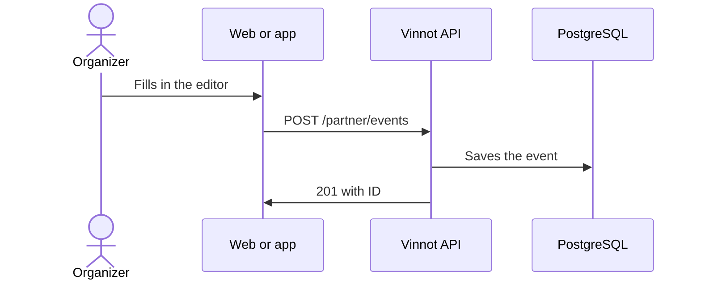

# UC-PAR-02 · Create an event

| Field | Value |
|---|---|
| ID | `UC-PAR-02` |
| Module | [Partners](../README.md) |
| Platforms | Web, APK |
| Actors | Organizer (partner or administrator) |
| Lucidchart IDs | [WEB UC-PAR-02](https://lucid.app/lucidchart/9f11a16b-bb5a-42fc-a9e8-0852b17bd241/edit), [APK UC-ORG-02](https://lucid.app/lucidchart/e095dd25-e8ac-41ba-bf5b-396e1055f217/edit) |
| Requirements | [`RF-WEB-PAR-02`](../requirements.md), [`RF-APK-PAR-02`](../requirements.md) |
| Test cases | [`CP-PAR-03`](../testing.md), [`CP-PAR-04`](../testing.md), [`CP-PAR-05`](../testing.md), [`CP-PAR-06`](../testing.md) |

## Preconditions

- The person is an organizer and is on “My events”.

## Postconditions

- The event was created as a draft or published.

## Main flow

1. The person chooses “Create event”.
2. They fill in the editor by sections: basic data and cover, location on the map, contact and registration.
3. In registration they choose free or online payment with Mercado Pago, capacity, deadline and ticket limit.
4. The client validates dates, coordinates, price, capacity and contact, and sends `POST /partner/events`.
5. The API uses the signed-in person as organizer, applies the event rules and returns `201` with the ID.

## Alternative flows

- 2a. The person closes the editor without saving: the draft stays on the device for 7 days and resuming it is offered.
- 5a. The event is paid and publishing is requested without a linked Mercado Pago account: the API rejects it; saving it as a draft is allowed.
- 4a. Some data is invalid: the editor opens the section with the error.

## Business rules

- An empty capacity means unlimited.
- A free event has no price; a paid one needs a positive price in ARS.
- Manual or automatic approval and attendee confirmation are only set on free events.
- Zero coordinates are valid.

## Diagram

[View the full “UC-PAR-02 · Create an event” diagram](https://images.vinnot.com/docs/diagrams/v1/en/modules-partner-use-cases-uc-par-02-create-event-3b1d98929dbb.svg)

Component diagram in Lucidchart: [WEB UC-PAR-02](https://lucid.app/lucidchart/9f11a16b-bb5a-42fc-a9e8-0852b17bd241/edit), [APK UC-ORG-02](https://lucid.app/lucidchart/e095dd25-e8ac-41ba-bf5b-396e1055f217/edit).

## Code

| Layer | Location |
|---|---|
| Endpoints | `POST /partner/events` |
| Backend | [`PartnerEventController.java`](../../../../../backend/src/main/java/com/vinnot/partner/infrastructure/web/controller/PartnerEventController.java), [`CreateEventCommandHandler.java`](../../../../../backend/src/main/java/com/vinnot/event/application/command/handler/CreateEventCommandHandler.java) |
| Web | [`PartnerEventsPage.tsx`](../../../../../frontend-react/src/presentation/pages/partner/PartnerEventsPage.tsx), [`usePartnerEventsViewModel.ts`](../../../../../frontend-react/src/presentation/pages/partner/usePartnerEventsViewModel.ts), [`EventFormModal.tsx`](../../../../../frontend-react/src/presentation/components/features/event/EventFormModal.tsx), [`useEventEditor.ts`](../../../../../frontend-react/src/presentation/components/features/event/useEventEditor.ts), [`usePartnerEventMutations.ts`](../../../../../frontend-react/src/presentation/hooks/queries/partner/usePartnerEventMutations.ts), [`partner.service.ts`](../../../../../frontend-react/src/application/services/partner.service.ts), [`partner.client.ts`](../../../../../frontend-react/src/infrastructure/api/clients/partner.client.ts) |
| App | `frontend-mobile/app/(app)/partner/index.tsx`, [`PartnerEventRow.tsx`](../../../../../frontend-mobile/src/presentation/features/partner/PartnerEventRow.tsx), [`PartnerEventSheet.tsx`](../../../../../frontend-mobile/src/presentation/features/partner/PartnerEventSheet.tsx), [`EventEditorSheet.tsx`](../../../../../frontend-mobile/src/presentation/features/event/EventEditorSheet.tsx), [`EventEditorFields.tsx`](../../../../../frontend-mobile/src/presentation/features/event/EventEditorFields.tsx), [`useEventEditor.ts`](../../../../../frontend-mobile/src/presentation/features/event/useEventEditor.ts), [`partner.service.ts`](../../../../../frontend-mobile/src/application/services/partner.service.ts), [`partner.client.ts`](../../../../../frontend-mobile/src/infrastructure/api/clients/partner.client.ts) |

## Automated tests

- Backend: [`EventOwnershipTest.java`](../../../../../backend/src/test/java/com/vinnot/event/application/command/handler/EventOwnershipTest.java)
- Web: [`usePartnerEventMutations.test.tsx`](../../../../../frontend-react/src/presentation/hooks/queries/partner/usePartnerEventMutations.test.tsx), [`partner.mappers.test.ts`](../../../../../frontend-react/src/domain/partner/partner.mappers.test.ts)
- App: [`EventEditorFields.test.tsx`](../../../../../frontend-mobile/src/presentation/features/event/EventEditorFields.test.tsx), [`useEventEditor.test.ts`](../../../../../frontend-mobile/src/presentation/features/event/useEventEditor.test.ts), [`partner.mappers.test.ts`](../../../../../frontend-mobile/src/domain/partner/partner.mappers.test.ts)
