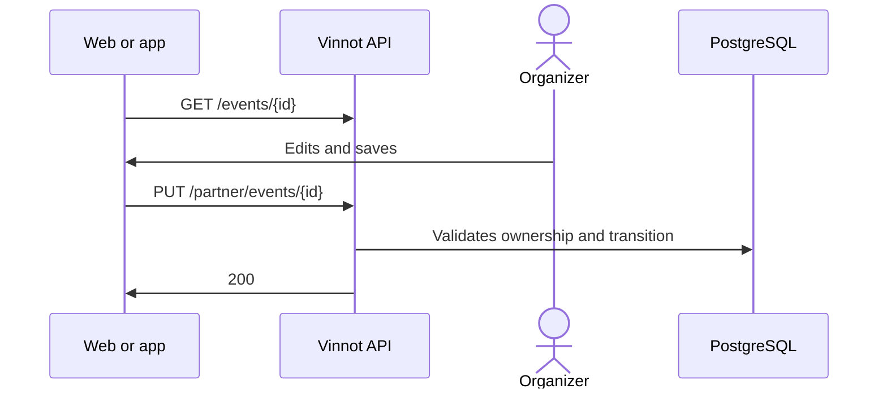

# UC-PAR-03 · Edit an event and change its state

| Field | Value |
|---|---|
| ID | `UC-PAR-03` |
| Module | [Partners](../README.md) |
| Platforms | Web, APK |
| Actors | Organizer (partner or administrator) |
| Lucidchart IDs | [WEB UC-PAR-03](https://lucid.app/lucidchart/9f11a16b-bb5a-42fc-a9e8-0852b17bd241/edit), [APK UC-ORG-02](https://lucid.app/lucidchart/e095dd25-e8ac-41ba-bf5b-396e1055f217/edit), [APK UC-ORG-04](https://lucid.app/lucidchart/e095dd25-e8ac-41ba-bf5b-396e1055f217/edit) |
| Requirements | [`RF-WEB-PAR-03`](../requirements.md), [`RF-WEB-PAR-04`](../requirements.md), [`RF-APK-PAR-03`](../requirements.md), [`RF-APK-PAR-04`](../requirements.md) |
| Test cases | [`CP-PAR-07`](../testing.md), [`CP-PAR-21`](../testing.md), [`CP-PAR-23`](../testing.md), [`CP-PAR-08`](../testing.md), [`CP-PAR-09`](../testing.md), [`CP-PAR-10`](../testing.md), [`CP-PAR-22`](../testing.md) |

## Preconditions

- The person organizes the event or is an administrator.

## Postconditions

- The event was updated with its new state.

## Main flow

1. The person chooses to edit an event.
2. The client loads the full details with `GET /events/{id}` and opens the editor.
3. The person changes data or the state: draft, published or completed. The editor does not offer “Cancelled”: to cancel the event, the “Cancel event” action is used ([UC-PAR-04](uc-par-04-cancel-event.md)).
4. The client sends `PUT /partner/events/{id}`, with the state only when it changed and with `clearFields` naming each optional field the person emptied.
5. The API checks that the event belongs to the person, applies only the fields sent, empties the optional fields listed in `clearFields` and applies the state transition.

## Alternative flows

- 4a. The state did not change, or the event is sold out and the editor shows it as published: the client does not send the state and the API keeps the current one.
- 4b. The person emptied an optional field, such as the contact phone or the website: the client names it in `clearFields` and the API clears it.
- 5a. The event belongs to someone else: the API answers 422.
- 5b. The transition is not allowed, such as moving a cancelled event back to draft: the API answers 400.
- 5c. The event is paid, stays published or sold out and the Mercado Pago account is missing: the API rejects it.
- 5d. The request asks to move the event to cancelled: the API answers 400 `USE_CANCEL_ENDPOINT`.

## Business rules

- A cancelled event never changes state again.
- A completed event can go back to published or draft, but cannot be cancelled or postponed.
- The web and app editors do not offer the postponed state; the API accepts it in `PUT /partner/events/{id}`.
- “Sold out” is computed by the system from capacity; it is not chosen. Sending the current state back, sold out included, is not a state change.
- An event is only cancelled through the “Cancel event” action, which asks for the reason and notifies registered attendees.
- Fields that are not sent keep their value; emptying an optional field in the editor and saving clears it, because the client names it in `clearFields`.
- The app editor does not send the payment alias, QR or instructions, which it does not show, so saving from the app never clears them.

## Diagram

[View the full “UC-PAR-03 · Edit an event and change its state” diagram](https://images.vinnot.com/docs/diagrams/v1/en/modules-partner-use-cases-uc-par-03-edit-event-70c5b9daf313.svg)

Component diagram in Lucidchart: [WEB UC-PAR-03](https://lucid.app/lucidchart/9f11a16b-bb5a-42fc-a9e8-0852b17bd241/edit), [APK UC-ORG-02](https://lucid.app/lucidchart/e095dd25-e8ac-41ba-bf5b-396e1055f217/edit), [APK UC-ORG-04](https://lucid.app/lucidchart/e095dd25-e8ac-41ba-bf5b-396e1055f217/edit).

## Code

| Layer | Location |
|---|---|
| Endpoints | `GET /events/{id}`, `PUT /partner/events/{id}` |
| Backend | [`PartnerEventController.java`](../../../../../backend/src/main/java/com/vinnot/partner/infrastructure/web/controller/PartnerEventController.java), [`UpdateEventCommandHandler.java`](../../../../../backend/src/main/java/com/vinnot/event/application/command/handler/UpdateEventCommandHandler.java), [`Event.java`](../../../../../backend/src/main/java/com/vinnot/event/domain/model/Event.java) |
| Web | [`PartnerEventsPage.tsx`](../../../../../frontend-react/src/presentation/pages/partner/PartnerEventsPage.tsx), [`usePartnerEventsViewModel.ts`](../../../../../frontend-react/src/presentation/pages/partner/usePartnerEventsViewModel.ts), [`EventFormModal.tsx`](../../../../../frontend-react/src/presentation/components/features/event/EventFormModal.tsx), [`useEventEditor.ts`](../../../../../frontend-react/src/presentation/components/features/event/useEventEditor.ts), [`usePartnerEventMutations.ts`](../../../../../frontend-react/src/presentation/hooks/queries/partner/usePartnerEventMutations.ts), [`partner.service.ts`](../../../../../frontend-react/src/application/services/partner.service.ts), [`partner.client.ts`](../../../../../frontend-react/src/infrastructure/api/clients/partner.client.ts) |
| App | `frontend-mobile/app/(app)/partner/index.tsx`, [`PartnerEventRow.tsx`](../../../../../frontend-mobile/src/presentation/features/partner/PartnerEventRow.tsx), [`PartnerEventSheet.tsx`](../../../../../frontend-mobile/src/presentation/features/partner/PartnerEventSheet.tsx), [`EventEditorSheet.tsx`](../../../../../frontend-mobile/src/presentation/features/event/EventEditorSheet.tsx), [`EventEditorFields.tsx`](../../../../../frontend-mobile/src/presentation/features/event/EventEditorFields.tsx), [`useEventEditor.ts`](../../../../../frontend-mobile/src/presentation/features/event/useEventEditor.ts), [`partner.service.ts`](../../../../../frontend-mobile/src/application/services/partner.service.ts), [`partner.client.ts`](../../../../../frontend-mobile/src/infrastructure/api/clients/partner.client.ts) |

## Automated tests

- Backend: [`EventOwnershipTest.java`](../../../../../backend/src/test/java/com/vinnot/event/application/command/handler/EventOwnershipTest.java), [`EventStatusTransitionTest.java`](../../../../../backend/src/test/java/com/vinnot/event/domain/model/EventStatusTransitionTest.java), [`UpdateEventCommandHandlerTest.java`](../../../../../backend/src/test/java/com/vinnot/event/application/command/handler/UpdateEventCommandHandlerTest.java), [`PartnerEventControllerTest.java`](../../../../../backend/src/test/java/com/vinnot/partner/infrastructure/web/controller/PartnerEventControllerTest.java)
- Web: [`usePartnerEventMutations.test.tsx`](../../../../../frontend-react/src/presentation/hooks/queries/partner/usePartnerEventMutations.test.tsx), [`usePartnerEventsViewModel.status.test.tsx`](../../../../../frontend-react/src/presentation/pages/partner/usePartnerEventsViewModel.status.test.tsx), [`eventEditor.test.ts`](../../../../../frontend-react/src/domain/event/eventEditor.test.ts), [`partner.client.test.ts`](../../../../../frontend-react/src/infrastructure/api/clients/partner.client.test.ts)
- App: [`useEventEditor.test.ts`](../../../../../frontend-mobile/src/presentation/features/event/useEventEditor.test.ts), [`partner.client.test.ts`](../../../../../frontend-mobile/src/infrastructure/api/clients/partner.client.test.ts)
