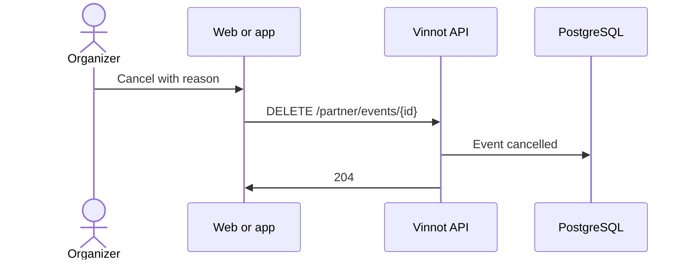

# UC-PAR-04 · Cancel an event

| Field | Value |
|---|---|
| ID | `UC-PAR-04` |
| Module | [Partners](../README.md) |
| Platforms | Web, APK |
| Actors | Organizer (partner or administrator) |
| Lucidchart IDs | [WEB UC-PAR-04](https://lucid.app/lucidchart/9f11a16b-bb5a-42fc-a9e8-0852b17bd241/edit), [APK UC-ORG-05](https://lucid.app/lucidchart/e095dd25-e8ac-41ba-bf5b-396e1055f217/edit) |
| Requirements | [`RF-WEB-PAR-05`](../requirements.md), [`RF-APK-PAR-05`](../requirements.md) |
| Test cases | [`CP-PAR-11`](../testing.md), [`CP-PAR-12`](../testing.md), [`CP-PAR-13`](../testing.md), [`CP-PAR-14`](../testing.md) |

## Preconditions

- The person organizes the event or is an administrator, and the event is not completed.

## Postconditions

- The event was cancelled; registered people get the notice and online payments are refunded.

## Main flow

1. The person chooses “Cancel event”.
2. The client shows the dialog with the preselected reason “Unforeseen circumstances” and warns that cancelling is final, that the event cannot be published again and that online payments are refunded automatically through Mercado Pago, which cannot be undone.
3. The person confirms, changing the reason if they want.
4. The client sends `DELETE /partner/events/{id}` with the reason.
5. The API checks ownership, cancels the event without deleting it and answers `204`.

## Alternative flows

- 3a. The reason is “Other”: an optional note of up to 280 characters appears.
- 3b. The person chooses “Keep event”: it is not cancelled.
- 5a. The event is completed: the API answers 400.

## Business rules

- Cancelling does not delete the row: the event keeps a cancelled state.
- The notices to registered people and the refunds are described in [Events](../../events/README.md) and [Payments](../../payments/README.md).

## Diagram

[View the full “UC-PAR-04 · Cancel an event” diagram](https://images.vinnot.com/docs/diagrams/v1/en/modules-partner-use-cases-uc-par-04-cancel-event-a0d01bf0771b.svg)

Component diagram in Lucidchart: [WEB UC-PAR-04](https://lucid.app/lucidchart/9f11a16b-bb5a-42fc-a9e8-0852b17bd241/edit), [APK UC-ORG-05](https://lucid.app/lucidchart/e095dd25-e8ac-41ba-bf5b-396e1055f217/edit).

## Code

| Layer | Location |
|---|---|
| Endpoints | `DELETE /partner/events/{id}` |
| Backend | [`PartnerEventController.java`](../../../../../backend/src/main/java/com/vinnot/partner/infrastructure/web/controller/PartnerEventController.java), [`CancelEventCommandHandler.java`](../../../../../backend/src/main/java/com/vinnot/event/application/command/handler/CancelEventCommandHandler.java) |
| Web | [`PartnerEventsPage.tsx`](../../../../../frontend-react/src/presentation/pages/partner/PartnerEventsPage.tsx), [`usePartnerEventsViewModel.ts`](../../../../../frontend-react/src/presentation/pages/partner/usePartnerEventsViewModel.ts), [`CancelEventDialog.tsx`](../../../../../frontend-react/src/presentation/components/features/event/CancelEventDialog.tsx), [`partner.service.ts`](../../../../../frontend-react/src/application/services/partner.service.ts), [`partner.client.ts`](../../../../../frontend-react/src/infrastructure/api/clients/partner.client.ts) |
| App | `frontend-mobile/app/(app)/partner/index.tsx`, [`PartnerEventRow.tsx`](../../../../../frontend-mobile/src/presentation/features/partner/PartnerEventRow.tsx), [`PartnerEventSheet.tsx`](../../../../../frontend-mobile/src/presentation/features/partner/PartnerEventSheet.tsx), [`CancelEventSheet.tsx`](../../../../../frontend-mobile/src/presentation/features/event/CancelEventSheet.tsx), [`partner.service.ts`](../../../../../frontend-mobile/src/application/services/partner.service.ts), [`partner.client.ts`](../../../../../frontend-mobile/src/infrastructure/api/clients/partner.client.ts) |

## Automated tests

- Backend: [`EventOwnershipTest.java`](../../../../../backend/src/test/java/com/vinnot/event/application/command/handler/EventOwnershipTest.java), [`EventCancellationTest.java`](../../../../../backend/src/test/java/com/vinnot/event/domain/valueobject/EventCancellationTest.java)
- Web: [`CancelEventDialog.test.tsx`](../../../../../frontend-react/src/presentation/components/features/event/CancelEventDialog.test.tsx), [`eventCancellation.test.ts`](../../../../../frontend-react/src/domain/event/eventCancellation.test.ts)
- App: [`CancelEventSheet.test.tsx`](../../../../../frontend-mobile/src/presentation/features/event/CancelEventSheet.test.tsx), [`eventCancellation.test.ts`](../../../../../frontend-mobile/src/domain/event/eventCancellation.test.ts), [`useEventCancellation.test.ts`](../../../../../frontend-mobile/src/presentation/features/event/useEventCancellation.test.ts)
