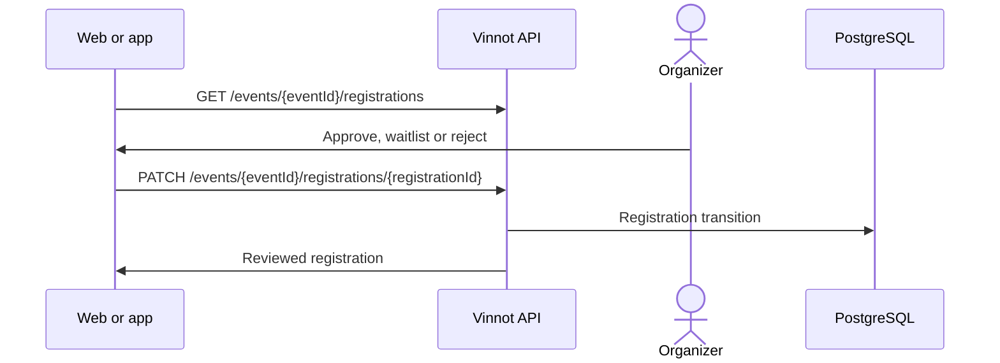

# UC-PAR-05 · Review registrations

| Field | Value |
|---|---|
| ID | `UC-PAR-05` |
| Module | [Partners](../README.md) |
| Platforms | Web, APK |
| Actors | Organizer (partner or administrator) |
| Lucidchart IDs | [WEB UC-PAR-05](https://lucid.app/lucidchart/9f11a16b-bb5a-42fc-a9e8-0852b17bd241/edit), [APK UC-ORG-06](https://lucid.app/lucidchart/e095dd25-e8ac-41ba-bf5b-396e1055f217/edit) |
| Requirements | [`RF-WEB-PAR-06`](../requirements.md), [`RF-WEB-PAR-07`](../requirements.md), [`RF-APK-PAR-06`](../requirements.md), [`RF-APK-PAR-07`](../requirements.md) |
| Test cases | [`CP-PAR-15`](../testing.md), [`CP-PAR-16`](../testing.md), [`CP-PAR-17`](../testing.md), [`CP-PAR-18`](../testing.md) |

## Preconditions

- The person organizes the event or is an administrator.

## Postconditions

- The reviewed registrations were approved, waitlisted or rejected.

## Main flow

1. The person opens an event's registrations.
2. The client calls `GET /events/{eventId}/registrations` and shows each registration with its state, oldest request first.
3. The client offers only the actions possible for the state and whether the event is paid.
4. The person approves, waitlists or rejects, with an optional note.
5. The client sends `PATCH /events/{eventId}/registrations/{registrationId}` and the API applies the transition.

## Alternative flows

- 4a. Rejecting asks for confirmation.
- 5a. The event belongs to someone else: the API rejects it even if the ID is known.
- 5b. The registration is already confirmed or finished: it cannot be rejected.

## Business rules

- Approving a free registration confirms it, or leaves it waiting for the attendee's confirmation if the event asks for it; on a paid event it leaves it waiting for payment.
- The organizer never credits payments by hand: only Mercado Pago confirms a payment.
- The note the organizer writes when approving, waitlisting or rejecting is kept for the attendee.
- If there are not enough places when approving, the registration moves to the waitlist with the organizer's note, if any.
- The note field is cleared after each successful review.
- Each registration's payments and refunds are shown in the same manager ([UC-PAY-04](../../payments/use-cases/uc-pay-04-refund-registration.md)).

## Diagram

[View the full “UC-PAR-05 · Review registrations” diagram](https://images.vinnot.com/docs/diagrams/v1/en/modules-partner-use-cases-uc-par-05-review-registrations-f2cea14ca9db.svg)

Component diagram in Lucidchart: [WEB UC-PAR-05](https://lucid.app/lucidchart/9f11a16b-bb5a-42fc-a9e8-0852b17bd241/edit), [APK UC-ORG-06](https://lucid.app/lucidchart/e095dd25-e8ac-41ba-bf5b-396e1055f217/edit).

## Code

| Layer | Location |
|---|---|
| Endpoints | `GET /events/{eventId}/registrations`, `PATCH /events/{eventId}/registrations/{registrationId}` |
| Backend | [`EventController.java`](../../../../../backend/src/main/java/com/vinnot/event/infrastructure/web/controller/EventController.java), [`ReviewEventRegistrationCommandHandler.java`](../../../../../backend/src/main/java/com/vinnot/event/application/command/handler/ReviewEventRegistrationCommandHandler.java), [`EventRegistration.java`](../../../../../backend/src/main/java/com/vinnot/event/domain/model/EventRegistration.java) |
| Web | [`PartnerEventsPage.tsx`](../../../../../frontend-react/src/presentation/pages/partner/PartnerEventsPage.tsx), [`usePartnerEventsViewModel.ts`](../../../../../frontend-react/src/presentation/pages/partner/usePartnerEventsViewModel.ts), [`EventRegistrationsManagerModal.tsx`](../../../../../frontend-react/src/presentation/components/features/event/EventRegistrationsManagerModal.tsx) |
| App | `frontend-mobile/app/(app)/partner/index.tsx`, [`PartnerEventRow.tsx`](../../../../../frontend-mobile/src/presentation/features/partner/PartnerEventRow.tsx), [`PartnerEventSheet.tsx`](../../../../../frontend-mobile/src/presentation/features/partner/PartnerEventSheet.tsx), [`EventRegistrationsManagerSheet.tsx`](../../../../../frontend-mobile/src/presentation/features/event/EventRegistrationsManagerSheet.tsx) |

## Automated tests

- Backend: [`ReviewEventRegistrationCommandHandlerTest.java`](../../../../../backend/src/test/java/com/vinnot/event/application/command/handler/ReviewEventRegistrationCommandHandlerTest.java), [`EventRegistrationTest.java`](../../../../../backend/src/test/java/com/vinnot/event/domain/model/EventRegistrationTest.java)
- Web: None
- App: [`EventRegistrationsManagerSheet.test.tsx`](../../../../../frontend-mobile/src/presentation/features/event/EventRegistrationsManagerSheet.test.tsx), [`eventRegistrationActions.test.ts`](../../../../../frontend-mobile/src/domain/event/eventRegistrationActions.test.ts)
