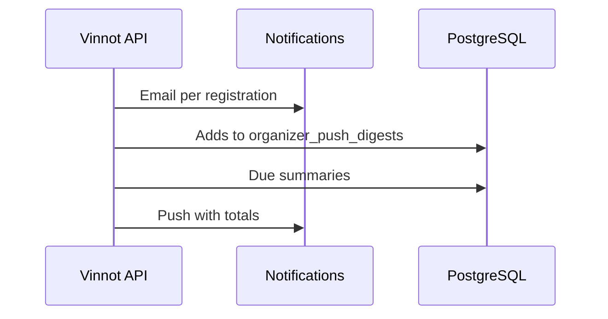

# UC-PAR-06 · Notify the organizer of registrations

| Field | Value |
|---|---|
| ID | `UC-PAR-06` |
| Module | [Partners](../README.md) |
| Platforms | Backend only |
| Actors | System (scheduled jobs) |
| Lucidchart IDs | None |
| Requirements | None |
| Test cases | [`CP-PAR-19`](../testing.md), [`CP-PAR-20`](../testing.md) |

## Preconditions

- Someone registered, requested a spot or cancelled on an event.

## Postconditions

- The organizer got an email for each registration and a push with the totals.

## Main flow

1. The system emails the organizer for each new registration.
2. It adds up confirmed, requested and cancelled for the event over 15 minutes.
3. A job checks due summaries every minute.
4. It sends one push per event with the totals, which opens the organizer's events.

## Alternative flows

- 4a. The event was cancelled: the summary is dropped.

## Business rules

- The push follows the [Notifications](../../notifications/README.md) rules: preferences, quiet hours and caps.
- Each summary is sent only once per event and due time.

## Diagram

[View the full “UC-PAR-06 · Notify the organizer of registrations” diagram](https://images.vinnot.com/docs/diagrams/v1/en/modules-partner-use-cases-uc-par-06-organizer-notices-22c3f90463f9.svg)

## Code

| Layer | Location |
|---|---|
| Backend | [`NotifyEventRegistrationService.java`](../../../../../backend/src/main/java/com/vinnot/event/application/service/NotifyEventRegistrationService.java), [`SendOrganizerDigestsService.java`](../../../../../backend/src/main/java/com/vinnot/event/application/service/SendOrganizerDigestsService.java), [`OrganizerDigestScheduler.java`](../../../../../backend/src/main/java/com/vinnot/event/infrastructure/scheduling/OrganizerDigestScheduler.java) |

## Automated tests

- Backend: [`SendOrganizerDigestsServiceTest.java`](../../../../../backend/src/test/java/com/vinnot/event/application/service/SendOrganizerDigestsServiceTest.java), [`OrganizerDigestSchedulerTest.java`](../../../../../backend/src/test/java/com/vinnot/event/infrastructure/scheduling/OrganizerDigestSchedulerTest.java), [`OrganizerDigestPostgresIntegrationTest.java`](../../../../../backend/src/test/java/com/vinnot/event/infrastructure/OrganizerDigestPostgresIntegrationTest.java)
- Web: None
- App: None
