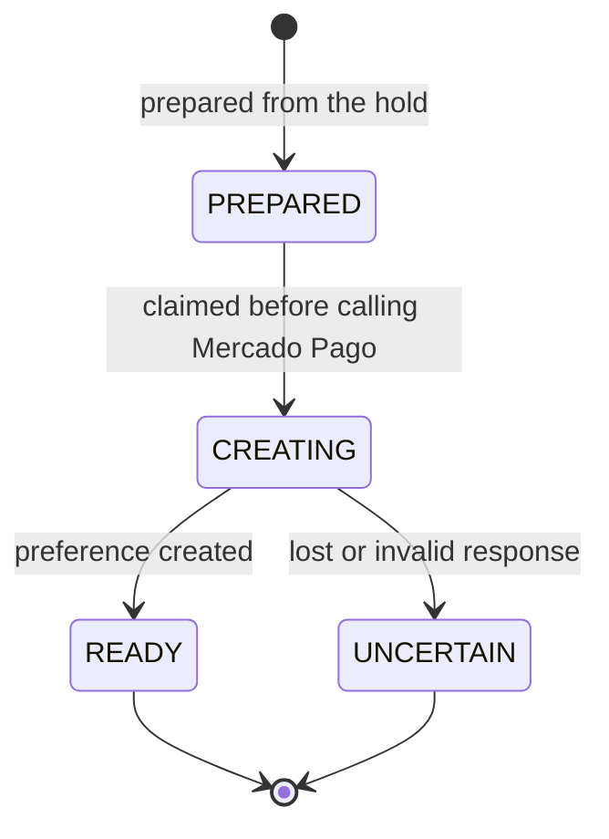
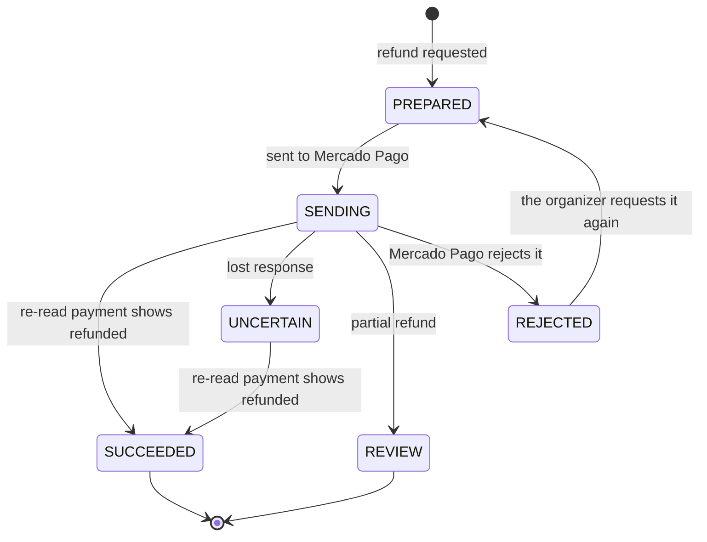
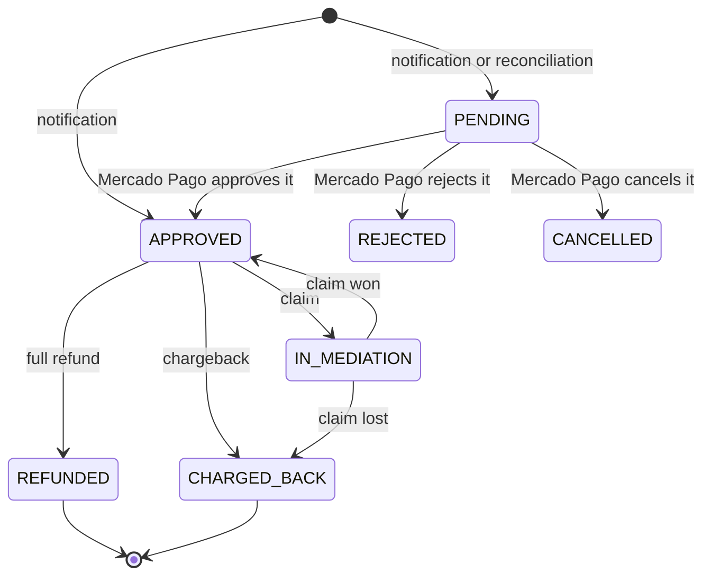
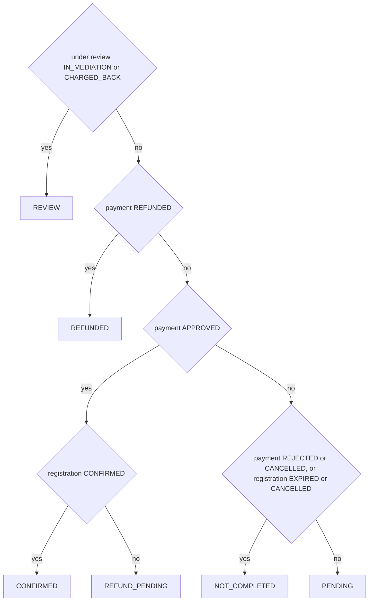
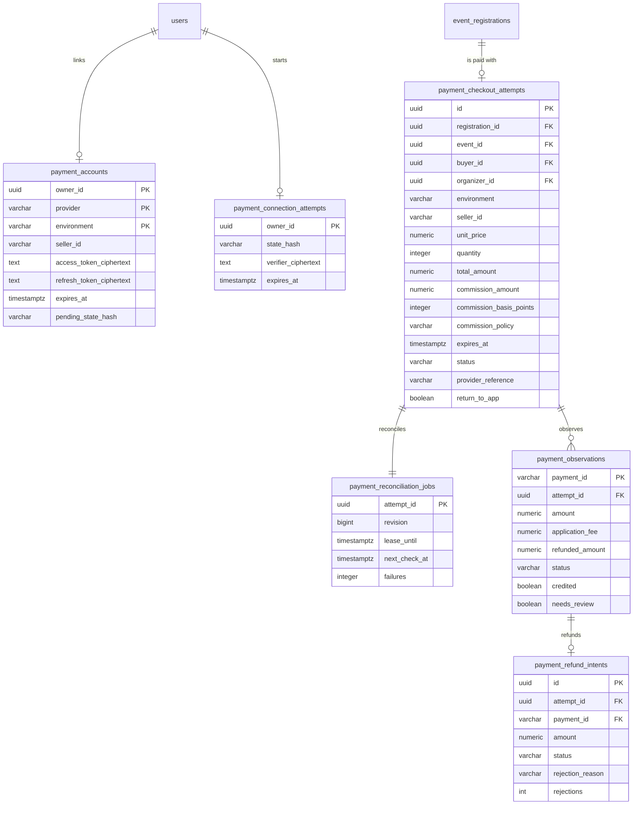

# Payments

Charging paid event registrations with Mercado Pago: the checkout, the receipt the
buyer sees, each organizer's payout account, refunds, and the jobs that confirm
payments and renew credentials. Vinnot charges a configurable fee (3% today, policy
`VINNOT_3_PERCENT_V1`) with Mercado Pago's split model; Mercado Pago moves the money and Vinnot keeps the decision and the status of
each registration ([Events](../events/README.md)).

- Module code: `PAY`.
- Backend: package [`payment`](../../../../backend/src/main/java/com/vinnot/payment/).
- [Use cases](use-cases/README.md) · [Requirements](requirements.md) ·
  [Architecture](architecture.md) · [Testing](testing.md)

## Actors

| Actor | What they do in this module |
|---|---|
| Signed-in user | Pays their registration and sees the receipt |
| Organizer or administrator | Links their Mercado Pago account and refunds registration payments |
| Mercado Pago | Charges, reports changes and executes refunds |
| System (scheduled jobs) | Reconciles payments, sends refunds and renews credentials |

## Business rules

| Rule | Detail | Where |
|---|---|---|
| Confirmation | Only the server confirms a payment, by reading it from Mercado Pago; the checkout return and the notice credit nothing | [`ReconcilePaymentsService.java`](../../../../backend/src/main/java/com/vinnot/payment/application/service/ReconcilePaymentsService.java) |
| Fee | The current policy's percentage (300 basis points by default, `VINNOT_3_PERCENT_V1`) of the ARS total, rounded once to cents and deducted from the seller. Each attempt stores its policy and is always validated against it | [`TicketPaymentQuote.java`](../../../../backend/src/main/java/com/vinnot/payment/domain/valueobject/TicketPaymentQuote.java), [`CommissionPolicy.java`](../../../../backend/src/main/java/com/vinnot/payment/domain/valueobject/CommissionPolicy.java) |
| Environment | `SANDBOX`, `LIVE_PILOT` (one seller, up to ARS 50) or `LIVE` (real sellers other than the platform) | [`PaymentExecutionPolicy.java`](../../../../backend/src/main/java/com/vinnot/payment/application/service/PaymentExecutionPolicy.java) |
| Paid events | Publishing a paid event or registering for one requires payments on and a valid organizer account | [`OnlineEventPaymentAvailability.java`](../../../../backend/src/main/java/com/vinnot/payment/application/service/OnlineEventPaymentAvailability.java) |
| One attempt per registration | Amount, seller and expiry are frozen; retrying reuses it | [`EventCheckoutReservationService.java`](../../../../backend/src/main/java/com/vinnot/payment/application/service/EventCheckoutReservationService.java) |
| One credited payment | Each attempt credits at most one payment; late or duplicate payments are refunded | [`ApplyProviderPaymentService.java`](../../../../backend/src/main/java/com/vinnot/payment/application/service/ApplyProviderPaymentService.java) |
| Cancellation | If the event is cancelled, credited online payments are refunded automatically | [`ApplyProviderPaymentService.java`](../../../../backend/src/main/java/com/vinnot/payment/application/service/ApplyProviderPaymentService.java) |
| Refunds | Full, requested by the organizer or an administrator, for approved payments not under review; a refund Mercado Pago rejected can be requested again | [`RequestPaymentRefundService.java`](../../../../backend/src/main/java/com/vinnot/payment/application/service/RequestPaymentRefundService.java) |
| Receipt | Encrypted, valid for 7 days and with no personal data | [`EncryptedPaymentReceiptAccess.java`](../../../../backend/src/main/java/com/vinnot/payment/infrastructure/security/EncryptedPaymentReceiptAccess.java) |
| Credentials | Encrypted with AES-GCM; renewed one day before they expire | [`RenewPaymentCredentialsService.java`](../../../../backend/src/main/java/com/vinnot/payment/application/service/RenewPaymentCredentialsService.java) |
| Signed notices | HMAC-SHA256 with a 10-minute window | [`MercadoPagoWebhookSignature.java`](../../../../backend/src/main/java/com/vinnot/payment/infrastructure/security/MercadoPagoWebhookSignature.java) |

## Checkout attempt states

[View the full “Checkout attempt states” diagram](https://images.vinnot.com/docs/diagrams/v1/en/modules-payments-readme-4a837e3a5a24.svg)

An `UNCERTAIN` attempt, or one stopped in `CREATING`, accepts no new checkout;
reconciliation recovers whatever happened on Mercado Pago.

## Refund states

[View the full “Refund states” diagram](https://images.vinnot.com/docs/diagrams/v1/en/modules-payments-readme-40ec98223346.svg)

An `UNCERTAIN` refund is never sent again: it is only verified by reading the payment
again. A `REJECTED` one moved no money and is not resent on its own either; the organizer
gets an email and can request it again. Until it is confirmed, the buyer still sees it as
pending.

## Mercado Pago payment status

[View the full “Mercado Pago payment status” diagram](https://images.vinnot.com/docs/diagrams/v1/en/modules-payments-readme-6f9ea17b492a.svg)

`ProviderPayment.Status` copies what Mercado Pago reports (pending, in_process and
authorized become PENDING). Vinnot does not enforce each arrow: it ignores a reading
older than the stored one, one that lowers the refunded amount, or one that takes a
payment out of a reversed state (fully refunded or charged back). An approved payment
confirms the registration while it is still eligible; otherwise a refund is
requested. A refunded, charged back or disputed payment cancels the registration.

## Receipt status

[View the full “Receipt status” diagram](https://images.vinnot.com/docs/diagrams/v1/en/modules-payments-readme-07ec5085dc3d.svg)

`PaymentReceiptStatus` is not stored: `PaymentReceiptStatus.from` works it out from
the payment status, the registration status and the review flag, in that order. It
is what the payer sees and carries no amounts, identities or event details.

## Where it lives

| Part | Location |
|---|---|
| API | Controllers in [`payment/infrastructure/web`](../../../../backend/src/main/java/com/vinnot/payment/infrastructure/web/), under `/payments` and `/events/{eventId}/registrations/{registrationId}/checkout` |
| Web | Payment on the event details, return in [`PaymentReturnPage`](../../../../frontend-react/src/presentation/pages/events/PaymentReturnPage.tsx) and payout account in [`PaymentAccountPage`](../../../../frontend-react/src/presentation/pages/partner/PaymentAccountPage.tsx) |
| App | Payment on the event details, return in `frontend-mobile/app/payments/return.tsx` and linking in the event editor |

## Data

[View the full “Payments · Data” diagram](https://images.vinnot.com/docs/diagrams/v1/en/modules-payments-readme-a788832f4555.svg)

`payment_accounts` is keyed by owner, provider and environment. Payment attempts are not
deleted in cascade with the account, to keep the record of each charge. No card data,
payer data or raw Mercado Pago bodies are stored.
