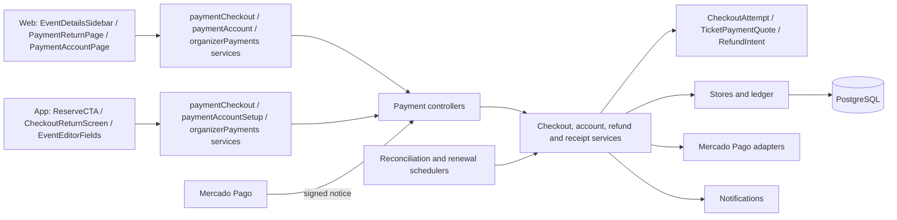

# Architecture

How the module is built in each layer. The backend follows the hexagonal flow
`controller → input port → service → domain → output port → adapter`;
the web and the app follow `screen → hook → service → API client → HTTP transport`.
Registrations and events belong to [Events](../events/README.md); payments only
charges, confirms and refunds them.

[View the full “Architecture” diagram](https://images.vinnot.com/docs/diagrams/v1/en/modules-payments-architecture-6032dc3f2f9d.svg)

## Backend

### Boundaries and activation

The `payment` package keeps account authorization, money rules and the Mercado Pago
transport apart from the event workflow. Events uses the `PaidEventAvailability`
output port, implemented by `OnlineEventPaymentAvailability`: before publishing a paid
event or creating a paid registration it checks that payments are on, that the
organizer has valid credentials, that the currency is ARS and that the amount and
seller policy allows it. Drafts and free events need no linked account.

The integration is off by default and is turned on in parts:

| Variable | Enables |
|---|---|
| `EVENT_PAYMENTS_ENABLED` | Account linking, credential renewal and `GET /payments/mercadopago/account` |
| `EVENT_PAYMENTS_SETTLEMENT_ENABLED` + `EVENT_PAYMENTS_WEBHOOK_SECRET` | Signed notices, reconciliation, receipts, the organizer list and refunds |
| `EVENT_PAYMENTS_CHECKOUT_ENABLED` | Checkout creation |

`EVENT_PAYMENTS_CLIENT_ID`, `EVENT_PAYMENTS_CLIENT_SECRET`, `EVENT_PAYMENTS_ENCRYPTION_KEY`
(32-byte AES key in Base64) and `EVENT_PAYMENTS_REDIRECT_URI` are required when linking is
on; `EVENT_PAYMENTS_NOTIFICATION_URI` and `EVENT_PAYMENTS_CHECKOUT_RETURN_URI` set the
notices and the checkout return. The `EVENT_PAYMENTS_SANDBOX_*` names are only read as a
legacy fallback, except for the encryption key. Values live in the environment's secret
manager ([Environments and secrets](../../infra/architecture/environments-and-secrets.md)).

### Payment environments

`PaymentExecutionPolicy` applies `EVENT_PAYMENTS_ENVIRONMENT`:

| Environment | Rules |
|---|---|
| `SANDBOX` (default) | Mercado Pago test accounts, verified with the `test_user` tag |
| `LIVE_PILOT` | One allowed seller and a total of up to ARS 50 (`PAYMENT_PILOT_RESTRICTED`) |
| `LIVE` | Real organizers in Argentina, other than the platform account (`PAYMENT_SELLER_IS_PLATFORM`), with a positive ARS amount (`PAYMENT_INVALID_AMOUNT`) |

`LIVE` stores its data in the `LIVE_PILOT` namespace (`PaymentStorageEnvironment`) so
accounts, receipts and attempts already encrypted with that context stay valid.

### Endpoints

Every response uses `Cache-Control: no-store`.

| Endpoint | Access | Result |
|---|---|---|
| `POST /events/{eventId}/registrations/{registrationId}/checkout` | Signed-in buyer; optional body `{returnToApp}` | 200 `{attemptId, checkoutUrl}`, or 202 with `checkoutUrl: null` when creation could not be confirmed |
| `GET /payments/receipt?token=` | Public | `{status}`: `PENDING`, `CONFIRMED`, `NOT_COMPLETED`, `REFUND_PENDING`, `REFUNDED` or `REVIEW`; invalid receipt → 404 |
| `GET /payments/mercadopago/account` | PARTNER or ADMIN | `{connected, environment, commissionBasisPoints, commissionPercent}`, no tokens; the fee is the one new sales pay |
| `POST /payments/mercadopago/account/connect` | Active PARTNER or ADMIN; optional body `{returnToApp}` | `{authorizationUrl}` with a random state and PKCE S256 |
| `POST /payments/mercadopago/connection/callback` | Public, rate limited | Completes linking; returns `{returnToApp}` |
| `POST /payments/mercadopago/account/complete` | The same account that started | Authenticated variant of the return, kept for compatibility; 204 |
| `GET /payments/events/{eventId}/registrations?registrationIds=` | PARTNER or ADMIN; 1 to 50 registrations | Amount, currency, `paymentStatus`, `refundStatus` and `canRefund` per registration |
| `POST /payments/checkouts/{attemptId}/refund` | ADMIN, or the event's organizer PARTNER | 202: full refund requested, not money already returned; requests a `REJECTED` refund again |
| `POST /payments/mercadopago/webhooks/{attemptId}` | Mercado Pago HMAC-SHA256 signature | 200 after storing the job; 401 on a bad signature |
| `POST /payments/mercadopago/webhooks` | Same signature | Only wakes payments already seen in its environment |

### Account linking

`ConnectPaymentAccountService` creates a 256-bit state, stored as SHA-256, that expires
after ten minutes and is consumed once before calling the provider; a new attempt
invalidates the previous one. The public return resolves the owner only from that
state, revalidates their role and exchanges the code with PKCE. `MercadoPagoSellerVerifier`
calls `/users/me` (MLA site; `test_user` tag only in `SANDBOX`). Tokens and the verifier
are stored with AES-GCM and an owner and field context (`PaymentCredentialCipher`).
Switching to another seller when the account already has operations returns
`PAYMENT_ACCOUNT_HAS_OPERATIONS`; reconnecting the same seller is allowed. Errors:
`PAYMENT_ACCOUNT_FORBIDDEN`, `PAYMENT_CONNECTION_EXPIRED` and `PAYMENT_PROVIDER_UNAVAILABLE` (503).

### Checkout

1. `EventCheckoutReservationService` locks the event and then the registration, and
   requires an active owning buyer, an active PARTNER or ADMIN organizer, a `PUBLISHED`
   or `SOLD_OUT` event that has not started and an `AWAITING_PAYMENT` registration with a
   current hold. It also recovers older `REQUESTED` registrations or ones with a reported payment.
2. The quote (`TicketPaymentQuote`) comes from the total and count stored on the
   registration: total = price × count (1 to 20, ARS only) and fee = total × basis
   points / 10000, rounded once to cents (HALF_UP). The basis points and the policy come
   from `CurrentCommissionPolicy` (see “Changing the fee”). With the default policy
   (`VINNOT_3_PERCENT_V1`), two ARS 10,000 tickets pay a fee of ARS 600 and the seller
   receives ARS 19,400 before the provider's cost; with `VINNOT_8_PERCENT_V1` the fee
   would be ARS 1,600.
3. `CheckoutSnapshot` freezes registration, event, buyer, seller, price and expiry (the
   earlier of the hold and the event start). There is one attempt per registration;
   retrying reuses it.
4. `DispatchTicketCheckoutService` moves the attempt from `PREPARED` to `CREATING` before
   calling Mercado Pago and to `READY` or `UNCERTAIN` afterwards, without holding a
   transaction during the call or retrying on its own. `MercadoPagoCheckoutAdapter`
   creates the preference with `marketplace_fee`, the attempt reference, the notification
   address and a return carrying the encrypted receipt, and only accepts a link to
   `https://www.mercadopago.com.ar/checkout/v1/redirect`.

Starting a checkout marks the registration as provider-managed
(`externally_managed_payment`): from then on the payment cannot be reported or approved by hand.

### Changing the fee

The fee is a versioned policy (`CommissionPolicy`): basis points from 1 to 3000 and an
id `VINNOT_<percent>_PERCENT_V<version>` that names the same percentage. For example,
300 is `VINNOT_3_PERCENT_V1`, 800 is `VINNOT_8_PERCENT_V1`, 1200 is
`VINNOT_12_PERCENT_V1` and 250 is `VINNOT_2_5_PERCENT_V1`. The version changes when the
terms change at the same percentage.

- **Where it is set.** `ConfiguredCommissionPolicy` reads
  `app.payments.commission.basis-points` (default `300`) and
  `app.payments.commission.policy` (default `VINNOT_3_PERCENT_V1`). To change the rate,
  change both values together and restart the backend.
- **Startup validation.** If the basis points and the name disagree (for example `800`
  with `VINNOT_3_PERCENT_V1`) or are out of range, the backend does not start, so it never
  charges an ambiguous rate.
- **Existing attempts.** Each attempt stores `commission_amount`,
  `commission_basis_points` and `commission_policy`. `PostgresCheckoutAttemptStore`
  rebuilds the quote from those stored values, never from the current policy. A 3%
  attempt therefore still reconciles and compares terms (`ProviderPayment`,
  `CheckoutSnapshot.hasSameTerms`) after the switch to 8%. A retry of the same
  registration reuses the attempt with its original fee.
- **Database.** `V74` replaces the `V30` CHECKs, which pinned 3%, with general rules:
  basis points from 1 to 3000, `commission_amount = round(total_amount *
  commission_basis_points / 10000.0, 2)` and the id format.
- **Clients.** `GET /payments/mercadopago/account` reports the current fee
  (`commissionBasisPoints` and `commissionPercent`). The web (`/partner/payments` and the
  event editor) and the app (event editor) show that value and never hard-code the rate;
  without a valid value they show none.

### Confirmation and reconciliation

The Mercado Pago notice credits nothing: it only brings the attempt's reconciliation
forward. `ReconcilePaymentsService` reads the attempt's payments (up to 20) from the
provider API with the seller's credentials, and validates environment, seller,
currency, exact amount and fee. The queue (`PostgresPaymentReconciliationQueue`) uses
`FOR UPDATE SKIP LOCKED` with a 15-minute lease; the scheduler processes up to ten jobs
per cycle.

`ReconciliationSchedule`: every 5 minutes until one hour after the expiry (after an
error, one minute later); then every 30 minutes on the first day, every 6 hours in the
first week and once a day after that, until it is parked at 180 days. An attempt whose
payments are all final and has no pending refunds is parked earlier. The `V38`
triggers wake the job when a paid registration stops being confirmed or its event is cancelled.

`ApplyProviderPaymentService` locks event, registration and job and stores everything
in one transaction:

| Situation | Effect |
|---|---|
| Payment approved before the expiry | Confirms the registration and sends `PAYMENT_RECEIPT` |
| Credited payment whose registration is no longer confirmed, or whose event was cancelled | Requests the full refund and sends `PAYMENT_REFUND_REQUESTED` |
| Late payment or second payment for the same registration | Requests its refund without taking a place |
| Partial refund, chargeback or mediation | Cancels the registration, puts the case under review and sends `PAYMENT_REFUNDED` or `PAYMENT_CHARGEBACK` |

Each attempt credits at most one payment, and older or repeated evidence does not repeat
effects. Notices are queued in the same transaction, so a rolled-back settlement sends nothing.

### Refunds

`RequestPaymentRefundService` only accepts full refunds of an approved payment with no
earlier refunds and not under review (`RefundEligibility`). It cancels the registration,
releases the place and stores the intent in `payment_refund_intents`; repeating the
request reuses the same intent. Reconciliation sends `POST /v1/payments/{id}/refunds`
with a stored `X-Idempotency-Key` and only marks `SUCCEEDED` after reading the payment
again. States: `PREPARED`, `SENDING`, `UNCERTAIN`, `SUCCEEDED`, `REVIEW` and `REJECTED`.

`MercadoPagoPaymentAdapter` tells two outcomes apart. A definite rejection (a 4xx other
than 408, 409 or 429, or an amount over the `LIVE_PILOT` limit) throws
`RefundRejectedException` with a short code (`HTTP_<status>` plus Mercado Pago's code,
without messages or payer data). Before recording it, reconciliation reads the payment
again: if it already shows a refund (for example one made from the Mercado Pago panel),
the intent becomes `UNCERTAIN` and is verified like any other outcome. Otherwise
`RefundRejectionRecorder` moves the intent from `SENDING`
to `REJECTED`, stores `rejection_reason`, increments `rejections` and enqueues
`PAYMENT_REFUND_REJECTED` to the organizer in the same transaction; the rejection is
logged and never resent on its own. A 408, 409, 429, 5xx, network failure or malformed
body leaves the intent `UNCERTAIN`: the refund may exist, so it is only verified and never
resent. Requesting the refund again with `POST /payments/checkouts/{attemptId}/refund`
only re-arms a `REJECTED` intent (back to `PREPARED`, with no new
`PAYMENT_REFUND_REQUESTED`); one being sent, uncertain or settled is left alone. Each
retry uses its own idempotency key (`<intentId>-retry-<n>`), because reusing the rejected
key would replay Mercado Pago's stored rejection. Under
Mercado Pago's split model the refund is deducted proportionally from the seller and
from Vinnot's fee.

### Activity diagram: payment and refund

Shows in UML activity notation the payment of a paid registration, its confirmation through reconciliation and the refund, including a Mercado Pago rejection.

```mermaid
flowchart TD
    subgraph U["Attendee"]
        start((" ")) --> u1("Start paying for the registration")
        u2("Pay in the Mercado Pago checkout")
        u3("Return with the encrypted receipt and see the status")
    end
    subgraph O["Organizer"]
        start2((" ")) --> o1("Cancel the event or request the refund")
    end
    subgraph B["Backend"]
        b1("Validate AWAITING_PAYMENT, freeze the snapshot and create the preference")
        b4("Reconcile the attempt: notification or scheduler")
        d1{" "}
        b6("Confirm the registration and send PAYMENT_RECEIPT")
        b7("Request the full refund and release the seats")
        b8("POST /v1/payments/{id}/refunds with an idempotency key")
        d2{" "}
        b9("SUCCEEDED after reading the payment again")
        b10("REJECTED: notify PAYMENT_REFUND_REJECTED")
        b11("UNCERTAIN: verify only, never resend")
    end
    subgraph MP["Mercado Pago"]
        m1("Process the payment and send the notification")
    end
    u1 --> b1 --> u2 --> m1 --> f1[" "]
    f1 --> u3
    f1 --> b4
    b4 --> d1
    d1 -->|"[approved before expiry]"| b6
    d1 -->|"[late, repeated or registration no longer confirmed]"| b7
    o1 --> b7
    b6 & u3 --> j1[" "] --> stop(((" ")))
    b7 --> b8 --> d2
    d2 -->|"[accepted]"| b9
    d2 -->|"[final rejection]"| b10
    d2 -->|"[408, 409, 429, 5xx or network]"| b11
    b10 -->|"[organizer retries]"| b8
    b9 & b10 & b11 --> stop
    classDef bar fill:#30262c,stroke:#30262c,color:#30262c
    style start fill:#30262c,stroke:#30262c
    style stop fill:#30262c,stroke:#30262c
    style start2 fill:#30262c,stroke:#30262c
    class f1,j1 bar
```

[View the full “Activity diagram: payment and refund” diagram](https://images.vinnot.com/docs/diagrams/v1/en/modules-payments-architecture-f4543117dbb2.svg)

### Receipts

`EncryptedPaymentReceiptAccess` encrypts the receipt with AES-GCM and the context
`public-payment-receipt:<environment>`; it is valid for seven days.
`GetPaymentReceiptService` only returns the status, with no personal data.

### Credential renewal

`RenewPaymentCredentialsService` renews one day before expiry, in batches of 20 with a
60-second lease, outside transactions. A revoked or expired authorization leaves the
account needing reconnection; `RenewalFailureRecorder` stores the failure and queues
`PAYMENT_ACCOUNT_RECONNECT_REQUIRED` (email and push) once per connection (`V58`).
Temporary failures are retried after five minutes.

### Data

`V29` accounts and connection attempts, `V30` checkout attempts, `V31` the
provider-managed flag on `event_registrations`, `V32` reconciliation jobs, observations
and refunds, `V33` the `LIVE_PILOT` environment, `V34` renewal, `V36` and `V37` the
return to the app, `V38` the reconciliation triggers, `V58` the reconnect notice and `V63`
the refunds' `REJECTED` state with `rejection_reason` and `rejections`, `V74` the
configurable fee and `V77` the history that outlives account deletion.
No card data, payer data or raw provider bodies are stored.

### Payment history when an account is deleted

Deleting a buyer's or an organizer's account does not delete their payments. `V77` sets
the attempt's links (`buyer_id`, `organizer_id`, `registration_id`, `event_id`) to
`NULL`, and the attempt, its observations, refunds and reconciliation job are kept as the
financial history of the operation. The commercial terms (seller, title, amounts and fee)
live on the attempt itself. The organizer's payment account (`payment_accounts`) is
deleted with the account.

`CheckoutSnapshot.linked()` tells whether the attempt keeps all four links. A new attempt
always has them: `PostgresCheckoutAttemptStore.prepare` rejects one without them. An
attempt without links is handled like this:

- **The buyer was deleted** (with their registration): reconciliation goes on with the
  organizer's connection. `ApplyProviderPaymentService` records the provider evidence
  without touching tickets or capacity. A credited payment stays as it is; an approved
  payment that was never credited is refunded, because no ticket can be issued for it
  anymore. Refunds, reversals and chargebacks are only announced to the organizer.
- **The organizer was deleted** (with their events and payment connection): there are no
  credentials to read or refund with, so `ReconcilePaymentsService` parks the job instead
  of retrying it forever.
- `RequestPaymentRefundService` refuses the refund with `PAYMENT_REFUND_UNAVAILABLE`,
  because it needs the buyer's registration; it is made from the Mercado Pago panel.
  `DispatchTicketCheckoutService` never starts a checkout without links.
- `PaymentNoticeService` never writes to a deleted account, and the buyer's notice is only
  sent while the ticket it links to exists.

## Web

- **Payment.** `EventDetailsSidebar` offers “Pay” when the registration allows payment
  (`canStartOnlinePayment`) and the payments flag is on (`isEventPaymentsEnabled`:
  `VITE_EVENT_PAYMENTS_ENABLED`, or `VITE_EVENT_PAYMENTS_SANDBOX` outside production).
  `useEventCheckout` → `paymentCheckoutService` → `eventsClient` requests the checkout
  and `paymentCheckoutNavigator` only opens the Mercado Pago destination validated in
  `eventCheckout.ts`. Registering for a paid event opens the checkout right away.
- **Return.** `/payments/return` sits outside the shell and has no guard.
  `PaymentReturnPage` uses `usePaymentReceipt`, which calls `GET /payments/receipt`
  without the session interceptor and repeats every 5 seconds, up to 24 times, while it
  is `PENDING`. If the payment started on the app, `checkoutReturnService` builds
  `vinnot://payments/return` with the receipt and ticket ID and tries to open the app;
  from a phone it only offers it. The page declares `no-referrer` and `noindex` and links to `/my-tickets`.
- **Payout account.** `/partner/payments` and `/partner/payments/callback` only exist
  with the flag on. `PaymentAccountPage` → `usePaymentAccountConnection` →
  `paymentAccountService`. The callback removes the code from the URL, keeps it only in
  memory and completes linking through the public return; a double click does not
  repeat the exchange. `PaymentAccountStatus` shows the status in the event editor.
- **Refunds.** `EventRegistrationsManagerModal` loads payments with
  `useOrganizerPayments` → `organizerPaymentsService` and offers “Refund” when
  `canRefund` is true, with a confirmation that shows the total. With a `REJECTED`
  refund (`refundCanBeRetried`) it shows the rejection notice and offers “Retry refund”,
  which confirms and sends the same request.

## App

- **Payment.** `ReserveCTA` offers “Pay” with `canStartOnlinePayment` and the
  `EXPO_PUBLIC_EVENT_PAYMENTS_ENABLED` flag (or `EXPO_PUBLIC_EVENT_PAYMENTS_SANDBOX`
  outside production). `useEventCheckout` → `paymentCheckoutService` requests the
  checkout with `returnToApp: true` and `paymentCheckoutNavigator` opens it with
  `Linking`. If the API answers 202, the app says the payment is pending.
- **Return.** `vinnot://payments/return` arrives through `app/+native-intent.tsx` and
  `navigation/paymentReturn.ts`, which only accept an opaque receipt and a valid ticket
  ID. `CheckoutReturnScreen` uses `useCheckoutReceipt` (every 5 seconds, up to 24 times)
  and offers to go to My tickets.
- **Payout account.** There is no screen of its own: the paid section of
  `EventEditorFields` uses `usePaymentAccountSetup` → `paymentAccountSetupService` →
  `paymentAccountClient` with `returnToApp: true`. Linking comes back through
  `vinnot://payments/connected` (`paymentReturnNavigation.ts`) and the editor checks the
  status when it returns to the foreground.
- **Refunds.** `EventRegistrationsManagerSheet` uses `useOrganizerPayments` and asks for
  confirmation before refunding. With a `REJECTED` refund (`refundCanBeRetried`) it
  offers “Retry refund” with its own confirmation.
