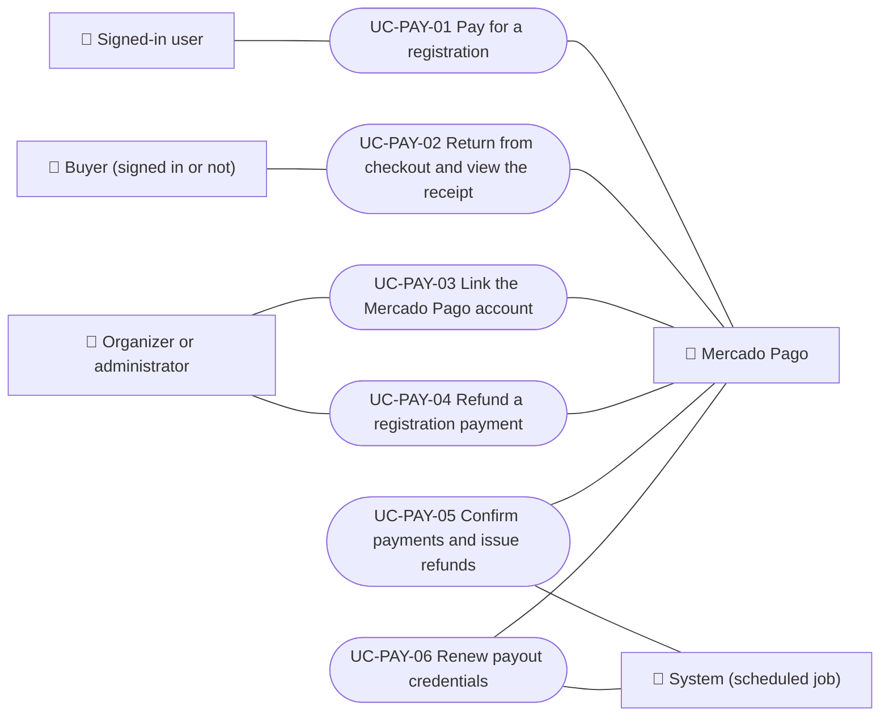

# Use cases

Payment use cases: paying a registration with Mercado Pago, returning from checkout and viewing the receipt, linking the organizer's payout account, refunding a payment, and the jobs that confirm payments, issue refunds and renew credentials. Each case applies to the platforms listed.

| ID | Use case | Platforms | Actors |
|---|---|---|---|
| `UC-PAY-01` | [Pay for a registration](uc-pay-01-pay-registration.md) | Web, APK | Signed-in user, Mercado Pago |
| `UC-PAY-02` | [Return from checkout and view the receipt](uc-pay-02-checkout-return.md) | Web, APK | Buyer (signed in or not), Mercado Pago |
| `UC-PAY-03` | [Link the Mercado Pago account](uc-pay-03-link-payment-account.md) | Web, APK | Organizer or administrator, Mercado Pago |
| `UC-PAY-04` | [Refund a registration payment](uc-pay-04-refund-registration.md) | Web, APK | Organizer or administrator, Mercado Pago |
| `UC-PAY-05` | [Confirm payments and issue refunds](uc-pay-05-confirm-and-reconcile.md) | Backend only | Mercado Pago, System (scheduled job) |
| `UC-PAY-06` | [Renew payout credentials](uc-pay-06-renew-credentials.md) | Backend only | System (scheduled job), Mercado Pago |

## Use case diagram

[View the full “Use cases · Use case diagram” diagram](https://images.vinnot.com/docs/diagrams/v1/en/modules-payments-use-cases-readme-154f75410d38.svg)

## Lucidchart mapping

| ID | Lucidchart IDs |
|---|---|
| `UC-PAY-01` | [WEB UC-EVT-05](https://lucid.app/lucidchart/9f11a16b-bb5a-42fc-a9e8-0852b17bd241/edit), [APK UC-EVT-06](https://lucid.app/lucidchart/e095dd25-e8ac-41ba-bf5b-396e1055f217/edit) |
| `UC-PAY-02` | [WEB UC-EVT-06](https://lucid.app/lucidchart/9f11a16b-bb5a-42fc-a9e8-0852b17bd241/edit) |
| `UC-PAY-03` | [WEB UC-PAR-07](https://lucid.app/lucidchart/9f11a16b-bb5a-42fc-a9e8-0852b17bd241/edit), [APK UC-ORG-03](https://lucid.app/lucidchart/e095dd25-e8ac-41ba-bf5b-396e1055f217/edit) |
| `UC-PAY-04` | [WEB UC-PAR-06](https://lucid.app/lucidchart/9f11a16b-bb5a-42fc-a9e8-0852b17bd241/edit), [APK UC-ORG-07](https://lucid.app/lucidchart/e095dd25-e8ac-41ba-bf5b-396e1055f217/edit) |
| `UC-PAY-05` | None |
| `UC-PAY-06` | None |
