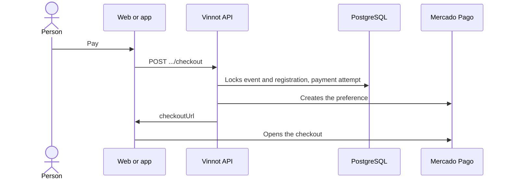

# UC-PAY-01 · Pay for a registration

| Field | Value |
|---|---|
| ID | `UC-PAY-01` |
| Module | [Payments](../README.md) |
| Platforms | Web, APK |
| Actors | Signed-in user, Mercado Pago |
| Lucidchart IDs | [WEB UC-EVT-05](https://lucid.app/lucidchart/9f11a16b-bb5a-42fc-a9e8-0852b17bd241/edit), [APK UC-EVT-06](https://lucid.app/lucidchart/e095dd25-e8ac-41ba-bf5b-396e1055f217/edit) |
| Requirements | [`RF-WEB-PAY-01`](../requirements.md), [`RF-APK-PAY-01`](../requirements.md) |
| Test cases | [`CP-PAY-01`](../testing.md), [`CP-PAY-02`](../testing.md), [`CP-PAY-03`](../testing.md), [`CP-PAY-04`](../testing.md), [`CP-PAY-05`](../testing.md) |

## Preconditions

- The person has an `AWAITING_PAYMENT` registration for a paid event that is published or sold out and has not started yet.
- The organizer has linked their Mercado Pago account ([UC-PAY-03](uc-pay-03-link-payment-account.md)).

## Postconditions

- The person is on the Mercado Pago checkout with their place held.

## Main flow

1. On registering for a paid event, or with “Pay” on the event details, the client requests the checkout.
2. The client sends `POST /events/{eventId}/registrations/{registrationId}/checkout`; the app also asks to return to the app.
3. The API locks the event and the registration and checks that the registration is the person's, that buyer and organizer are active and that the event is still available.
4. It calculates the total in pesos and Vinnot's fee with the current policy (3% today), and reuses the registration's payment attempt if one already exists.
5. It creates the Mercado Pago preference with the fee, the attempt reference, the notification address and an expiry that does not go past the hold or the event start.
6. The API returns the checkout address and the client opens Mercado Pago.

## Alternative flows

- 6a. The API could not confirm the preference was created: it answers 202 without an address and the client says the payment is pending.
- 3a. The hold expired or the event no longer accepts payments: the API answers `PAYMENT_RESERVATION_UNAVAILABLE` or `PAYMENT_CHECKOUT_EXPIRED`.
- 5a. The organizer's account is unavailable: the API answers `PAYMENT_ACCOUNT_UNAVAILABLE`.
- 3b. An older `REQUESTED` registration or one with a reported payment can resume payment through this same path.

## Business rules

- Returning from checkout does not confirm the payment: the server confirms it when it verifies it with Mercado Pago ([UC-PAY-05](uc-pay-05-confirm-and-reconcile.md)).
- Argentine pesos only, 1 to 20 tickets; the fee is deducted from the seller. An attempt keeps the policy it was created with even if the rate changes later.
- In production the seller cannot be the platform account; in pilot the total does not exceed ARS 50 and only one seller is allowed.
- Clients only show payment when the payments flag is on.

## Diagram

[View the full “UC-PAY-01 · Pay for a registration” diagram](https://images.vinnot.com/docs/diagrams/v1/en/modules-payments-use-cases-uc-pay-01-pay-registration-fadd9d95d638.svg)

Component diagram in Lucidchart: [WEB UC-EVT-05](https://lucid.app/lucidchart/9f11a16b-bb5a-42fc-a9e8-0852b17bd241/edit), [APK UC-EVT-06](https://lucid.app/lucidchart/e095dd25-e8ac-41ba-bf5b-396e1055f217/edit).

## Code

| Layer | Location |
|---|---|
| Endpoints | `POST /events/{eventId}/registrations/{registrationId}/checkout` |
| Backend | [`EventCheckoutController.java`](../../../../../backend/src/main/java/com/vinnot/payment/infrastructure/web/EventCheckoutController.java), [`StartEventCheckoutService.java`](../../../../../backend/src/main/java/com/vinnot/payment/application/service/StartEventCheckoutService.java), [`EventCheckoutReservationService.java`](../../../../../backend/src/main/java/com/vinnot/payment/application/service/EventCheckoutReservationService.java), [`DispatchTicketCheckoutService.java`](../../../../../backend/src/main/java/com/vinnot/payment/application/service/DispatchTicketCheckoutService.java), [`TicketPaymentQuote.java`](../../../../../backend/src/main/java/com/vinnot/payment/domain/valueobject/TicketPaymentQuote.java), [`PaymentExecutionPolicy.java`](../../../../../backend/src/main/java/com/vinnot/payment/application/service/PaymentExecutionPolicy.java), [`MercadoPagoCheckoutAdapter.java`](../../../../../backend/src/main/java/com/vinnot/payment/infrastructure/gateway/MercadoPagoCheckoutAdapter.java) |
| Web | [`EventDetailsSidebar.tsx`](../../../../../frontend-react/src/presentation/pages/events/EventDetailsSidebar.tsx), [`useEventCheckout.ts`](../../../../../frontend-react/src/presentation/hooks/useEventCheckout.ts), [`paymentCheckout.service.ts`](../../../../../frontend-react/src/application/services/paymentCheckout.service.ts), [`eventCheckout.ts`](../../../../../frontend-react/src/application/services/eventCheckout.ts), [`paymentCheckoutNavigator.ts`](../../../../../frontend-react/src/infrastructure/payments/paymentCheckoutNavigator.ts), [`events.client.ts`](../../../../../frontend-react/src/infrastructure/api/clients/events.client.ts) |
| App | [`ReserveCTA.tsx`](../../../../../frontend-mobile/src/presentation/features/event/ReserveCTA.tsx), [`useEventCheckout.ts`](../../../../../frontend-mobile/src/presentation/hooks/useEventCheckout.ts), [`paymentCheckout.service.ts`](../../../../../frontend-mobile/src/application/services/paymentCheckout.service.ts), [`eventCheckout.ts`](../../../../../frontend-mobile/src/application/services/eventCheckout.ts), [`paymentCheckoutNavigator.ts`](../../../../../frontend-mobile/src/infrastructure/payments/paymentCheckoutNavigator.ts), [`events.client.ts`](../../../../../frontend-mobile/src/infrastructure/api/clients/events.client.ts) |

## Automated tests

- Backend: [`StartEventCheckoutServiceTest.java`](../../../../../backend/src/test/java/com/vinnot/payment/application/service/StartEventCheckoutServiceTest.java), [`EventCheckoutReservationServiceTest.java`](../../../../../backend/src/test/java/com/vinnot/payment/application/service/EventCheckoutReservationServiceTest.java), [`EventCheckoutReservationPostgresIntegrationTest.java`](../../../../../backend/src/test/java/com/vinnot/payment/infrastructure/persistence/EventCheckoutReservationPostgresIntegrationTest.java), [`DispatchTicketCheckoutServiceTest.java`](../../../../../backend/src/test/java/com/vinnot/payment/application/service/DispatchTicketCheckoutServiceTest.java), [`TicketPaymentQuoteTest.java`](../../../../../backend/src/test/java/com/vinnot/payment/domain/valueobject/TicketPaymentQuoteTest.java), [`PaymentExecutionPolicyTest.java`](../../../../../backend/src/test/java/com/vinnot/payment/application/service/PaymentExecutionPolicyTest.java), [`MercadoPagoCheckoutAdapterTest.java`](../../../../../backend/src/test/java/com/vinnot/payment/infrastructure/gateway/MercadoPagoCheckoutAdapterTest.java), [`EventCheckoutControllerTest.java`](../../../../../backend/src/test/java/com/vinnot/payment/infrastructure/web/EventCheckoutControllerTest.java)
- Web: [`paymentCheckout.service.test.ts`](../../../../../frontend-react/src/application/services/paymentCheckout.service.test.ts), [`eventCheckout.test.ts`](../../../../../frontend-react/src/application/services/eventCheckout.test.ts), [`useEventCheckout.test.ts`](../../../../../frontend-react/src/presentation/hooks/useEventCheckout.test.ts)
- App: [`paymentCheckout.service.test.ts`](../../../../../frontend-mobile/src/application/services/paymentCheckout.service.test.ts), [`useEventCheckout.test.ts`](../../../../../frontend-mobile/src/presentation/hooks/useEventCheckout.test.ts), [`ReserveCTA.test.tsx`](../../../../../frontend-mobile/src/presentation/features/event/ReserveCTA.test.tsx)
