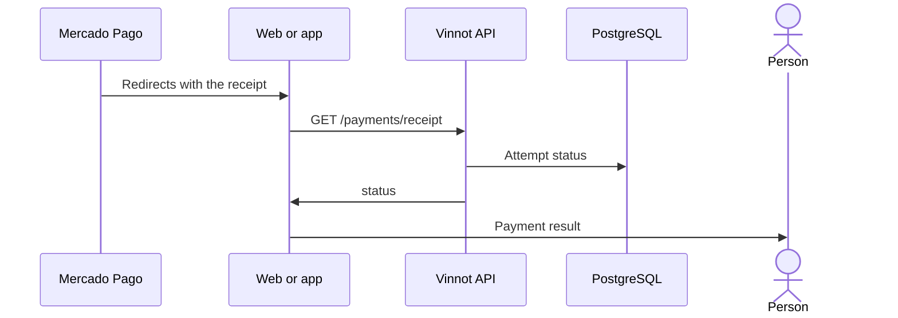

# UC-PAY-02 · Return from checkout and view the receipt

| Field | Value |
|---|---|
| ID | `UC-PAY-02` |
| Module | [Payments](../README.md) |
| Platforms | Web, APK |
| Actors | Buyer (signed in or not), Mercado Pago |
| Lucidchart IDs | [WEB UC-EVT-06](https://lucid.app/lucidchart/9f11a16b-bb5a-42fc-a9e8-0852b17bd241/edit) |
| Requirements | [`RF-WEB-PAY-02`](../requirements.md) |
| Test cases | [`CP-PAY-06`](../testing.md), [`CP-PAY-07`](../testing.md), [`CP-PAY-08`](../testing.md), [`CP-PAY-09`](../testing.md) |

## Preconditions

- The person finished, cancelled or left the payment pending on Mercado Pago.

## Postconditions

- The person sees the verified status of their payment.

## Main flow

1. Mercado Pago redirects to `/payments/return` with an opaque receipt.
2. The page calls `GET /payments/receipt?token=` without needing a session.
3. The API decrypts the receipt and returns the status: pending, confirmed, not completed, refund pending, refunded or under review.
4. While it is pending, the page checks again every 5 seconds, up to 24 times, and offers to refresh.
5. The page shows the result and links to “My tickets”.

## Alternative flows

- 1a. The payment started on the app: the page tries to open `vinnot://payments/return` and the app shows the same receipt on its return screen.
- 1b. The payment started on the web but the page opens on a phone: it offers to open the app without doing it by itself.
- 3a. The receipt is invalid or expired: the API answers 404.

## Business rules

- URL parameters only guide navigation; the status always comes from the receipt.
- The receipt is valid for 7 days and exposes no personal data.
- The page does not send the receipt to other sites (`no-referrer`) and is not indexed.
- Viewing the ticket still requires a session ([Events](../../events/README.md)).

## Diagram

[View the full “UC-PAY-02 · Return from checkout and view the receipt” diagram](https://images.vinnot.com/docs/diagrams/v1/en/modules-payments-use-cases-uc-pay-02-checkout-return-d36980874594.svg)

Component diagram in Lucidchart: [WEB UC-EVT-06](https://lucid.app/lucidchart/9f11a16b-bb5a-42fc-a9e8-0852b17bd241/edit).

## Code

| Layer | Location |
|---|---|
| Endpoints | `GET /payments/receipt` |
| Backend | [`PaymentReceiptController.java`](../../../../../backend/src/main/java/com/vinnot/payment/infrastructure/web/PaymentReceiptController.java), [`GetPaymentReceiptService.java`](../../../../../backend/src/main/java/com/vinnot/payment/application/service/GetPaymentReceiptService.java), [`EncryptedPaymentReceiptAccess.java`](../../../../../backend/src/main/java/com/vinnot/payment/infrastructure/security/EncryptedPaymentReceiptAccess.java) |
| Web | [`PaymentReturnPage.tsx`](../../../../../frontend-react/src/presentation/pages/events/PaymentReturnPage.tsx), [`useMyTickets.ts`](../../../../../frontend-react/src/presentation/hooks/queries/event/useMyTickets.ts), [`useCheckoutReturn.ts`](../../../../../frontend-react/src/presentation/hooks/useCheckoutReturn.ts), [`checkoutReturn.service.ts`](../../../../../frontend-react/src/application/services/checkoutReturn.service.ts) |
| App | [`CheckoutReturnScreen.tsx`](../../../../../frontend-mobile/src/presentation/features/event/CheckoutReturnScreen.tsx), [`useCheckoutReceipt.ts`](../../../../../frontend-mobile/src/presentation/hooks/useCheckoutReceipt.ts), [`paymentReturn.ts`](../../../../../frontend-mobile/src/presentation/navigation/paymentReturn.ts) |

## Automated tests

- Backend: [`GetPaymentReceiptServiceTest.java`](../../../../../backend/src/test/java/com/vinnot/payment/application/service/GetPaymentReceiptServiceTest.java), [`EncryptedPaymentReceiptAccessTest.java`](../../../../../backend/src/test/java/com/vinnot/payment/infrastructure/security/EncryptedPaymentReceiptAccessTest.java)
- Web: [`PaymentReturnPage.test.tsx`](../../../../../frontend-react/src/presentation/pages/events/PaymentReturnPage.test.tsx), [`useCheckoutReturn.test.tsx`](../../../../../frontend-react/src/presentation/hooks/useCheckoutReturn.test.tsx), [`checkoutReturn.service.test.ts`](../../../../../frontend-react/src/application/services/checkoutReturn.service.test.ts)
- App: [`CheckoutReturnScreen.test.tsx`](../../../../../frontend-mobile/src/presentation/features/event/CheckoutReturnScreen.test.tsx), [`useCheckoutReceipt.test.ts`](../../../../../frontend-mobile/src/presentation/hooks/useCheckoutReceipt.test.ts), [`paymentReturn.test.ts`](../../../../../frontend-mobile/src/presentation/navigation/paymentReturn.test.ts)
