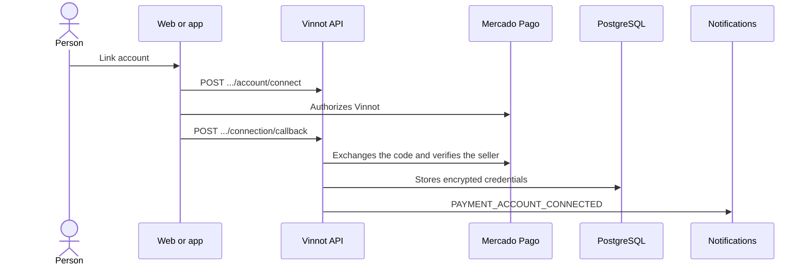

# UC-PAY-03 · Link the Mercado Pago account

| Field | Value |
|---|---|
| ID | `UC-PAY-03` |
| Module | [Payments](../README.md) |
| Platforms | Web, APK |
| Actors | Organizer or administrator, Mercado Pago |
| Lucidchart IDs | [WEB UC-PAR-07](https://lucid.app/lucidchart/9f11a16b-bb5a-42fc-a9e8-0852b17bd241/edit), [APK UC-ORG-03](https://lucid.app/lucidchart/e095dd25-e8ac-41ba-bf5b-396e1055f217/edit) |
| Requirements | None |
| Test cases | [`CP-PAY-10`](../testing.md), [`CP-PAY-11`](../testing.md), [`CP-PAY-12`](../testing.md), [`CP-PAY-13`](../testing.md), [`CP-PAY-14`](../testing.md) |

## Preconditions

- The seller is a partner or an administrator and is signed in.

## Postconditions

- The Mercado Pago account is linked and paid events can be published.

## Main flow

1. On the web, the organizer opens `/partner/payments` from “My events”; on the app, they use the linking button in the paid section of the event editor.
2. The client sends `POST /payments/mercadopago/account/connect` and gets the authorization address.
3. The organizer authorizes Vinnot on Mercado Pago.
4. Mercado Pago returns to `/partner/payments/callback`, which sends the code to `POST /payments/mercadopago/connection/callback`.
5. The API checks the single-use state, exchanges the code for credentials, verifies the seller account and stores the credentials encrypted.
6. The organizer gets `PAYMENT_ACCOUNT_CONNECTED` and the client shows the account as connected (`GET /payments/mercadopago/account`).

## Alternative flows

- 4a. Linking started on the app: the return page goes back to the app through `vinnot://payments/connected` and the editor checks the status again.
- 5a. More than 10 minutes passed or the state was already used: the API answers `PAYMENT_CONNECTION_EXPIRED`.
- 5b. Switching to another seller when the account already has operations: the API answers `PAYMENT_ACCOUNT_HAS_OPERATIONS`; reconnecting the same seller is allowed.
- 5c. Mercado Pago does not respond: the API answers 503 `PAYMENT_PROVIDER_UNAVAILABLE`.

## Business rules

- Authorization uses PKCE and a single-use state valid for 10 minutes, stored as a hash.
- Credentials are stored encrypted and never travel in links.
- Saving a draft does not require an account; publishing a paid event does.
- There is no unlinking: only reconnecting.
- The web payout account page only exists with the payments flag on; on the app linking lives in the editor.

## Diagram

[View the full “UC-PAY-03 · Link the Mercado Pago account” diagram](https://images.vinnot.com/docs/diagrams/v1/en/modules-payments-use-cases-uc-pay-03-link-payment-account-ac471f42e969.svg)

Component diagram in Lucidchart: [WEB UC-PAR-07](https://lucid.app/lucidchart/9f11a16b-bb5a-42fc-a9e8-0852b17bd241/edit), [APK UC-ORG-03](https://lucid.app/lucidchart/e095dd25-e8ac-41ba-bf5b-396e1055f217/edit).

## Code

| Layer | Location |
|---|---|
| Endpoints | `GET /payments/mercadopago/account`, `POST /payments/mercadopago/account/connect`, `POST /payments/mercadopago/connection/callback` |
| Backend | [`PaymentAccountController.java`](../../../../../backend/src/main/java/com/vinnot/payment/infrastructure/web/PaymentAccountController.java), [`PaymentConnectionCallbackController.java`](../../../../../backend/src/main/java/com/vinnot/payment/infrastructure/web/PaymentConnectionCallbackController.java), [`ConnectPaymentAccountService.java`](../../../../../backend/src/main/java/com/vinnot/payment/application/service/ConnectPaymentAccountService.java), [`MercadoPagoAuthorizationAdapter.java`](../../../../../backend/src/main/java/com/vinnot/payment/infrastructure/gateway/MercadoPagoAuthorizationAdapter.java), [`MercadoPagoSellerVerifier.java`](../../../../../backend/src/main/java/com/vinnot/payment/infrastructure/gateway/MercadoPagoSellerVerifier.java), [`PaymentCredentialCipher.java`](../../../../../backend/src/main/java/com/vinnot/payment/infrastructure/security/PaymentCredentialCipher.java) |
| Web | [`PaymentAccountPage.tsx`](../../../../../frontend-react/src/presentation/pages/partner/PaymentAccountPage.tsx), [`usePaymentAccountConnection.ts`](../../../../../frontend-react/src/presentation/hooks/usePaymentAccountConnection.ts), [`paymentAccount.service.ts`](../../../../../frontend-react/src/application/services/paymentAccount.service.ts), [`PaymentAccountStatus.tsx`](../../../../../frontend-react/src/presentation/components/features/event/PaymentAccountStatus.tsx), [`paymentAccount.client.ts`](../../../../../frontend-react/src/infrastructure/api/clients/paymentAccount.client.ts) |
| App | [`EventEditorFields.tsx`](../../../../../frontend-mobile/src/presentation/features/event/EventEditorFields.tsx), [`usePaymentAccountSetup.ts`](../../../../../frontend-mobile/src/presentation/hooks/usePaymentAccountSetup.ts), [`paymentAccountSetup.service.ts`](../../../../../frontend-mobile/src/application/services/paymentAccountSetup.service.ts), [`paymentReturnNavigation.ts`](../../../../../frontend-mobile/src/application/services/paymentReturnNavigation.ts), [`paymentAccount.client.ts`](../../../../../frontend-mobile/src/infrastructure/api/clients/paymentAccount.client.ts) |

## Automated tests

- Backend: [`ConnectPaymentAccountServiceTest.java`](../../../../../backend/src/test/java/com/vinnot/payment/application/service/ConnectPaymentAccountServiceTest.java), [`MercadoPagoAuthorizationAdapterTest.java`](../../../../../backend/src/test/java/com/vinnot/payment/infrastructure/gateway/MercadoPagoAuthorizationAdapterTest.java), [`PaymentCredentialCipherTest.java`](../../../../../backend/src/test/java/com/vinnot/payment/infrastructure/security/PaymentCredentialCipherTest.java), [`PaymentAccountControllerTest.java`](../../../../../backend/src/test/java/com/vinnot/payment/infrastructure/web/PaymentAccountControllerTest.java), [`PostgresPaymentAccountStoreTest.java`](../../../../../backend/src/test/java/com/vinnot/payment/infrastructure/persistence/PostgresPaymentAccountStoreTest.java)
- Web: [`usePaymentAccountConnection.test.tsx`](../../../../../frontend-react/src/presentation/hooks/usePaymentAccountConnection.test.tsx), [`paymentAccount.service.test.ts`](../../../../../frontend-react/src/application/services/paymentAccount.service.test.ts), [`PaymentAccountStatus.test.tsx`](../../../../../frontend-react/src/presentation/components/features/event/PaymentAccountStatus.test.tsx), [`paymentAuthorization.browser.test.ts`](../../../../../frontend-react/src/infrastructure/payments/paymentAuthorization.browser.test.ts)
- App: [`usePaymentAccountSetup.test.ts`](../../../../../frontend-mobile/src/presentation/hooks/usePaymentAccountSetup.test.ts), [`paymentAccountSetup.service.test.ts`](../../../../../frontend-mobile/src/application/services/paymentAccountSetup.service.test.ts), [`paymentReturnNavigation.test.ts`](../../../../../frontend-mobile/src/application/services/paymentReturnNavigation.test.ts), [`EventEditorFields.test.tsx`](../../../../../frontend-mobile/src/presentation/features/event/EventEditorFields.test.tsx)
