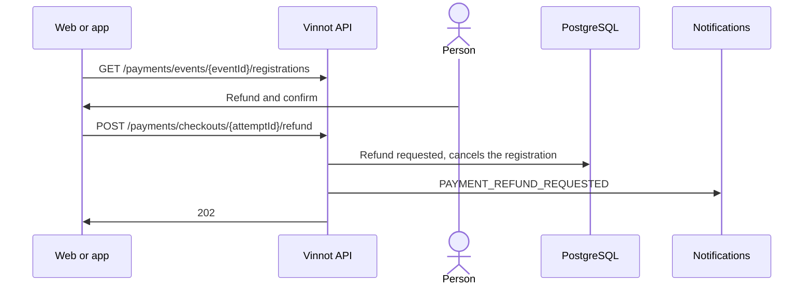

# UC-PAY-04 · Refund a registration payment

| Field | Value |
|---|---|
| ID | `UC-PAY-04` |
| Module | [Payments](../README.md) |
| Platforms | Web, APK |
| Actors | Organizer or administrator, Mercado Pago |
| Lucidchart IDs | [WEB UC-PAR-06](https://lucid.app/lucidchart/9f11a16b-bb5a-42fc-a9e8-0852b17bd241/edit), [APK UC-ORG-07](https://lucid.app/lucidchart/e095dd25-e8ac-41ba-bf5b-396e1055f217/edit) |
| Requirements | [`RF-WEB-PAY-03`](../requirements.md), [`RF-APK-PAY-02`](../requirements.md) |
| Test cases | [`CP-PAY-15`](../testing.md), [`CP-PAY-16`](../testing.md), [`CP-PAY-17`](../testing.md), [`CP-PAY-18`](../testing.md), [`CP-PAY-28`](../testing.md) |

## Preconditions

- The event's organizer, or an administrator, opens the registrations of a paid event.

## Postconditions

- The registration is cancelled and the full refund is requested from Mercado Pago.

## Main flow

1. The client calls `GET /payments/events/{eventId}/registrations` with up to 50 registrations.
2. The API returns, per registration, the amount, the payment status, the refund status and whether it can be refunded.
3. The organizer chooses “Refund” and confirms the total and the cancellation of the registration.
4. The client sends `POST /payments/checkouts/{attemptId}/refund`.
5. The API checks the role and that it is the organizer, and that the payment is credited, with no refunds and not under review.
6. It records the refund, releases the place, cancels the registration, sends `PAYMENT_REFUND_REQUESTED` and answers 202.
7. Reconciliation sends the refund to Mercado Pago and sends `PAYMENT_REFUNDED` when it is confirmed ([UC-PAY-05](uc-pay-05-confirm-and-reconcile.md)).

## Alternative flows

- 5a. The payment cannot be refunded: the API answers `PAYMENT_REFUND_UNAVAILABLE`.
- 6a. The refund was already requested: the API reuses it and sends no new notice.
- 3a. The organizer goes back: nothing is refunded.
- 3b. Mercado Pago rejected the previous refund: the client shows the rejection notice and offers “Retry refund”; confirming sends the same request, the API prepares that refund again, with no new `PAYMENT_REFUND_REQUESTED`, and reconciliation sends it with a new idempotency key.

## Business rules

- Full refunds only.
- Only a rejected refund can be requested again; one being sent, uncertain or settled is left alone.
- Organizers do not confirm payments or credit them by hand: they only approve, reject or waitlist according to the status ([Partners](../../partner/README.md)).
- Cancelling the event refunds online payments without anyone asking ([UC-PAY-05](uc-pay-05-confirm-and-reconcile.md)).

## Diagram

[View the full “UC-PAY-04 · Refund a registration payment” diagram](https://images.vinnot.com/docs/diagrams/v1/en/modules-payments-use-cases-uc-pay-04-refund-registration-7c3384d27fc7.svg)

Component diagram in Lucidchart: [WEB UC-PAR-06](https://lucid.app/lucidchart/9f11a16b-bb5a-42fc-a9e8-0852b17bd241/edit), [APK UC-ORG-07](https://lucid.app/lucidchart/e095dd25-e8ac-41ba-bf5b-396e1055f217/edit).

## Code

| Layer | Location |
|---|---|
| Endpoints | `GET /payments/events/{eventId}/registrations`, `POST /payments/checkouts/{attemptId}/refund` |
| Backend | [`OrganizerPaymentsController.java`](../../../../../backend/src/main/java/com/vinnot/payment/infrastructure/web/OrganizerPaymentsController.java), [`GetOrganizerPaymentsService.java`](../../../../../backend/src/main/java/com/vinnot/payment/application/service/GetOrganizerPaymentsService.java), [`PaymentRefundController.java`](../../../../../backend/src/main/java/com/vinnot/payment/infrastructure/web/PaymentRefundController.java), [`RequestPaymentRefundService.java`](../../../../../backend/src/main/java/com/vinnot/payment/application/service/RequestPaymentRefundService.java), [`RefundEligibility.java`](../../../../../backend/src/main/java/com/vinnot/payment/domain/model/RefundEligibility.java) |
| Web | [`EventRegistrationsManagerModal.tsx`](../../../../../frontend-react/src/presentation/components/features/event/EventRegistrationsManagerModal.tsx), [`useOrganizerPayments.ts`](../../../../../frontend-react/src/presentation/hooks/queries/event/useOrganizerPayments.ts), [`organizerPayments.service.ts`](../../../../../frontend-react/src/application/services/organizerPayments.service.ts), [`organizerPayments.client.ts`](../../../../../frontend-react/src/infrastructure/api/clients/organizerPayments.client.ts) |
| App | [`EventRegistrationsManagerSheet.tsx`](../../../../../frontend-mobile/src/presentation/features/event/EventRegistrationsManagerSheet.tsx), [`useOrganizerPayments.ts`](../../../../../frontend-mobile/src/presentation/hooks/queries/event/useOrganizerPayments.ts), [`organizerPayments.service.ts`](../../../../../frontend-mobile/src/application/services/organizerPayments.service.ts), [`organizerPayments.client.ts`](../../../../../frontend-mobile/src/infrastructure/api/clients/organizerPayments.client.ts) |

## Automated tests

- Backend: [`GetOrganizerPaymentsServiceTest.java`](../../../../../backend/src/test/java/com/vinnot/payment/application/service/GetOrganizerPaymentsServiceTest.java), [`RequestPaymentRefundServiceTest.java`](../../../../../backend/src/test/java/com/vinnot/payment/application/service/RequestPaymentRefundServiceTest.java), [`OrganizerPaymentTest.java`](../../../../../backend/src/test/java/com/vinnot/payment/domain/model/OrganizerPaymentTest.java), [`PaymentSettlementPostgresIntegrationTest.java`](../../../../../backend/src/test/java/com/vinnot/payment/infrastructure/persistence/PaymentSettlementPostgresIntegrationTest.java), [`CancellationRefundTest.java`](../../../../../backend/src/test/java/com/vinnot/event/domain/valueobject/CancellationRefundTest.java)
- Web: [`EventRegistrationsManagerModal.test.tsx`](../../../../../frontend-react/src/presentation/components/features/event/EventRegistrationsManagerModal.test.tsx), [`organizerPayments.service.test.ts`](../../../../../frontend-react/src/application/services/organizerPayments.service.test.ts)
- App: [`EventRegistrationsManagerSheet.test.tsx`](../../../../../frontend-mobile/src/presentation/features/event/EventRegistrationsManagerSheet.test.tsx), [`organizerPayments.service.test.ts`](../../../../../frontend-mobile/src/application/services/organizerPayments.service.test.ts)
