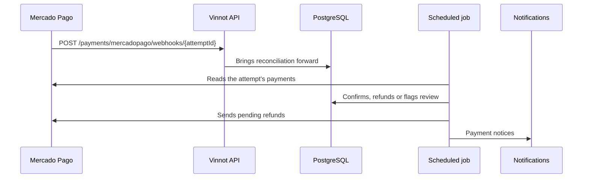

# UC-PAY-05 · Confirm payments and issue refunds

| Field | Value |
|---|---|
| ID | `UC-PAY-05` |
| Module | [Payments](../README.md) |
| Platforms | Backend only |
| Actors | Mercado Pago, System (scheduled job) |
| Lucidchart IDs | None |
| Requirements | None |
| Test cases | [`CP-PAY-19`](../testing.md), [`CP-PAY-20`](../testing.md), [`CP-PAY-21`](../testing.md), [`CP-PAY-22`](../testing.md), [`CP-PAY-23`](../testing.md), [`CP-PAY-24`](../testing.md), [`CP-PAY-29`](../testing.md), [`CP-PAY-30`](../testing.md) |

## Preconditions

- There are payment attempts sent to Mercado Pago, or a paid event was cancelled.

## Postconditions

- Each registration reflects the actual status of its payment and pending refunds are sent.

## Main flow

1. Mercado Pago reports a change with `POST /payments/mercadopago/webhooks/{attemptId}`.
2. The API verifies the notice signature and brings forward that attempt's reconciliation.
3. The reconciliation job takes pending attempts and reads their payments (up to 20) from the Mercado Pago API with the seller's credentials.
4. A payment approved before the expiry confirms the registration and sends `PAYMENT_RECEIPT`.
5. If there are pending refunds, it sends them to Mercado Pago with an idempotency key and reads the payment again.
6. It schedules the attempt's next check.

## Alternative flows

- 2a. The signature is invalid: the API answers 401 and does nothing.
- 4a. The payment arrives late or is a second payment for the same registration: its refund is requested.
- 4b. A credited payment whose registration is no longer confirmed, or whose event was cancelled, is refunded automatically and `PAYMENT_REFUND_REQUESTED` is sent.
- 4c. There is a partial refund, a chargeback or a mediation: the registration is cancelled, the case goes under review and `PAYMENT_REFUNDED` or `PAYMENT_CHARGEBACK` is sent.
- 1a. No notice arrives: reconciliation checks the attempt anyway on its schedule.
- 5a. Mercado Pago definitely rejects the refund (a 4xx error other than 408, 409 or 429, or the `LIVE_PILOT` limit): the refund becomes `REJECTED` with a reason code, it is logged and the organizer gets `PAYMENT_REFUND_REJECTED` once per rejection; it is not resent on its own.
- 5b. The outcome is uncertain (408, 409, 429, 5xx, network or invalid response): the refund becomes `UNCERTAIN` and is never resent; it is only verified by reading the payment again.

## Business rules

- Every 5 minutes until one hour after the expiry; after an error, one minute later; then every 30 minutes, 6 hours and 24 hours; it is parked after 180 days.
- Each attempt credits at most one payment.
- Until a refund is confirmed, the buyer still sees it as pending.
- The notice signature is HMAC-SHA256 with a 10-minute window.
- Payment notices arrive by email and push ([Notifications](../../notifications/README.md)).

## Diagram

[View the full “UC-PAY-05 · Confirm payments and issue refunds” diagram](https://images.vinnot.com/docs/diagrams/v1/en/modules-payments-use-cases-uc-pay-05-confirm-and-reconcile-27837dfa4dce.svg)

## Code

| Layer | Location |
|---|---|
| Endpoints | `POST /payments/mercadopago/webhooks/{attemptId}`, `POST /payments/mercadopago/webhooks` |
| Backend | [`PaymentWebhookController.java`](../../../../../backend/src/main/java/com/vinnot/payment/infrastructure/web/PaymentWebhookController.java), [`MercadoPagoWebhookSignature.java`](../../../../../backend/src/main/java/com/vinnot/payment/infrastructure/security/MercadoPagoWebhookSignature.java), [`RecordPaymentNotificationService.java`](../../../../../backend/src/main/java/com/vinnot/payment/application/service/RecordPaymentNotificationService.java), [`PaymentReconciliationScheduler.java`](../../../../../backend/src/main/java/com/vinnot/payment/infrastructure/scheduling/PaymentReconciliationScheduler.java), [`ReconcilePaymentsService.java`](../../../../../backend/src/main/java/com/vinnot/payment/application/service/ReconcilePaymentsService.java), [`ReconciliationSchedule.java`](../../../../../backend/src/main/java/com/vinnot/payment/application/service/ReconciliationSchedule.java), [`ApplyProviderPaymentService.java`](../../../../../backend/src/main/java/com/vinnot/payment/application/service/ApplyProviderPaymentService.java), [`PaymentNoticeService.java`](../../../../../backend/src/main/java/com/vinnot/payment/application/service/PaymentNoticeService.java) |

## Automated tests

- Backend: [`MercadoPagoWebhookSignatureTest.java`](../../../../../backend/src/test/java/com/vinnot/payment/infrastructure/security/MercadoPagoWebhookSignatureTest.java), [`RecordPaymentNotificationServiceTest.java`](../../../../../backend/src/test/java/com/vinnot/payment/application/service/RecordPaymentNotificationServiceTest.java), [`ReconcilePaymentsServiceTest.java`](../../../../../backend/src/test/java/com/vinnot/payment/application/service/ReconcilePaymentsServiceTest.java), [`ReconciliationScheduleTest.java`](../../../../../backend/src/test/java/com/vinnot/payment/application/service/ReconciliationScheduleTest.java), [`ApplyProviderPaymentServiceTest.java`](../../../../../backend/src/test/java/com/vinnot/payment/application/service/ApplyProviderPaymentServiceTest.java), [`PaymentSettlementPostgresIntegrationTest.java`](../../../../../backend/src/test/java/com/vinnot/payment/infrastructure/persistence/PaymentSettlementPostgresIntegrationTest.java), [`PaymentNoticeServiceTest.java`](../../../../../backend/src/test/java/com/vinnot/payment/application/service/PaymentNoticeServiceTest.java), [`MercadoPagoPaymentAdapterTest.java`](../../../../../backend/src/test/java/com/vinnot/payment/infrastructure/gateway/MercadoPagoPaymentAdapterTest.java), [`RefundRejectionRecorderTest.java`](../../../../../backend/src/test/java/com/vinnot/payment/application/service/RefundRejectionRecorderTest.java)
- Web: None
- App: None
