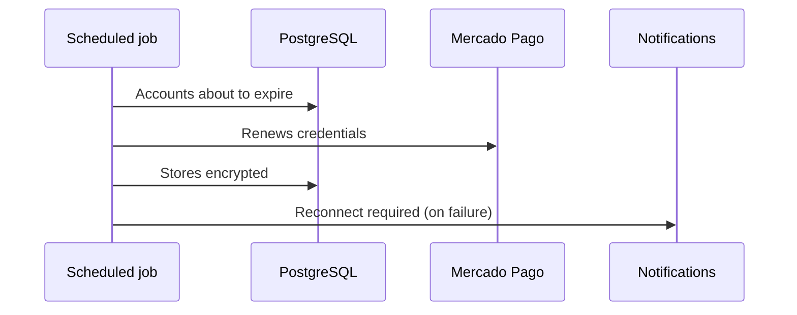

# UC-PAY-06 · Renew payout credentials

| Field | Value |
|---|---|
| ID | `UC-PAY-06` |
| Module | [Payments](../README.md) |
| Platforms | Backend only |
| Actors | System (scheduled job), Mercado Pago |
| Lucidchart IDs | None |
| Requirements | None |
| Test cases | [`CP-PAY-25`](../testing.md), [`CP-PAY-26`](../testing.md), [`CP-PAY-27`](../testing.md) |

## Preconditions

- There are linked payout accounts whose credentials expire.

## Postconditions

- The credentials stay valid or the organizer knows they must reconnect.

## Main flow

1. The job takes up to 20 accounts whose credentials expire in less than a day.
2. It requests new credentials from Mercado Pago.
3. It stores the new credentials encrypted.

## Alternative flows

- 2a. Mercado Pago revoked the authorization or it expired: the account needs reconnecting and the organizer gets `PAYMENT_ACCOUNT_RECONNECT_REQUIRED` only once.
- 2b. Temporary failure: it retries after 5 minutes.

## Business rules

- A seller's credentials with operations are kept for reconciliation and refunds.
- Reconnecting works like linking ([UC-PAY-03](uc-pay-03-link-payment-account.md)).

## Diagram

[View the full “UC-PAY-06 · Renew payout credentials” diagram](https://images.vinnot.com/docs/diagrams/v1/en/modules-payments-use-cases-uc-pay-06-renew-credentials-f4fb83b11634.svg)

## Code

| Layer | Location |
|---|---|
| Backend | [`PaymentCredentialRenewalScheduler.java`](../../../../../backend/src/main/java/com/vinnot/payment/infrastructure/scheduling/PaymentCredentialRenewalScheduler.java), [`RenewPaymentCredentialsService.java`](../../../../../backend/src/main/java/com/vinnot/payment/application/service/RenewPaymentCredentialsService.java), [`RenewalFailureRecorder.java`](../../../../../backend/src/main/java/com/vinnot/payment/application/service/RenewalFailureRecorder.java), [`PaymentAccountNoticeService.java`](../../../../../backend/src/main/java/com/vinnot/payment/application/service/PaymentAccountNoticeService.java) |

## Automated tests

- Backend: [`RenewPaymentCredentialsServiceTest.java`](../../../../../backend/src/test/java/com/vinnot/payment/application/service/RenewPaymentCredentialsServiceTest.java), [`RenewalFailureRecorderTest.java`](../../../../../backend/src/test/java/com/vinnot/payment/application/service/RenewalFailureRecorderTest.java), [`PaymentAccountNoticeServiceTest.java`](../../../../../backend/src/test/java/com/vinnot/payment/application/service/PaymentAccountNoticeServiceTest.java)
- Web: None
- App: None
