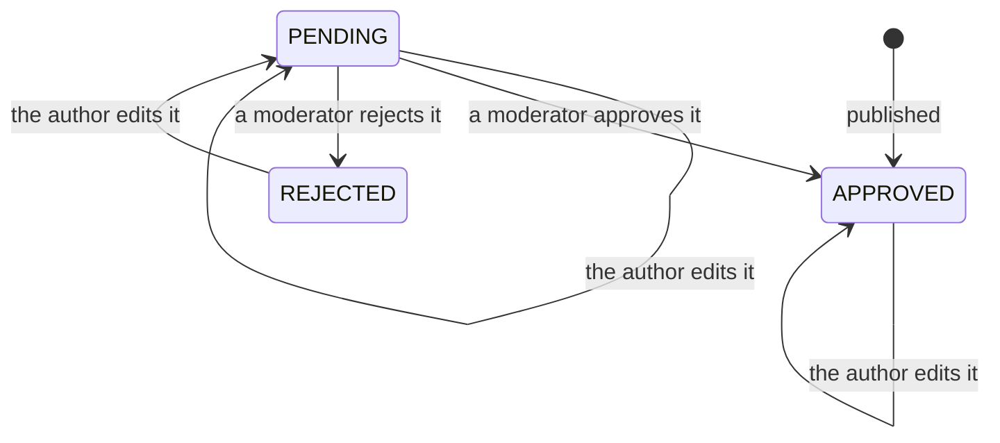
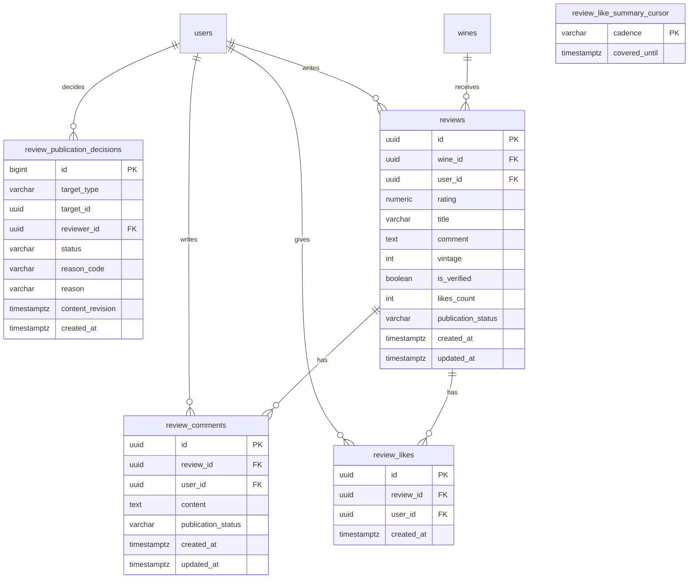

# Reviews

People's opinions about wines: a rating from 0.1 to 5.0 in
glasses that fill by the fraction with an optional title and comment,
plus likes and comments on each review. Reviews feed each wine's average and
their author is notified of the activity. Reports and blocks are in
[Community](../community/README.md); moderation and the staff review list, in
[Administration](../admin/README.md); publishing a cellar note as a review, in
[Cellar](../cellar/README.md).

- Module code: `REV`.
- Backend: package [`review`](../../../../backend/src/main/java/com/vinnot/review/).
- [Use cases](use-cases/README.md) · [Requirements](requirements.md) ·
  [Architecture](architecture.md) · [Testing](testing.md)

## Actors

| Actor | What they do in this module |
|---|---|
| Signed-in user | Reads reviews, publishes their own, likes and comments |
| Review author | Edits or deletes their review and gets comment and like notices |
| Moderator | Deletes other people's reviews and comments |
| Administrator | Can also edit other people's reviews |
| Email and push services | Deliver the activity notices |

## Business rules

| Rule | Detail | Where |
|---|---|---|
| Access | Reading and writing reviews needs a session | [`SecurityConfig.java`](../../../../backend/src/main/java/com/vinnot/shared/infrastructure/config/SecurityConfig.java) |
| One per wine | Each person can have only one review of each wine | [`CreateReviewCommandHandler.java`](../../../../backend/src/main/java/com/vinnot/review/application/command/handler/CreateReviewCommandHandler.java) |
| Rating | From 0.1 to 5.0 with at most one decimal (2.15 is entered as 2.2); the API rejects any other scale or out-of-range value (trailing zeros such as `3.60` are the same rating; reviews and cellar share one request check, `OneDecimalRating`). Web and app pick it with the bottle control that fills the glasses and show each glass filled by its fraction, with glass, wine and bottle by wine type ([Points and seals](../../manuals/points-and-seals.mdx#rating-with-glasses)) | [`Review.java`](../../../../backend/src/main/java/com/vinnot/review/domain/model/Review.java) |
| Tasted vintage | Optional, from 1800 to next year and independent from the catalog vintage; editing without it keeps it, `clearVintage` removes it | [`Review.java`](../../../../backend/src/main/java/com/vinnot/review/domain/model/Review.java) |
| Publication | New reviews and comments are published at once; editing a pending or rejected review returns it to `PENDING` | [`Review.java`](../../../../backend/src/main/java/com/vinnot/review/domain/model/Review.java) |
| Editing | The author or an administrator; a moderator cannot edit other people's content | [`UpdateReviewCommandHandler.java`](../../../../backend/src/main/java/com/vinnot/review/application/command/handler/UpdateReviewCommandHandler.java) |
| Deletion | The author or anyone with `REVIEW_DELETE`; deleting someone else's content emails its author | [`DeleteReviewCommandHandler.java`](../../../../backend/src/main/java/com/vinnot/review/application/command/handler/DeleteReviewCommandHandler.java) |
| Wine average | Only approved reviews count; it is recalculated in the same transaction and rounded to two decimals | [`ReviewPersistenceAdapter.java`](../../../../backend/src/main/java/com/vinnot/review/infrastructure/persistence/adapter/ReviewPersistenceAdapter.java) |
| Likes | One per person and review, own review included; approved reviews only | [`LikeReviewCommandHandler.java`](../../../../backend/src/main/java/com/vinnot/review/application/command/handler/LikeReviewCommandHandler.java) |
| Comments | 1 to 2000 characters, no editing, approved reviews only | [`AddReviewCommentCommandHandler.java`](../../../../backend/src/main/java/com/vinnot/review/application/command/handler/AddReviewCommentCommandHandler.java) |
| Seal and points | Every author shows their seal (`badgeTier`, loaded in batch per page; `null` when the account is locked or inactive). The approved review, a comment of 80 characters or more, likes received and comments on other people's reviews earn points | [Points and seals](../gamification/README.md) |
| Blocks | A block hides reviews and comments and stops likes and comments both ways | [Community](../community/README.md) |
| Cellar | Publishing a review adds the wine to the cellar with its rating; the comment replaces the notes only when there is one, so a review without a comment keeps the private notes; a review vintage is copied to the cellar, and a review without one keeps the cellar vintage; deleting it leaves the cellar alone | [`CellarCommandAdapter.java`](../../../../backend/src/main/java/com/vinnot/review/infrastructure/persistence/adapter/CellarCommandAdapter.java) |
| Notices | A notice for each comment; a like summary by push at 19:00 and by email on Sundays at 10:00 (Argentina time) | [`ReviewLikeSummaryScheduler.java`](../../../../backend/src/main/java/com/vinnot/review/infrastructure/scheduling/ReviewLikeSummaryScheduler.java) |
| Usage limits | 60 reads per minute and 300 writes per minute | [`RateLimitPolicyResolver.java`](../../../../backend/src/main/java/com/vinnot/shared/infrastructure/security/RateLimitPolicyResolver.java) |

## Publication states

[View the full “Publication states” diagram](https://images.vinnot.com/docs/diagrams/v1/en/modules-reviews-readme-7818215a3e6a.svg)

`PENDING` and `REJECTED` only appear on content older than immediate
publication; the decision queue is in [Administration](../admin/README.md).

## Where it lives

| Part | Location |
|---|---|
| API | [`ReviewController`](../../../../backend/src/main/java/com/vinnot/review/infrastructure/web/controller/ReviewController.java), under `/wines/{wineId}/reviews` |
| Web | Reviews section of the wine page, in [`features/wine`](../../../../frontend-react/src/presentation/components/features/wine/) |
| App | Wine page in `frontend-mobile/app/(app)/(tabs)/wines/[id].tsx` and components in [`features/wine`](../../../../frontend-mobile/src/presentation/features/wine/) |

## Data

Tables created in `V1__baseline_schema.sql` and extended by the publication
states (`V26`), the decision reasons (`V53`) and the like-summary cursor
(`V55`).

[View the full “Reviews · Data” diagram](https://images.vinnot.com/docs/diagrams/v1/en/modules-reviews-readme-ae28dbbfa90b.svg)

`reviews` is unique per wine and person, and `review_likes` per review and person.
The average and number of approved reviews are stored in
`wines.rating_average` and `wines.rating_count`.
