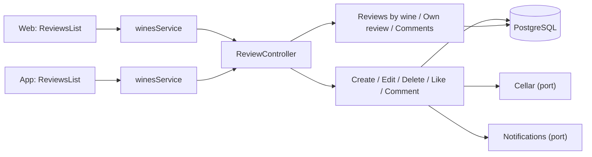
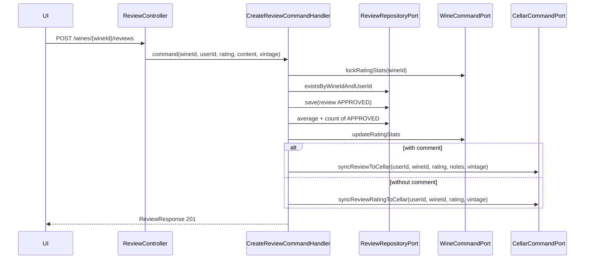
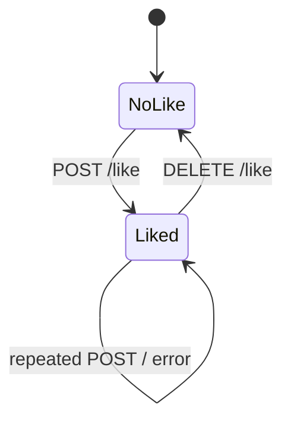

# Architecture

How the module is built in each layer. The backend follows the hexagonal flow
`controller → input port → handler → domain → output port → adapter`;
the web and the app follow `screen → hook → service → API client → HTTP transport`.



[View the full “Architecture” diagram](https://images.vinnot.com/docs/diagrams/v1/en/modules-reviews-architecture-832bcaaa89bf.svg)

## Backend

### Scope

The `review` module manages structured wine opinions and engagement around them.
It separates the review—an aggregate with rating and content—from likes and
comments, which need their own uniqueness, authorship and queries.

### Architecture

| Responsibility | Implementation |
|---|---|
| Review invariants | `Review` |
| Writes | command handlers for create/edit/delete/like/comment |
| Reads | reviews by wine, own review and comments |
| Owned ports | review, like and comment repositories |
| Cross-module ports | user, wine and cellar |
| HTTP | `ReviewController` under `/wines/{wineId}/reviews` |

### Review rules

- Required rating from `0.1` through `5.0`, with at most one decimal.
- Optional tasted vintage from `1800` through next year (`INVALID_VINTAGE`); it is
  independent from the catalog wine vintage.
- A user may create at most one review per wine.
- `userId` comes from the authenticated principal.
- Only the author or `ADMIN` may edit; deletion accepts authorship or `REVIEW_DELETE`.
- Creating a review publishes it as `APPROVED`. Editing keeps an `APPROVED`
  review public; an edited `REJECTED` or `PENDING` review returns to the
  moderation queue as `PENDING` instead of becoming public. New comments are
  published as `APPROVED` at once and the review's author is notified.
- Only `APPROVED` reviews contribute to public wine average/count.
- Create/edit recalculates those projections in the same transaction. Creation
  always synchronizes cellar (the notes only when the review has a comment); an edit synchronizes it only when the author edits
  their own review (see [Edit and delete](#edit-and-delete)). A failure propagates
  and rolls back the operation. Deletion updates wine statistics without deleting
  or overwriting the saved personal cellar rating.
- `verified`, `helpfulCount` and `likesCount` are not freely editable through the
  public request.

### Create and metric propagation



[View the full “Create and metric propagation” diagram](https://images.vinnot.com/docs/diagrams/v1/en/modules-reviews-architecture-5313b6e10933.svg)

Wine update and cellar convenience use ports; `review` never imports their JPA
repositories.

### Publication and visibility

Creation returns 201 with `APPROVED`; editing an approved review keeps it
published and recalculates ratings without hiding it or its approved comments.
Editing a rejected review does not republish it: it goes back to `PENDING` so a
moderator decides again.
The policy change alone does not approve existing pending/rejected rows.
Authors may read those states; everyone else sees only `APPROVED`.
New comments publish at once and have no edit endpoint. Reports, blocking and
administrative removal are how they are moderated. The manual queue keeps only
the reviews and comments left pending before that, with independent review and
exact revision checks; see
[community](../community/architecture.md#review-and-comment-publication).

Personal synchronization copies the review rating to the cellar with its decimal,
without rounding: both use the same 0.1 to 5.0 scale.

### Query and ordering

`GET /wines/{wineId}/reviews` builds PageQuery and maps the ordering filter to the handler's supported properties. ReviewerInfoResolver obtains public author projections; likes and comment counts enrich the page.

The `mine` filter on `GET /wines/{wineId}/reviews?filter=mine` returns the
authenticated principal’s review for the wine with the same enriched DTO.
It accepts no client-supplied author and does not depend on the recent page.
Page zero contains at most one review; subsequent pages are empty with the
same total. Authors without a review receive an empty result. The handler also returns an empty result without a user, but that branch is unreachable over HTTP because `SecurityConfig` requires a session for `GET /wines/**`.
Existing publication status is preserved; this read neither publishes nor replaces content.

`GET .../mine` returns only `{ "hasReview": boolean }`. The controller accepts optional identity: without a user it returns false (unreachable over HTTP, since `GET /wines/**` requires authentication); with a user it executes the existence query. It returns neither review ID nor content. Creation duplicate checks and the user/wine constraint are independent of this query.

### Edit and delete

UpdateReviewCommand identifies reviewId and requestingUserId plus the administrative flag. The handler loads by ID, checks author or administrator and applies updateContent; it uses the review's stored wineId to recalculate rating/count and synchronize cellar. The outer URL wineId is not a field of the edit command.

`PATCH` is a partial update: an omitted (`null`) `rating`, `title` or `comment`
keeps its stored value, so an edit can omit the rating. The tasted
`vintage` follows the same rule: omitted or `null` keeps it, a value replaces it,
and only `clearVintage: true` removes it (it wins over a supplied `vintage`), so
app versions that do not send the field never erase it. Rating, title and comment
have no clear marker.

The cellar is the author's private record. Creating a review with a comment replaces
the cellar notes; creating one without a comment only updates the cellar rating
(`syncReviewRatingToCellar`) and never erases the notes. Only the author's own edit
synchronizes it, and only with what that edit supplied: a supplied `comment`
replaces the cellar notes together with the rating, a rating-only edit
updates just the cellar rating (`syncReviewRatingToCellar`) and keeps the notes,
and a title-only edit does not touch the cellar. A supplied vintage travels in the
same sync and replaces the cellar vintage (a vintage-only edit syncs it with the
current rating); an omitted or cleared review vintage leaves the cellar
vintage as it is. An administrator editing
another user's review never changes that user's cellar.

Delete removes the review and recalculates statistics; FKs control related
comments/likes. It does not delete or reset the personal cellar entry. On creation
or an author's edit, synchronization creates a missing entry or updates the
existing one. A synchronization or rating failure propagates and rolls back the transaction.

### Likes

- one row per `reviewId` and `userId`;
- a second like is rejected even when concurrent taps arrive;
- like increments and unlike decrements without allowing a negative counter;
- the materialized counter speeds reads, while relation rows remain rebuildable
  truth;
- unlike only removes the principal's relation;
- new likes require an approved review and no account block. Removing an
  existing own like remains allowed.



[View the full “Likes” diagram](https://images.vinnot.com/docs/diagrams/v1/en/modules-reviews-architecture-66e617d3e22e.svg)

### Comments

AddReviewCommentCommand contains reviewId, userId and content. The handler requires an approved review without an interaction block; it normalizes content to 1–2000 characters, saves it `APPROVED` and asks `CommentActivityAnnouncer` to notify the review's author. Queries populate author/timestamps. DeleteReviewCommentCommand contains commentId, requestingUserId and a global-permission flag: the handler loads the comment and checks authorship or that permission. Path wine/review IDs are not passed to this command.

Comment reads require an approved parent review or ownership of that review,
and each comment must be approved or owned by the reader. Account blocks are
checked against both identities before returning results.

### Response contracts

`ReviewResponse` includes rating, title, comment, tasted `vintage`, flags, counters, author,
timestamps, `publicationStatus`, and the `likedByCurrentUser` boolean. For an authenticated query the
handler derives it from that user's liked review IDs; without a current user it
is `false`. `ReviewCommentResponse` includes `publicationStatus` and limits
author identity to public fields. UI never receives email, internal roles or
tokens.

The author of a review or comment arrives as `reviewer` with `id`, `username`,
`displayName`, `avatarUrl` and `badgeTier` (reviews add `totalReviews`, currently always sent as 0).
`ReviewerInfoResolver` builds it with `UserQueryPort`, `ReviewerBadgePort` and
`AvatarUrlResolver`, so `avatarUrl` is always an absolute URL or `null` (see
[Stored value and the URL clients receive](../users/architecture.md#stored-value-and-the-url-clients-receive)).
The web and app clients resolve the author's photo again when they map reviews
and comments; an absolute URL is left unchanged.

### Frontends

Web and mobile access presentation → application service → HTTP client. The backend does not control query keys or invalidation. Creation/edit responses and review reads are mapped to frontend models before rendering.

### Expected errors

Review/comment EntityNotFoundException maps to 404; Bean Validation/DomainException normally to 400. Handler-detected duplicates and REVIEW_OWNERSHIP/REVIEW_COMMENT_OWNERSHIP are BusinessRuleViolationException (422 except mapper-specific codes). Concurrent constraints produce DataIntegrityViolationException (409 DUPLICATE_ENTRY). Wine/user references are also protected by FKs; not every invalid FK is a 404.

### Tests

- domain: `ReviewTest` (rating and vintage bounds, edits and counters) and `ReviewPublicationTest`;
- handlers: `ReviewInteractionHandlersTest`, `UpdateReviewCommandHandlerTest`, `ReviewOwnershipTest` and `CommentActivityAnnouncerTest`;
- queries: `GetReviewsByWineQueryHandlerTest`, `CheckUserReviewQueryHandlerTest`, `GetReviewCommentsQueryHandlerTest` and `ReviewerInfoResolverTest`;
- persistence: `ReviewPersistenceAdapterTest`, `ReviewPersistenceMapperTest`, `CellarCommandAdapterTest` and `JdbcReviewLikeSummaryAdapterPostgresIntegrationTest`;
- like summaries: `SummarizeReviewLikesCommandHandlerTest` and `ReviewLikeSummarySchedulerTest`;
- HTTP: `ReviewControllerTest`.

### References

- `backend/src/main/java/com/vinnot/review`
- `frontend-react/src/infrastructure/api/clients/wines.reviews.client.ts`
- `frontend-mobile/src/infrastructure/api/clients/wines.client.ts`
- [Personal cellar](../cellar/architecture.md)
- [Errors and consistency](../../backend/architecture/errors-transactions-and-consistency.md)

### Consistency and access contract

Writes lock wine before review; like/unlike lock the review. Rating is updated through column-specific SQL and is not overwritten by ORM catalog edits. Account deletion recomputes projections after cascades.

[Coordination details](../../backend/architecture/session-and-data-integrity.md).

### Reports and blocking

Public reads and new interactions enforce account blocks. Removal from a report reuses deletion use cases and preserves the case audit. See [Community reports, blocking and moderation](../community/architecture.md).

## Web

```text
ReviewsList → useReviews / useCreateReview / … → winesService → winesReviewsClient → http
```

Reviews live on the wine's page
([`WineDetailsPage.tsx`](../../../../frontend-react/src/presentation/pages/wines/WineDetailsPage.tsx)). The cellar
can also publish a note as a review ([Cellar](../cellar/README.md)); the
moderation screens are in [Administration](../admin/README.md).

| Piece | What it does |
|---|---|
| [`ReviewsList.tsx`](../../../../frontend-react/src/presentation/components/features/wine/ReviewsList.tsx) | Pages of 20 in recent or popular order, the person's own review first, create and edit, confirmation before deleting and an optimistic like that is reverted when it fails |
| [`ReviewCard.tsx`](../../../../frontend-react/src/presentation/components/features/wine/ReviewCard.tsx) | Author with photo (or a person icon when it is missing or fails to load), name and seal, with their `@username` below in gray; the photo and the name open their public profile (`/users/{id}`). Stars, text, date, counts and status label; like and comments disabled when the review is not approved |
| [`ReviewForm.tsx`](../../../../frontend-react/src/presentation/components/features/wine/ReviewForm.tsx) | Bottle control from 0.1 to 5.0, a title of up to 255 characters, a comment and the immediate-publication notice |
| [`ReviewComments.tsx`](../../../../frontend-react/src/presentation/components/features/wine/ReviewComments.tsx) | Comment list with the author's photo (or a person icon), name, seal and `@username` below in gray; new comments of up to 2000 characters and deletion with confirmation |
| [`hooks/queries/wine`](../../../../frontend-react/src/presentation/hooks/queries/wine/) | Queries and mutations; creating or deleting reloads the wine page, the catalog, the cellar and the community data |
| [`wines.service.ts`](../../../../frontend-react/src/application/services/wines.service.ts) | Maps the DTOs; a 409 or 422 when creating or editing is treated as a state conflict and reloads the list |
| [`wines.reviews.client.ts`](../../../../frontend-react/src/infrastructure/api/clients/wines.reviews.client.ts) | Endpoints of `/wines/{wineId}/reviews` |

## App

Reviews close the “Info” tab of the wine's page,
`frontend-mobile/app/(app)/(tabs)/wines/[id].tsx`. With `?tab=reviews` (the cards'
count) the page scrolls down to them, and with `?review=mine` it leads to the
person's own review;
[`useWineReviewFocus.ts`](../../../../frontend-mobile/src/presentation/hooks/ui/useWineReviewFocus.ts)
does that scroll. The cellar can also publish a note as a review
([Cellar](../cellar/README.md)).

| Piece | What it does |
|---|---|
| [`ReviewsList.tsx`](../../../../frontend-mobile/src/presentation/features/wine/ReviewsList.tsx) | Pages of 10 with “Previous” and “Next”, “Most recent” or “Most popular” order when there is more than one review, the person's own review first on the first page and the form while there is no own review yet |
| [`ReviewItem.tsx`](../../../../frontend-mobile/src/presentation/features/wine/ReviewItem.tsx) | Author with photo (their initials when it is missing or fails to load), name, seal and `@username` below in gray; tapping the author opens their public profile. Rating in glasses filled by fraction, text, status label, like, edit and deletion with confirmation |
| [`ReviewForm.tsx`](../../../../frontend-mobile/src/presentation/features/wine/ReviewForm.tsx) and [`ReviewFormFields.tsx`](../../../../frontend-mobile/src/presentation/features/wine/ReviewFormFields.tsx) | Bottle control above the glasses, from 0.1 to 5.0 (a glass can also be tapped), a title of up to 255 characters, a comment and the immediate-publication notice |
| [`ReviewComments.tsx`](../../../../frontend-mobile/src/presentation/features/wine/ReviewComments.tsx) | Comment list with the author's photo (or their initials), name, seal and `@username` below in gray; new comments of up to 2000 characters and deletion with confirmation |
| [`useWines.ts`](../../../../frontend-mobile/src/presentation/hooks/queries/wine/useWines.ts) | Queries and mutations for reviews, likes and comments |
| [`wines.service.ts`](../../../../frontend-mobile/src/application/services/wines.service.ts) | Maps the DTOs to app models |
| [`wines.client.ts`](../../../../frontend-mobile/src/infrastructure/api/clients/wines.client.ts) | Endpoints of `/wines/{wineId}/reviews` |

Blocking an account clears the stored reviews and comments from the cache
([Community](../community/README.md)).
