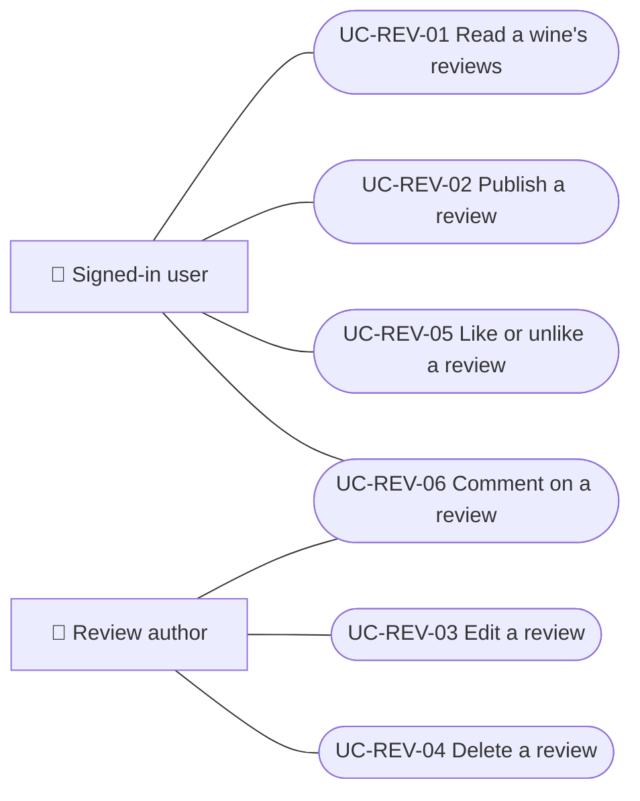
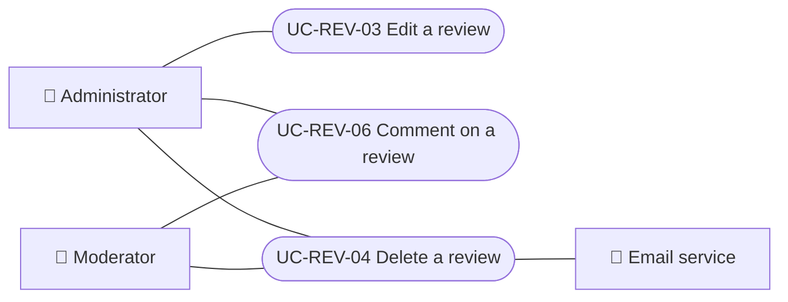
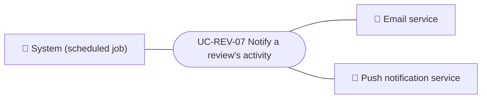

# Use cases

Use cases of the reviews module: reading, publishing, editing and deleting reviews, liking, commenting and telling the review's author about the activity. Each case applies to the platforms listed.

| ID | Use case | Platforms | Actors |
|---|---|---|---|
| `UC-REV-01` | [Read a wine's reviews](uc-rev-01-read-reviews.md) | Web, APK | Signed-in user |
| `UC-REV-02` | [Publish a review](uc-rev-02-publish-review.md) | Web, APK | Signed-in user |
| `UC-REV-03` | [Edit a review](uc-rev-03-edit-review.md) | Web, APK | Review author, Administrator |
| `UC-REV-04` | [Delete a review](uc-rev-04-delete-review.md) | Web, APK | Review author, Moderator, Administrator, Email service |
| `UC-REV-05` | [Like or unlike a review](uc-rev-05-like-review.md) | Web, APK | Signed-in user |
| `UC-REV-06` | [Comment on a review](uc-rev-06-review-comments.md) | Web, APK | Signed-in user, Review author, Moderator, Administrator |
| `UC-REV-07` | [Notify a review's activity](uc-rev-07-activity-notices.md) | Backend only | System (scheduled job), Email service, Push notification service |

## Use case diagram

### Readers and authors

[View the full “Readers and authors” diagram](https://images.vinnot.com/docs/diagrams/v1/en/modules-reviews-use-cases-readme-e561bcfd0499.svg)

### Moderation

[View the full “Moderation” diagram](https://images.vinnot.com/docs/diagrams/v1/en/modules-reviews-use-cases-readme-afe024ab6155.svg)

### Activity notices

[View the full “Activity notices” diagram](https://images.vinnot.com/docs/diagrams/v1/en/modules-reviews-use-cases-readme-1cde1d2e3eb1.svg)

## Lucidchart mapping

| ID | Lucidchart IDs |
|---|---|
| `UC-REV-01` | [WEB UC-REV-01](https://lucid.app/lucidchart/9f11a16b-bb5a-42fc-a9e8-0852b17bd241/edit), [APK UC-REV-01](https://lucid.app/lucidchart/e095dd25-e8ac-41ba-bf5b-396e1055f217/edit) |
| `UC-REV-02` | [WEB UC-REV-02](https://lucid.app/lucidchart/9f11a16b-bb5a-42fc-a9e8-0852b17bd241/edit), [APK UC-REV-02](https://lucid.app/lucidchart/e095dd25-e8ac-41ba-bf5b-396e1055f217/edit) |
| `UC-REV-03` | [WEB UC-REV-03](https://lucid.app/lucidchart/9f11a16b-bb5a-42fc-a9e8-0852b17bd241/edit), [APK UC-REV-02](https://lucid.app/lucidchart/e095dd25-e8ac-41ba-bf5b-396e1055f217/edit) |
| `UC-REV-04` | [WEB UC-REV-04](https://lucid.app/lucidchart/9f11a16b-bb5a-42fc-a9e8-0852b17bd241/edit), [APK UC-REV-03](https://lucid.app/lucidchart/e095dd25-e8ac-41ba-bf5b-396e1055f217/edit) |
| `UC-REV-05` | [WEB UC-REV-05](https://lucid.app/lucidchart/9f11a16b-bb5a-42fc-a9e8-0852b17bd241/edit), [APK UC-REV-04](https://lucid.app/lucidchart/e095dd25-e8ac-41ba-bf5b-396e1055f217/edit) |
| `UC-REV-06` | [WEB UC-REV-06](https://lucid.app/lucidchart/9f11a16b-bb5a-42fc-a9e8-0852b17bd241/edit), [APK UC-REV-05](https://lucid.app/lucidchart/e095dd25-e8ac-41ba-bf5b-396e1055f217/edit) |
| `UC-REV-07` | None |
