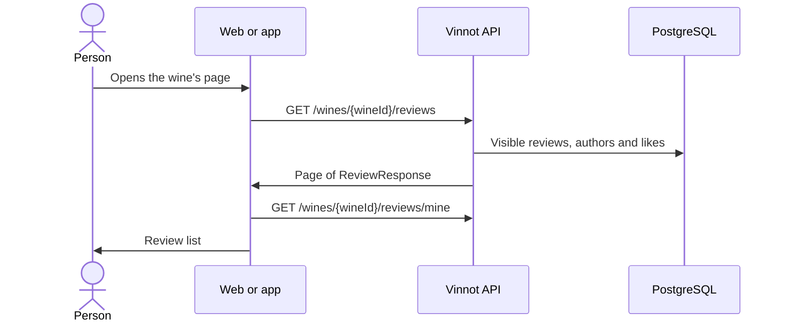

# UC-REV-01 · Read a wine's reviews

| Field | Value |
|---|---|
| ID | `UC-REV-01` |
| Module | [Reviews](../README.md) |
| Platforms | Web, APK |
| Actors | Signed-in user |
| Lucidchart IDs | [WEB UC-REV-01](https://lucid.app/lucidchart/9f11a16b-bb5a-42fc-a9e8-0852b17bd241/edit), [APK UC-REV-01](https://lucid.app/lucidchart/e095dd25-e8ac-41ba-bf5b-396e1055f217/edit) |
| Requirements | [`RF-WEB-REV-01`](../requirements.md), [`RF-WEB-REV-02`](../requirements.md), [`RF-APK-REV-01`](../requirements.md), [`RF-APK-REV-02`](../requirements.md), [`RF-WEB-REV-11`](../requirements.md), [`RF-APK-REV-11`](../requirements.md) |
| Test cases | [`CP-REV-01`](../testing.md), [`CP-REV-02`](../testing.md), [`CP-REV-03`](../testing.md), [`CP-REV-04`](../testing.md), [`CP-REV-33`](../testing.md) |

## Preconditions

- The person is signed in and opened a wine's page.

## Postconditions

- The wine's visible reviews are shown with their author, rating, text, date and counts.

## Main flow

1. The client calls `GET /wines/{wineId}/reviews` in recent order.
2. The API returns the approved reviews and the viewer's own, without those of blocked accounts.
3. The client calls `GET /wines/{wineId}/reviews/mine` to know whether the person already wrote a review.
4. The web shows pages of 20 and lets the person sort by recent or popular; the app shows pages of 10 with “Previous” and “Next” and, with more than one review, lets the person choose “Most recent” or “Most popular”.

## Alternative flows

- 1a. The page opens with `?review=mine`: the client asks for the person's own review with `filter=mine` and shows it first.
- 2a. The wine has no visible reviews: the empty state is shown.
- 4a. The person changes the order: it goes back to the first page with the chosen order.
- 4b. In the app, the person moves to another page: the own review stays pinned only at the top of the first page and later pages follow the API order.

## Business rules

- API orders: `recent`, `likes` or `popular`, `rating_high`, `rating_low` and `mine`; pages of 20 by default and up to 200.
- Pending or rejected reviews are only seen by their author, with a status label.
- A block between accounts hides reviews both ways.
- `/mine` only says whether the person has a review, in any status; it does not return its content.
- Each review identifies its author with photo, name, seal and `@username` below, smaller and in gray. The API returns the photo as an absolute URL; when it is missing or fails to load, the web shows a person icon and the app the initials. On the web, the photo and the name open the author's public profile; in the app, the whole author block does.

## Diagram

[View the full “UC-REV-01 · Read a wine's reviews” diagram](https://images.vinnot.com/docs/diagrams/v1/en/modules-reviews-use-cases-uc-rev-01-read-reviews-aeee36087967.svg)

Component diagram in Lucidchart: [WEB UC-REV-01](https://lucid.app/lucidchart/9f11a16b-bb5a-42fc-a9e8-0852b17bd241/edit), [APK UC-REV-01](https://lucid.app/lucidchart/e095dd25-e8ac-41ba-bf5b-396e1055f217/edit).

## Code

| Layer | Location |
|---|---|
| Endpoints | `GET /wines/{wineId}/reviews?page=&size=&filter=`, `GET /wines/{wineId}/reviews/mine` |
| Backend | [`ReviewController.java`](../../../../../backend/src/main/java/com/vinnot/review/infrastructure/web/controller/ReviewController.java), [`GetReviewsByWineQueryHandler.java`](../../../../../backend/src/main/java/com/vinnot/review/application/query/handler/GetReviewsByWineQueryHandler.java), [`CheckUserReviewQueryHandler.java`](../../../../../backend/src/main/java/com/vinnot/review/application/query/handler/CheckUserReviewQueryHandler.java), [`ReviewerInfoResolver.java`](../../../../../backend/src/main/java/com/vinnot/review/application/query/handler/ReviewerInfoResolver.java) |
| Web | [`ReviewsList.tsx`](../../../../../frontend-react/src/presentation/components/features/wine/ReviewsList.tsx), [`ReviewCard.tsx`](../../../../../frontend-react/src/presentation/components/features/wine/ReviewCard.tsx), [`useReviews.ts`](../../../../../frontend-react/src/presentation/hooks/queries/wine/useReviews.ts), [`wines.reviews.client.ts`](../../../../../frontend-react/src/infrastructure/api/clients/wines.reviews.client.ts), [`wine.mappers.review.ts`](../../../../../frontend-react/src/domain/wine/wine.mappers.review.ts) |
| App | [`ReviewsList.tsx`](../../../../../frontend-mobile/src/presentation/features/wine/ReviewsList.tsx), [`ReviewItem.tsx`](../../../../../frontend-mobile/src/presentation/features/wine/ReviewItem.tsx), [`useWines.ts`](../../../../../frontend-mobile/src/presentation/hooks/queries/wine/useWines.ts), [`wines.client.ts`](../../../../../frontend-mobile/src/infrastructure/api/clients/wines.client.ts) |

## Automated tests

- Backend: [`GetReviewsByWineQueryHandlerTest.java`](../../../../../backend/src/test/java/com/vinnot/review/application/query/handler/GetReviewsByWineQueryHandlerTest.java), [`CheckUserReviewQueryHandlerTest.java`](../../../../../backend/src/test/java/com/vinnot/review/application/query/handler/CheckUserReviewQueryHandlerTest.java), [`ReviewerInfoResolverTest.java`](../../../../../backend/src/test/java/com/vinnot/review/application/query/handler/ReviewerInfoResolverTest.java), [`ReviewControllerTest.java`](../../../../../backend/src/test/java/com/vinnot/review/infrastructure/web/controller/ReviewControllerTest.java)
- Web: [`ReviewsList.test.tsx`](../../../../../frontend-react/src/presentation/components/features/wine/ReviewsList.test.tsx), [`useOwnReviewFocus.test.tsx`](../../../../../frontend-react/src/presentation/hooks/ui/useOwnReviewFocus.test.tsx), [`wine.mappers.test.ts`](../../../../../frontend-react/src/domain/wine/wine.mappers.test.ts), [`useWineQueries.spec.tsx`](../../../../../frontend-react/tests/unit/hooks/useWineQueries.spec.tsx)
- App: [`ReviewsList.test.tsx`](../../../../../frontend-mobile/src/presentation/features/wine/ReviewsList.test.tsx), [`useWineReviewFocus.test.tsx`](../../../../../frontend-mobile/src/presentation/hooks/ui/useWineReviewFocus.test.tsx), [`wine.mappers.test.ts`](../../../../../frontend-mobile/src/domain/wine/wine.mappers.test.ts)
