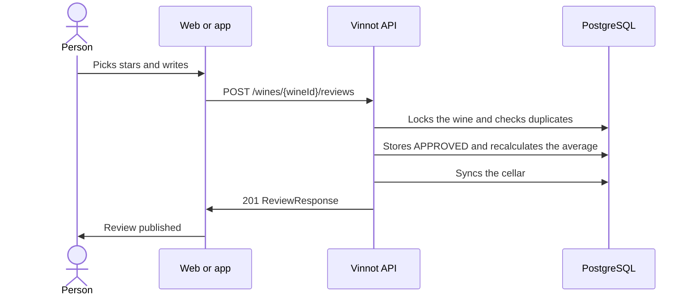

# UC-REV-02 · Publish a review

| Field | Value |
|---|---|
| ID | `UC-REV-02` |
| Module | [Reviews](../README.md) |
| Platforms | Web, APK |
| Actors | Signed-in user |
| Lucidchart IDs | [WEB UC-REV-02](https://lucid.app/lucidchart/9f11a16b-bb5a-42fc-a9e8-0852b17bd241/edit), [APK UC-REV-02](https://lucid.app/lucidchart/e095dd25-e8ac-41ba-bf5b-396e1055f217/edit) |
| Requirements | [`RF-WEB-REV-03`](../requirements.md), [`RF-WEB-REV-04`](../requirements.md), [`RF-APK-REV-03`](../requirements.md), [`RF-APK-REV-04`](../requirements.md) |
| Test cases | [`CP-REV-05`](../testing.md), [`CP-REV-06`](../testing.md), [`CP-REV-07`](../testing.md), [`CP-REV-08`](../testing.md), [`CP-REV-32`](../testing.md) |

## Preconditions

- The person is signed in, has the `REVIEW_CREATE` permission and has not reviewed that wine yet.

## Postconditions

- The review is published, the wine's average is updated and the wine is in the person's cellar.

## Main flow

1. The person opens the review form on the wine's page.
2. They pick 0.1 to 5.0 with the bottle that fills the glasses and can add a title of up to 255 characters, a comment and the vintage they tasted; the form says the review is published at once.
3. The client sends `POST /wines/{wineId}/reviews`.
4. The API checks that the person has no other review for that wine and stores it as `APPROVED`.
5. It recalculates the wine's average and number of approved reviews in the same transaction.
6. It adds the wine to the cellar if it was not there and stores the rating with its decimal and, when the review has a comment, the comment as notes; a review vintage becomes the cellar vintage.
7. The API answers 201 and the client confirms the publication and reloads the list and the average.

## Alternative flows

- 1a. The person already has a review of that wine: the form is not offered.
- 4a. The person already has a review for that wine: the API answers 422, or 409 if two arrived at the same time; the web closes the form and reloads the list.
- 3a. The rating is missing, outside 0.1 to 5.0 or has more than one decimal, or the vintage is outside 1800 to 2100: the API answers 400; a vintage after next year is rejected with `INVALID_VINTAGE`.
- 6a. The review has no comment: the cellar stores only the rating and keeps the notes it already had.
- 6b. The review has no vintage: the cellar keeps the vintage it already had.

## Business rules

- One review per person and wine.
- The tasted vintage is optional and independent from the catalog wine vintage.
- The API takes ratings from 0.1 to 5.0 with one decimal; web and app pick them with the bottle control above five glasses.
- An approved review earns points for its author's seal ([Points and seals](../../gamification/README.md)).
- New reviews are published without prior approval; moderation acts afterwards, through reports, blocks and removal ([Community](../../community/README.md)).
- Only approved reviews count for the average, rounded to two decimals.
- A cellar note can also be published as a review ([Cellar](../../cellar/README.md)).

## Diagram

[View the full “UC-REV-02 · Publish a review” diagram](https://images.vinnot.com/docs/diagrams/v1/en/modules-reviews-use-cases-uc-rev-02-publish-review-e0af9e63a4c9.svg)

Component diagram in Lucidchart: [WEB UC-REV-02](https://lucid.app/lucidchart/9f11a16b-bb5a-42fc-a9e8-0852b17bd241/edit), [APK UC-REV-02](https://lucid.app/lucidchart/e095dd25-e8ac-41ba-bf5b-396e1055f217/edit).

## Code

| Layer | Location |
|---|---|
| Endpoints | `POST /wines/{wineId}/reviews` |
| Backend | [`ReviewController.java`](../../../../../backend/src/main/java/com/vinnot/review/infrastructure/web/controller/ReviewController.java), [`CreateReviewCommandHandler.java`](../../../../../backend/src/main/java/com/vinnot/review/application/command/handler/CreateReviewCommandHandler.java), [`Review.java`](../../../../../backend/src/main/java/com/vinnot/review/domain/model/Review.java), [`CellarCommandAdapter.java`](../../../../../backend/src/main/java/com/vinnot/review/infrastructure/persistence/adapter/CellarCommandAdapter.java) |
| Web | [`ReviewForm.tsx`](../../../../../frontend-react/src/presentation/components/features/wine/ReviewForm.tsx), [`RatingStars.tsx`](../../../../../frontend-react/src/presentation/components/ui/RatingStars.tsx), [`useCreateReview.ts`](../../../../../frontend-react/src/presentation/hooks/queries/wine/useCreateReview.ts), [`wines.reviews.client.ts`](../../../../../frontend-react/src/infrastructure/api/clients/wines.reviews.client.ts) |
| App | [`ReviewForm.tsx`](../../../../../frontend-mobile/src/presentation/features/wine/ReviewForm.tsx), [`ReviewFormFields.tsx`](../../../../../frontend-mobile/src/presentation/features/wine/ReviewFormFields.tsx), [`WineGlassIcon.tsx`](../../../../../frontend-mobile/src/presentation/components/ui/WineGlassIcon.tsx), [`useWineReviewSubmission.ts`](../../../../../frontend-mobile/src/presentation/hooks/useWineReviewSubmission.ts), [`wines.client.ts`](../../../../../frontend-mobile/src/infrastructure/api/clients/wines.client.ts) |

## Automated tests

- Backend: [`ReviewTest.java`](../../../../../backend/src/test/java/com/vinnot/review/domain/model/ReviewTest.java), [`ReviewInteractionHandlersTest.java`](../../../../../backend/src/test/java/com/vinnot/review/application/command/handler/ReviewInteractionHandlersTest.java), [`CellarCommandAdapterTest.java`](../../../../../backend/src/test/java/com/vinnot/review/infrastructure/persistence/adapter/CellarCommandAdapterTest.java), [`ReviewPersistenceAdapterTest.java`](../../../../../backend/src/test/java/com/vinnot/review/infrastructure/persistence/adapter/ReviewPersistenceAdapterTest.java), [`ReviewControllerTest.java`](../../../../../backend/src/test/java/com/vinnot/review/infrastructure/web/controller/ReviewControllerTest.java)
- Web: [`useCreateReview.test.tsx`](../../../../../frontend-react/src/presentation/hooks/queries/wine/useCreateReview.test.tsx), [`wines.service.test.ts`](../../../../../frontend-react/src/application/services/wines.service.test.ts)
- App: [`wine.validators.test.ts`](../../../../../frontend-mobile/src/domain/wine/wine.validators.test.ts), [`wines.service.test.ts`](../../../../../frontend-mobile/src/application/services/wines.service.test.ts), [`wines.client.test.ts`](../../../../../frontend-mobile/src/infrastructure/api/clients/wines.client.test.ts)
