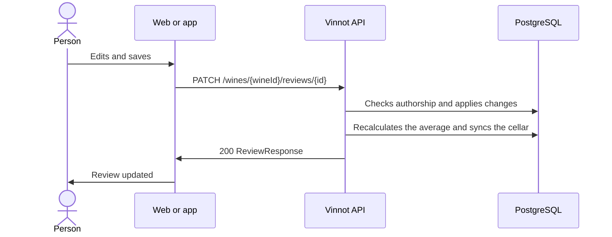

# UC-REV-03 · Edit a review

| Field | Value |
|---|---|
| ID | `UC-REV-03` |
| Module | [Reviews](../README.md) |
| Platforms | Web, APK |
| Actors | Review author, Administrator |
| Lucidchart IDs | [WEB UC-REV-03](https://lucid.app/lucidchart/9f11a16b-bb5a-42fc-a9e8-0852b17bd241/edit), [APK UC-REV-02](https://lucid.app/lucidchart/e095dd25-e8ac-41ba-bf5b-396e1055f217/edit) |
| Requirements | [`RF-WEB-REV-05`](../requirements.md), [`RF-APK-REV-05`](../requirements.md) |
| Test cases | [`CP-REV-09`](../testing.md), [`CP-REV-10`](../testing.md), [`CP-REV-11`](../testing.md), [`CP-REV-12`](../testing.md), [`CP-REV-13`](../testing.md) |

## Preconditions

- The person is the review's author or has the `ADMIN` role.

## Postconditions

- The review has the changes and the wine's average is updated.

## Main flow

1. The person chooses to edit their review and the form opens with the current data.
2. They change the rating, the title, the comment or the tasted vintage and save.
3. The client sends `PATCH /wines/{wineId}/reviews/{id}`; an omitted field keeps its value; `clearVintage: true` removes the vintage.
4. The API checks authorship or the role, applies the changes and recalculates the wine's average.
5. When the author edits, it updates the cellar with what changed: the comment replaces the notes, a vintage replaces the cellar vintage and the rating is rounded to 1–5.
6. The API answers 200 and the client shows the updated review.

## Alternative flows

- 4a. The editor is neither the author nor `ADMIN`: the API answers 422 `REVIEW_OWNERSHIP`.
- 4b. The review no longer exists: the API answers 404.
- 4c. The review was pending or rejected: it goes back to `PENDING` for a moderator to decide.
- 2a. The person cancels: nothing is sent.

## Business rules

- An approved review stays published after it is edited.
- A moderator can delete other people's reviews but not edit them.
- An administrator editing someone else's review does not touch that person's cellar.
- Editing only the title does not change the cellar; editing only the rating keeps the notes.
- Removing the review vintage does not remove the cellar vintage.

## Diagram

[View the full “UC-REV-03 · Edit a review” diagram](https://images.vinnot.com/docs/diagrams/v1/en/modules-reviews-use-cases-uc-rev-03-edit-review-15a31172a770.svg)

Component diagram in Lucidchart: [WEB UC-REV-03](https://lucid.app/lucidchart/9f11a16b-bb5a-42fc-a9e8-0852b17bd241/edit), [APK UC-REV-02](https://lucid.app/lucidchart/e095dd25-e8ac-41ba-bf5b-396e1055f217/edit).

## Code

| Layer | Location |
|---|---|
| Endpoints | `PATCH /wines/{wineId}/reviews/{id}` |
| Backend | [`ReviewController.java`](../../../../../backend/src/main/java/com/vinnot/review/infrastructure/web/controller/ReviewController.java), [`UpdateReviewCommandHandler.java`](../../../../../backend/src/main/java/com/vinnot/review/application/command/handler/UpdateReviewCommandHandler.java), [`Review.java`](../../../../../backend/src/main/java/com/vinnot/review/domain/model/Review.java) |
| Web | [`ReviewForm.tsx`](../../../../../frontend-react/src/presentation/components/features/wine/ReviewForm.tsx), [`useUpdateReview.ts`](../../../../../frontend-react/src/presentation/hooks/queries/wine/useUpdateReview.ts), [`wines.reviews.client.ts`](../../../../../frontend-react/src/infrastructure/api/clients/wines.reviews.client.ts) |
| App | [`ReviewForm.tsx`](../../../../../frontend-mobile/src/presentation/features/wine/ReviewForm.tsx), [`useWineReviewSubmission.ts`](../../../../../frontend-mobile/src/presentation/hooks/useWineReviewSubmission.ts), [`wines.client.ts`](../../../../../frontend-mobile/src/infrastructure/api/clients/wines.client.ts) |

## Automated tests

- Backend: [`UpdateReviewCommandHandlerTest.java`](../../../../../backend/src/test/java/com/vinnot/review/application/command/handler/UpdateReviewCommandHandlerTest.java), [`ReviewOwnershipTest.java`](../../../../../backend/src/test/java/com/vinnot/review/application/command/handler/ReviewOwnershipTest.java), [`ReviewTest.java`](../../../../../backend/src/test/java/com/vinnot/review/domain/model/ReviewTest.java)
- Web: [`useUpdateReview.test.tsx`](../../../../../frontend-react/src/presentation/hooks/queries/wine/useUpdateReview.test.tsx)
- App: [`ReviewItem.test.tsx`](../../../../../frontend-mobile/src/presentation/features/wine/ReviewItem.test.tsx)
