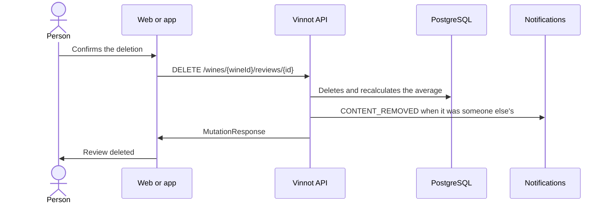

# UC-REV-04 · Delete a review

| Field | Value |
|---|---|
| ID | `UC-REV-04` |
| Module | [Reviews](../README.md) |
| Platforms | Web, APK |
| Actors | Review author, Moderator, Administrator, Email service |
| Lucidchart IDs | [WEB UC-REV-04](https://lucid.app/lucidchart/9f11a16b-bb5a-42fc-a9e8-0852b17bd241/edit), [APK UC-REV-03](https://lucid.app/lucidchart/e095dd25-e8ac-41ba-bf5b-396e1055f217/edit) |
| Requirements | [`RF-WEB-REV-06`](../requirements.md), [`RF-APK-REV-06`](../requirements.md) |
| Test cases | [`CP-REV-14`](../testing.md), [`CP-REV-15`](../testing.md), [`CP-REV-16`](../testing.md), [`CP-REV-17`](../testing.md), [`CP-REV-18`](../testing.md) |

## Preconditions

- The person is the review's author or has the `REVIEW_DELETE` permission (moderators and administrators).

## Postconditions

- The review, its comments and its likes are removed and the wine's average is updated.

## Main flow

1. The person chooses to delete the review.
2. The client asks for confirmation.
3. The client sends `DELETE /wines/{wineId}/reviews/{id}`.
4. The API checks authorship or the permission, deletes the review and recalculates the wine's average.
5. The client removes the review from the list and updates the average.

## Alternative flows

- 2a. The person cancels: nothing is deleted.
- 4a. The person is neither the author nor has the permission: the API answers 422 `REVIEW_OWNERSHIP`.
- 4b. The review no longer exists: the API answers 404.
- 4c. The review belonged to someone else: a `CONTENT_REMOVED` email is sent to its author.

## Business rules

- Deleting a review does not delete or change the cellar entry.
- The review's comments and likes are deleted in cascade.
- Removing reported content reuses this use case ([Community](../../community/README.md)).

## Diagram

[View the full “UC-REV-04 · Delete a review” diagram](https://images.vinnot.com/docs/diagrams/v1/en/modules-reviews-use-cases-uc-rev-04-delete-review-41c773b8883d.svg)

Component diagram in Lucidchart: [WEB UC-REV-04](https://lucid.app/lucidchart/9f11a16b-bb5a-42fc-a9e8-0852b17bd241/edit), [APK UC-REV-03](https://lucid.app/lucidchart/e095dd25-e8ac-41ba-bf5b-396e1055f217/edit).

## Code

| Layer | Location |
|---|---|
| Endpoints | `DELETE /wines/{wineId}/reviews/{id}` |
| Backend | [`ReviewController.java`](../../../../../backend/src/main/java/com/vinnot/review/infrastructure/web/controller/ReviewController.java), [`DeleteReviewCommandHandler.java`](../../../../../backend/src/main/java/com/vinnot/review/application/command/handler/DeleteReviewCommandHandler.java) |
| Web | [`ReviewsList.tsx`](../../../../../frontend-react/src/presentation/components/features/wine/ReviewsList.tsx), [`useDeleteReview.ts`](../../../../../frontend-react/src/presentation/hooks/queries/wine/useDeleteReview.ts), [`wines.reviews.client.ts`](../../../../../frontend-react/src/infrastructure/api/clients/wines.reviews.client.ts) |
| App | [`ReviewItem.tsx`](../../../../../frontend-mobile/src/presentation/features/wine/ReviewItem.tsx), [`useWines.ts`](../../../../../frontend-mobile/src/presentation/hooks/queries/wine/useWines.ts), [`wines.client.ts`](../../../../../frontend-mobile/src/infrastructure/api/clients/wines.client.ts) |

## Automated tests

- Backend: [`ReviewOwnershipTest.java`](../../../../../backend/src/test/java/com/vinnot/review/application/command/handler/ReviewOwnershipTest.java), [`EmailReviewModerationNotifierTest.java`](../../../../../backend/src/test/java/com/vinnot/review/infrastructure/notification/EmailReviewModerationNotifierTest.java)
- Web: [`useDeleteReview.test.tsx`](../../../../../frontend-react/src/presentation/hooks/queries/wine/useDeleteReview.test.tsx)
- App: [`ReviewItem.test.tsx`](../../../../../frontend-mobile/src/presentation/features/wine/ReviewItem.test.tsx)
