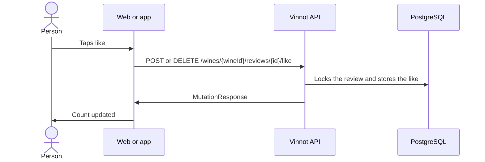

# UC-REV-05 · Like or unlike a review

| Field | Value |
|---|---|
| ID | `UC-REV-05` |
| Module | [Reviews](../README.md) |
| Platforms | Web, APK |
| Actors | Signed-in user |
| Lucidchart IDs | [WEB UC-REV-05](https://lucid.app/lucidchart/9f11a16b-bb5a-42fc-a9e8-0852b17bd241/edit), [APK UC-REV-04](https://lucid.app/lucidchart/e095dd25-e8ac-41ba-bf5b-396e1055f217/edit) |
| Requirements | [`RF-WEB-REV-07`](../requirements.md), [`RF-APK-REV-07`](../requirements.md) |
| Test cases | [`CP-REV-19`](../testing.md), [`CP-REV-20`](../testing.md), [`CP-REV-21`](../testing.md), [`CP-REV-22`](../testing.md) |

## Preconditions

- The person is signed in and the review is approved.

## Postconditions

- The review has or lacks the person's like and the count is updated.

## Main flow

1. The person taps a review's like.
2. The client shows the change at once.
3. The client sends `POST /wines/{wineId}/reviews/{id}/like`, or `DELETE` if it was already liked.
4. The API locks the review, stores or removes the like and updates the count.

## Alternative flows

- 4a. The person already liked it, or unlikes without a like: the API answers 422 and the client reverts the change with an error notice.
- 4b. The review is not approved or there is a block between the accounts: the API answers 404.
- 1a. The review is pending or rejected: the like appears disabled.

## Business rules

- One like per person and review.
- A person can like their own review.
- The count never goes below zero.
- The review's author gets likes in a summary, not one by one ([UC-REV-07](uc-rev-07-activity-notices.md)).

## Diagram

[View the full “UC-REV-05 · Like or unlike a review” diagram](https://images.vinnot.com/docs/diagrams/v1/en/modules-reviews-use-cases-uc-rev-05-like-review-41d0c4d66fe1.svg)

Component diagram in Lucidchart: [WEB UC-REV-05](https://lucid.app/lucidchart/9f11a16b-bb5a-42fc-a9e8-0852b17bd241/edit), [APK UC-REV-04](https://lucid.app/lucidchart/e095dd25-e8ac-41ba-bf5b-396e1055f217/edit).

## Code

| Layer | Location |
|---|---|
| Endpoints | `POST /wines/{wineId}/reviews/{id}/like`, `DELETE /wines/{wineId}/reviews/{id}/like` |
| Backend | [`ReviewController.java`](../../../../../backend/src/main/java/com/vinnot/review/infrastructure/web/controller/ReviewController.java), [`LikeReviewCommandHandler.java`](../../../../../backend/src/main/java/com/vinnot/review/application/command/handler/LikeReviewCommandHandler.java), [`UnlikeReviewCommandHandler.java`](../../../../../backend/src/main/java/com/vinnot/review/application/command/handler/UnlikeReviewCommandHandler.java), [`Review.java`](../../../../../backend/src/main/java/com/vinnot/review/domain/model/Review.java) |
| Web | [`ReviewCard.tsx`](../../../../../frontend-react/src/presentation/components/features/wine/ReviewCard.tsx), [`useToggleReviewLike.ts`](../../../../../frontend-react/src/presentation/hooks/queries/wine/useToggleReviewLike.ts), [`wines.reviews.client.ts`](../../../../../frontend-react/src/infrastructure/api/clients/wines.reviews.client.ts) |
| App | [`ReviewItem.tsx`](../../../../../frontend-mobile/src/presentation/features/wine/ReviewItem.tsx), [`useWines.ts`](../../../../../frontend-mobile/src/presentation/hooks/queries/wine/useWines.ts), [`wines.client.ts`](../../../../../frontend-mobile/src/infrastructure/api/clients/wines.client.ts) |

## Automated tests

- Backend: [`ReviewInteractionHandlersTest.java`](../../../../../backend/src/test/java/com/vinnot/review/application/command/handler/ReviewInteractionHandlersTest.java), [`ReviewTest.java`](../../../../../backend/src/test/java/com/vinnot/review/domain/model/ReviewTest.java)
- Web: [`ReviewsList.test.tsx`](../../../../../frontend-react/src/presentation/components/features/wine/ReviewsList.test.tsx)
- App: [`ReviewItem.test.tsx`](../../../../../frontend-mobile/src/presentation/features/wine/ReviewItem.test.tsx)
