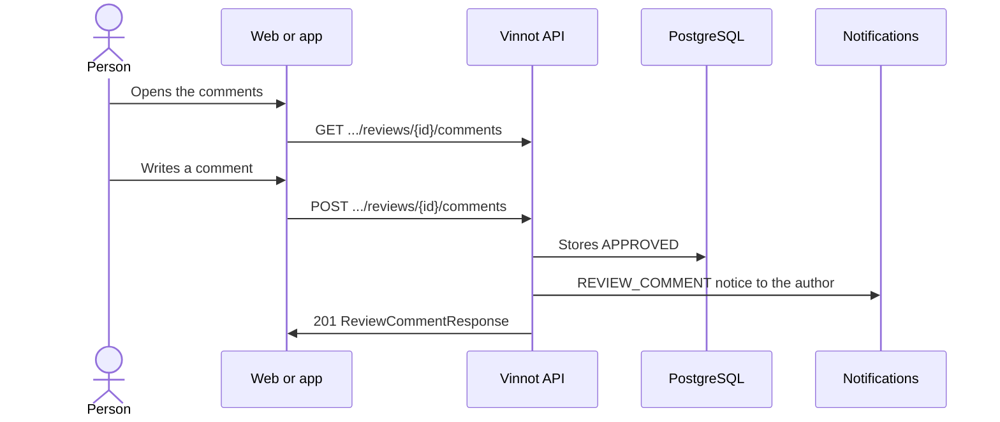

# UC-REV-06 · Comment on a review

| Field | Value |
|---|---|
| ID | `UC-REV-06` |
| Module | [Reviews](../README.md) |
| Platforms | Web, APK |
| Actors | Signed-in user, Review author, Moderator, Administrator |
| Lucidchart IDs | [WEB UC-REV-06](https://lucid.app/lucidchart/9f11a16b-bb5a-42fc-a9e8-0852b17bd241/edit), [APK UC-REV-05](https://lucid.app/lucidchart/e095dd25-e8ac-41ba-bf5b-396e1055f217/edit) |
| Requirements | [`RF-WEB-REV-08`](../requirements.md), [`RF-WEB-REV-09`](../requirements.md), [`RF-WEB-REV-10`](../requirements.md), [`RF-APK-REV-08`](../requirements.md), [`RF-APK-REV-09`](../requirements.md), [`RF-APK-REV-10`](../requirements.md) |
| Test cases | [`CP-REV-23`](../testing.md), [`CP-REV-24`](../testing.md), [`CP-REV-25`](../testing.md), [`CP-REV-26`](../testing.md), [`CP-REV-27`](../testing.md) |

## Preconditions

- The person is signed in and the review is approved.

## Postconditions

- The comment is published on the review, or deleted when that was asked.

## Main flow

1. The person opens a review's comments.
2. The client calls `GET /wines/{wineId}/reviews/{id}/comments` and shows the approved comments and the person's own.
3. The person writes a comment of up to 2000 characters and sends it.
4. The client sends `POST /wines/{wineId}/reviews/{id}/comments`.
5. The API trims the text, stores it as `APPROVED` and notifies the review's author ([UC-REV-07](uc-rev-07-activity-notices.md)).
6. The API answers 201 and the client shows the comment and updates the count.

## Alternative flows

- 2a. There are no comments: the empty state is shown.
- 4a. The text is empty or longer than 2000 characters after trimming: the API rejects it (400 or 422).
- 4b. The review is not approved or there is a block between the accounts: the API answers 404.
- 6a. The person deletes their own comment, or a moderator or administrator someone else's: the client asks for confirmation and sends `DELETE .../comments/{commentId}`; without authorship or permission the API answers 422 `REVIEW_COMMENT_OWNERSHIP`.

## Business rules

- Comments are published at once and cannot be edited.
- The comment list is not paged.
- The comment count only counts approved ones.
- Deleting someone else's comment sends a `CONTENT_REMOVED` email to its author.
- Each comment shows the author's photo (a person icon on the web or the initials in the app when it is missing or fails to load), their name with the seal and their `@username` below, smaller and in gray.

## Diagram

[View the full “UC-REV-06 · Comment on a review” diagram](https://images.vinnot.com/docs/diagrams/v1/en/modules-reviews-use-cases-uc-rev-06-review-comments-5babb0d7a504.svg)

Component diagram in Lucidchart: [WEB UC-REV-06](https://lucid.app/lucidchart/9f11a16b-bb5a-42fc-a9e8-0852b17bd241/edit), [APK UC-REV-05](https://lucid.app/lucidchart/e095dd25-e8ac-41ba-bf5b-396e1055f217/edit).

## Code

| Layer | Location |
|---|---|
| Endpoints | `GET /wines/{wineId}/reviews/{id}/comments`, `POST /wines/{wineId}/reviews/{id}/comments`, `DELETE /wines/{wineId}/reviews/{id}/comments/{commentId}` |
| Backend | [`ReviewController.java`](../../../../../backend/src/main/java/com/vinnot/review/infrastructure/web/controller/ReviewController.java), [`GetReviewCommentsQueryHandler.java`](../../../../../backend/src/main/java/com/vinnot/review/application/query/handler/GetReviewCommentsQueryHandler.java), [`AddReviewCommentCommandHandler.java`](../../../../../backend/src/main/java/com/vinnot/review/application/command/handler/AddReviewCommentCommandHandler.java), [`DeleteReviewCommentCommandHandler.java`](../../../../../backend/src/main/java/com/vinnot/review/application/command/handler/DeleteReviewCommentCommandHandler.java) |
| Web | [`ReviewComments.tsx`](../../../../../frontend-react/src/presentation/components/features/wine/ReviewComments.tsx), [`useReviewComments.ts`](../../../../../frontend-react/src/presentation/hooks/queries/wine/useReviewComments.ts), [`useCreateReviewComment.ts`](../../../../../frontend-react/src/presentation/hooks/queries/wine/useCreateReviewComment.ts), [`useDeleteReviewComment.ts`](../../../../../frontend-react/src/presentation/hooks/queries/wine/useDeleteReviewComment.ts), [`wines.reviews.client.ts`](../../../../../frontend-react/src/infrastructure/api/clients/wines.reviews.client.ts) |
| App | [`ReviewComments.tsx`](../../../../../frontend-mobile/src/presentation/features/wine/ReviewComments.tsx), [`useWines.ts`](../../../../../frontend-mobile/src/presentation/hooks/queries/wine/useWines.ts), [`wines.client.ts`](../../../../../frontend-mobile/src/infrastructure/api/clients/wines.client.ts) |

## Automated tests

- Backend: [`GetReviewCommentsQueryHandlerTest.java`](../../../../../backend/src/test/java/com/vinnot/review/application/query/handler/GetReviewCommentsQueryHandlerTest.java), [`ReviewInteractionHandlersTest.java`](../../../../../backend/src/test/java/com/vinnot/review/application/command/handler/ReviewInteractionHandlersTest.java), [`ReviewOwnershipTest.java`](../../../../../backend/src/test/java/com/vinnot/review/application/command/handler/ReviewOwnershipTest.java)
- Web: [`ReviewComments.test.tsx`](../../../../../frontend-react/src/presentation/components/features/wine/ReviewComments.test.tsx)
- App: [`ReviewComments.test.tsx`](../../../../../frontend-mobile/src/presentation/features/wine/__tests__/ReviewComments.test.tsx)
