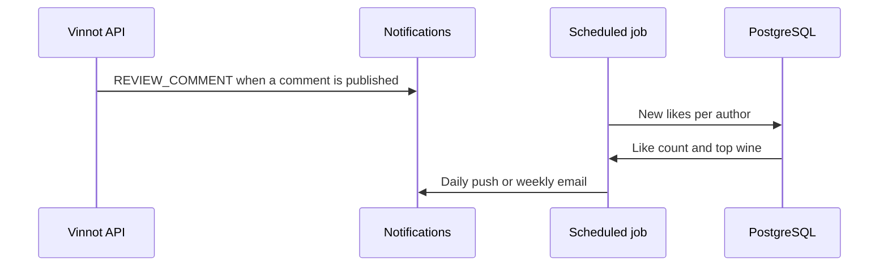

# UC-REV-07 · Notify a review's activity

| Field | Value |
|---|---|
| ID | `UC-REV-07` |
| Module | [Reviews](../README.md) |
| Platforms | Backend only |
| Actors | System (scheduled job), Email service, Push notification service |
| Lucidchart IDs | None |
| Requirements | None |
| Test cases | [`CP-REV-28`](../testing.md), [`CP-REV-29`](../testing.md), [`CP-REV-30`](../testing.md), [`CP-REV-31`](../testing.md) |

## Preconditions

- Someone commented on or liked a review.

## Postconditions

- The review's author gets the comment notice and a summary of the likes.

## Main flow

1. When a comment is published, the API queues a `REVIEW_COMMENT` email and push for the review's author.
2. Every day at 19:00 (Argentina time) the scheduled job gathers each author's new likes.
3. It sends a `REVIEW_LIKES_DAILY` push with the number of likes, of reviews and the wine with the most likes.
4. On Sundays at 10:00 it sends the week's summary by email (`REVIEW_LIKES_WEEKLY`).

## Alternative flows

- 1a. The commenter is the review's author or there is a block between the accounts: no notice is sent.
- 2a. Nobody gave new likes: no summary is sent.
- 3a. The daily push cannot be shown within the day: it is dropped.

## Business rules

- Own likes and likes from blocked accounts do not count for the summary.
- Each summary covers the time since the previous one and leaves 5 minutes of margin for likes still being saved.
- The times and the zone are set with `app.community.likes.*`.
- Delivery uses the [Notifications](../../notifications/README.md) module.

## Diagram

[View the full “UC-REV-07 · Notify a review's activity” diagram](https://images.vinnot.com/docs/diagrams/v1/en/modules-reviews-use-cases-uc-rev-07-activity-notices-e5632016acde.svg)

## Code

| Layer | Location |
|---|---|
| Backend | [`CommentActivityAnnouncer.java`](../../../../../backend/src/main/java/com/vinnot/review/application/command/handler/CommentActivityAnnouncer.java), [`NotificationCommunityActivityNotifier.java`](../../../../../backend/src/main/java/com/vinnot/review/infrastructure/notification/NotificationCommunityActivityNotifier.java), [`ReviewLikeSummaryScheduler.java`](../../../../../backend/src/main/java/com/vinnot/review/infrastructure/scheduling/ReviewLikeSummaryScheduler.java), [`SummarizeReviewLikesCommandHandler.java`](../../../../../backend/src/main/java/com/vinnot/review/application/command/handler/SummarizeReviewLikesCommandHandler.java), [`JdbcReviewLikeSummaryAdapter.java`](../../../../../backend/src/main/java/com/vinnot/review/infrastructure/persistence/adapter/JdbcReviewLikeSummaryAdapter.java) |

## Automated tests

- Backend: [`CommentActivityAnnouncerTest.java`](../../../../../backend/src/test/java/com/vinnot/review/application/command/handler/CommentActivityAnnouncerTest.java), [`NotificationCommunityActivityNotifierTest.java`](../../../../../backend/src/test/java/com/vinnot/review/infrastructure/notification/NotificationCommunityActivityNotifierTest.java), [`SummarizeReviewLikesCommandHandlerTest.java`](../../../../../backend/src/test/java/com/vinnot/review/application/command/handler/SummarizeReviewLikesCommandHandlerTest.java), [`ReviewLikeSummarySchedulerTest.java`](../../../../../backend/src/test/java/com/vinnot/review/infrastructure/scheduling/ReviewLikeSummarySchedulerTest.java), [`JdbcReviewLikeSummaryAdapterPostgresIntegrationTest.java`](../../../../../backend/src/test/java/com/vinnot/review/infrastructure/persistence/adapter/JdbcReviewLikeSummaryAdapterPostgresIntegrationTest.java)
- Web: None
- App: None
