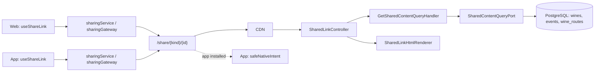

# Architecture

How the module is built in each layer. The backend follows the hexagonal flow
`controller → input port → handler → domain → output port → adapter`;
the web and the app follow `screen → hook → service → device gateway`.

[View the full “Architecture” diagram](https://images.vinnot.com/docs/diagrams/v1/en/modules-sharing-architecture-f7ef70c67588.svg)

## Backend

### Preview page

`SharedLinkController` → `GetSharedContentUseCase` → `GetSharedContentQueryHandler` →
`SharedContentQueryPort` → `JdbcSharedContentQueryAdapter`. The module has no tables of
its own: the adapter reads the wine, event or route by primary key and projects only
title, description (cut to 240 characters) and image; it does not load stops, AI
profiles, accounts, contacts or registrations. The domain (`SharedContent`,
`SharedContentKind`) does not depend on Spring, HTTP or JDBC.

| Path | Response |
|---|---|
| `GET /share`, `GET /share/en` | General app download page |
| `GET /share/{kind}/{id}`, `GET /share/{kind}/{id}/en` | Content preview; `kind` is `wines`, `events` or `wine-routes` |

All accept `HEAD` and answer HTML. Spanish is the default language; `?lang=en` also
selects English. An unknown kind or a non-UUID ID returns 404 without querying the
database. Active wines, `PUBLISHED` routes and events published at least once that are
not `DRAFT` are shown, even if they were cancelled later; anything else returns 404
with a neutral page.

### Page content

`SharedLinkHtmlRenderer` fills the `resources/sharing/landing.html` template in a single
pass and escapes all text. The title is cut to 120 characters. The content image is
only accepted from `images.vinnot.com` or from the configured API origin's uploads;
otherwise the brand is used. Open Graph and Twitter use that same photo, so the link
preview shows the wine, event or route; it carries no size or type tags because the
photo's size is not known. Without a photo they use the 1200 × 630 PNG brand preview
with its size tags. The photos are WebP: WhatsApp, Messenger, iMessage and Telegram
show them, while a client that does not process WebP may show the preview without an
image. The page offers “Open in Vinnot”
(`vinnot://{kind}/{id}`), “Continue on the web” (`/{kind}/{id}`) and the stores; the
Google Play one is active since the public Android launch (`app.sharing.android-available`,
`true` by default and in the dev and production compose files); `false` brings back
“Coming soon on Google Play”. An invalid API origin stops startup.

### Security

Only `GET` and `HEAD` on these paths are anonymous (`SecurityConfig`); they use the
public catalog limit (180 per minute). Every response carries `Cache-Control:
no-store`, a strict CSP, `nosniff`, `Referrer-Policy: no-referrer` and `X-Robots-Tag:
noindex, nofollow`. In production the CDN sends `/share` to the API without query
strings, cookies or session; the [public links activation](../../infra/guides/public-sharing.md)
guide details the CDN, the association files and the builds.

### Tests

- `SharedLinkControllerTest` and `SharedLinkHtmlRendererTest`: metadata, links, escaping, images, headers and general page.
- `GetSharedContentQueryHandlerTest`: delegates only the public projection and keeps missing content missing.
- `SharedContentHttpPostgresIntegrationTest`: visibility with migrated PostgreSQL, `HEAD`, no private data and `POST` rejected.

## Web

### Sharing

`useShareLink` → `sharingService` → `domain/sharing/contentLink` → `sharingGateway`. The
URL policy is pure: it only builds links for known kinds and UUID IDs, with the
`vinnot.com` or `dev.vinnot.com` domain. Only the gateway knows `navigator.share` and the
clipboard. When the browser cannot share, the link is copied and a notice is shown;
cancelling shows no success; a failure shows an error notice. The wine, event and route
details use it. `domain/sharing/publicContent` mirrors the preview rules: the event and
route details only show “Share” when they have a public page. For events it uses the
detail's `publiclyVisible` and, when it is missing, a status other than `DRAFT`; for
routes, `isPublished`.

### Preview page

The SPA has no `/share` route: the API serves the page. The web provides the static
assets in `public/share-assets/` (styles, language choice from the device and download
button by iOS or Android) and generates `/.well-known/apple-app-site-association` and
`/.well-known/assetlinks.json` per environment from `config/link-associations.mjs`.
“Continue on the web” opens the details, which require a session: `ProtectedRoute` goes
to `/login?returnUrl=…` and then returns to the content.

## App

### Sharing

`useShareLink` → `sharingService` → `domain/sharing/contentLink` → `sharingGateway`, which
uses React Native `Share`: iOS receives the link as a URL, for its preview, and Android
as text. Cancelling shows no success; a failure shows an error notice. The wine, event
and route details use it. `domain/sharing/shareability` mirrors the preview rules: the
event and route details only show “Share” when they have a public page (`canShareEvent`
uses `publiclyVisible` and, when it is missing, a status other than `DRAFT`;
`canShareRoute` uses `isPublished`).

### Opening links

`app.config.ts` declares the `vinnot` scheme, the iOS associated domains and the Android
filters with automatic verification for `/share`, `/share/` and each kind's prefix.
`app/+native-intent.tsx` handles the payment return first and then `safeNativeIntent`
(`domain/navigation/nativeIntent.ts`): it discards links longer than 4096 characters or
with control characters, accepts `vinnot://{kind}/{id}` and HTTPS only from
`vinnot.com` and `dev.vinnot.com` without credentials or port, takes `/share` to Home and
`/share/{kind}/{id}` to `/wines/{id}`, `/events/{id}` or `/routes/{id}`; any other link
opens Home. Without a session, `AuthGuard` remembers the destination and returns to it
after login. The domain association is native: it requires a store build and an OTA
does not add it.
